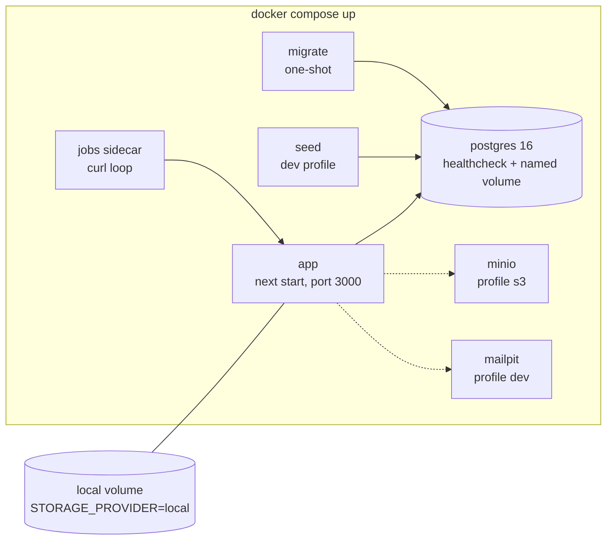
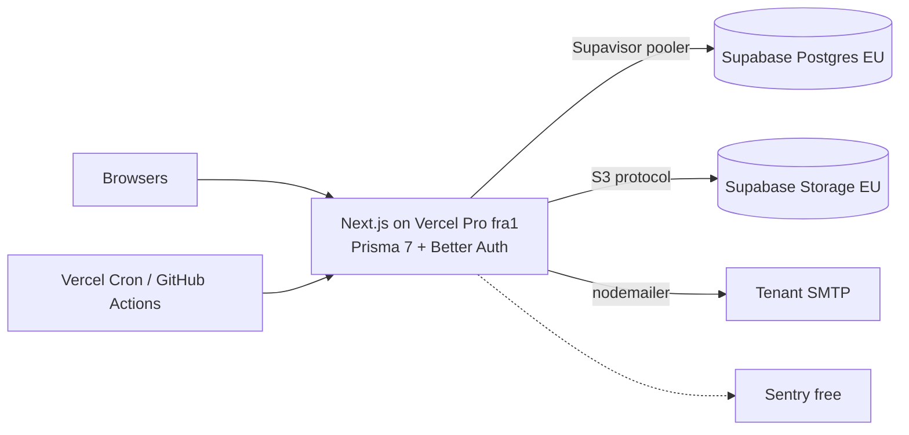
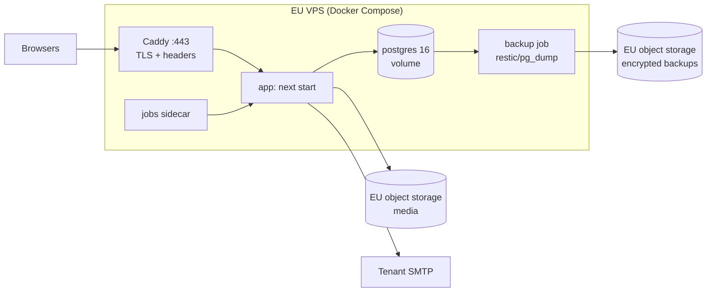

# Architecture and technology options: RentCar

Version 1.0 · 2026-11-01 · Owner: solution-architect · Status: **proposal for GATE 2** (user chooses an option)
Inputs: `docs/01-discovery.md`, `docs/02-requisiti.md` (approved v1.1), `docs/spec/car-rental-spec.md`, `docs/00-stato-progetto.md`, `docs/pm/raid.md`, `docs/03-inputs/security-constraints.md`, `docs/03-inputs/observability-options.md`.
Also read: `docs/03-inputs/devops-costs.md` (reconciled in section 11). ADRs: `docs/adr/0001` to `0014` (status: proposed).
Language: English. Prices were checked on official pages on **2026-11-01** unless marked "estimated" or "third-party".

---

## 1. Summary

- The stack is fixed by the spec (Next.js App Router + TypeScript, PostgreSQL, Zod, shadcn/ui, Tailwind, Lucide). The real choices are: ORM, authentication, tenant-isolation mechanism, hosting of the database/app/storage, and how a few serverless-sensitive features (PDF, jobs, email, uploads, rate limiting) are built.
- **Buy vs build**: an off-the-shelf rental SaaS (e.g. Booqable-type products) would cover the booking features, but RentCar's product *is* the multi-tenant SaaS the owner sells, with per-tenant SMTP, branding and revenue snapshots. Buying would make the owner a reseller, not the vendor. No CMS/low-code covers the 80% at lower cost for that goal. Build is justified; we still buy commodity pieces (managed Postgres, object storage, SMTP, hosting).
- **Three bundles** are compared:
  - **A (recommended): "Portable core on serverless"** — Drizzle, in-house DB sessions with argon2id, RLS + repository scoping, react-pdf. Production: Vercel (Pro, Frankfurt) + Neon (Frankfurt) + Scaleway Object Storage (Paris).
  - **B: "Managed-platform bundle"** — Prisma 7, Better Auth, Supabase (EU Postgres + Storage) on Vercel.
  - **C: "Container-first single EU VPS"** — same code as A, production = Docker Compose on one VPS with Caddy.
- **Key insight**: code-level decisions (ORM, auth, tenant isolation, PDF, jobs) are independent of where it is hosted. A and C share the same codebase and differ only in deployment; the hosting choice stays reversible by environment variables (AC10). Only A vs B binds the code.
- **Cost flag (needs a user decision, ARC-2)**: Vercel's free Hobby plan is *personal, non-commercial use only* and limits cron jobs to once per day. A SaaS with paying tenants needs Vercel Pro (USD 20 per developer seat per month). Free-tier-only production on Vercel is therefore not compliant with Vercel's terms.
- **Decisions common to all options** (they follow from the requirements, not from the bundle): modular monolith (no microservices); Postgres exclusion constraint for double booking; react-pdf; cron endpoint + lazy evaluation + idempotent jobs; Postgres-backed rate limiting; self-hosted fonts; HTTP-level caching only.
- **Phase 1** (local `docker compose up`, AC1) is identical for all three options, costs 0, and is the first deliverable.

---

## 2. Architecture drivers

| # | Driver | Source | Weight in decision |
|---|---|---|---|
| D1 | Stack fixed by spec; no Vercel-specific API outside adapters | spec §2, discovery E18 | Hard constraint (not scored) |
| D2 | `docker compose up` works end to end with automatic migrations (AC1) | spec AC1, FR-PLT-01 | Hard constraint |
| D3 | Later: app on Vercel (serverless), DB external, EU; no local disk, short connections, ~10 s request assumption, external scheduler | discovery C9, NFR-SRV-01 | High |
| D4 | Low running cost, free tiers preferred, no paid services unless needed | discovery B6/B7 | High |
| D5 | EU residency and GDPR (processor role, DPA, sub-processor list) | NFR-GDPR-01..07 | High |
| D6 | Strict tenant isolation with cross-tenant tests | NFR-ISO-01..03, KPI-5 | High |
| D7 | Pluggable DB/storage by env only (AC10); adapters for email, PDF, jobs, rate limit, error tracking | NFR-PLG-01/02 | High |
| D8 | Owner runs infrastructure alone (no ops staff); not critical, no alerting | discovery C11, D14 | High |
| D9 | Zero double bookings under concurrency, including edits and buffer time | KPI-3, FR-BKG-08 | Hard constraint |
| D10 | Scale: <50 tenants, ≤50 vehicles each, ≤100 concurrent public sessions, 10x headroom | NFR-SCL-01 | Low (no scaling machinery needed) |
| D11 | Future custom domains: one tenant-resolution point | FR-PLT-04 | Hard constraint |
| D12 | Backups: RPO ≤ 24 h, restore tested once | NFR-BKP-01 | Medium |
| D13 | Security: ASVS L2 candidate, RLS defence in depth, sessions revocable | security-constraints.md | High |

Hard constraints are pass/fail (section 6), not weights.

---

## 3. Decisions common to all options

These are chosen once; options differ elsewhere. Each has an ADR.

| Topic | Decision | ADR |
|---|---|---|
| Style | Modular monolith in one Next.js app; feature modules with thin layers (route/server action → service → repository); ports/adapters only where a real swap exists (DB access, storage, mail, PDF, scheduler, rate limit, error reporter, clock, id generator); manual DI via a composition root, no container library. Detailed layout goes to `docs/03b-struttura-codice.md` after the choice. | 0001 |
| Double booking | `EXCLUDE USING gist (vehicle_id WITH =, blocked_during WITH &&) WHERE status <> 'cancelled'` with `btree_gist`. `blocked_during = tstzrange(start_at, end_at + buffer, '[)')`, buffer snapshotted per booking. Symmetric buffer is exactly equivalent to this range (two ranges overlap iff `s1 < e2+b` and `s2 < e1+b`). SQLSTATE `23P01` maps to `BookingConflictError`. Serializable transactions or advisory locks rejected as primary mechanism (retries, bypassable by any code path). | 0004 |
| PDF | `@react-pdf/renderer` in a Node.js route; fonts embedded from files; logo converted to PNG (react-pdf image support is JPEG/PNG; to be confirmed in spike S2). Puppeteer/Chromium rejected: 50 MB+ binary, multi-second cold start, memory risk on serverless (RAID R-5). | 0006 |
| Jobs | Port `JobScheduler`; jobs are idempotent use cases `runDueJobs(now)` guarded by a unique `JobRun(job, period)` key plus `pg_try_advisory_xact_lock`. Triggers: `GET/POST /api/jobs/run` with `Authorization: Bearer ${CRON_SECRET}` (constant-time compare; Vercel Cron sends GET with that header), a compose sidecar in Docker, GitHub Actions cron as universal fallback. State changes are also **evaluated lazily on read** (effective booking status, subscription grace, year snapshot on first access), so a missed run never produces wrong output. | 0007 |
| Email | `nodemailer` created per send with 5 s connect / 10 s socket timeouts; SMTP host SSRF guard (reject private/loopback/link-local ranges after DNS resolution, ports 25/465/587/2525, TLS verified); `EmailLog` outbox row written first, sent inline via Next `after()`, retried by the hourly job. Booking never waits for or fails on email (FR-MAIL-05). Outbound port 25 is commonly blocked on serverless platforms: document 465/587 only (spike S4). | 0008 |
| Storage | Port `StoragePort` with `local` and `s3` (`@aws-sdk/client-s3`, `forcePathStyle` for MinIO). Keys `tenants/{tenantId}/…/{uuid}.{ext}`. Images re-encoded with `sharp` at upload into 480 px and 1280 px WebP variants (plus PNG logo for PDF); served through `/media/*` with immutable cache headers, so no per-transformation image-optimizer billing. Upload limit 4 MB per photo (Vercel body cap 4.5 MB) with client-side downscale (ARC-4). | 0009 |
| Rate limiting | Port `RateLimitStore`; default Postgres table with atomic upsert; HMAC-hashed IP keys; rows purged within 24 h; login/reset fail closed, public reads fail open. Redis (Upstash EU) is a drop-in adapter if ever needed. | 0013 |
| Tenant resolution and theme | `TenantResolver.resolve({host, pathname})` is the only place that knows about `/{slug}`; all links built by `tenantUrl()`; reserved slugs list. Theme: pure `deriveTheme(palette)` (variants, WCAG ratios) rendered by a same-origin route `/{slug}/theme.css?v={themeVersion}` (immutable cache, `style-src 'self'` friendly, validated hex only); three self-hosted variable fonts (Inter, Manrope, Plus Jakarta Sans, OFL) via `@font-face`, browser downloads only the selected family. | 0012 |
| Observability | As proposed by the observability-engineer: pino JSON to stdout with AsyncLocalStorage request id, `/api/healthz` + `/api/readyz`, `ErrorReporter` port (`noop` default, Sentry free via env), `JobRun`, `EmailLog` and audit tables as durable evidence. No alerting. | 0014 |
| Caching | No Redis, no Next data cache for tenant state (suspension must apply immediately). Per-request memoisation (`React.cache`) of tenant and session; HTTP caching for `/media/*` and `theme.css`; availability and revenue always computed live. | 0014 |
| Config | One Zod-validated typed config object created at startup (`instrumentation.ts`), injected; fail fast without printing secrets; `STORAGE_PROVIDER=local` rejected when running on Vercel. New variables beyond spec §3: `APP_ENCRYPTION_KEY`, `CRON_SECRET`, `DIRECT_DATABASE_URL` (migrations, optional), `S3_REGION`, `TRUSTED_PROXY_COUNT`, `OBS_*`. | 0001 |
| Account credentials | The auth module issues credentials through a `CredentialIssuer` strategy: temporary password (spec) or one-time set-password link (security recommendation SEC-3); switching needs no schema change. Extension point for OTP/biometrics: `SecondFactorVerifier` port and `session.assurance_level` column (FR-AUTH-12). | 0005 |

---

## 4. Options

### Option A (recommended): Portable core on serverless

**Idea.** Code is deployment-agnostic and tuned for the strictest target (Vercel functions + pooled external Postgres). Production uses the cheapest EU-resident managed pieces; nothing in the code knows the provider.

| Layer | Choice |
|---|---|
| Frontend / backend | Next.js App Router, React Server Components, server actions for admin mutations, route handlers for jobs/media/PDF/health, Zod, shadcn/ui + Tailwind, Lucide |
| ORM and migrations | **Drizzle ORM** with `pg` (node-postgres) pool; SQL-first migrations (`drizzle-kit generate`, reviewed SQL files); hand-written SQL migrations for `btree_gist`, exclusion constraint, RLS, triggers. Local: one-shot `migrate` Compose service runs before the app (`depends_on: service_completed_successfully`) under `pg_advisory_lock`. Production: migrations run from CI on `DIRECT_DATABASE_URL` *before* promoting the deployment (never on cold start); expand/contract rule because old and new versions overlap. |
| Auth | In-house **DB-backed opaque sessions** (256-bit token, SHA-256 hash stored, `__Host-` HttpOnly cookie, idle + absolute expiry, rotation at login/forced change, revoke on deactivation/suspension/password change), `@node-rs/argon2` (argon2id, tuned ~250 ms on target), tenant bound into the session, Origin-check wrapper for route handlers, throttling through `RateLimitStore`. Primitives from `node:crypto`; no home-made crypto. |
| Tenant isolation | **Both**: mandatory `TenantScope`-bound repositories (type system prevents building a repository without a tenant id) **and** Postgres RLS (`FORCE ROW LEVEL SECURITY`, non-owner runtime role, `SET LOCAL app.tenant_id` in an explicit transaction, compatible with transaction-mode poolers). Tenant-less paths (system console, slug lookup, jobs) use a separate audited path; jobs iterate tenants, each in its own scoped transaction. CI has the generated cross-tenant matrix plus a "runtime role without GUC returns zero rows" test. |
| Database (prod) | **Neon Postgres, AWS Frankfurt (eu-central-1)**, pooled endpoint for runtime, direct endpoint for migrations. Launch plan in production; Free plan for dev/preview branches. |
| Storage (prod) | **Scaleway Object Storage (Paris)** recommended (EU company, S3 API); Cloudflare R2 as alternative (free 10 GB, no egress fee, US company). |
| App hosting (prod) | **Vercel Pro**, function region pinned to Frankfurt (`fra1`), Node.js runtime, Fluid compute default (2 GB memory). |
| Email | System SMTP from env (e.g. Brevo free: 300 emails/day, French company; DPA to verify); tenants use their own SMTP. |
| Backups | Neon Launch keeps up to 7 days of history (Free: 6 h, not acceptable). A scheduled GitHub Actions job also does a nightly `pg_dump` encrypted with `age` to a bucket at a *different* provider (key not stored with the dump), 30-day retention (A-31 allows up to 35); one restore test before go-live and then quarterly. |
| CI/CD | GitHub Actions: lint, types, architecture rules, unit/integration (Testcontainers), cross-tenant matrix, Playwright, migration job, nightly dump, dependency and secret scanning. |

```mermaid
flowchart LR
  subgraph Browser
    C[Customer phone]:::u
    S[Staff / systemadmin]:::u
  end
  subgraph Vercel["Vercel Pro (fra1)"]
    APP[Next.js app<br/>public /{slug}, /{slug}/admin, /system<br/>route handlers: media, pdf, health]
    JOB[/api/jobs/run<br/>Bearer CRON_SECRET/]
  end
  CRON[Vercel Cron hourly<br/>or GitHub Actions cron]
  PG[(Neon Postgres<br/>Frankfurt, pooled)]
  S3[(Scaleway Object Storage<br/>Paris)]
  SMTPT[Tenant SMTP servers]
  SMTPS[System SMTP]
  OBS[Sentry free<br/>optional]
  C --> APP
  S --> APP
  CRON --> JOB
  APP -->|pg pool, SET LOCAL tenant| PG
  JOB --> PG
  APP -->|S3 API| S3
  APP -->|nodemailer 465/587| SMTPT
  APP --> SMTPS
  APP -.-> OBS
  classDef u fill:#eef,stroke:#88a;
```

Local (phase 1, all options):



**Cost (USD unless noted; estimates labelled)**

| Item | Local | Month 1 | Month 12 (<50 tenants) | Source / note |
|---|---|---|---|---|
| Vercel Pro (1 developer seat) | 0 | 20 | 20 (+ usage inside the included USD 20 credit; estimated) | vercel.com/pricing, 2026-11-01 |
| Neon Postgres | 0 (Free plan for dev/preview branches only) | 5 to 15 (Launch, usage-based: 0.106/CU-h, 0.35/GB-month; devops estimate) | 10 to 25 (Launch, estimated) | neon.com/pricing, 2026-11-01; devops-costs.md section 4.1 |
| Object storage | 0 | 0 to 1 | 0 to 2 (estimated; sizing about 2.3 GB at 50 tenants; Scaleway about EUR 0.0146/GB-month with 75 GB egress free, R2 free up to 10 GB) | scaleway.com, developers.cloudflare.com/r2 |
| System SMTP | 0 | 0 | 0 (Brevo free, 300/day; verify DPA) | brevo.com |
| CI, error tracking, backups | 0 | 0 | 0 (GitHub Actions free minutes, Sentry free) | observability input |
| **Total** | **0** | **about 25 to 35** (about EUR 23 to 32 at 0.9 EUR/USD, assumption) | **about 30 to 45** (about EUR 27 to 41) | domain (about EUR 10 to 15 per year, estimated) not included; matches devops-costs.md candidate A2 |

Neon Free is used for development and preview branches only: its 6-hour restore window does not meet NFR-BKP-01 and, per the devops input, free projects inactive for 90+ days are subject to deletion. Production starts on Neon Launch (scale-to-zero left on; an hourly cron keeps compute active roughly a third of the time at the 0.25 CU minimum, while a 5-minute cron would keep it awake permanently). The first request after 5 idle minutes pays a cold start (about 1 s, to be measured in spike S1).

**Development effort (relative, estimated).** Baseline 100%. Whole spec scope is roughly 16 to 22 person-weeks of human-equivalent work (no budget declared, discovery B6); the agent team delivers by milestone (M1..M6, requirements 3.2). Extra over B: in-house auth (about 1 to 1.5 weeks), RLS transaction wrapper and test harness (about 1 week).
**Time-to-market.** First deliverable (M1, local compose, auth, tenants) unaffected by hosting. Serverless smoke test (NFR-SRV-01) once M2 exists.
**Skills.** TypeScript, SQL, Postgres. No ops skills beyond a Vercel/Neon dashboard.
**Maintainability.** High: no servers; ~600 lines of auth code to own and review; Drizzle and `pg` are boring and permissively licensed (Apache-2.0 / MIT).
**Scalability.** Far above need (30k concurrency on Vercel; Neon pooler 10,000 connections). The real ceiling is Neon compute on the Launch plan, scalable by setting.
**Security and compliance.** RLS + scoping, revocable sessions, argon2id, AES-256-GCM for SMTP secrets. Data in Frankfurt/Paris. Processors: Vercel (US-HQ, global edge) and Neon (US-HQ, Databricks): DPA + SCC/DPF checks and sub-processor list required (security input, SEC-6/SEC-9).
**Lock-in and exit.** Low: plain Postgres via `pg_dump`, S3 API, Next.js standard build (`output: 'standalone'` runs in Docker, which is option C). Exit cost: change env vars and a deployment target.
**Main risks.** (1) Vercel Pro cost vs "free tiers" intent. (2) Bespoke auth bugs (mitigated by ASVS tests and review). (3) Neon free limits/cold starts. (4) RLS + pooler subtleties (spike S1). (5) react-pdf behaviour on Vercel (spike S2). (6) Vercel/Neon are US-HQ processors.

### Option B: Managed-platform bundle

**Idea.** Maximise bought components: a mature auth library and a single platform for Postgres and files, to reduce code to own, at a fixed monthly price.

| Layer | Choice |
|---|---|
| ORM and migrations | **Prisma 7** (Rust-free client, `prisma-client` generator, `@prisma/adapter-pg`); `prisma migrate deploy` as a one-shot Compose service (local) and CI step (prod). Exclusion constraint, `tstzrange` column (`Unsupported`), RLS and triggers live in raw SQL migrations; Prisma cannot model them, so `migrate dev` drift warnings must be managed. RLS via client extension wrapping each operation in `$transaction` + `set_config`. |
| Auth | **Better Auth** (successor of Auth.js, which is in maintenance mode since Sept 2025 per community sources) with `username`, `admin` and (later) `twoFactor`/`passkey` plugins; DB sessions; built-in rate limit. Fit gaps: `username` is globally unique by default while the requirement is per-tenant (A-1), so the stored username must be `slug:username` or the schema adapted; `mustChangePassword`, lockout rules, tenant-SMTP reset mail and session revocation need custom hooks; the library owns `user/session/account/verification` tables, which must be merged with our `User` (tenant_id nullable). |
| Tenant isolation | Same as A (scoping + RLS), implemented through Prisma extension (less ergonomic than Drizzle). |
| Database + storage (prod) | **Supabase Pro** in an EU region (Postgres via Supavisor transaction pooler; Storage with S3 protocol). Free plan pauses after one week of inactivity and has no backups: not usable in production. Only plain Postgres and S3 are used (no PostgREST, no Supabase Auth, no supabase-js), to keep portability. |
| App hosting | Vercel Pro `fra1` (as A). |
| Backups | Daily backups kept 7 days included in Pro (meets NFR-BKP-01); still add a dump to a separate bucket. |



**Cost.** Month 1: Vercel Pro 20 + Supabase Pro from 25 = **about 45**; month 12: **about 45 to 55** (compute add-ons possible, estimated). Sources: vercel.com/pricing and supabase.com/pricing, 2026-11-01. Storage 100 GB and 250 GB egress included.
**Effort.** Roughly equal to A: auth is partly bought (saves about 1 week) but adaptation to per-tenant usernames, forced change and tenant SMTP gives back about half; Prisma extension for RLS adds friction.
**Maintainability.** Medium-high: less own auth code, but fast-moving library (Better Auth releases frequently; ownership news is unconfirmed), and schema owned by two tools.
**Security/compliance.** Mature MFA/passkey path out of the box (good for SEC-1). Same US-HQ processor on the app side; Supabase region to be confirmed at project creation (EU regions exist; not stated on the pricing page).
**Lock-in and exit.** Medium: Prisma schema and Better Auth tables tie data model to two libraries; DB/storage portable if only Postgres/S3 features are used.
**Risks.** Fixed USD 45/month with no free path; username-scoping mismatch; Prisma cannot express key constraints; two vendors (Vercel + Supabase) plus library churn.

### Option C: Container-first on one EU VPS

**Idea.** Production *is* the Compose stack: one small EU VPS runs Caddy (automatic TLS), the app container (`next start`, standalone output), Postgres 16 and a jobs sidecar. Same code and same Drizzle/auth/RLS choices as A. The app does not require Vercel.

| Layer | Choice |
|---|---|
| Code | Identical to A (Drizzle, in-house sessions, RLS, react-pdf). |
| Hosting | One VPS in Germany/Finland (e.g. Hetzner; official page shows cost-optimized from EUR 5.99/month excl. VAT but marks the CX line "currently not available"; a third-party August 2026 list shows CX23 at EUR 5.49; **verify at order time**). Caddy reverse proxy, UFW firewall (80/443, SSH by key), unattended-upgrades. |
| Database | Postgres in a container with a named volume, private network only. Encrypted nightly `pg_dump`/restic to an EU object store (separate key), restore test before go-live. |
| Storage | `local` volume possible, but use `s3` (Scaleway or provider storage) to keep backups and portability simple. |
| Jobs | Compose sidecar calling the same endpoint; no scheduler lock-in. |
| Observability | Docker log rotation, GlitchTip self-hosted (more RAM) or Sentry free; Uptime Kuma optional (observability input S1/S2). |
| Serverless proof | Still required by NFR-SRV-01: keep a periodic Vercel preview smoke test, otherwise the "later Vercel" promise decays. |



**Cost.** Month 1: **about EUR 11 to 13** (devops estimate: CX33 about EUR 8.99 incl. IPv4, server backups about EUR 1.70, domain; CX23 at EUR 5.99 is tight on disk); month 12: **about EUR 11 to 20** (larger VPS if GlitchTip runs on the same box). No per-seat fee. Hetzner repriced twice in 2026: re-check at order time.
**Effort.** Same code as A plus about 1 week for provisioning, hardening and backup/restore runbooks; ongoing: monthly patching, Postgres upgrades, TLS and backup checks by the owner (discovery C11: no ops staff).
**Maintainability.** Low-medium for a non-ops owner: the owner is the sysadmin.
**Scalability.** Adequate for <50 tenants; single point of failure accepted (D14).
**Security/compliance.** Best residency story (EU company, no US processor in the app path, simple sub-processor list); weakest operational security unless patching is disciplined.
**Lock-in and exit.** None.
**Risks.** (1) Hetzner reportedly blocks outbound ports 25 and 465 by default (587 open; third-party reports, devops input), which can break per-tenant SMTP (FR-BRD-06) unless unblocked on request or tenants use 587; another EU VPS provider would need the same check. (2) Unpatched host, failed backups unnoticed (no alerting). (3) Serverless compatibility not exercised in production. (4) Availability tied to one machine.

---

## 5. Hard-constraint check (pass/fail)

| Constraint | A | B | C |
|---|---|---|---|
| Spec §2 stack; no Vercel API outside adapters | pass | pass | pass |
| `docker compose up` with auto migrations (AC1) | pass | pass | pass |
| DB / storage swap by env only (AC10) | pass | pass (Prisma + Supabase used as plain PG/S3) | pass |
| Serverless-compatible design (NFR-SRV-01) | pass, exercised | pass, exercised | pass by design; needs periodic preview smoke test |
| Zero double bookings (AC4, KPI-3) | pass (exclusion constraint) | pass (raw-SQL constraint) | pass |
| Tenant isolation tests (NFR-ISO-01) | pass | pass | pass |
| Backups RPO ≤ 24 h (NFR-BKP-01) | pass (Neon Launch PITR + nightly dump) | pass | pass with nightly dump |
| Per-tenant SMTP works on common ports (FR-BRD-06) | pass (465/587; only 25 blocked) | pass | conditional: ports 25/465 reportedly blocked on Hetzner by default; unblock request or tenants use 587 |
| EU data residency (NFR-GDPR-05) | pass (Frankfurt/Paris) with DPA/SCC for US-HQ processors | pass, region to confirm | pass |
| No paid service in the base design (discovery B6) | **soft fail**: Vercel Pro needed for commercial use | **soft fail** (Vercel Pro + Supabase Pro) | pass |

No option is excluded. The "soft fail" row is the reason the hosting choice is a user decision (ARC-2).

---

## 6. Weighted decision matrix

Weights derive from the discovery discriminants (stack/AC1/AC10 hard constraints are pass/fail above). Scores 1 to 5 (5 best).

| Criterion (weight) | A | B | C |
|---|---|---|---|
| Running cost, free tiers preferred (20) | 4 — about USD 25-35 at launch, 30-45 at month 12 | 2 — about USD 45 fixed, no free path | 5 — about EUR 11-20 |
| Maintainable by owner without ops staff (15) | 4 — no servers; own auth code is small | 4 — managed; library churn | 2 — owner patches OS, DB, backups |
| Tenant isolation strength and testability (15) | 5 — scoped repositories + RLS, SQL-close ORM | 4 — same, but Prisma extension is clumsier | 5 — as A |
| Auth fit and extensibility (10) | 4 — exact fit (per-tenant usernames, forced change); extension port defined, not built | 3 — OTP/passkey ready but per-tenant username mismatch needs workarounds | 4 — as A |
| Portability and lock-in (AC10, pluggability) (10) | 5 — plain PG, S3 API, standard build | 3 — two libraries own schema; Supabase pull | 5 — nothing proprietary |
| Serverless readiness proven (NFR-SRV-01) (10) | 5 — target is the design point | 4 — same target, pooler differs | 3 — not exercised unless smoke-tested |
| Development effort / complexity (10) | 3 — own auth + RLS wrapper | 4 — auth partly bought, but adaptation work | 3 — plus provisioning and runbooks |
| Security posture, backups, GDPR simplicity (10) | 3 — bespoke auth risk; dumps needed on free DB; US-HQ processors | 4 — backups included, mature auth; US-HQ app host | 3 — best residency, weakest ops security |
| **Weighted total (out of 5)** | **4.15** | **3.40** | **3.85** |

Arithmetic (weight x score): A = 80+60+75+40+50+50+30+30 = 415; B = 40+60+60+30+30+40+40+40 = 340; C = 100+30+75+40+50+30+30+30 = 385.

**Sensitivity**

| Scenario | A | B | C | Winner |
|---|---|---|---|---|
| Base | 4.15 | 3.40 | 3.85 | A |
| Cost weight +10 (30), maintainability -10 (5) | 4.15 | 3.20 | 4.15 | A and C tie |
| Maintainability +10 (25), cost -10 (10) | 4.15 | 3.60 | 3.55 | A |
| Isolation +10 (25), effort -10 (0) | 4.35 | 3.40 | 4.05 | A |
| Security/backups +10 (20), cost -10 (10) | 4.05 | 3.60 | 3.65 | A |

B never wins. C overtakes A only if cost matters much more than not running a server; since the user's stated intent is Vercel and the owner has no ops staff, A stays ahead. The A-versus-C choice is mostly a deployment-time decision (ARC-2), not a code decision.

---

## 7. Recommendation

We recommend **Option A** because, given a fixed Next.js stack, a stated intent to run on Vercel with an external EU Postgres, an owner without ops staff, and a need for strong tenant isolation, it gives a codebase that is portable to any host (including option C) at about USD 25 to 35/month at launch (Vercel Pro + Neon Launch) and nothing during development.
We would choose **C** if the owner wants the lowest recurring cost or the most conservative GDPR story (no US-HQ processor) and accepts patching a server monthly; the code is the same, so switching is a deployment change.
We would choose **B** only if MFA/passkeys for tenants become a near-term must and the owner accepts USD 45/month fixed for built-in backups.

---

## 8. Recommended option in detail

### 8.1 Components and responsibilities

| Module (under `src/modules/`) | Responsibility |
|---|---|
| `tenancy` | `TenantResolver`, tenant status, reserved slugs, `tenantUrl()`, `TenantScope` |
| `auth` | login, sessions, password policy, reset, credential issuing, lockout, extension port for second factor |
| `subscriptions` | limits (`maxVehicles`, `maxOperators`), grace period and read-only derivation, renewal reminders |
| `fleet` | vehicles, photos, maintenance toggle, archive |
| `booking` | availability, `pricing` (pure function), create/edit/cancel, status derivation, code generation, idempotency |
| `customers` | de-duplication by normalised phone, anonymisation, export |
| `finance` | expenses, revenue aggregates, versioned yearly snapshots, corrections |
| `branding` | palette, `deriveTheme`, contrast checks, fonts, logo |
| `notifications` | email outbox, templates, PDF rendering, owner/admin mails |
| `audit` | append-only audit log |
| `jobs` | `runDueJobs`, job registry, `JobRun` |
| `platform/*` | adapters: `db`, `storage`, `mailer`, `pdf`, `scheduler`, `rate-limit`, `error-reporter`, `clock`, `ids`, `config` |

Dependencies point inward: `app/` (routes, server actions, components) → module services → repositories/ports → adapters. Architecture tests (dependency-cruiser) forbid ORM/SDK imports outside `platform/*` and repositories (US-121).

### 8.2 Main flows

Public booking (AC3, AC4):

```mermaid
sequenceDiagram
  participant U as Customer
  participant R as Route/server action
  participant S as BookingService
  participant DB as Postgres
  participant O as Email outbox
  U->>R: POST booking (idempotency key, honeypot)
  R->>R: rate limit (IP, phone), Zod validation, TenantResolver
  R->>S: createPublicBooking(tenantScope, input)
  S->>DB: BEGIN; SET LOCAL app.tenant_id
  S->>DB: check vehicle bookable, price via pricing()
  S->>DB: INSERT booking (blocked_during, code)
  alt overlap
    DB-->>S: 23P01 exclusion violation
    S-->>R: BookingConflictError
    R-->>U: friendly message, back to results
  else ok
    S->>DB: INSERT audit, email_log (pending); COMMIT
    S-->>R: booking
    R->>O: after(): render PDF, send via tenant SMTP
    R-->>U: confirmation + code + PDF link
  end
```

Scheduled work: trigger (`CRON_SECRET`) → `runDueJobs(now)` → per tenant (scoped transaction): booking status transitions, subscription expiry markers and 14-day reminders, year-end snapshot (tenant time zone), email retries, yearly privacy reminder, rate-limit purge → `JobRun` row + log line.

### 8.3 Authentication and authorisation
Per-realm cookies (`__Host-rc_tenant`, `__Host-rc_system`), session bound to tenant and rejected on another slug. Central guard `requireRole(scope, role)` is called in every server action, route handler and page (not middleware alone); data layer re-checks via RLS. Operator write attempts return 403 at the action level (AC8). `mustChangePassword` is checked in the guard on every request (FR-AUTH-04). Login/reset use constant-shape responses and shared-store throttling.

### 8.4 Environments
| Env | App | DB | Storage | Notes |
|---|---|---|---|---|
| dev (local) | `docker compose up` | Postgres container | `local` volume (or MinIO profile for AC10 test) | seed systemadmin from env, Mailpit |
| CI | ephemeral | Testcontainers Postgres | local temp dir | cross-tenant matrix, Playwright mobile viewports |
| staging | Vercel preview/branch with deployment protection | separate Neon branch (never production data) | separate bucket/prefix | separate keys per environment |
| prod | Vercel Pro `fra1` | Neon Frankfurt | Scaleway Paris | production systemadmin via one-off command (A-33) |

### 8.5 Backup, observability, multilingual, costs
Backups: nightly encrypted dump to a separate EU bucket (see Option A). Observability: baseline in section 3. Multilingual: single locale `en`, message catalog with English keys (a typed `t()` helper), structure ready for more locales (NFR-I18N-01); no i18n routing now. Cost control: no usage-billed Vercel features (no Image Optimization, Analytics, KV, Blob), hourly cron, DB queries bounded and indexed, budget alert on the Vercel and Neon accounts (email, not on-call).

### 8.6 Validation spikes (before or during M1/M2)
| Spike | Question | Pass criterion |
|---|---|---|
| S1 | Drizzle + `pg` + Neon pooler + `SET LOCAL` RLS under concurrency; cold start | Zero rows without GUC; no tenant bleed over 1,000 concurrent requests; cold start measured |
| S2 | react-pdf on Vercel: fonts, PNG logo, memory, time | One-page PDF ≤ 2 s, ≤ 512 MB |
| S3 | `@node-rs/argon2` on Vercel with 19 MiB / t=2 | ~250 ms, 10 concurrent logins stable |
| S4 | Outbound SMTP 465/587 from Vercel to a test server | Delivered with timeouts respected |
| S5 | Exclusion constraint under 50 parallel conflicting inserts and edits | Exactly one winner, no deadlock |
| S6 | 50,000-row CSV export on Vercel (response cap 4.5 MB for non-streamed bodies) | Streams without timeout, or falls back to a short-lived signed URL in storage |

---

## 9. Risks (architecture level)

| ID | Risk | Sev. | Mitigation |
|---|---|---|---|
| AR-1 | Vercel Hobby cannot be used commercially; Pro adds cost | high | ARC-2; option C ready as same-code fallback |
| AR-2 | RLS with transaction-mode pooler breaks (session-level state leaks) | high | Only `SET LOCAL` in explicit transactions, forbid session `SET`, spike S1, DB-level test |
| AR-3 | Bespoke auth defects | high | Follow security-constraints §4, ASVS tests, review by security-engineer, small surface |
| AR-4 | Neon Free limits (1 GB, 100 CU-h, 6 h restore) | medium | Hourly cron, nightly dump, upgrade path |
| AR-5 | US-HQ processors (Vercel, Neon) for EU personal data | medium | DPA/SCC/DPF checks, EU regions pinned, sub-processor list; option C removes it |
| AR-6 | Serverless surprises (PDF, SMTP port, body cap, cron) | medium | Spikes S2-S4; 4 MB upload cap; jobs lazy + idempotent |
| AR-7 | Buffer changes do not retro-apply to existing bookings | low | Documented: buffer snapshotted per booking; applies to new/edited bookings (ASSUMPTION, REQ to confirm) |
| AR-8 | Theme CSP: Radix/shadcn emit inline `style` attributes | low | Theme in same-origin CSS; `style-src-attr` decision with security-engineer in Phase 4 |
| AR-9 | Free-tier or price changes (Hetzner raised prices twice in 2026) | low | All provider choices env-switchable; re-check prices before go-live |

---

## 10. Assumptions

| ID | Assumption | Needs confirmation |
|---|---|---|
| AS-1 | Production owner accepts a paid hosting plan only if required by provider terms; development stays at 0 | ARC-2 |
| AS-2 | Photo upload limit lowered from 5 MB (A-23) to 4 MB with client-side downscale because of the 4.5 MB function body cap | ARC-4 |
| AS-3 | Buffer minutes are snapshotted on each booking at write time | requirements-analyst/user |
| AS-4 | Single KEK (`APP_ENCRYPTION_KEY`) with per-record key id and AAD (tenant + field) is acceptable instead of per-tenant DEKs (security input allows it) | security-engineer |
| AS-5 | Next.js current stable major and Node LTS at project start; exact versions pinned in M1 | — |
| AS-6 | Cloudflare R2 "EU jurisdiction" and Supabase EU region names must be verified at account creation (not stated on pages fetched) | devops-engineer |
| AS-7 | Hetzner and Scaleway prices came from official pages that did not show full tables; third-party lists used and labelled | devops-engineer |

---

## 11. Reconciliation with parallel inputs

| Input | Status | Effect on this document |
|---|---|---|
| `security-constraints.md` | Read | Adopted: RLS + scoping, opaque revocable sessions, `__Host-` cookies, Origin wrapper, argon2id params, AES-256-GCM with AAD, SSRF guard, Postgres rate limiting with hashed IPs, sharp re-encode, CSP via same-origin theme CSS. Open: set-password link vs temp password (SEC-3) is supported by `CredentialIssuer`; MFA (SEC-1) supported by the extension port. Security's note that EU hosting (C/D) is simpler for compliance is reflected in the sensitivity analysis and ARC-2. Option D (EU managed container platform) is a hosting variant of the same container image as option C; devops priced Render (about USD 13 launch, 26-44 at month 12) but several terms are unverified, so it is not scored separately. |
| `observability-options.md` | Read | Adopted fully (endpoints `/api/healthz`, `/api/readyz`, `ErrorReporter`, `JobRun`, `EmailLog`, Sentry free, Vercel Hobby caveat). Cost impact 0. |
| `devops-costs.md` | Read | Aligned on: Vercel Hobby is non-commercial (Pro required), Pro cron per minute vs Hobby daily, function region must be set to EU (default `iad1`), pooled runtime URL + direct URL for migrations, atomic overlap check without session locks (exclusion constraint), nightly `age`-encrypted dump to a *different* provider, GitHub Actions cron as portable fallback, `CRON_SECRET`, `APP_ENCRYPTION_KEY`, `DIRECT_DATABASE_URL` (variable names aligned with devops). **Changes I made after reading it**: Neon Free demoted to dev/preview (6 h history, 90-day inactivity deletion) and Neon Launch used in production, so option A costs about USD 25-35 at launch and 30-45 at month 12 (devops A2); option C costed at EUR 11-13 / 11-20 with Hetzner SMTP port blocking recorded as a risk. **Open differences**: (1) devops suggests presigned direct upload for 5 MB photos; I chose a 4 MB server-side limit with client downscale (ARC-4) and keep presigned upload as the alternative. (2) devops says "await SMTP inside the request" because work after the response may be frozen; I use Next `after()` (backed by the platform waitUntil on Vercel) with an outbox retried by the hourly job, and spike S4 must prove completion; if it does not, switch to awaiting with a 3 s budget (FR-MAIL-05) behind the same `Mailer` port. (3) devops names job routes `/api/cron/*`; I use `/api/jobs/run` (optional `job` parameter): naming only. (4) devops scored R2 as storage default; I recommend Scaleway for a European provider but both are env-switchable (ARC-5). (5) devops candidates Render/Railway/Fly (C1/C2) are not carried as separate options: they are hosting variants of the same container image as option C. Devops questions OPS-1..OPS-8 overlap with ARC-2, ARC-5, ARC-6; the PM should merge them. |

---

## 12. Next steps after the choice
1. Record the decision in ADR statuses (proposed → accepted) and `00-stato-progetto.md` (PM).
2. Write `docs/03b-struttura-codice.md` (folder tree, layers, DI composition root, patterns, quality gates).
3. Phase 4 specialists (database-architect: exclusion constraint, RLS policies, trigger for `blocked_during`; security-engineer: threat model and CSP; ux/ui) work from the chosen option.

---

## Esito
- **Stato**: completato
- **File prodotti/modificati**: `/Users/ermaaga/Work/RentCar/docs/03-architettura.md`, `/Users/ermaaga/Work/RentCar/docs/adr/0001-modular-monolith-and-composition-root.md`, `0002-orm-and-migration-strategy.md`, `0003-tenant-isolation-scoping-and-rls.md`, `0004-double-booking-exclusion-constraint.md`, `0005-authentication-and-sessions.md`, `0006-pdf-engine-react-pdf.md`, `0007-scheduled-jobs-cron-endpoint-and-lazy-evaluation.md`, `0008-email-delivery-per-tenant-smtp.md`, `0009-storage-adapter-and-production-s3-provider.md`, `0010-production-database-and-connection-pooling.md`, `0011-production-hosting-target.md`, `0012-tenant-resolution-and-theming.md`, `0013-rate-limiting-store.md`, `0014-observability-baseline-and-caching.md` (all in `/Users/ermaaga/Work/RentCar/docs/adr/`)
- **Sintesi**:
  1. Three options compared: A portable core on serverless (recommended), B managed-platform bundle (Prisma 7 + Better Auth + Supabase), C container-first on an EU VPS.
  2. A scores 4.15, C 3.85, B 3.40; sensitivity shows B never wins and A ties C only if cost is overweighted.
  3. Code-level decisions are hosting-independent; A and C share one codebase, so the production host stays reversible by env.
  4. Common decisions: exclusion constraint with `tstzrange` + `btree_gist` for double booking and buffer, react-pdf, cron endpoint + lazy evaluation + idempotent jobs, Postgres rate limiting, same-origin theme CSS, self-hosted fonts.
  5. Recommended A: Drizzle, in-house DB sessions + argon2id, scoping + RLS, Neon Frankfurt, Scaleway Paris, Vercel Pro fra1; about USD 25-35 at launch, USD 30-45 at month 12 (matches devops-costs.md candidate A2).
  6. Vercel Hobby is non-commercial only and limits cron to daily: production on Vercel needs Pro. This conflicts with the free-tier preference and needs the user's decision.
  7. Six validation spikes (RLS+pooler, react-pdf, argon2, SMTP egress and `after()`, exclusion concurrency, CSV streaming) to run in M1/M2.
  8. Security, observability and devops inputs reconciled (section 11); Neon Free is dev/preview only, production uses Neon Launch; Hetzner SMTP port blocking is a risk for option C.
- **Assunzioni**: AS-1..AS-7 (section 10): paid hosting only where terms require it; photo limit 4 MB; buffer snapshotted per booking; single KEK; versions pinned in M1; R2/Supabase EU naming to verify; Hetzner/Scaleway prices partly third-party.
- **Rischi**: AR-1 Vercel Pro cost/terms (alta); AR-2 RLS with pooler (alta); AR-3 bespoke auth (alta); AR-4 Neon free limits (media); AR-5 US-HQ processors (media); AR-6 serverless surprises (media); AR-7..AR-9 (bassa).
- **Rilievi bloccanti**: nessuno
- **Criteri non verificati**: nessuno nel perimetro (design phase). Not verified: Neon free-plan commercial-use wording, Cloudflare R2 EU jurisdiction, Supabase EU region list, Hetzner current order prices (official page incomplete) · tool: provider terms pages · attempted: WebFetch of neon.com/pricing, supabase.com/pricing, developers.cloudflare.com/r2/pricing, hetzner.com/cloud (pages did not state these items).

## Domande per l'utente
| ID | Domanda | Opzioni (la prima è raccomandata) | Perché conta / impatto | Bloccante |
|---|---|---|---|---|
| ARC-1 | Quale impostazione tecnica scegli per costruire RentCar? | A (raccomandata): codice portabile e "serverless" (Drizzle, login sviluppato in casa, doppia protezione sui dati dei clienti), pronto per Vercel + database europeo, circa 25-35 USD/mese in produzione e 0 in sviluppo / B: piattaforme gestite (Prisma, Better Auth, Supabase), circa 45 USD/mese fissi, meno codice di login da mantenere / C: stesso codice di A ma in produzione su un solo server europeo, circa 11-20 EUR/mese, ma devi occuparti tu di aggiornamenti e backup, e le email dei tenant potrebbero richiedere lo sblocco di una porta | Decide librerie, schema dati e costi. Il codice di A e C è lo stesso: potrai passare da Vercel al server (o viceversa) cambiando solo la configurazione | sì (GATE 2) |
| ARC-2 | Per la produzione, accetti di pagare Vercel Pro (circa 20 USD/mese)? Il piano gratuito di Vercel vieta l'uso commerciale e permette solo un controllo automatico al giorno | A (raccomandata): sì, Vercel Pro in regione Francoforte, decisione definitiva prima del go-live / B: no, produzione su server europeo (opzione C), circa 11-20 EUR/mese, più lavoro di manutenzione per te / C: Vercel gratuito solo per un pilota senza clienti paganti | Incide su costo mensile, rispetto dei termini del fornitore e semplicità legale (Vercel è un'azienda USA: servono DPA e clausole standard). Non blocca la Fase 1 (locale) | no (sì prima del go-live) |
| ARC-3 | Vuoi la "doppia chiusura" sui dati dei tenant (controllo nel codice più regole direttamente nel database)? | A (raccomandata): sì, fin dalla prima migrazione; un errore di programmazione non può mostrare i dati di un altro noleggiatore / B: solo controllo nel codice, più semplice ma con rischio più alto | Aggiunge circa 1 settimana di lavoro iniziale, ma riadattarla dopo costa molto di più. Raccomandata anche dal security-engineer | no |
| ARC-4 | Le foto dei veicoli: va bene un limite di 4 MB per foto (ridimensionate in automatico dal telefono prima dell'invio) invece di 5 MB? | A (raccomandata): sì, 4 MB con ridimensionamento automatico / B: tieni 5 MB, con un caricamento diretto sul servizio file più complesso | Su Vercel una richiesta non può superare circa 4,5 MB; A è semplice e l'utente non nota differenze, B aggiunge circa 2-3 giorni di lavoro | no |
| ARC-5 | Dove conservare i file (foto e loghi) in produzione? | A (raccomandata): Scaleway (Parigi, società europea), pochi centesimi o 1-2 EUR al mese / B: Cloudflare R2 (10 GB gratis, società USA con dati in UE) / C: Supabase Storage (solo se scegli l'opzione B) | Incide su costo (trascurabile) e sulla semplicità della privacy. Si cambia con una variabile di configurazione, quindi si può decidere più tardi | no |
| ARC-6 | Dove ospitare il database in produzione? | A (raccomandata): Neon a Francoforte, piano a consumo (5-15 USD/mese all'inizio, 10-25 USD con più tenant), più copia notturna di sicurezza presso un secondo fornitore / B: un database gestito da società europea (costo da verificare, stimato 10-20 EUR/mese) / C: nel server europeo dell'opzione C | Incide su costo, backup e privacy; si può cambiare con `DATABASE_URL` e un trasferimento dati. Si decide prima del go-live | no |
