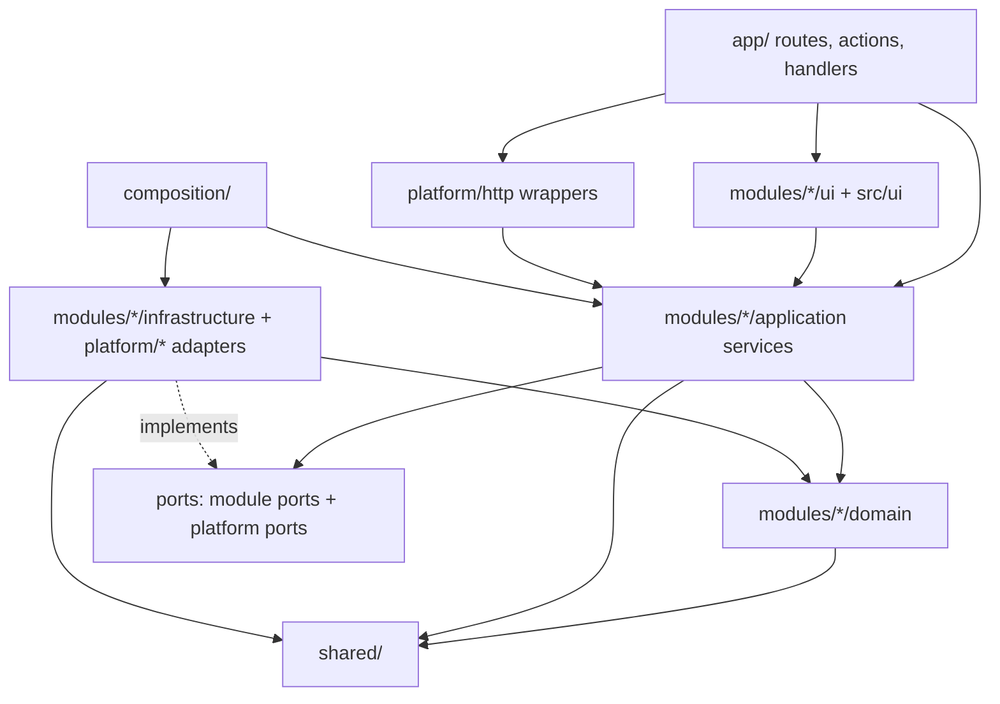

# Code structure and conventions: RentCar

Version 1.0 · 2026-11-01 · Owner: solution-architect · Status: **binding for every Phase 4+ agent** (law of the codebase; changes need an ADR)
Inputs: `docs/03-architettura.md` (Option A, GATE 2), ADR-0001..0015, `docs/security/sign-off.md` (section 4, M0 controls), `docs/02-requisiti.md`.
Greenfield project: there is no existing code, so there is no as-is section. The "reference example" paths in section 6 are **planned paths**: the first task that creates each pattern (listed in section 6) must create it at exactly that path and becomes the model for all later code.
Language rule: all code, comments, logs, tests, commits and branch names in English. User-visible text only in the message catalog (section 13).

---

## 1. Architectural style and why

- **Modular monolith, one Next.js App Router app, no workspace** (ADR-0001, ADR-0015). Feature modules with thin layers; ports only at real swap points (DB access, storage, mailer, PDF, scheduler, rate limit, error reporter, clock, ids, second factor, credential issuer).
- **Proportionate**: the domain has non-trivial pure rules (calendar-day pricing, buffers, status derivation, snapshot versioning, theme derivation) but is CRUD-heavy. So: pure `domain/` functions per module (no framework), `application/` services with constructor-injected ports, `infrastructure/` adapters (Drizzle repositories), and a presentation layer (`app/` routes, server actions, React components). No entity classes per aggregate, no CQRS, no event bus, no DI container library.
- **Hosting-independent**: nothing in `src/modules` knows Vercel, Neon, Scaleway or Hetzner. The only provider-aware code is inside `src/platform/*` adapters and only reads env-derived config. Option A-hosting and C-hosting differ by environment variables only (AC10).

## 2. Folder tree and responsibilities

```
/
├── .github/workflows/        CI (created in M0): ci.yml, security.yml, nightly-backup.yml, jobs-cron.yml
├── compose.yaml              local stack: postgres, migrate (one-shot), seed, app, jobs sidecar, profiles minio/mailpit
├── Dockerfile                multi-stage, output: 'standalone', non-root, pinned base digest
├── drizzle/                  reviewed SQL migrations (generated + hand-written: btree_gist, exclusion, RLS, triggers, grants)
├── drizzle.config.ts
├── scripts/                  CLI entry points: migrate.ts, seed.ts, create-systemadmin.ts, dump-restore helpers
├── docs/                     project documentation
├── public/                   static assets; fonts in public/fonts (self-hosted woff2, OFL)
├── tests/
│   ├── integration/          service+repository tests on real Postgres (section 14)
│   ├── security/             cross-tenant matrix, RLS tests, auth-negative helpers, header test, log canary
│   ├── e2e/                  Playwright specs and page objects
│   └── support/              fakes, builders (factories), testcontainers setup, matrix generator
└── src/
    ├── app/                  PRESENTATION ROUTING ONLY. Next.js routes, layouts, loading/error boundaries
    │   ├── (public)/[slug]/…         public booking site (theme.css route, search, booking, confirmation)
    │   ├── (tenant)/[slug]/admin/…   tenant admin and operator area
    │   ├── (system)/system/…         systemadmin console
    │   ├── api/                      route handlers: jobs/run, healthz, readyz, media/[...key], pdf, exports
    │   └── actions/                  server actions grouped per module (thin, built with defineAction)
    ├── modules/              BUSINESS CODE, one folder per bounded module (section 4)
    │   └── <module>/
    │       ├── index.ts              PUBLIC API of the module (types, service factory type, ports). Only entry point for other modules
    │       ├── domain/               pure TS: types, value objects, rules, errors. No imports outside shared/ and domain/
    │       ├── application/          services (use cases), port interfaces, input/output DTOs, Zod input schemas
    │       ├── infrastructure/       Drizzle table definitions, repositories, adapters implementing this module's ports
    │       └── ui/                   React components/hooks of this module (feature components), messages keys use
    ├── platform/             TECHNICAL ADAPTERS shared by modules (each has port.ts + implementations)
    │   ├── config/           Zod env schema, loadConfig, production guards
    │   ├── db/               pg pool, Drizzle instance, TenantDb/withTenant/withSystem, schema aggregator, errors mapping (SQLSTATE)
    │   ├── storage/          StoragePort; local-fs and s3 adapters
    │   ├── mailer/           Mailer port; nodemailer adapter, SSRF guard, fake
    │   ├── pdf/              PdfRenderer port; react-pdf adapter
    │   ├── scheduler/        JobScheduler port, cron-endpoint trigger helpers
    │   ├── rate-limit/       RateLimitStore port; postgres adapter, in-memory (tests/local only)
    │   ├── error-reporter/   ErrorReporter port; noop and sentry adapters
    │   ├── logging/          pino logger factory, request context (AsyncLocalStorage), redaction list
    │   ├── crypto/           Encryptor (AES-256-GCM, key id + AAD), token generation/hash, constant-time compare
    │   ├── clock/            Clock port; system clock
    │   ├── ids/              IdGenerator port (uuid v7)
    │   ├── http/             defineAction, defineRoute wrappers, Origin check, Result-to-response mapping
    │   └── host/             the ONLY place that reads host-specific headers/env (client IP, region), e.g. vercel vs proxy
    ├── composition/          COMPOSITION ROOT (section 5): container.ts, test-container.ts
    ├── shared/               shared kernel: Result, AppError hierarchy, Money, time helpers, pagination, branded ids, Zod primitives
    ├── i18n/                 message catalog and typed t() (section 13)
    ├── ui/                   design-system layer: shadcn/ui components (components/ui), layout primitives, theme provider
    ├── styles/               tokens.css (CSS variables), globals.css, tailwind preset
    └── instrumentation.ts    startup: loadConfig() fail-fast, container warm-up
```

Responsibility rules in one line each:
- `app/` decides URLs and wires a page/action/handler to one service call. It contains no business rules and no SQL.
- `modules/*/domain` is deterministic and I/O-free; `application` orchestrates; `infrastructure` talks to the DB; `ui` renders.
- `platform/*` offers ports that more than one module uses or that wrap an external system.
- `shared/` has no knowledge of any module or platform adapter.
- Table definitions live with the owning module (`modules/<m>/infrastructure/schema.ts`); `platform/db/schema.ts` only re-exports them for drizzle-kit and typing.

## 3. Layers and dependency rules



Allowed imports (anything not listed is forbidden; enforced in CI, section 10):

| From | May import |
|---|---|
| `shared/` | nothing from `src` (only npm packages: zod, date lib) |
| `modules/X/domain` | `shared/`, own `domain` only. No zod parsing, no framework, no ORM, no `process`, no `Date.now()` (receives `now` as parameter) |
| `modules/X/application` | own `domain`, `shared/`, `platform/*/port` (types only), **other modules only via their `index.ts`** |
| `modules/X/infrastructure` | own `domain` and `application` (ports to implement), `shared/`, `platform/db` and other `platform/*` ports, drizzle/pg |
| `modules/X/ui` | own `application` types/DTOs, `shared/`, `src/ui`, `src/i18n`; never `infrastructure`, never the DB |
| `platform/*` adapters | `shared/`, own port; never `modules/*` (except `platform/db` reading `TenantScope` type from `modules/tenancy/index.ts`) |
| `app/` | `modules/*/index.ts`, `modules/*/ui`, `platform/http`, `composition/`, `src/ui`, `src/i18n`, `shared/` |
| `composition/` | everything (it is the only place allowed to import `infrastructure/*` and adapters concretely) |

Hard bans (each is a CI rule):
1. ORM (`drizzle-orm`, `pg`), `@aws-sdk/*`, `nodemailer`, `sharp`, `@react-pdf/renderer`, `@sentry/*` imported **only** inside `modules/*/infrastructure` and `platform/*`.
2. `process.env` read **only** in `platform/config` (and `scripts/` bootstrap, `next.config`, `drizzle.config`).
3. No import cycles (`no-circular`), including between modules. Module dependency direction is acyclic (section 4).
4. No deep imports into another module (`modules/booking/application/...` from `fleet`): use `modules/booking` (index).
5. `Date.now()`, `new Date()` (no args), `Math.random()`, `crypto.randomUUID()` banned outside `platform/clock`, `platform/ids`, `platform/crypto`: use `Clock` and `IdGenerator`.
6. Raw SQL (`sql\`\``, `pool.query`) only inside `infrastructure/` and `platform/db`, always parameterised.
7. `dangerouslySetInnerHTML`, `eval`, `fetch(userControlled)` banned (Semgrep rules; SSRF guard lives in `platform/mailer`).
8. A repository can only be constructed with a `TenantDb` handle (section 7), never with the global pool.

## 4. Module boundaries per epic

Dependency direction (arrows point to what is depended on; acyclic):
`app → booking, finance, notifications, … → customers, fleet, subscriptions → auth → tenancy → shared/platform`. `audit` and `branding` are leaves used by many. Where a lower module needs an upper one, the **lower module declares a port and `composition/` wires the implementation** (example: `booking` declares `BookingNotifier`; `notifications` implements it; no import from `booking` to `notifications`).

| Module | Epics | Owns (tables, rules) | Public API (index.ts) highlights | May depend on |
|---|---|---|---|---|
| `tenancy` | EP-02, EP-13, EP-10 (settings) | tenants, slug rules, reserved slugs, status (active/grace/suspended/terminated), `TenantScope`, `TenantResolver`, `tenantUrl()`, tenant settings (time zone, currency, buffer, duration, lead time), 90-day hard-delete job | `TenantScope`, `TenantResolver`, `tenantUrl`, `TenantService` | `audit` (port) |
| `auth` | EP-01, EP-08 | users (systemadmin, tenant admin, operator), sessions, credential tokens, password policy (min 12), lockout, `CredentialIssuer`, `SecondFactorVerifier`, `requireRole`, staff-account use cases (create/deactivate operator, replace admin) | `Guard`, `AuthService`, `StaffService` | `tenancy`, `audit` |
| `subscriptions` | EP-02 | plan limits (`maxVehicles`, `maxOperators`), expiry/grace derivation, read-only mode, renewal reminders | `SubscriptionService`, `getEffectiveAccess(tenant, now)` | `tenancy` |
| `fleet` | EP-05 | vehicles, photos, maintenance toggle, archive, limit enforcement | `FleetService`, `VehicleReadModel` | `tenancy`, `subscriptions`, `audit`, `platform/storage` |
| `customers` | EP-07 | customers, phone normalisation and de-duplication, anonymisation, export | `CustomerService` | `tenancy`, `audit` |
| `booking` | EP-03, EP-04, EP-06 | bookings, `pricing()` (pure), availability, `deriveStatus()`, code generation, idempotency keys, exclusion constraint mapping, calendar read model, CSV export | `BookingService`, `AvailabilityQuery`, `CalendarQuery`, port `BookingNotifier` | `tenancy`, `subscriptions`, `fleet`, `customers`, `audit` |
| `finance` | EP-05 (expenses), EP-09 | expenses, revenue aggregates (completed bookings by return month), versioned yearly snapshots, corrections | `FinanceService` | `tenancy`, `booking` (via `RevenueSource` query), `fleet`, `audit` |
| `branding` | EP-10, EP-12 | palette, `deriveTheme()` (pure), contrast checks, fonts, logo reference, `themeVersion` | `BrandingService`, `deriveTheme`, `renderThemeCss` | `tenancy`, `platform/storage` |
| `notifications` | EP-11 | `EmailLog` outbox, templates (use `i18n`), PDF documents, owner/admin mails, SMTP settings, SMTP SSRF guard use, retry | `NotificationService`, implements `BookingNotifier` and other modules' notifier ports | `tenancy`, `platform/mailer`, `platform/pdf`, `platform/crypto` |
| `audit` | EP-14 | append-only `audit_log` (grants: INSERT/SELECT only), viewer, CSV export | `AuditLog` (port `record(event)`), `AuditQuery` | `tenancy` (type only) |
| `jobs` | EP-13 | `JobRun`, job registry, `runDueJobs(now)` orchestration | `JobRunner`, `registerJob` | all modules via their public job functions, wired in `composition/` |

A new epic or feature extends the module that owns its data. A new module needs an ADR.

## 5. Dependency injection and composition root

**Mechanism: manual constructor/parameter injection with factory functions; no container library** (ADR-0001).

- Every service is a factory taking explicit deps and returning an object of functions:
  ```ts
  export type BookingServiceDeps = {
    repo: BookingRepository; availability: AvailabilityQuery; customers: CustomerService;
    fleet: FleetService; subscriptions: SubscriptionService; notifier: BookingNotifier;
    audit: AuditLog; clock: Clock; ids: IdGenerator; db: TenantDb;
  };
  export const createBookingService = (deps: BookingServiceDeps): BookingService => ({ /* use cases */ });
  ```
  More than 4 collaborators is acceptable in `Deps` because it is a single object parameter (the "max 4 parameters" rule is satisfied).
- **Composition root** = `src/composition/container.ts`: `buildContainer(config: AppConfig): Container` instantiates adapters (pool, storage, mailer, pdf, clock…), repositories, then services in dependency order, and returns `{ services, guard, jobs, resolver, … }`. It is the only file that imports concrete adapters and `infrastructure/*`.
- **Lifetime**: one container per server process, created lazily on first use by `getContainer()` (a memoised module-level reference **inside `composition/` only**; this is the one permitted process-wide singleton and it is read-only after build). On Vercel this is per function instance; the DB pool inside it uses a small `max` (1 to 3, ADR-0010). Request-scoped data (request id, `TenantScope`, actor) is **not** in the container: it travels as explicit parameters (`scope`, `actor`) and the logger context uses `AsyncLocalStorage` (`platform/logging`).
- **Config** is built once by `loadConfig(process.env)` in `instrumentation.ts` and passed to `buildContainer(config)`. Nothing else reads env.
- **Tests**: `composition/test-container.ts` `buildTestContainer({ overrides })` builds the same graph with fakes (`FakeClock`, `FakeMailer`, `InMemoryStorage`, `FakeRateLimitStore`, `NoopErrorReporter`) and, for integration tests, a real test database. Every service must be unit-testable by calling its factory with fakes: no `vi.mock` of modules, no global patching.
- **Registering a new service**: (1) define `XxxDeps` and `createXxxService` in the module's `application/`; (2) add its ports to the module `index.ts`; (3) instantiate in `buildContainer` after its dependencies; (4) expose on `Container`; (5) add an override key in `buildTestContainer`. Adding a new adapter follows the same steps in `platform/<name>/`.
- **Pluggable adapters selected by config** (AC10, NFR-PLG): `STORAGE_PROVIDER=local|s3`, `MAILER` (smtp-system), `ERROR_REPORTER=noop|sentry`, `RATE_LIMIT_STORE=postgres|memory` (memory refused outside `APP_ENV=local|ci`), `CREDENTIAL_ISSUER=set_password_link`, `SECOND_FACTOR=none`. The container has one `switch` per adapter with an exhaustive check.

## 6. Standard patterns (one way to do each thing)

Each pattern has a **reference file** that the first task creating it must place at the stated path. Later code copies it; deviation requires an ADR.

| Pattern | Reference path (planned) | Created by |
|---|---|---|
| Server action | `src/app/actions/fleet/create-vehicle.ts` | M2 fleet |
| Route handler | `src/app/api/jobs/run/route.ts` | M1 jobs |
| Service (use case) | `src/modules/fleet/application/fleet-service.ts` | M2 fleet |
| Repository | `src/modules/fleet/infrastructure/vehicle-repository.ts` | M2 fleet |
| Pure domain rule | `src/modules/booking/domain/pricing.ts` | M3 booking |
| Zod input schema | `src/modules/fleet/application/schemas.ts` | M2 fleet |
| Adapter + port + fake | `src/platform/clock/` (simplest), then `src/platform/storage/` | M1 platform |
| Component (server) / form (client) | `src/modules/fleet/ui/vehicle-form.tsx` | M2 fleet |
| Hook | `src/modules/booking/ui/use-availability-search.ts` | M3 booking |
| Job | `src/modules/booking/application/jobs/advance-booking-status.ts` | M3 booking |
| Unit test / integration test / E2E / matrix | see section 14 | M1 |

If an earlier milestone needs a pattern before its reference exists, it creates the reference there and registers it in this table in the same commit.

### 6.1 Result and error pattern
- `shared/result.ts`: `type Result<T, E extends AppError = AppError> = { ok: true; value: T } | { ok: false; error: E }` with `ok()`, `err()`, `mapResult()`. No exceptions for **expected** outcomes.
- `shared/errors.ts`: `AppError` base `{ code, kind, messageKey, details? }`, where `code` is a stable string enum (`BOOKING_CONFLICT`, `VALIDATION_FAILED`, `NOT_FOUND`, `FORBIDDEN`, `UNAUTHENTICATED`, `RATE_LIMITED`, `PLAN_LIMIT_REACHED`, `TENANT_READ_ONLY`, `STORAGE_TOO_LARGE`, …), `kind` is one of `validation | not_found | conflict | forbidden | unauthenticated | rate_limited | unavailable`. `messageKey` is a catalog key (section 13); domain errors contain **no user text and no PII**.
- Services return `Result`. They **throw only for bugs and infrastructure failure** (DB down, adapter crash); those reach the error reporter.
- Repositories translate DB errors at the boundary: SQLSTATE `23P01` -> `BookingConflict`, `23505` -> `Duplicate*`, `23514` -> `ValidationFailed`. Unknown errors are rethrown.
- **One translator**: `platform/http` maps `AppError.kind` to HTTP status (route handlers) and to the action result `{ ok: false, error: { code, messageKey, fieldErrors? } }` (server actions). No other file builds error responses. Responses never include stack traces, SQL or internal ids not meant for the user; login/reset responses are constant-shape (FR-AUTH-08).

### 6.2 Validation (Zod)
- **Input schemas live in `modules/<m>/application/schemas.ts`** and describe the use-case input (they are DTOs). Primitives (phone, email, slug, hex colour, money, ISO date) are in `shared/zod/`. Error messages in schemas are catalog keys, not text.
- **Parsing happens at the boundary** (inside `defineAction` / `defineRoute`): untrusted input -> Zod -> typed DTO -> service. Services trust their typed input for shape but **re-check business invariants** (limits, ownership, state). Unknown keys are stripped (`.strict()` for auth/admin forms so mass assignment fails with 400).
- Domain code never imports Zod. The client reuses the same schema for form validation but the server always re-validates.
- Output DTOs are plain serialisable objects (ISO strings, minor-unit integers); no ORM rows or class instances cross `application` -> `app/` (explicit mapping functions, e.g. `toVehicleDto`).

### 6.3 Server actions versus route handlers
| Use | When |
|---|---|
| **Server action** (`app/actions/<module>/*.ts`) | Any mutation initiated by our own UI: admin forms, public booking submit, login/logout, set-password, cancel booking. Progressive enhancement friendly. |
| **Route handler** (`app/api/**/route.ts`) | Anything that is not a UI form mutation: `jobs/run` (Bearer `CRON_SECRET`), `healthz`/`readyz`, `media/[...key]` (GET, cache headers), PDF download, CSV/data export (streamed), `{slug}/theme.css`, future webhooks. |
| **Server component data loading** | Reads for pages call a service **query** function directly (no action, no route). |

Both are created only through wrappers in `platform/http`, so no unguarded entry point exists:
- `defineAction({ input: schema, auth: { realm, minRole } | 'public', rateLimit?, handler })` performs: request context + logger, tenant resolution from the route slug, `Origin` check, rate limit, auth guard (`requireRole(scope, role)`, `mustChangePassword`, tenant status/read-only check), Zod parse, call `handler(ctx, input)`, Result -> action result, error reporting.
- `defineRoute({ method, auth, rateLimit?, handler })` is the equivalent for handlers (including Origin check on non-GET; the jobs route uses its own `bearerAuth(CRON_SECRET)` constant-time check).
- Direct `export async function POST` or `'use server'` functions that do not use the wrappers fail the CI rule (Semgrep custom rule + eslint).
- Middleware does only routing/redirect hints; it is never the sole authorisation.
- Public routes under `[slug]` never accept a tenant id from the client; the tenant comes only from `TenantResolver`.

## 7. Repository pattern, mandatory tenant scoping and RLS session handling

**Principles** (ADR-0003): defence in depth. Layer 1 is the type system plus mandatory repository predicates; layer 2 is PostgreSQL RLS with `FORCE ROW LEVEL SECURITY`. A forgotten filter returns empty results, never another tenant's rows.

**Types** (in `modules/tenancy` and `platform/db`):
- `TenantScope`: opaque branded type `{ tenantId, slug, timeZone, currency }`. Its only constructors are `TenantResolver.resolve()` and the system/jobs path; the brand makes it impossible to forge in feature code (the constructor symbol is not exported from the module `index.ts`).
- `TenantDb`: a handle created by `db.withTenant(scope, fn)`. `fn` receives a `TenantTx` (transaction handle) that is **already bound** to the tenant.
- `SystemDb`: `db.withSystem(actor: SystemActor, reason, fn)` for tenant-less operations (system console, slug lookup, job tenant iteration). It sets `app.system_actor` (not `app.tenant_id`), writes an audit/log line, and is callable only from code that holds a `SystemActor` (obtained from a systemadmin session or the jobs entry point). RLS policies on tenant-owned tables allow access only when `tenant_id = current_setting('app.tenant_id', true)::uuid`; the `tenants`/`users` (system realm) policies additionally allow the system GUC. The database-architect owns the final policies and grants.

**Transaction and GUC handling** (works with transaction-mode poolers, AR-2):
1. `withTenant` opens an explicit transaction on a pool client: `BEGIN`.
2. `SELECT set_config('app.tenant_id', $1, true)` (the `true` makes it transaction-local, equivalent to `SET LOCAL`). Parameterised, never string-concatenated.
3. Run `fn(tx)`; `COMMIT`; on error `ROLLBACK`; the client is always released in `finally`.
4. **Forbidden**: session-level `SET`, `set_config(..., false)`, session advisory locks, `LISTEN/NOTIFY`, named prepared statements, running repository queries on the bare pool. `pg_try_advisory_xact_lock` (transaction-level) is allowed for jobs.
5. The runtime DB role is non-owner, without `BYPASSRLS`; the migration role is separate (`DIRECT_DATABASE_URL`). Test: the runtime role with no GUC set sees zero rows on every tenant table.
6. Nested `withTenant` calls are not allowed; a service that needs two repositories receives one `tx` and passes it to both (unit of work = the `withTenant` callback).

**Repository rules**:
- Constructed in `composition/` with the module's table definitions; **methods take `tx: TenantTx` as the first argument** and every query includes `eq(table.tenantId, tx.tenantId)` explicitly (the explicit predicate keeps queries indexable and lets unit-level tests catch omissions even without RLS).
- A `TenantTx` is required by the method signature; there is no overload that works without it.
- Repositories return **domain types** (mapped rows), never Drizzle row types; they contain no business rules; they translate SQLSTATE errors (6.1).
- Inserts take `tenantId` from `tx`, never from caller input (a DTO field called `tenantId` is a review blocker).
- Reads for lists are paginated and bounded; no `select *` of wide tables for listings.
- Tenant-less repositories (`TenantRepository`, `SystemUserRepository`, `JobRunRepository`) take `SystemDb` and are listed explicitly in `tests/security/system-paths.md` (reviewed by security-engineer).

**CI guarantees** (`tests/security/`): (a) a registry test fails if any table with a `tenant_id` column is missing from the matrix; (b) the matrix generator exercises, for each registered entity and each repository/service read/write path, "tenant A actor, tenant B resource" and expects 404 / empty (never 200 with data); (c) catalog query asserts every tenant table has RLS enabled and forced; (d) "runtime role without GUC returns zero rows"; (e) concurrency test of 1,000 interleaved tenant transactions shows no GUC bleed (spike S1 as permanent test, smaller volume in CI).

## 8. Adapters (ports in `platform/*`)

Every adapter has: `port.ts` (interface + error types), one file per implementation, a fake in `tests/support/fakes/`, and a contract test run against every implementation.

| Port | Responsibilities and rules | Implementations |
|---|---|---|
| `StoragePort` | `put/get/delete/head`, keys `tenants/{tenantId}/{kind}/{uuid}.{ext}`, key built by the module not by the caller; `UPLOAD_MAX_BYTES` 4 MB; local adapter checks resolved path stays in base dir | `local`, `s3` (forcePathStyle for MinIO) |
| `Mailer` | `send(message, smtpConfig)`; per-send transport, 5 s connect / 10 s socket timeouts; calls the SSRF guard (DNS resolve, reject private/loopback/link-local, ports 25/465/587/2525 only, TLS verified) **before** connecting; never logs credentials or bodies | `nodemailer`, `fake` |
| `PdfRenderer` | `render(document) -> Buffer`; fonts embedded from files; logo as PNG | `react-pdf`, `fake` (returns marker bytes) |
| `JobScheduler` | trigger side only (`/api/jobs/run`, compose sidecar, GitHub cron); jobs are idempotent use cases `runDueJobs(now)` with unique `JobRun(job, period)` and xact advisory lock | `cron-endpoint` |
| `RateLimitStore` | `hit(key, window, limit) -> {allowed, retryAfter}`; keys HMAC-hashed; fail-closed for login/reset, fail-open for public reads; purge within 24 h | `postgres`, `memory` (local/CI only) |
| `ErrorReporter` | `capture(error, context)` with PII scrubbing | `noop`, `sentry` |
| `Clock` | `now(): Date` | `system`, `fake` (settable) |
| `IdGenerator` | `uuid()` (v7) and `token(bytes)` | `system`, `sequential` (tests) |
| `Encryptor` | AES-256-GCM, key id + AAD (`tenantId:field`), KEK from `APP_ENCRYPTION_KEY` | `aes-gcm` |
| `CredentialIssuer` (auth module port) | issue/consume credential for a user; **default `SetPasswordLinkIssuer`** (ADR-0005: 24 h, single use, hashed) | `set-password-link` (wired), `temporary-password` (not wired) |
| `SecondFactorVerifier` (auth module port) | `isRequired(user)`, `verify(user, proof)`; extension point (FR-AUTH-12) | `noop` (returns "not required"); future TOTP |

Adapters may be host-aware only in `platform/host` (client IP header selection using `TRUSTED_PROXY_COUNT`, region). No adapter or module may check `process.env.VERCEL`.

## 9. Config module (`platform/config`)

- `schema.ts`: one Zod object for all variables (names in English, `SCREAMING_SNAKE_CASE`). `loadConfig(env)` returns a deeply readonly `AppConfig`; failure prints **variable names and reasons, never values**, and aborts startup (`instrumentation.ts`), including `next start` in Docker.
- **Environment class**: `APP_ENV = local | ci | staging | production`. (`NODE_ENV` is `production` in the local compose build too, so it cannot discriminate.) Production-like = `staging | production`.
- **Production guards** (Zod `superRefine`, unit-tested, mandated by the M0 control "dev placeholder keys rejected"):
  - `SESSION_*`, `APP_ENCRYPTION_KEY`, `CRON_SECRET`, `RATE_LIMIT_HMAC_KEY` must be at least 32 bytes of entropy and **must not equal or start with the placeholder values committed in `.env.example`/`compose.yaml`** (placeholders carry the prefix `INSECURE_DEV_`; any value matching it is rejected when production-like).
  - Seed systemadmin password and the `seed` profile are refused when production-like.
  - `STORAGE_PROVIDER=local` and `RATE_LIMIT_STORE=memory` refused when production-like.
  - `DATABASE_URL` must use TLS (`sslmode=verify-full`) when production-like; the runtime URL must differ from `DIRECT_DATABASE_URL` and must not use the owner role (checked at startup by `readyz`, not by parsing).
  - `PUBLIC_BASE_URL` must be https when production-like.
  - Host portability: the check "local storage on Vercel" is expressed as `STORAGE_PROVIDER=local` + `HOST_KIND=serverless` (config value set by the deployment, defaulting to `server`), so no code inspects Vercel env names.
- Variables beyond spec §3 already decided: `APP_ENCRYPTION_KEY`, `CRON_SECRET`, `DIRECT_DATABASE_URL`, `S3_REGION`, `S3_FORCE_PATH_STYLE`, `TRUSTED_PROXY_COUNT`, `UPLOAD_MAX_BYTES`, `CREDENTIAL_ISSUER`, `OBS_*`, `APP_ENV`, `HOST_KIND`.
- `.env.example` is the only committed env file; it is generated/validated by a test that every schema key appears in it and vice versa.

## 10. Quality limits and automated architecture checks (CI, all blocking)

| Check | Tool and setting |
|---|---|
| Format | Prettier (`--check`) |
| Lint | ESLint flat config, `typescript-eslint` strict + stylistic, `eslint-plugin-boundaries` (layer/module rules of section 3), `eslint-plugin-import` (`no-cycle`, `no-restricted-paths`), `no-process-env` (except config), `no-restricted-imports` (ORM/SDK bans), `no-restricted-globals`/syntax (`Date.now`, `new Date()` no-arg, `Math.random`), `react/jsx-no-literals` (hard-coded UI text), `jsx-a11y` strict, `no-console`, `no-eval`, `@typescript-eslint/no-explicit-any` error |
| Types | `tsc --noEmit` with `strict`, `noUncheckedIndexedAccess`, `exactOptionalPropertyTypes`, `noImplicitOverride`, `verbatimModuleSyntax` |
| Complexity and size | ESLint: `complexity` 10, `max-lines-per-function` 40 (skip blanks/comments; tests and Zod/schema files exempt), `max-lines` 300, `max-params` 4 (use a deps/options object), `max-depth` 3 |
| Architecture | **dependency-cruiser** (`.dependency-cruiser.cjs`): forbids circular deps, deep imports across modules (only `modules/*/index.ts`), ORM/SDK imports outside allowed folders, `domain` importing anything but `shared`, `app/` importing `infrastructure`, `modules/*` importing `app/`, orphans; runs on `src` and `tests`. Unit test of the rules themselves with fixture violations (failing-then-passing evidence for the cybersecurity-manager) |
| Duplication | `jscpd` threshold 3% over `src` (min 60 tokens/6 lines), tests excluded from the threshold but reported |
| Dead code | `knip` (unused exports/files/dependencies) |
| Security static | Semgrep with custom rules: raw SQL not parameterised, repository call without `TenantTx`, route/action not built with `defineRoute`/`defineAction`, `dangerouslySetInnerHTML`, `fetch` of non-constant URL; gitleaks; `pnpm audit --audit-level=high` and OSV-Scanner; Trivy on image and compose; license check (per M0 table in `docs/security/sign-off.md`) |
| Coverage | Vitest v8: `domain` >= 90% lines and branches, `application` >= 80%, `infrastructure` covered by integration tests (no numeric gate), global >= 75%; thresholds can only be raised |
| Tests | all suites of section 14 on every PR; nightly: full matrix + mutation spot-check on `pricing`/`availability` (optional) |
| Commits | commitlint (Conventional Commits) in CI on the PR range and in a Husky `commit-msg` hook |

CI jobs (GitHub Actions, created in M0): `lint-types-arch` -> `unit` -> `integration` (Postgres service/Testcontainers) -> `security-matrix` -> `e2e` (Playwright against `docker compose up`) -> `scans`; actions pinned by SHA, `permissions: contents: read` by default, frozen lockfile. The failing-then-passing run for each M0 control is stored in the PR that introduces it.

## 11. Conventions

**Naming**
- Files and folders `kebab-case`; one main export per file named after it (`vehicle-repository.ts` exports `createVehicleRepository`). React components `PascalCase` in `kebab-case` files. Tests next to unit code as `*.test.ts(x)`.
- Types/interfaces `PascalCase` without `I` prefix (`StoragePort`, not `IStorage`); ports end in `Port` only when the noun is ambiguous (`StoragePort`) otherwise the capability name (`Mailer`, `Clock`). Factories `createXxx`. Booleans as questions (`isActive`, `hasAccess`). Constants `SCREAMING_SNAKE_CASE`; no magic numbers or strings (named constants or enums in `domain/constants.ts`).
- Database: tables `snake_case` plural (`bookings`), columns `snake_case`, every tenant table has `tenant_id uuid not null` first after `id`; Drizzle maps to camelCase in TS. Timestamps `*_at` `timestamptz`. Enums as Postgres enums or checked text, mirrored by TS union types.
- Env vars `SCREAMING_SNAKE_CASE`; message keys `module.area.name` lowercase dot-separated (`booking.errors.conflict`); metric/event/log names `snake_case` English.
- Server actions named `verbNoun` (`createVehicle`); route paths follow the spec URLs.

**Errors, logging**: Result for expected failures (6.1); logger from `platform/logging` injected (`deps.logger`), JSON, fields `requestId`, `tenantId`, `actorId`, `event`; no PII (phones, emails, names, SMTP data, tokens) in logs - a redaction list and the log-scrub canary test enforce it. Audit events go to `AuditLog`, not the log.

**Dates**: instants are UTC `Date`/`timestamptz`; calendar-day logic (pricing "calendar days touched", status derivation, year-end snapshot) uses the **tenant time zone** from `TenantScope` through helpers in `shared/time` (the only place using the date library; ASSUMPTION: `date-fns` + `@date-fns/tz`, confirmed by the backend-developer in M1 with a note in the module README). Domain functions receive `now` as a parameter. Tests use `FakeClock`; DST edge cases are mandatory test cases for pricing.

**Money**: integer minor units + ISO currency (`Money` in `shared/money`), never floats; formatting only in `ui`/templates via the locale formatter; VAT included in final prices (REQ-13).

**DTOs and mapping**: input DTOs = Zod-inferred types; output DTOs = plain serialisable objects; explicit `toXxxDto`/`toDomain` mappers; no `tenantId` in input DTOs; branded id types (`VehicleId`, `BookingId`) from `shared/ids`.

**Dependencies**: new npm packages follow the dependency policy (license allowlist, pinned versions, audit) and are justified in the PR; no package that duplicates something in `shared/` or `platform/`.

**Comments**: explain why, in English; no commented-out code; every disabled lint rule carries a reason comment and is reviewed.

## 12. Theming tokens

- `src/styles/tokens.css` defines semantic CSS variables only (shadcn naming: `--background`, `--foreground`, `--primary`, `--primary-foreground`, `--muted`, `--border`, `--ring`, `--destructive`, `--radius`, spacing/typography scales, plus RentCar extras `--brand`, `--brand-foreground`). Light and dark values under `:root` and `.dark`/`[data-theme]`.
- Tailwind theme maps colours to these variables (`bg-primary` = `hsl(var(--primary))`); **components use semantic classes only**. No hex values, no arbitrary colour values (`bg-[#fff]`) and no inline `style` for colours in components (lint rule + Semgrep); this keeps `style-src` strict (AR-8).
- Tenant palette: `branding` module `deriveTheme(palette)` (pure) -> `renderThemeCss(theme)` -> route `/{slug}/theme.css?v={themeVersion}` overriding the same variables. Only validated hex values are emitted.
- Fonts: three variable woff2 families in `public/fonts`, `@font-face` + `font-display: swap`; the selected family is referenced through `--font-sans`.
- The ui-designer's `docs/design/tokens.json` is the source; a script (`scripts/build-tokens.ts`) generates `tokens.css` and the Tailwind preset, and CI fails if the generated files differ from committed ones.
- Mobile first: base styles target 360 px width; touch targets >= 44 px; all components are verified at the Playwright mobile viewports.

## 13. i18n message catalog (single locale `en`, structure ready for more)

- `src/i18n/messages/en.ts`: one typed nested object (`as const`); keys are English identifiers `module.area.name`. `src/i18n/index.ts` exposes `getTranslator(locale)` (server) and `useT()` (client) with **compile-time checked keys** (`MessageKey` derived from the catalog) and ICU-style parameters/plurals (ASSUMPTION: `intl-messageformat`; no i18n routing now).
- Every user-visible string - UI, validation messages, email templates, PDF text, error `messageKey`s, empty states - is a key. Literal user text in `.ts/.tsx` is a lint error (`react/jsx-no-literals` plus a Semgrep rule for string literals in `toast()`/`throw`-to-user paths). Log messages and internal exception messages are English literals (they are not user text).
- Domain/application code returns keys (`AppError.messageKey`); translation happens in `ui`, `platform/http` (action result carries key + resolved text) and `notifications` templates.
- A unit test fails when a key used in code is missing from the catalog or a catalog key is unused (knip-style check script `scripts/check-messages.ts`). Adding a locale later = adding `it.ts` with the same type (compile error when keys are missing) and a locale resolver; no code restructuring.
- Dates, numbers and currency via `Intl` with the tenant's time zone/currency and the active locale.

## 14. Testing layout

| Layer | Location | Tooling | What and rules |
|---|---|---|---|
| Unit | colocated `*.test.ts(x)` next to the code | Vitest | Domain functions (pricing, availability rules, status derivation, theme derivation, phone normalisation) and services with fakes. No I/O, no network, no DB, <50 ms each, no global mocks. Each Zod schema and each config guard has tests |
| Integration | `tests/integration/<module>/*.test.ts` | Vitest + **Testcontainers Postgres 16** (same major as `compose.yaml`) | Global setup starts one container, applies the real `drizzle/` migrations with the migration role, creates a **template database**; each test file clones it (`CREATE DATABASE … TEMPLATE`) and connects with the **runtime role** so RLS is really active. Covers repositories, exclusion constraint (50 parallel conflicting inserts), RLS, jobs idempotency, outbox. In GitHub Actions the same suite can use a `postgres:16` service container via `TEST_DATABASE_URL` (Testcontainers is the default locally and in CI unless Docker-in-Docker is unavailable) |
| Security and cross-tenant | `tests/security/*.test.ts`, generator in `tests/support/tenant-matrix.ts` | Vitest + real DB | Matrix per section 7; auth-negative helpers (401/403/404/400/mass assignment/429); header test against the running compose app; log-scrub canary; config production guards |
| E2E | `tests/e2e/*.spec.ts`, page objects in `tests/e2e/pages/` | Playwright against `docker compose up` (seeded synthetic data) | Projects: `desktop-chromium`, `mobile-iphone` (WebKit, iPhone 13 profile), `mobile-android` (Pixel 7), `small-360` (360x640 custom viewport). Mobile projects run the public booking flow, the admin calendar and the vehicle form on every PR; desktop runs the full suite. `@axe-core/playwright` on key pages (WCAG 2.2 AA). Specs use data-testid sparingly (prefer roles/labels, which also checks a11y) |
| Contract | `tests/integration/platform/<port>.contract.test.ts` | Vitest | Same tests run against every implementation of a port (storage local/s3 via MinIO container, rate limit postgres/memory) |
| Architecture | CI `depcruise` + a unit test that runs dependency-cruiser against fixture files | dependency-cruiser | Section 10 |

Support code: `tests/support/builders/` (factory functions for domain objects, deterministic via `FakeClock`/`sequential` ids), `tests/support/fakes/`, `tests/support/db.ts` (template clone helper), `tests/support/auth.ts` (create actor for realm/role). Test names and descriptions are English sentences (`it('rejects an overlapping booking for the same vehicle')`). A bug fix starts with a failing test. Flaky tests are quarantined only with a tracked issue and a deadline.

## 15. Commit, branch and review conventions

- **Conventional Commits** in English: `type(scope): imperative summary`, with type in `feat | fix | refactor | test | docs | chore | build | ci | perf | security` and scope = module or area (`booking`, `auth`, `platform-db`, `ci`, `docs`). Breaking changes with `!` and footer. Body explains why; reference the task and requirement ids (`Refs: US-123, FR-BKG-08`).
- **One commit per completed task** (user request): each commit leaves lint, types, architecture rules and tests green; no "wip"/"fix tests" follow-ups squashed in later - amend before pushing. Migration + schema + repository + test for one task belong in the same commit.
- Branches: `feat/<epic>-<slug>`, `fix/<slug>`, `chore/<slug>`, `docs/<slug>` (current working branch for documents: `docs/analysis`). PR into `main`, title = Conventional Commit, branch protection and CI green as per M0 controls (no force push).
- Reviews: code-reviewer applies `dev-team:code-review-checklist`; any deviation from this document is a blocking finding unless an ADR exists. New pattern = ADR first.

## 16. Reusable shared modules (initial inventory; extend, never duplicate)

`shared/result`, `shared/errors`, `shared/money`, `shared/time`, `shared/ids`, `shared/pagination`, `shared/zod/*` (phone, email, slug, hex colour, ISO date, money); `platform/http` (`defineAction`, `defineRoute`, `bearerAuth`), `platform/db` (`withTenant`, `withSystem`, SQLSTATE mapper), `platform/logging`, `platform/crypto`, `src/ui` (shadcn components, form field wrappers, data table, empty/loading/error states, `TenantThemeProvider`), `src/i18n`, `tests/support/*`. Before creating a helper, search these first (clean-architecture rule: reuse before create); at the third duplicate, extract (rule of three).

## 17. Known debt and proposed follow-ups

| ID | Item | Plan |
|---|---|---|
| TD-1 | No existing code: all reference paths in section 6 are planned, not yet real | Each is created by the first task that needs it (M1/M2/M3) and this document is updated in the same commit |
| TD-2 | Date library not yet pinned (ASSUMPTION `date-fns` + `@date-fns/tz`) | Backend-developer confirms in M1; ADR only if a different library is chosen |
| TD-3 | i18n library not yet pinned (ASSUMPTION `intl-messageformat`) | Frontend-developer confirms in M1 |
| TD-4 | Final RLS policies for system-realm tables (`tenants`, system `users`, `jobs`) | database-architect (Phase 4) validates against section 7 and spike S1 |
| TD-5 | Hosting-specific code (client IP header, region pin) deferred with the hosting decision | Confined to `platform/host` and `vercel.json`/Compose files; no impact on modules |
| TD-6 | MFA absent by user decision (risk accepted until GATE 4); `SecondFactorVerifier` is a no-op | Implement TOTP for systemadmin on the existing port if the decision changes |
