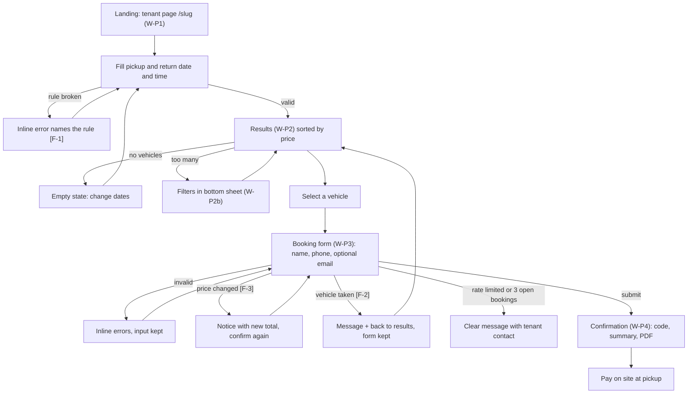
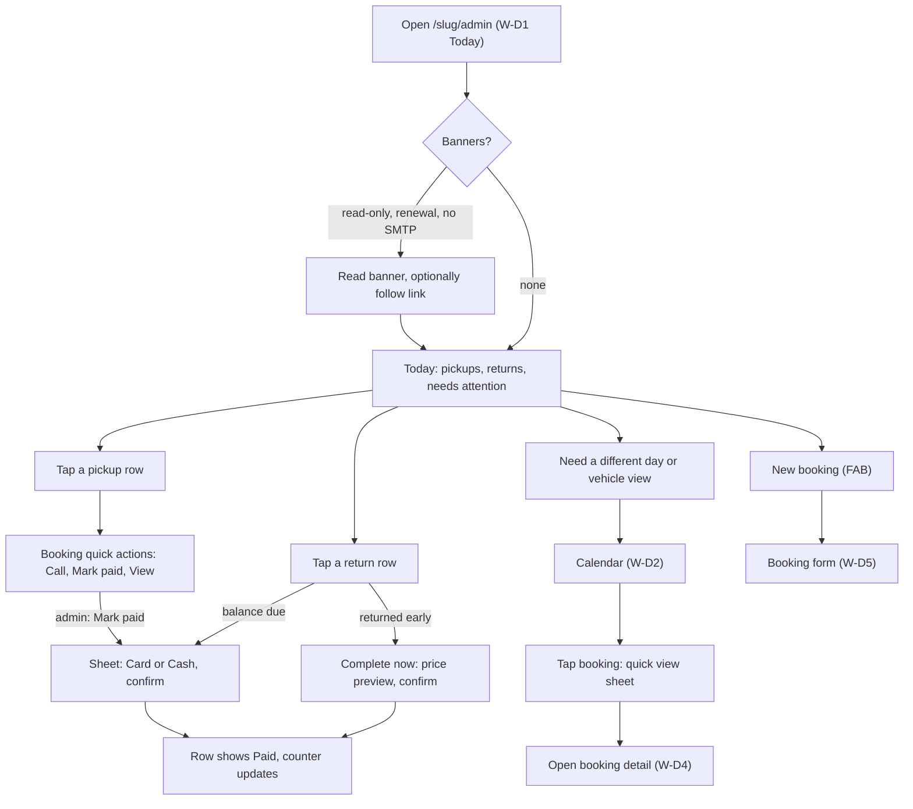
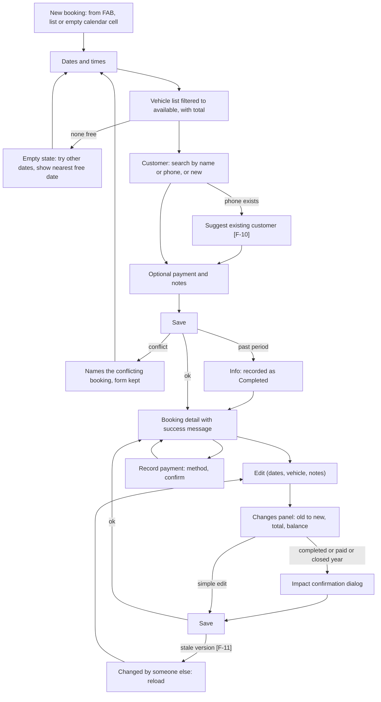
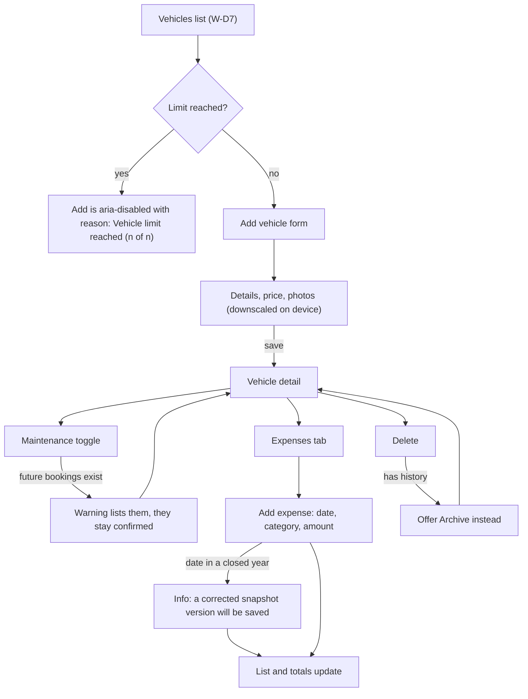
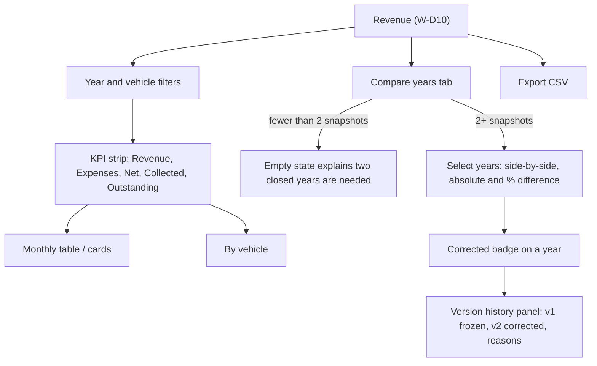
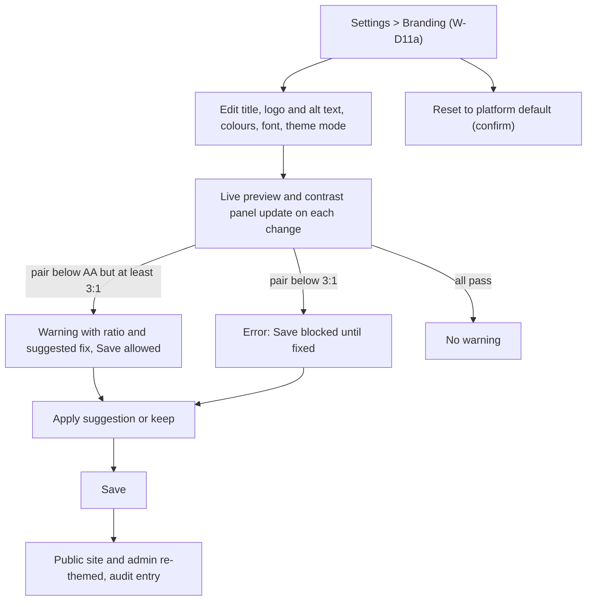
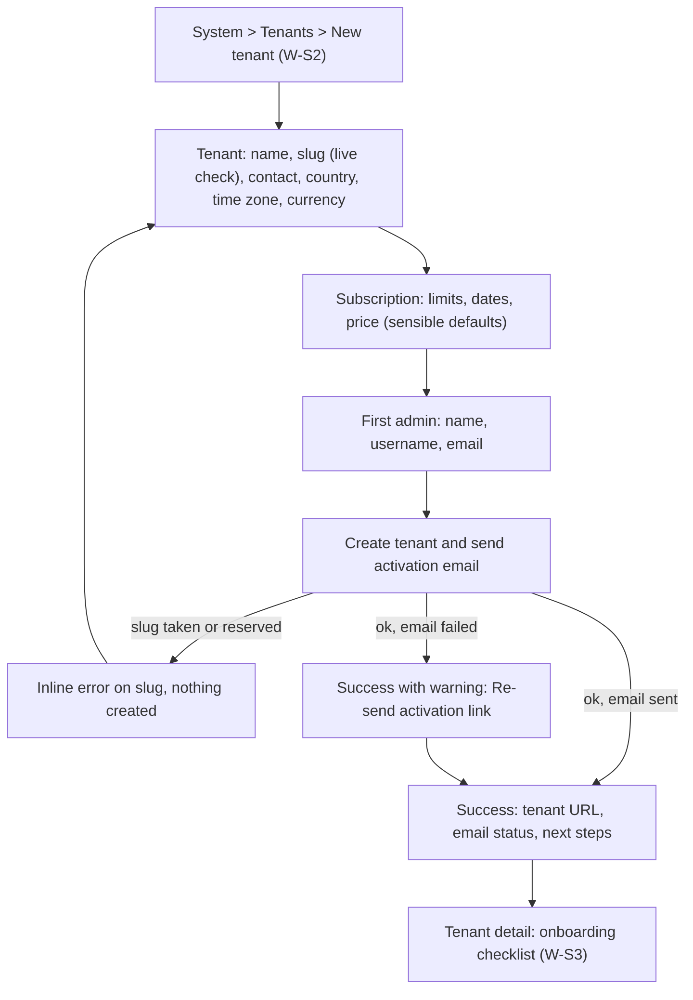
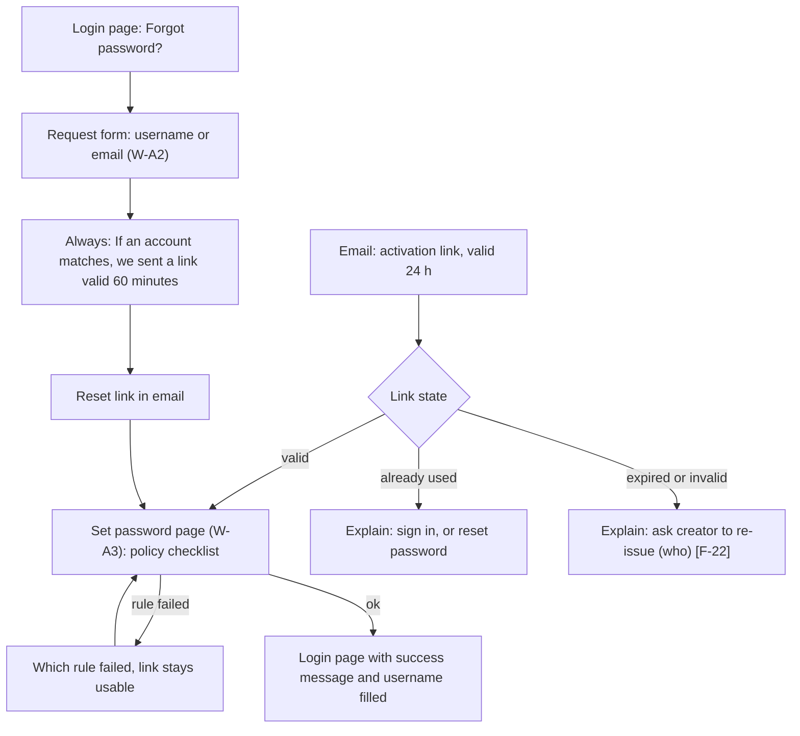
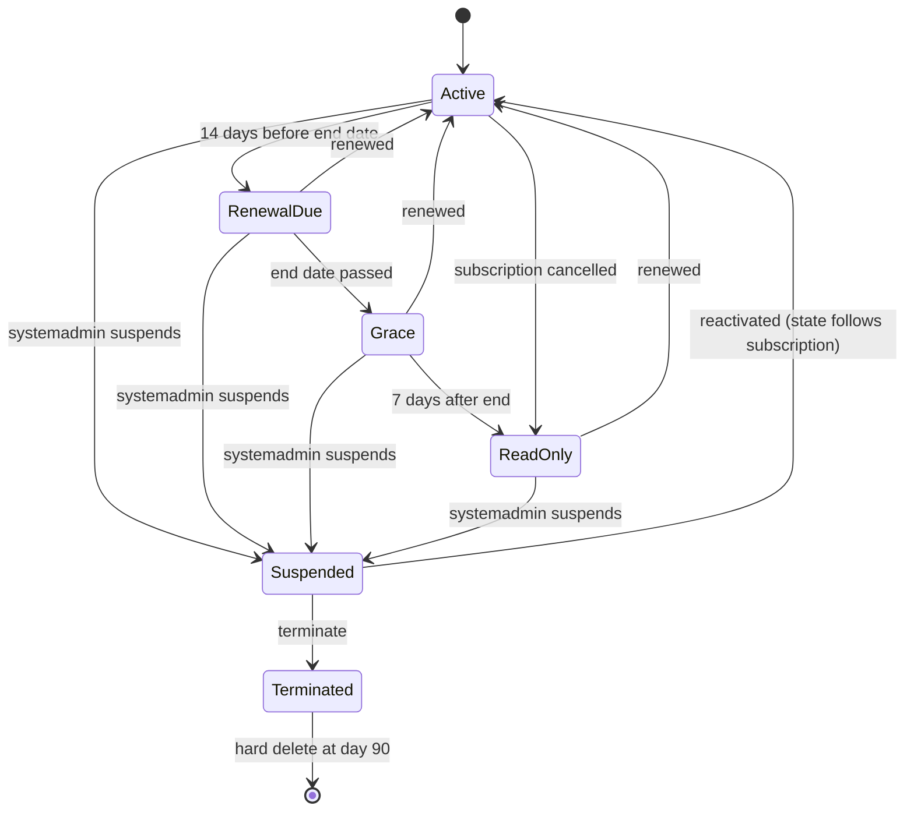

# UX design: RentCar (multi-tenant car rental SaaS)

Version 1.0 · 2026-11-01 · Owner: ux-designer · Phase 4, wave A · Status: draft for approval
Inputs: `docs/02-requisiti.md` v1.2, `docs/spec/car-rental-spec.md` (§6 to §8, §10), `docs/01-discovery.md`, `docs/03-architettura.md` (Option A; routing `/{slug}`, `/{slug}/admin`, `/system`).
Language: English (UI, docs). Next reader: ui-designer (visual design, reads section 1 first), frontend-developer, qa-engineer (section 12), seo-specialist and security-engineer (flags in section 4.4).

Conventions: `Wx` = wireframe id; `Jx` = journey; `S-xx` = shared state pattern (section 6.1); `FR-/US-/AC` = references to `02-requisiti.md`; `ASSUMPTION` = to be confirmed (section 13). Copy in quotes is proposed microcopy and lives in the message catalog (never in code). Money is shown as `€40.00` (tenant currency), dates as `03 Jun 2026`, times in 24 h `10:00` (A-32).

---

## 1. Usage context (input for the ui-designer)

| Persona | Where | Device | Frequency | Competence | Conditions / state of mind | Main goal |
|---|---|---|---|---|---|---|
| **Customer** (traveller, anonymous) | Airport, train, hotel, home sofa, queue; often outside Italy | Own smartphone (iOS Safari, Android Chrome), 320–430 px wide, one-handed; sometimes laptop | Once or twice a year per tenant; never logs in | Low to medium; no knowledge of the tenant's brand; may not read Italian business context | In a hurry, distracted, mobile data of uneven quality, sunlight glare, possibly on a roaming connection; wants certainty that the booking exists | Find a free car for the dates, book in under 2 minutes and 4 screens (KPI-2), keep the booking code |
| **Tenant admin: at the counter / on the move** | Rental counter, car park, in the van between pick-ups | Phone (primary), tablet; one hand, often standing, gloves possible in winter | Many times a day | Medium; knows the business, not software; no training | Interrupted constantly by customers; glance-and-act; poor light; noisy | See who picks up and returns today, take payment, extend or fix a booking in under 30 s |
| **Tenant admin: at the desk** | Office, evening | Laptop or desktop (large screen), also tablet | Daily to weekly | Medium | Calm, doing planning and bookkeeping | Plan the fleet in the calendar grid, record expenses, review revenue, change settings |
| **Operator** (counter staff, view-only) | Counter, car park | Phone or shared counter PC | Several times per shift | Low to medium; short briefing at most | Fast, repeated lookups; must never break anything; a hidden/disabled action must not confuse | Find a booking by code or name, read customer phone, check vehicle availability today |
| **Systemadmin** (platform owner) | Own office or phone | Laptop mainly; phone for quick checks | A few times per week (peaks when onboarding) | High | Focused; wants reliability and audit trail; no developer on hand | Onboard a tenant in 10 minutes or less (KPI-1), renew or suspend subscriptions, recover a locked-out admin |

**Implications for the visual design (ui-designer)**
1. Mobile-first on every surface, including admin. Baseline artboard 375 px, must hold at 320 px; also 768, 1024, 1280. Touch targets 44x44 px on touch viewports, spacing at least 8 px between adjacent targets.
2. Customer flow: calm, high-trust, light. One primary action per screen, a visible running total, large tappable vehicle cards, no marketing noise. Tenant branding drives the look; default theme for `/system` and unbranded tenants.
3. Admin on the move: high contrast (sunlight), large type for the "Today" screen, primary actions reachable with the thumb (bottom action bar, bottom navigation), tap-to-call everywhere a phone number appears.
4. Admin at the desk: denser tables and the full calendar grid; keyboard shortcuts are not required but every action must be keyboard reachable.
5. Colour is never the only signal (status, today, balance, validation, contrast warnings): always icon plus text label. Statuses need an icon set and, in the calendar, a pattern or border style per status (section 7.D2).
6. Tenant palettes are arbitrary: every component must remain legible with any palette that passes the contrast gate (FR-BRD-04); derived variants (hover, disabled, on-colour) come from the theme function, not from hand-picked values.
7. Sticky elements (header, bottom navigation, bottom action bar) must never cover the focused field or content (WCAG 2.4.11); budget their heights as tokens and use `scroll-padding`.
8. Dark mode follows the device unless the tenant forces light or dark (FR-BRD-05). Design both; the contrast gate must cover both.
9. Reduced motion: motion is decoration only; every transition has a no-motion equivalent.

---

## 2. Personas

| Persona | Name used in docs | One-line profile | Key needs | Biggest fears | Permissions |
|---|---|---|---|---|---|
| Customer | "Giulia, 34, tourist landing at Pisa airport" | Needs a car for 3 days, compares prices on her phone while waiting for luggage | Price and total visible early, no registration, instant proof of booking | Being charged online, hidden fees, booking that does not exist | none (anonymous) |
| Tenant admin | "Marco, 47, owner of a 15-car rental shop" | Runs the business from counter, phone and an office laptop; the only admin of the tenant | Know today's pick-ups and returns at a glance; avoid double bookings; know what each car earns | Missing a pick-up, losing revenue data, being locked out | everything in the tenant (permission matrix) |
| Operator | "Sara, 26, counter staff" | Helps customers at the desk, reads the calendar, checks bookings | Find a booking in seconds, call the customer, see if a car is free | Pressing something that changes data | view-only: calendar, bookings with contacts, vehicles without expenses |
| Systemadmin | "Elena, platform owner" | Sells and operates the SaaS alone | Fast onboarding, clear subscription health, recovery tools | Tenant lock-out, expired subscriptions unnoticed, data leaks | platform console only; never sees bookings or customers (A-13) |

---

## 3. User journeys

Friction points are marked `[F-n]` in the diagrams and listed under each. Journeys cover the flows required by the brief; screen ids refer to section 7.

### J1. Public booking (customer, phone, KPI-2: at most 4 screens, at most 2 minutes)


Friction and mitigation:
- F-1 Rules unknown until violated (min/max days, lead time): show the tenant rules as helper text under the form, show "Billed as N days" live, and name the broken rule in the error.
- F-2 Race for the same vehicle (AC4): keep all form data, return to results for the same dates, with a toast-free inline banner.
- F-3 Price changed between search and submit (FR-PUB-11): never silently change the amount; show old and new and relabel the submit button with the new total.
- F-4 Customer fears the booking is not real: confirmation shows the code large, a copy button, a PDF and "Pay on site, nothing was charged".
- F-5 Time zone confusion for travellers: always print "Times are in {tenant time zone} (local time of the rental office)" under date fields and on the summary.
- F-6 Email optional: when omitted, confirmation shows an explicit "Save your code or download the PDF, we won't send an email".

### J2. Admin daily operations: today's pick-ups and returns (admin or operator, phone)


Friction: F-7 staff must act with one hand and interruptions: row actions are inline, two taps maximum; F-8 operators see the same list without actions (hidden, not disabled), phone call stays; F-9 stale data when the screen stays open: pull-to-refresh equivalent button "Refresh" plus automatic refresh on tab focus and every 5 minutes, with "Updated 14:05".

### J3. Create or edit a booking, mark as paid (admin)


Friction: F-10 duplicate customers (phone match is suggested, never forced); F-11 concurrent edits (A-34); F-12 money consequences of edits are easy to miss (balance "Amount due" or "Overpaid" appears live in the changes panel and on the detail).

### J4. Vehicle and expenses (admin)


Friction: F-13 phone photos are 5 to 12 MB: downscale on the device with a progress indicator, no error for large originals; F-14 deleting a vehicle with history: explain archive instead of a dead-end error.

### J5. Revenue and yearly comparison (admin, desk)


Friction: F-15 definitions confuse (revenue = completed bookings by return date): one-line help text under the KPI strip and a "How is this calculated?" disclosure; F-16 a year changes after the fact: "Corrected" badge with date, reason and access to the previous version.

### J6. Branding with contrast warnings (admin)


Friction: F-17 colour pickers are hard for non-designers: accept hex, offer a native swatch, show a live preview and a one-tap suggestion; F-18 warnings must not feel like failure: AA warnings are advice, only below 3:1 blocks.

### J7. Systemadmin onboards a tenant (KPI-1: 10 minutes or less)


Friction: F-19 slug is immutable: show the resulting URL while typing and warn before submit; F-20 time zone and currency are locked after first vehicle or booking: warn at the field; F-21 double submit (US-010): button pending state plus idempotency.

### J8. Activation link, password reset (admin, operator, systemadmin)


Friction: F-22 dead end on expired link: always say who can re-issue it (tenant admin: platform owner; operator: the tenant admin) and show their contact; F-23 password rules: show all rules before typing, mark each pass or fail live with text and icon; allow paste and show/hide (no confirmation field, WCAG 3.3.7/3.3.8); F-24 the SMTP of the tenant is down: the reset page still shows the generic confirmation (no enumeration), the admin sees the failure in Settings > Email.

### J9. Tenant availability states (customer, staff, systemadmin)


What each state looks like: see section 6.3 (banner matrix) and W-P5 (public pages).

### J10. Recover tenant admin access (systemadmin)
System > Tenant > Admin access tab (W-S3c) > choose "Send new access link" (same admin, old password and sessions invalidated) or "Replace admin" (new person, old deactivated) > confirmation dialog stating consequences > success message "Activation email sent to x" or failure with "Re-send". Friction: F-25 the two actions look alike: show them as two cards with plain-language consequences, and default to the milder one.

---

## 4. Information architecture

### 4.1 Public area `/{slug}` (customer, no login, no cookies except none: FR-PUB-13)

```
/{slug}                         W-P1 Search (tenant home; also hosts contact block)
/{slug}/vehicles?pickup=&return=&sort=&category=&fuel=&seats=     W-P2 Results (+ W-P2b Filters sheet)
/{slug}/book?vehicle=&pickup=&return=                              W-P3 Booking form
/{slug}/booking/{code}          W-P4 Confirmation (noindex)
/{slug}/booking/{code}/pdf      PDF download (route handler)
/{slug}/privacy   /{slug}/terms Legal pages when stored as text; external URL otherwise
(any state)                     W-P5 Unavailable / not found pages
```
Query format is human-readable and in the tenant time zone: `pickup=2026-06-01T10:00&return=2026-06-03T10:30`, `sort=price-asc|price-desc`, `category=suv,van`, `fuel=diesel`, `seats=5` (minimum seats). URLs are bookmarkable and survive reload; invalid parameters fall back to the search form with the error shown.

Header: logo (or title text) linking to `/{slug}`; "Contact" link (opens contact block/dialog: phone as tap-to-call, email, address). Footer: Privacy notice · Rental terms · Contact. Contact stays in the same place on every public page (WCAG 3.2.6).

### 4.2 Tenant admin area `/{slug}/admin`

```
/{slug}/admin/login | /forgot-password | /reset-password?token= | /activate?token=        (W-A1..A3, no nav)
/{slug}/admin                              W-D1 Today (home)
/{slug}/admin/calendar?view=&date=&cancelled=   W-D2 grid | month | week | day | agenda
/{slug}/admin/bookings?status=&from=&to=&vehicle=&q=&sort=&page=     W-D3 list
/{slug}/admin/bookings/new?vehicle=&start=       W-D5 create
/{slug}/admin/bookings/{code}                    W-D4 detail
/{slug}/admin/bookings/{code}/edit               W-D5 edit
/{slug}/admin/vehicles?q=&status=&category=&archived=   W-D7 list
/{slug}/admin/vehicles/new
/{slug}/admin/vehicles/{id}                      detail: Details | Bookings | Expenses (admin only)
/{slug}/admin/vehicles/{id}/edit
/{slug}/admin/vehicles/{id}/expenses?category=&from=&to=
/{slug}/admin/customers?q=&page=    /customers/{id}      W-D8   (admin)
/{slug}/admin/operators                          W-D9   (admin)
/{slug}/admin/revenue?year=&vehicle=   /revenue/compare?years=2025,2026   W-D10 (admin)
/{slug}/admin/settings                           index (drill-down list on phones)
  /settings/branding | /booking-rules | /legal | /contact | /email   W-D11 (admin)
/{slug}/admin/activity?entity=&user=&from=&to=&q=  W-D12 audit log (admin)
/{slug}/admin/account                            change own password
```
Role visibility: operator sees Today, Calendar, Bookings, Vehicles (no Expenses tab, no write controls) and Account. Items an operator may not use are **absent**, not disabled. Direct URL access to an admin-only route shows the 403 page (S-F).

### 4.3 Systemadmin console `/system`

```
/system/login | /forgot-password | /reset-password?token=
/system                              redirects to /system/tenants
/system/tenants?q=&status=&sub=&sort=&page=    W-S1 list
/system/tenants/new                  W-S2 create (tenant + subscription + first admin)
/system/tenants/{slug}               W-S3 detail, sections: Overview · Subscription · Admin access · Email · Branding · Audit · Danger zone
/system/activity                     platform audit events (tenant and subscription events)
/system/account                      change own password
```

### 4.4 Flags for parallel work (not edits of their files)
- **seo-specialist**: `/{slug}` is the only page meant for indexing (title and description from tenant title, FR-PUB-14). `/vehicles?...` results, `/book`, `/booking/{code}`, legal fallbacks, all of `/{slug}/admin/**` and `/system/**` should be `noindex`. Results are parameterised and personal, not landing pages.
- **security-engineer**: (1) activation and reset tokens travel in the URL query: the page should consume the token server-side and redirect to a token-less URL, with `Referrer-Policy: no-referrer`; (2) the confirmation URL `/{slug}/booking/{code}` is a capability link (unguessable code, FR-PDF-04): this design shows only vehicle, dates, price and the customer's name (no phone or email) on it, see W-P4 (ASSUMPTION UX-7); (3) the login error and throttling copy never reveals account existence; (4) session timeout warning dialog (section 9) needs an endpoint to extend the session.

---

## 5. Navigation patterns and responsive breakpoints

### 5.1 Breakpoints (Tailwind defaults, so no custom config)
| Token | Width | Layout class | Notes |
|---|---|---|---|
| base | 320 to 639 px | Phone | Design baseline 375, must hold at 320. Single column. |
| sm | 640 to 767 | Large phone / landscape | Still phone patterns (cards, bottom nav, bottom sheets); two-column vehicle cards allowed |
| md | 768 to 1023 | Tablet | Tables return (reduced columns), icon rail navigation, filters as side panel/popover, dialogs instead of full-height sheets |
| lg | 1024 to 1279 | Small desktop | Persistent sidebar, full tables, calendar grid default view |
| xl | 1280+ | Desktop | Wider content (max 1280 admin, 1120 public), side-by-side layouts |

Rules: stacked cards below `md`; "touch" density when `width < 768` **or** `(pointer: coarse)` (targets 44x44, spacing 8); "pointer" density otherwise (targets never below 32 high, always at least 24x24 with spacing, WCAG 2.5.8). Verification widths: 320, 375, 768, 1024, 1280 (the brief lists 320/375/768/1280; 1024 is added because the navigation changes there). Reflow: content reflows without two-dimensional scroll at 320 CSS px (400% zoom) except the calendar grid (WCAG 1.4.10 exception). Long unbreakable text (emails, codes, URLs, plates) must wrap (`overflow-wrap: anywhere`). Landscape phones (height below 500 px): header and bottom bar do not both stay sticky; only the bottom action bar sticks.

### 5.2 Navigation per surface and breakpoint
| Surface | base to sm (below 768) | md (768 to 1023) | lg and up |
|---|---|---|---|
| Public | Top bar: logo + Contact. No menu. Sticky bottom bar only on booking form (total + confirm) | Same, centered content | Same, results with left filter panel |
| Tenant admin | Top app bar (logo, page title, avatar menu) + **bottom navigation**: Today, Calendar, Bookings, Vehicles, More (More = Customers, Revenue, Operators, Settings, Activity; shown only if the role has overflow items). Primary create action as FAB on Today, Calendar, Bookings (admin only) | Left icon rail (labels on hover/focus and expandable), top bar with avatar menu, "New booking" button in top bar | Persistent sidebar with groups Operations (Today, Calendar, Bookings, Vehicles, Customers), Business (Revenue, Operators), Settings (Settings, Activity log); breadcrumb on deep pages |
| Systemadmin | Top bar with **hamburger** opening a drawer (Tenants, Activity, Account, Sign out) | Same hamburger or rail | Sidebar with Tenants, Activity; avatar menu |
| Auth pages | Centered card, no nav | same | same |

Details:
- Bottom navigation has 5 slots at most, each at least 44 px high with icon + visible label, `aria-current="page"` on the current one. It is hidden on full-screen form routes (new/edit booking, add/edit vehicle) where a sticky action bar replaces it (Cancel left, Save right).
- Deep pages show a "Back to {parent}" link in the top app bar on phones; breadcrumbs from `md`.
- The avatar menu always contains: name and role, Account (change password), Sign out. Operators therefore never need "More".
- Filters: bottom sheet below `md`, popover/side panel from `md`, inline filter bar from `lg` on admin lists.
- Forms in overlays (record payment, add expense, cancel): below `md` they open as bottom sheets with a visible Close button; from `md` as centered dialogs. Short confirmations are centered dialogs at any size.
- Tabs: up to 3 tabs inline at 320 px; more than 3 sections become a drill-down list or a "Section" select on phones (no horizontally scrolling tab strip, to keep "no horizontal scroll" clean). Vehicle detail (3 tabs) stays tabs; tenant detail in `/system` (7 sections) and Settings use a list on phones.

---

## 6. Cross-cutting patterns

### 6.1 State catalogue (every list, calendar and form uses these; FR-UX-10)
| Id | State | Pattern | Copy rule |
|---|---|---|---|
| S-L | Loading | Skeleton of the final layout shown after 300 ms (no flash); container `aria-busy="true"`; a visually hidden "Loading {thing}" status. Actions: button shows spinner, label changes to "Saving…", button disabled, form not cleared. Under reduced motion skeletons are static. | Never a blank screen; never a full-page spinner for partial loads |
| S-E | Empty (first use) | Icon, one-line reason, one primary next action | "No vehicles yet. Add your first vehicle." |
| S-E2 | Empty (filtered) | Different from first use: "No bookings match these filters." + "Clear filters" button | Always offers the way out |
| S-R | Error (load failed) | In-place error block with plain reason, "Try again" button, and a reference id when the server provides one; the rest of the page stays usable | "We couldn't load bookings. Check your connection and try again." |
| S-F | No permission / not found | Full-page, friendly, with link home. Cross-tenant or unknown ids show the **same** not-found page (no disclosure) | "You don't have access to this page." / "We couldn't find that page." |
| S-RO | Read-only tenant | Persistent banner (section 6.3) and write controls shown **disabled with a visible reason** (`aria-disabled` + text, still focusable), except operations FR-ENF-01 keeps allowed | "Unavailable while your subscription is read-only." |
| S-X | Conflict / stale | Inline banner at form top, form data kept, names the conflicting booking with a link | "Fiat Panda is already booked from 03 Jun 10:00 to 05 Jun 10:00 (booking AB12-CD34)." |
| S-O | Offline / network | Inline error on the failed action with Retry; submitted data is kept; no data loss | "You seem to be offline. Your changes are still here. Try again when you're back online." |
| S-T | Session expired | Dialog "Your session expired. Sign in to continue." over the page, form state kept in memory, after sign-in the pending action is retried once | |

Rule of thumb for hidden vs disabled: **permission** (role) = absent; **state or limit** (read-only, limit reached, cancelled booking) = visible, `aria-disabled`, with a visible reason.

### 6.2 Status vocabulary (text + icon + shape, never colour alone)
| Domain | Values | Notes |
|---|---|---|
| Booking | Confirmed, Active, Completed, Cancelled | Icon per status; cancelled also struck-through text in lists; in calendar a distinct border/pattern each |
| Payment | Paid, Unpaid, "Amount due €40.00", "Overpaid €20.00" | Balance sign shown as word and sign, never colour only |
| Vehicle | Available, Rented (derived), Maintenance, Archived | "Rented" shows "until 05 Jun 10:00" where space allows |
| Operator | Active, Pending activation, Activation not delivered, Deactivated | |
| Tenant | Active, Suspended, Terminated (deletes on 30 Jan 2027) | |
| Subscription | Active, Renewal due (n days), Grace (n days left), Read-only (expired), Cancelled | derived by the system |
| Email | Sent, Failed (reason), Not requested, No email address | |

### 6.3 Banner matrix (admin shell, below the top bar; one stacked region, `role="status"`, max 2 visible, rest summarised "2 more notices")
| Condition | Severity | Dismissible | Copy |
|---|---|---|---|
| Renewal due (14 days before end through grace) | Info then Warning inside grace | No | "Your subscription ends on 12 Dec 2026 (in 9 days). Contact {platform owner} to renew." |
| Grace period | Warning | No | "Your subscription ended on 12 Dec 2026. Everything works until 19 Dec 2026. After that, online booking stops and the admin becomes read-only." |
| Read-only (expired after grace) | Error-level | No | "Read-only: your subscription ended. You can view everything, record payments, change booking status and export CSV. Contact {platform owner} to renew." |
| Subscription cancelled | Error-level | No | "Read-only: your subscription was cancelled. …" same capabilities |
| Tenant SMTP missing or failing | Warning | Per session | "Emails are not being sent. Customers won't receive confirmations. [Fix email settings]" |
| No privacy notice or terms | Warning | Per session | "Add your privacy notice and rental terms before going live. [Open legal settings]" |
| Suspended | n/a (session invalid) | n/a | Login page message (W-A1) |

Operators see the read-only and subscription banners (informational) but never the SMTP and legal ones (admin concerns).

### 6.4 Formats
Dates `03 Jun 2026`, date-time `03 Jun 2026, 10:00`, always in the tenant time zone; when a user's browser zone differs, public and admin date fields show "Times are in Europe/Rome". Durations "3 days". Money `€1,234.50` with `Intl` in `en` and the tenant currency. Phone numbers displayed in international format and always a `tel:` link. Booking code `K7M2-9QXA` in monospace, uppercase, with a copy button.

---

## 7. Wireframes

Notation: `[Block]` = region; `{…}` = dynamic content; `→` = navigates; "Phone" = below 768 px, "Tablet" = 768 to 1023, "Desktop" = 1024+. Every screen lists **States** (S-L loading, S-E empty, S-R error, S-F forbidden, S-RO read-only, S-X conflict) with the screen-specific copy; shared behaviour comes from section 6.1.

### 7.P Public area

#### W-P1. Search `/{slug}` (AC3, FR-PUB-01/02)
```
[Header: logo/title · Contact]
[Hero: H1 "{Tenant title}" · one-line subtitle from tenant contact/tagline (optional)]
[Search card (form, role=search)]
  [Fieldset "Pickup"]  Date (native date, min = earliest allowed)  ·  Time (select, 15-min steps)
  [Fieldset "Return"]  Date  ·  Time
  [Live line] "Billed as 3 days" (appears when both valid)   [Helper] "Rentals of 1 to 30 days. Pickup at least 3 hours from now. Times are in Europe/Rome."
  [CTA primary full width] "Search available vehicles"
[Trust strip: "Pay on site by card or cash" · "No registration" · "Prices include VAT"]
[Footer: Privacy notice · Rental terms · Contact]
```
Defaults (ASSUMPTION UX-2): pickup tomorrow 10:00, return two days later 10:00, the earliest valid values if the lead time requires; the Billed-as line makes them visible.
Phone: fields stacked (date and time side by side in one row each, time select 44 px high); CTA full width, sticky not needed. Desktop: 4 fields in one horizontal bar next to the CTA.
States: S-L on submit (button "Searching…", fields kept); validation errors inline under the field and in an error summary on submit ("Return must be after pickup", "Pickup can't be in the past", "Earliest pickup is 03 Jun 2026, 13:00 (3 hours notice)", "Rentals must be at least 2 days", "Rentals can be at most 10 days"); S-R "We couldn't search right now. Try again." (inputs kept); rate limit (5 searches/min/IP): "Too many searches. Wait a minute and try again."; tenant unavailable → W-P5 instead of the form. No empty state (the form is the content).

#### W-P2. Results `/{slug}/vehicles?...` (AC3, FR-PUB-03/04)
```
[Header]
[Summary bar] "Fri 03 Jun 10:00 → Sun 05 Jun 10:00 · 3 days"  [Change dates] (opens the search card inline / sheet)
[Toolbar] [Sort select: Price low to high | Price high to low]  [Filters button with count badge]
[Active filter chips] SUV ✕  5+ seats ✕   [Clear all]
[Live region, visually hidden + visible text] "12 vehicles available"
[Vehicle cards list, 1 column phone, 2 columns sm to md, 3 columns lg+]
  Card: [Photo 4:3, 480 px variant, lazy] [Name H2] [Category chip] [Fuel icon+text · Seats icon+text]
        [Price line] "€40.00 / day"   [Total line, emphasised] "3 days · €120.00 total"
        [Button primary full width] "Select"  (accessible name "Select Fiat Panda")
[Footer]
```
Sort default price ascending, ties by name. Photo: cover photo; if more than one photo, a "n photos" button opens a gallery dialog (Should; ASSUMPTION UX-3). No photo: neutral placeholder with car icon.
States: S-L skeleton of 3 cards with "Searching available vehicles…"; empty (no availability): "No vehicles available for these dates." + [Change dates] + hint "Try shorter rental or different days"; empty filtered: "No vehicles match your filters." + [Clear filters]; S-R "We couldn't load vehicles." + [Try again]; invalid or missing params: redirect to W-P1 with the field errors; vehicle became unavailable after load: handled at booking (W-P3).
Phone: card image on top, price block and Select button below; Select is the only tappable control in the card besides the name (no nested interactive elements, whole card not a link). Desktop: left filter panel (not sheet), results grid.

#### W-P2b. Filters sheet (FR-PUB-04, US-021)
```
[Bottom sheet (phone/tablet) · role=dialog, labelled "Filters" · focus trapped · Esc closes · background inert]
[Header] "Filters" · [Close ✕ 44x44]
[Group "Category"]  checkboxes: City, Compact, Sedan, SUV, Van, Convertible, Luxury, Other  (only categories present in results, with counts)
[Group "Fuel"]      checkboxes: Petrol, Diesel, Hybrid, Plug-in hybrid, Electric, LPG/CNG
[Group "Seats"]     radio: Any, 2+, 4+, 5+, 7+
[Sticky footer] [Clear all (secondary)]  [Show 7 vehicles (primary, live count)]
```
Filtering is client-side on the loaded result set (few dozen vehicles) with URL kept in sync. Rows at least 44 px high. If a combination yields 0, the primary button reads "No vehicles" and is aria-disabled with the hint "Remove a filter to see vehicles". Closing returns focus to the Filters button. States: not applicable beyond the zero case. Desktop: same groups rendered as a static left panel, live applied.

#### W-P3. Booking form `/{slug}/book` (FR-PUB-05..11)
```
[Header: ← Back to results]
[H1 "Your details"]
[Booking summary card, collapsible on phone (expanded on desktop)]
  Vehicle name+photo · "03 Jun 10:00 → 05 Jun 10:00 (Europe/Rome)" · "3 days × €40.00" · [Total €120.00, VAT included]  [Change]
[Form]
  First name (autocomplete given-name)   Last name (family-name)
  Phone (type=tel, inputmode=tel, autocomplete=tel)  helper "The rental office may call or text you about this booking."
  Email (optional)  helper "Optional. We'll email your booking summary."
  [Honeypot: off-screen, tabindex -1, aria-hidden, autocomplete off]
[Notice] "Pay on site by card or cash. Nothing is charged now."
[Legal line] "By continuing you acknowledge the {privacy notice} and {rental terms}."  (links; external URLs open in new tab and say "(opens in new tab)")
[Sticky bottom bar on phone: Total €120.00 · [Confirm booking primary]]   (desktop: right column summary + button)
```
Validation (on blur, then on change; on submit an error summary at the top receives focus): "Enter your first name", "Enter your last name", "Enter a phone number we can call, for example +39 333 123 4567", "Enter a valid email address or leave it empty".
States:
- S-L submit: button "Confirming…", disabled, form kept, announced via live region; idempotency key prevents double booking on retry.
- S-X vehicle taken (FR-PUB-08): banner "Sorry, {vehicle} was just booked by someone else. Your details are saved. [See other vehicles for the same dates]" → W-P2.
- Price changed (FR-PUB-11): warning banner "The daily price changed from €40.00 to €45.00. New total: €135.00." Button becomes "Confirm at €135.00"; focus moves to the banner.
- Rate limit: "Too many booking attempts from this connection. Please try again later."
- Phone limit: "You already have 3 upcoming bookings with {Tenant}. Please call {phone} to change them."
- Tenant became unavailable meanwhile: "{Tenant} can't take online bookings right now. Please contact them: {phone}." (details kept visible).
- S-R/S-O: "We couldn't complete your booking. Nothing was lost; try again." (safe to retry, idempotent).
- Missing or tampered query params (vehicle no longer exists, dates invalid): redirect to W-P2 with explanation.
- Empty/forbidden: not applicable.
Draft retention: form values kept in memory/`sessionStorage` (no cookie) when going back to results or after a conflict.

#### W-P4. Confirmation `/{slug}/booking/{code}` (FR-PUB-07, AC3)
```
[Header]
[Success header, focus moved here on load, role=status] ✓ H1 "Booking confirmed"
[Code panel] "Your booking code"  K7M2-9QXA (large, monospace, selectable)  [Copy code] → "Copied" (live)
[Summary card] Vehicle · Pickup 03 Jun 2026, 10:00 · Return 05 Jun 2026, 10:00 (Europe/Rome) · Customer: Giulia R. · 3 days × €40.00 = €120.00 (VAT included)
[Pay on site] "Pay by card or cash when you pick up the car. Nothing was charged."
[Email line] with email: "We're emailing your summary to g***@example.com." · without: "You didn't give an email, so we won't send one. Save your code or download the PDF."
[Actions] [Download PDF primary] [Call {Tenant} (tel)] [Book another vehicle (text link)]
[Footnote] "To change or cancel your booking, contact {Tenant}: {phone}, {email}."
```
Page is `noindex`, no tracking. Shows the customer's name but no phone or email (capability-link minimisation, ASSUMPTION UX-7). The email line does not promise delivery: sending is asynchronous (FR-MAIL-05), so copy is "We're emailing…" and the PDF is always available. States: S-L of PDF: button shows "Preparing PDF…"; PDF failure: "We couldn't create the PDF. Your booking is confirmed; try again or contact {Tenant}."; invalid or unknown code: W-P5 not found; page revisit later: same content (read-only).

#### W-P5. Unavailable and not-found pages (US-025)
```
Suspended:   H1 "{Tenant} is temporarily unavailable"  · "Online booking is paused. Please contact them directly." · [Phone tap-to-call] [Email]   (no search form; tenant theme; noindex)
Past grace / cancelled subscription: H1 "Online booking is currently unavailable" · same contact block
Unknown slug: H1 "Page not found" · "Check the address or ask the rental office for the right link." (platform default theme, no tenant info)
Terminated: treated as Suspended wording.
```
States: S-L not needed; error pages carry no dynamic data beyond tenant name and contact. Contact fields come from tenant contact info (required at tenant creation).

### 7.A Authentication (tenant and system, same templates)

#### W-A1. Login (`/{slug}/admin/login`, `/system/login`; FR-AUTH-01/02)
```
[Centered card, tenant logo/title (system: platform logo)]
[H1 "Sign in"]
[Username (autocomplete username)]  [Password (autocomplete current-password) + Show/Hide button]   (paste allowed)
[Primary "Sign in"]  [Link "Forgot your password?"]
```
States: S-L "Signing in…"; wrong credentials, deactivated, not yet activated: always "Incorrect username or password." (`role="alert"`, field focus returns to username); throttling: "Too many attempts. Try again in a few minutes."; suspended tenant: card replaced by "Access to {Tenant} is suspended. Contact {platform owner}: {email}" with no form; read-only/expired tenants log in normally; session expired redirect: info line "Your session expired. Sign in to continue." with return-to preserved (internal paths only); logged-in user visiting login: redirect to Today; success after set-password: green status line "Password set. You can sign in now." with username prefilled.

#### W-A2. Forgot password and W-A3. Set or reset password
```
Forgot:  [H1 "Reset your password"] [Field: Username or email] [Primary "Send reset link"] [Link "Back to sign in"]
         Result (always, same text): "If an account matches, we've sent a link. It's valid for 60 minutes."
Set/reset: [H1 "Set your password" (activation) / "Choose a new password" (reset)]
         [New password + Show/Hide] [Rules checklist, live, text+icon: "At least 12 characters", "Different from your username", "Not a commonly used password"]
         [Primary "Set password"]
```
States: S-L; rule failure keeps the link usable and marks the failed rule (the common-password check is server-side and appears after submit: "This password is too common. Choose a longer or less predictable one."); link used: H1 "This link was already used" · "If you already set your password, sign in." [Sign in]; link expired (24 h/60 min): H1 "This link has expired" · activation: "Ask {creator} to send you a new one" (admin: platform owner with contact; operator: your administrator) · reset: [Request a new link]; invalid link: H1 "This link isn't valid" with the same help; throttled: generic "Try again later". Suspended tenant: as W-A1. System SMTP/tenant SMTP down: user still sees the generic confirmation.

#### W-A4. Account `/…/account` (change own password)
`[H1 "Account"] [Name, username, role (read-only)] [Section "Change password": Current password · New password (+rules) · Primary "Change password"]`. Success: status "Password changed. Other devices were signed out." S-R "Current password is incorrect." Operators and admins share it; read-only tenants may use it (FR-ENF-01).

### 7.D Tenant admin

Common shell: top app bar (logo, title, avatar menu), notice region (6.3), main, bottom navigation (phone). FAB "New booking" (admin, phone) on D1, D2, D3. "Last updated 14:05 · Refresh" on live screens.

#### W-D1. Today `/{slug}/admin` (home)
```
[Notice region]
[H1 "Today" · "Fri 12 Jun 2026"]   [New booking primary (desktop/tablet)]
[Counters row, 2x2 on phone] Pickups today 4 · Returns today 3 · Rented now 7 of 15 · Available now 6   (each links to the matching list/calendar)
[Section "Pickups today (4)" — sorted by time]
  Row: 09:30 · Rossi, Mario · Fiat Panda · K7M2-9QXA · [Paid | Unpaid chip]   [Call] [Mark paid]  (admin) / [Call] (operator)
[Section "Returns today (3)"]
  Row: 11:00 · Bianchi, Anna · Audi A3 · … · [Amount due €40.00]  [Call] [Complete now / Mark paid]
[Section "Needs attention"] completed or active bookings with an unpaid balance (max 5, "View all"), email delivery failures count
[Section "Setup" (admin, until done)] checklist links: privacy notice, email settings, first vehicle, branding
```
Tap on a row opens the booking quick view (same sheet as the calendar, W-D2); a row is one link to detail with separate buttons for actions (no nested interactives: row title is the link, buttons are siblings). Mark paid opens the payment sheet (W-D4). "Complete now" appears only for active bookings and opens the early-return preview.
States: S-L skeleton with 3 rows per section; S-E for a section: "No pickups today." (no CTA) ; whole day empty with fleet: "Nothing scheduled today. [Create a booking]"; no vehicles at all (new tenant): "Add your first vehicle to start taking bookings. [Add vehicle]"; S-R per section ("Couldn't load today's pickups. [Try again]") so one failure does not blank the page; S-RO banner and payment/status actions still enabled (FR-ENF-01), "New booking" aria-disabled with reason; operator: no actions except Call/View; S-F not applicable.

#### W-D2. Calendar `/{slug}/admin/calendar` (AC5, FR-CAL-01..10)
```
[Toolbar] [← Prev] [Today] [Next →]  [Date label "June 2026" (button → native date picker)]
          [View: Grid | Month | Week | Day | Agenda]  (segmented ≥768; dropdown select <768)   [☐ Show cancelled]
[Legend row (collapsible on phone)] icon+pattern+label per status, Maintenance, Today
[View body]
[Quick view sheet/panel on booking tap]
```
Period and view are in the URL (`?view=grid&date=2026-06-12`). Defaults: Day on phone, Grid on desktop; the user's last choice is remembered in `localStorage` per device. Only the visible range is fetched.

**Grid view (vehicles x days, month window; Week view is the same component with 7 days)**
```
            |  Today ▼  |
Vehicle ▲   | Fri 12 | Sat 13 | Sun 14 | …   ← sticky header row (dates; today has "Today" tag, bold, top marker)
Audi A3     | [██ K7M2-9QXA Rossi ███████]  |
 AB123CD    |
bmw X1      |              [▒▒ MAINTENANCE ▒▒▒▒▒▒▒]   ← hatched pattern + wrench icon + label
Fiat Panda  | [▓▓ ACTIVE · Bianchi ▓▓]  ...
```
- Rows sorted by name, case-insensitive, natural order (Audi A3, bmw X1, Fiat Panda). Sticky first column (vehicle name + plate) 96 to 112 px on phone (name wraps to two lines, never truncated without full name available in the quick view and `aria-label`), sticky header row; cells at least 44 px wide and rows 56 px high on touch.
- The grid is the only element that scrolls horizontally; the page itself never does. On load it scrolls today into view (instant when reduced motion).
- Booking bars continue across the days covered; status encoded by icon + text label + border/pattern (confirmed: solid with check icon; active: solid with car icon and thicker top border; completed: muted with check; cancelled (if shown): dashed outline with strike-through; maintenance: diagonal hatch with wrench). Bar text: code + customer surname when width allows, otherwise code only; full text always in `aria-label`.
- Today column: tinted background **plus** "Today" label in the header and a bold date (not colour alone).
- Rented now: vehicle name cell shows a small "Rented" badge. Archived vehicles appear only if they have bookings in range, marked "Archived" (A-18).
- Tap/click a bar: opens quick view. Empty cell (admin): tap opens "New booking" prefilled with vehicle and start date (Could, FR-CAL-09); operators get no action.
- Keyboard: grid pattern with roving tabindex. Arrow keys move between day cells and vehicle rows, Home/End to first/last day of the row, PageUp/PageDown previous/next period, Enter or Space on a booking opens quick view, on an empty cell (admin) starts a new booking, Esc closes the quick view and returns focus to the cell. See section 9.3 for ARIA.

**Month view** (calendar-style grid of dates, one cell per day)
```
[Mon … Sun header] 6 rows of day cells; each cell: date number, then compact lines "3 pickups" "2 returns" (text), a dot row only as a supplement
Tap a day → Day view for that date. Today cell: outlined, bold number, "Today" visually hidden + visible small tag.
```
Phone: cells show the date and a count badge ("5") and are 44 px tall minimum; tapping goes to Day view. This answers "how busy is the month" while Grid answers "which car".

**Day view (default on phone)**
```
[Date label "Fri 12 Jun 2026" + prev/next]  [Summary "4 pickups · 3 returns · 6 free"]
[Vehicle cards sorted by name]
  Card: Fiat Panda · AB123CD · [Rented | Available | Maintenance chip]
        Booking line(s) touching this day: "Pickup 09:30 → Return 05 Jun 10:00" · K7M2-9QXA · Rossi · [Unpaid]   ← tap = quick view
        Slim 24 h bar (supplement, aria-hidden): occupied hours
        Free all day: "Free all day" + [Book] (admin)
```

**Agenda view (non-visual equivalent, NFR-A11Y-02)**: for the visible range grouped by day with `<h3>` per day: time, vehicle, customer, code, status, payment; pickups and returns listed as separate entries "10:00 Pickup · Fiat Panda · Rossi"; same quick view on activate. It is a real list (`<ul>`), not a grid.

**Quick view (sheet on phone, side panel on desktop; role=dialog, not modal on desktop)**
`Code · status chip · payment chip` / Vehicle / Customer name + [Call] [Email] / Pickup / Return / Total, balance / [Open booking] (primary) [Mark paid] (admin only, if unpaid). Operator: no payment action.

States: S-L skeleton rows (keep sticky column and headers visible); S-E (no vehicles): "No vehicles yet. [Add vehicle]" (admin) or "No vehicles to show." (operator); range with no bookings: grid shown normally with a status line "No bookings in this period."; S-R "We couldn't load the calendar. [Try again]" keeping toolbar; S-RO banner, empty-cell create disabled; cancelled hidden by default with the toggle (count in label "Show cancelled (2)"); S-F n/a. Very large fleet: vehicles virtualised, header sticky.

#### W-D3. Bookings list `/{slug}/admin/bookings` (FR-BKG-01)
```
[H1 "Bookings"] [New booking] [Export CSV (admin)]
[Search "Code, name or phone"] [Filters: Status (chips: All, Confirmed, Active, Completed, Cancelled), Date range, Vehicle] [Sort: Pickup date ▼]
[Result count "40 bookings"]
Desktop/Tablet table columns: Code · Customer · Vehicle · Pickup · Return · Total · Payment · Status (row link on code)
Phone cards: Code + status chip / Customer (tap-to-call icon) / Vehicle / "03 Jun 10:00 → 05 Jun 10:00" / "€120.00 · Unpaid"
[Pagination: Previous · Page 2 of 4 · Next; 25 per page; page in URL]
```
Filters: bottom sheet on phone, inline bar on desktop; all in URL (US-050). Export respects current filters and shows "Preparing export…" then downloads; above 50,000 rows: "Too many rows (limit 50,000). Narrow the filters." (A-38).
States: S-L skeleton of 6 rows/cards; S-E first use: "No bookings yet. Bookings from your public page and ones you create will appear here. [New booking]"; S-E2 "No bookings match these filters. [Clear filters]"; S-R; S-RO "New booking" aria-disabled, export enabled; operator: no New booking, no export.

#### W-D4. Booking detail `/{slug}/admin/bookings/{code}` (FR-BKG-02, US-052/053/054)
```
[← Bookings] [H1 K7M2-9QXA + copy]  [Status chip] [Payment chip]
[Primary action bar (admin; sticky bottom on phone)] one primary by state + [More actions ▾]
   confirmed/active/completed with balance > 0 → "Record payment"; active fully paid → "Complete rental"; otherwise "Edit"
   More: Edit, Mark as active (confirmed), Complete rental (active), Mark unpaid (paid), Cancel booking, Resend email, Download PDF
[Card Customer] Name (link to customer, admin only) · [Call] phone · [Email] address
[Card Rental] Vehicle (link) · Pickup · Return (Europe/Rome) · Billed days · Source: Public / Admin · Created
[Card Price and payment] "3 days × €40.00 = €120.00" · Paid €120.00 (Card) · Balance: "Paid in full" | "Amount due €40.00" | "Overpaid €20.00 (refund outside the system)"
[Card Notes] + warning "Do not enter card numbers or identity document data."
[Card Email] Confirmation: Sent 03 Jun 09:12 | Failed: {reason} [Resend] | Not requested (no email)
[Section History (collapsed on phone)] audit entries: time · who · what changed (old → new)
```
Dialogs (sheets on phone):
- **Record payment**: segmented "Card | Cash", amount line "Amount received €120.00 (full total)" (static; if already paid with a different total: "Update payment to the current total €160.00"), buttons [Mark as paid] [Cancel]. Allowed in read-only.
- **Mark unpaid**: "Mark this booking as unpaid? The payment record will be cleared and the change is logged." [Mark as unpaid] [Keep as paid].
- **Complete rental** (early): shows computed preview "Return time becomes 12 Jun 2026, 14:00. Billed days 3 → 2. Total €120.00 → €80.00." [Complete rental] [Cancel]. If after scheduled end: no preview, simple confirm.
- **Mark as active** (before start): "Mark as active now? Automatic updates won't undo this." 
- **Cancel booking**: reason (optional, 200 chars, notes warning), consequences list "The vehicle becomes free for these dates. This booking leaves revenue figures. This can't be undone." + if paid "This booking is marked paid. Refunds happen outside RentCar." Buttons [Keep booking] (default focus) [Cancel this booking] (destructive). Not offered for completed or cancelled.
States: S-L skeleton cards; S-R; not found or other tenant: S-F "We couldn't find that booking."; cancelled booking: all action buttons absent except Download PDF and a cancelled notice "Cancelled on 04 Jun 2026: {reason}"; S-RO: Edit and Cancel? Cancel stays allowed (status update), Edit aria-disabled with reason, Record payment and status updates enabled; operator: only Call, Email, Download? (no PDF/resend), history hidden (audit not accessible); dialog errors: network S-O, conflict n/a, stale "This booking changed. Reload to see the latest version."

#### W-D5. Create and edit booking (`/bookings/new`, `/bookings/{code}/edit`; FR-BKG-06/16/17)
```
[Top bar: ← Cancel · H1 "New booking" / "Edit K7M2-9QXA"]   (full-screen, no bottom nav; sticky action bar: [Cancel] [Save booking])
[Section 1 "Dates"]  Pickup date+time · Return date+time · "Billed as 3 days" · "Times are in Europe/Rome"
[Section 2 "Vehicle"] radio-card list of vehicles **available for these dates** (name, plate, price/day, total) · toggle "Show unavailable" (greyed with reason: Booked / Maintenance)
     live availability line, role=status: "Checking availability…" → "Available. Total €120.00" | "Not available: conflicts with booking AB12-CD34 (01 Jun 10:00 → 03 Jun 10:00)"
[Section 3 "Customer"] combobox search by name or phone (min 2 chars) → pick existing, or "New customer": first name, last name, phone, email (optional)
     duplicate phone notice: "A customer with this phone already exists: Mario Rossi. [Use this customer]"
[Section 4 "Payment" (optional, create only)] "Already paid?" · Card | Cash
[Section 5 "Notes"] textarea + warning "Do not enter card numbers or identity document data."
[Panel "Changes" (edit only, live)] Field · Old → New for dates, vehicle; Total €120.00 → €160.00; Paid €120.00; "Amount due €40.00"
```
Edit rules by status: confirmed: all fields editable; active: start date/time is locked with helper "The rental has started, so the start can't change." and the end can't be before now; completed: dates and vehicle editable, helper "Changing the return date moves this booking's revenue to that month."; paid: balance shown (never auto-refunded); cancelled: edit route redirects to detail with "Cancelled bookings can't be edited."
Impact confirmation dialog (only for completed, paid-with-total-change, or when a closed year is touched): "This changes the total from €120.00 to €160.00. The booking is paid €120.00, so €40.00 will be due. [Save changes] [Keep editing]" and, for closed years: "It also changes 2026, a closed year. A corrected yearly snapshot (version 2) will be saved." Past period on create: info "This period is in the past, so the booking will be recorded as Completed."
States: S-L initial load (edit) skeleton, availability check spinner; S-X conflict at save: banner with link to the conflicting booking, form kept, vehicle section scrolled into view; stale version (A-34): banner "This booking was changed by someone else at 14:02. [Reload latest] discards your edits. [Keep editing] and save will be refused until you reload." (explain that, no silent overwrite); S-E no vehicle free: "No vehicles are free for these dates. Try other dates." + nearest next free date if available; maintenance: "Fiat Panda is in maintenance and can't be booked for future dates."; limits/duration errors same wording as the public search (admin does not override rules, no override); S-RO: whole form replaced by "Booking changes are unavailable while your subscription is read-only. You can still record payments and update status. [Back to booking]"; operator: 403 page; S-T session expiry keeps the form; unsaved changes guard on navigate away; save success: redirect to detail with status message "Booking updated".

#### W-D7. Vehicles (list, detail, form, expenses) (FR-VEH-01..11)
**List `/vehicles`**
```
[H1 "Vehicles"] [Usage "12 of 15 vehicles" meter with text] [Add vehicle (admin)]
[Search "Name or plate"] [Filter: Status, Category] [☐ Show archived]
Rows/cards: thumbnail · Name · plate · category · fuel · seats · €/day · status chip (Available / Rented until… / Maintenance / Archived)
```
Add at limit: button stays focusable, aria-disabled, with visible text "Vehicle limit reached (15 of 15). Contact {platform owner} to raise it."; read-only: "Unavailable while your subscription is read-only."
States: S-L; S-E "No vehicles yet. Add your first vehicle to start taking bookings. [Add vehicle]" (operator: "No vehicles yet."); S-E2 with Clear filters; S-R.

**Detail `/vehicles/{id}`**: Header (photo gallery as a simple strip with large preview, name, plate, status chip, [Edit] [Maintenance toggle] admin). Tabs: **Details** (specs, price, notes), **Bookings** (past/upcoming list, reuses booking cards), **Expenses** (admin only, section W-D7c). States: S-L, S-R, not found S-F; archived: banner "This vehicle is archived. It is hidden from customers and new bookings; its history stays in your figures." with [Unarchive]? (no such requirement: do not offer; ASSUMPTION none).

**Form `/vehicles/new`, `/vehicles/{id}/edit` (full screen with sticky action bar)**
```
[Section "Basics"] Name* · Plate* · Make · Model
[Section "Specs"] Category (select, 8 values) · Fuel type (select, 6 values) · Seats (number 1–9)
[Section "Price"] Daily price (€ prefix, inputmode decimal) "Changes apply to new bookings only."
[Section "Photos"] [Add photos] (accept image/*, multiple, camera allowed) · grid of up to 10 · each: thumbnail, "Cover" badge, [Move earlier] [Move later] [Set as cover] [Remove] (buttons, no drag-only)
   progress per photo: "Resizing… Uploading… Done" · counter "3 of 10"
[Section "Availability"] Toggle "In maintenance now" helper "Hidden from customer search while on. Existing bookings stay."
[Section "Notes"] textarea + warning
```
Validation: plate unique "A vehicle with this plate already exists"; photos: wrong type "Use JPEG, PNG or WebP"; over 4 MB after resizing (server) "This photo is too large even after resizing. Try a smaller image."; 12 MB phone photos are accepted (downscaled client-side). Maintenance warning dialog when future bookings exist: "3 future bookings use this vehicle: K7M2-9QXA (12 Jun), … They stay confirmed. Check them and offer the customer another car." [Turn on maintenance] [Cancel]. Delete: if no history, confirm "Delete Fiat Panda? This can't be undone."; with history: dialog "Fiat Panda has bookings or expenses, so it can't be deleted. Archive it instead: it disappears from customer search and new bookings, and its history stays in your figures. [Archive vehicle] [Cancel]". Archived vehicles don't count towards the limit.

**Expenses tab (admin) `/vehicles/{id}/expenses` (FR-VEH-09, US-043)**
```
[Summary strip] Year ▾ (default current) · Revenue €2,450.00 · Expenses €310.00 · Net €2,140.00 (for the selected year; all-time on request)
[Filters: Category, Date range] [Add expense primary]
Rows/cards: Date · Category chip (Purchase cost, Repair, Maintenance, Other) · Description · Amount · [Edit] [Delete]
[Total of the filtered list: €310.00]
```
Add/Edit expense (sheet on phone): Date (default today) · Category (select) · Amount (decimal, > 0, 2 decimals) · Description + notes warning. Date in a closed year: info under the date "2026 is a closed year. Saving stores a corrected yearly snapshot (version 2)." Delete confirm: "Delete this expense? Revenue figures update, and the change is logged."
States: S-L; S-E "No expenses recorded for Fiat Panda. [Add expense]"; S-E2; S-R; S-RO add/edit/delete aria-disabled with reason; validation "Enter an amount greater than 0", "Use up to 2 decimals". Operator: tab absent.

#### W-D8. Customers (admin) `/customers`, `/customers/{id}` (FR-CUS-01..07)
**List**: `[H1 "Customers"] [Search name, phone or email] [Export (CSV)]`, columns Name · Phone · Email · Bookings · Last booking; phone cards with call icon; paginated 25.
States: S-L; S-E "No customers yet. Customers are created when someone books."; S-E2; S-R; anonymised customers appear as "Anonymised customer #123".
**Detail**: header name + [Call] [Email]; contact card with [Edit] (Should); history list (newest first): Code · Vehicle · Dates · Amount · Status · Paid; actions menu: **Export data** (downloads CSV, audit-logged), **Anonymise**.
Anonymise dialog: "Anonymise this customer? Name, phone and email are replaced permanently. Bookings, amounts and revenue stay. This can't be undone." [Keep customer] [Anonymise permanently]; blocked with open bookings: button aria-disabled + text "Can't anonymise while this customer has confirmed or active bookings (K7M2-9QXA)."
States: no bookings "No bookings for this customer yet."; S-R; S-F other tenant = not found.

#### W-D9. Operators `/operators` (admin; FR-OPR-01..05)
```
[H1 "Operators"] [Usage "2 of 3 operators"] [Add operator]
[SMTP warning if missing] "Activation emails can't be sent until email settings are fixed. [Fix email settings]"
Rows/cards: Name · username · email · status chip · actions: [Re-send activation link] (pending/not delivered) · [Edit] · [Deactivate | Reactivate]
```
Add operator form: Name* · Username* (unique in tenant, "This username is taken") · Email* ; helper "We'll email a link to set a password. It's valid for 24 hours."; success message "Activation email sent to sara@example.com." or "Operator created, but the email couldn't be sent. Fix your email settings, then re-send the link." Links and passwords are never shown on screen (A-26).
Deactivate dialog: "Deactivate Sara? She will be signed out and can't sign in. This frees an operator slot." [Deactivate] [Cancel]. Limit reached: Add aria-disabled "Operator limit reached (3 of 3)."
States: S-L; S-E "No operators yet. Operators can view bookings, the calendar and vehicles but can't change anything. [Add operator]"; S-R; S-RO add/edit/re-send disabled with reason (deactivate also disabled).

#### W-D10. Revenue `/revenue`, `/revenue/compare` (admin; EP-09)
```
[H1 "Revenue"] [Year select (current default)] [Vehicle select: All vehicles | each] [Export CSV]
[Sub-nav: Overview | By vehicle | Compare years]
Overview:
  [KPI strip] Revenue €10,000.00 · Expenses €4,000.00 · Net €6,000.00 · Collected €9,200.00 · Outstanding €800.00
  [Help line] "Revenue counts completed bookings, in the month they end. Cancelled and unfinished bookings are not included."  [How is this calculated? disclosure]
  [Monthly table] Month · Revenue · Expenses · Net · Collected · Outstanding ; totals row   (phone: 12 cards, Revenue/Expenses/Net first line, Collected/Outstanding second line)
  [Info, optional Could] "Booked, not yet completed: €1,350.00" kept visually separate
  [Closed year] badge "Closed year · snapshot v2, corrected 14 Feb 2027" + [Version history]
By vehicle: table Vehicle · Revenue · Expenses · Net (row → vehicle expenses/finances); archived vehicles flagged; totals equal Overview totals.
Compare years:
  [Years checkboxes: only years with a snapshot; ≥2 required; max 4 on desktop, 2 on phone]  ["Include current year so far (live)" option, off by default, UX-4]
  [Table] Metric × Year columns + Δ amount + Δ% ; global first, then per vehicle (expandable rows); phone: one card per metric "Revenue: 2025 €8,000.00 → 2026 €10,000.00 · up €2,000.00 (+25.0%)"
  Corrected years carry "Corrected 14 Feb 2027" badge text.
[Version history panel] List v1 frozen 02 Jan 2027, v2 corrected 14 Feb 2027 by {admin}, reason "Expense added: Repair €500.00 dated 20 Dec 2026"; selecting an old version shows a banner "You're viewing version 1, not the latest."
```
Differences use sign, arrow icon and words ("up", "down"), not only green/red. Optional charts (Could) sit beside, never replace, the tables, with text alternative = the table.
States: S-L skeleton KPI + table; S-E no completed bookings in year: "No completed bookings in 2027 yet. Revenue appears here when rentals are completed." ; compare with fewer than 2 snapshots: "Compare years needs at least two closed years. Your first yearly snapshot is created after 31 Dec." (FR-REV-12); S-R; S-RO: all views and export work; closed-year corrections are blocked together with the edits that cause them; S-L for snapshot lazy creation: "Preparing the 2026 archive…".

#### W-D11. Settings (admin; EP-10) `/settings` index then pages
Index (phone: list with chevrons; desktop: left sub-nav): Branding · Booking rules · Legal · Contact · Email. Each page has its own sticky action bar [Discard] [Save changes], an unsaved-changes guard, and a success status "Saved". Everything is audit-logged without secrets. S-RO: all inputs aria-disabled with the banner (no writes).

**W-D11a Branding**
```
[Title] text · [Logo] upload (PNG, JPEG, WebP, up to 1 MB), preview, [Replace] [Remove] ; Alt text* required when a logo exists: "Describe the logo, e.g. 'Sunny Rent logo'"
[Colours] Primary · Secondary · Accent · Background · Text : each = label, hex text input, native swatch button, current ratio chip
[Font] radio cards (Inter, Manrope, Plus Jakarta Sans) each rendered in its own font
[Theme] radio: Auto (follow device) · Light · Dark
[Contrast panel, role=status, updates live (debounced 300 ms)]
   ✓ Text on background 12.4:1 (needs 4.5)            Pass
   ⚠ Primary as link text on background 3.9:1 (needs 4.5)   [Use #0B6B62 (4.8:1)]
   ✕ Accent on background 2.1:1 (needs at least 3)    Save is blocked until fixed  [Use #…]
   (button text on primary, secondary pairs, focus ring vs background; also evaluated in dark mode when theme is Auto or Dark)
[Live preview] mini public page: header with logo, a card, primary button, link, input with focus ring, chips; Light/Dark toggle in preview. Phone: collapsed "Preview" section that opens a full-screen sheet.
[Actions] [Reset to platform default…] (confirm) [Save changes]
```
Rules: AA warnings (below 4.5 text, below 3.0 UI) do not block; below 3:1 blocks with the reason shown next to the Save button, not only in the panel (US-091). Suggestions are one-tap and reversible. Hex validation: "Enter a colour like #0F766E". Logo errors: "Use a PNG, JPEG or WebP image up to 1 MB." Preview and panel show text labels with icons (✓ ⚠ ✕) plus words (Pass, Warning, Blocked).
States: S-L; S-R "Couldn't save. Your changes are still here."; saved: status "Branding saved. Your public site and admin now use it."; first time: defaults = platform theme.

**W-D11b Booking rules**: Minimum rental (days, default 1) · Maximum rental (days, default 30) · Minimum notice before pickup (value + unit minutes/hours, default 0) · Buffer between rentals (minutes, step 15, default 0). Live example sentence: "Customers can book 1 to 30 days, at least 3 hours ahead. A car is blocked for 60 minutes after each return." Errors: "Minimum can't be more than maximum." "Use whole numbers, 0 or more." Note on buffer: "Applies to new and edited bookings; existing bookings keep their buffer." (AR-7, ASSUMPTION).
**W-D11c Legal**: Privacy notice and Rental terms, each: radio "Link to a web page" (URL input, https only) / "Write the text here" (textarea, max length counter); warning banner while empty: "Customers will see a standard notice from RentCar. Add yours before going live." Preview link opens `/{slug}/privacy`.
**W-D11d Contact**: Phone* · Email* · Address · Opening note? (no opening hours, REQ-8; free text omitted). Shown on public pages and unavailable pages.
**W-D11e Email**
```
[Section SMTP] Host* · Port (select 465, 587, 2525, 25) · Security (derived from port, shown as text) · Username · Password (shows "Saved. Leave blank to keep it." never the value) · From name · From address*
[Test] "Send test email to {admin email}" → result inline: "Test email sent." / "The server refused the login. Check username and password." / SSRF: "This host can't be used. Use a public mail server, not an internal address."
[Toggle] "Email me when a customer books" (default on)
[Recent emails (Should)] table/cards: Time · Type · To · Status · Reason ; [Resend] on failed booking mails
```
States: no SMTP configured: banner on this page and Today; test pending S-L "Sending…"; S-R; saved with failing test does not block saving, it warns.

#### W-D12. Activity log `/activity` (admin; EP-14)
`[H1 "Activity log"] [Filters: Type (Booking, Payment, Settings, Customer, Export, Snapshot, …), Who, Date range, Search code]`. Rows/cards: time (tenant zone) · who (name/role/"System"/"Public customer") · action ("Edited booking K7M2-9QXA") · expandable details "End: 03 Jun 10:00 → 05 Jun 10:00; Vehicle: Fiat Panda → Audi A3" (never secrets); paginated, newest first; read-only. States: S-L; S-E "No activity matches these filters."; S-R; operator: route 403.

### 7.S Systemadmin console

#### W-S1. Tenants `/system/tenants` (FR-SYS-01)
```
[H1 "Tenants"] [New tenant primary]
[Attention strip] "2 subscriptions end within 14 days · 1 in grace period · 1 read-only"  (links apply filters)
[Search name or slug] [Filter: Status, Subscription state] [Sort: Name | Ends soonest]
Table: Name (+slug) · Status chip · Subscription chip + ends 12 Dec 2026 · Vehicles 12/15 · Operators 2/3 · Activity (bookings last 30 days, count only; UX-6)
Phone cards: name, slug / chips / "Ends 12 Dec 2026" / usage line
```
States: S-L; S-E "No tenants yet. Create your first tenant to start onboarding. [New tenant]"; S-E2; S-R. Terminated tenants show "Terminated · deletes on 30 Jan 2027".

#### W-S2. Create tenant `/system/tenants/new` (US-010, KPI-1)
One page, three sections (cards, numbered "1 Tenant", "2 Subscription", "3 First admin"), sticky bottom bar [Cancel] [Create tenant and send activation email].
```
1 Tenant: Name* · Slug* (auto-suggest from name; live check "Available"/"Already in use"/"Reserved"; preview "https://…/sunny-rent"; helper "Can't be changed later") · Contact email* · Contact phone* · Address · Country* (default Italy; used for phone numbers, UX-?) · Time zone* (searchable, default Europe/Rome) · Currency* (default EUR) · helper "Time zone and currency are locked after the first vehicle or booking." · Status (Active)
2 Subscription: Max vehicles* · Max operators* · Start date (today) · End date* (default +1 year) · Price · Currency (EUR) · helper "Price is for your records only."
3 First admin: Full name* · Username* · Email* · helper "We'll email a link to set the password. It's valid for 24 hours."
```
Success screen: "Sunny Rent was created" · tenant URL (copy) · "Activation email sent to marco@example.com" or warning "The email couldn't be sent. [Re-send activation link]" · next steps checklist · [Go to tenant]. Validation: slug "Use 3 to 40 lowercase letters, numbers or hyphens", "This address is already used", "This name is reserved"; end date before start "End date must be after start date". Double submit guarded (button pending). Partial failure never leaves duplicate tenants. States: S-L; S-R "We couldn't create the tenant. Nothing was saved. Try again."; offline keeps input.

#### W-S3. Tenant detail `/system/tenants/{slug}`
Header: name · slug link "Open public page ↗" · status chip · subscription chip. Sections (tabs on desktop, list on phone):
- **Overview**: onboarding checklist (derived: admin activated; email settings tested; privacy notice set; branding set; first vehicle added; optional "DPA recorded" checkbox, UX-9); usage meters (vehicles, operators); contact info; edit.
- **Subscription**: current subscription card (limits, dates, price, state) · [Renew] (dialog: new end date default +1 year, shows resulting state "Active until 12 Dec 2027") · [Edit] · [Cancel subscription] (confirm, immediate read-only) · history list. Edit form: limits, dates, price, currency, status. Errors: overlap "This period overlaps the current subscription."; lowering limits: "This tenant uses 12 vehicles. Nothing will be deleted, but no new vehicles can be added until usage is below 10."
- **Admin access (J10)**: admin card (name, username, email, status: Active / Pending activation / Activation not delivered). Two option cards: "Send a new access link" (same person; old password and sessions stop working) and "Replace the administrator" (new name, username, email; the old admin is deactivated; history stays). Re-send/re-issue for pending activation. Each confirms with consequences; results show email status.
- **Email**: same form and test as W-D11e (system may edit, SSRF guard applies).
- **Branding**: same form as W-D11a.
- **Audit**: tenant/subscription events only (never bookings or customers).
- **Danger zone**: **Suspend** (dialog: "Suspend Sunny Rent? The public page shows 'temporarily unavailable'. Staff are signed out immediately and can't sign in. Data is kept." [Suspend tenant] [Cancel]) / **Reactivate** ("Behaviour will follow the subscription: currently Grace period."). **Terminate** (FR-SYS-16): 1) explanation + type the slug to confirm; 2) shows export progress "Preparing export… / Ready / Delivered to marco@example.com at …"; 3) shows "All data will be permanently deleted on 30 Jan 2027" with [Delete now] available only from that date, a second confirmation typing the slug, and if the export was not delivered: blocked with an override requiring a written reason.
States for every section: S-L skeleton; S-R; S-F unknown tenant (not found); suspended and terminated tenants show a full-width status banner on the detail page. Systemadmin never sees bookings or customers anywhere in the console.

---

## 8. Forms, validation and microcopy

### 8.1 Form patterns (all forms)
1. One column on phone; max width 640 px for forms on large screens. Visible label above each field, never placeholder-only; placeholders are examples only. Mark **optional** fields "(optional)" instead of asterisking everything; the Settings, tenant and vehicle forms may use "required" asterisks plus a legend "* Required".
2. Correct input types and `autocomplete` tokens: `given-name`, `family-name`, `tel`, `email`, `username`, `current-password`, `new-password`, `one-time-code` n/a; `inputmode="decimal"` for money, `numeric` for counts. Do not use `type=number` for phone, plate, or postal values.
3. Validate on blur after first interaction, then on change; on submit validate everything. After a failed submit render an **error summary** at the top (`role="alert"`, receives focus) listing each error as a link to its field, and also keep the inline message under the field (`aria-describedby`, `aria-invalid="true"`, icon + text).
4. Never clear the form on error. Submit button is disabled only while a request is pending (not while the form is invalid) and shows the pending label.
5. Use sensible defaults and remembered values to cut typing (tenant currency, time zone, country dial code, today's date, the last used payment method in the same session).
6. Long forms (vehicle, settings, booking edit) have an unsaved-changes guard on navigation and tab close. Saves are explicit; no autosave except the in-memory/session draft of the public form.
7. Destructive actions use a dialog that states the consequence in plain language, names the object, has the safe button focused first and a specific verb on the destructive button. Typing a confirmation word is reserved for the termination and deletion of a tenant.
8. Double-submit protection everywhere through pending state and server idempotency (FR-BKG-11).
9. Dialogs on phone are bottom sheets with a visible Close; forms in sheets keep the action row visible above the keyboard.
10. Trust cues on the public form: "Pay on site", "No registration", privacy/terms links before the button, no third-party badges, phone use explained.
11. Notes fields everywhere show the persistent warning "Do not enter card numbers or identity document data." under the field (not a tooltip), FR-DAT-01.

### 8.2 Microcopy rules
Plain English, short sentences, active voice, sentence case; say what happened, why, and what to do next; no blame ("Enter…", not "You entered an invalid…"); no error codes in front of users (a short reference id may be offered for support); numbers in messages (limits, dates, amounts); the button says the outcome ("Confirm booking", "Mark as paid", "Cancel this booking"), never "OK/Submit"; no exclamation marks, no humour in errors; same word for the same thing everywhere (say "Return", not "Drop-off/Check-in"; "Pickup" not "Collection"; "Booking", not "Reservation"; "Vehicle" in admin, "car" only in running prose for customers).

### 8.3 Message catalogue (starting set; keys are semantic, English, in `errors.*` and `feedback.*` namespaces)
| Situation | Copy |
|---|---|
| Required field empty | "Enter your {field}." |
| Return before pickup | "Return must be after pickup." |
| Pickup in the past | "Pickup can't be in the past." |
| Lead time | "Earliest pickup is {date}, {time}. {Tenant} needs {n} hours notice." |
| Min/max days | "Rentals must be at least {n} days." / "Rentals can be at most {n} days." |
| Invalid phone | "Enter a phone number we can call, for example +39 333 123 4567." |
| Invalid email | "Enter a valid email address, like name@example.com." |
| Vehicle taken | "Sorry, {vehicle} was just booked by someone else. Your details are saved." |
| Price changed | "The daily price changed from {old} to {new}. New total: {total}." |
| Rate limited (public) | "Too many attempts. Please try again later." |
| Phone booking limit | "You already have 3 upcoming bookings with {tenant}. Please call {phone} to change them." |
| Booking conflict (admin) | "{vehicle} is already booked from {start} to {end} (booking {code})." |
| Vehicle in maintenance | "{vehicle} is in maintenance and can't be booked for future dates." |
| Stale edit | "This booking was changed by someone else at {time}. Reload to see the latest version." |
| Limit reached | "Vehicle limit reached ({n} of {max})." / "Operator limit reached ({n} of {max})." |
| Read-only action | "Unavailable while your subscription is read-only." |
| Login failure | "Incorrect username or password." |
| Throttled | "Too many attempts. Try again in a few minutes." |
| Reset requested | "If an account matches, we've sent a link. It's valid for 60 minutes." |
| Link expired | "This link has expired. Ask {who} to send you a new one." |
| Link used | "This link was already used. If you already set your password, sign in." |
| Password too short | "Use at least 12 characters." |
| Password equals username | "Choose a password that's different from your username." |
| Password too common | "This password is too common. Choose a longer or less predictable one." |
| Duplicate plate | "A vehicle with this plate already exists." |
| Duplicate username | "This username is already used. Choose another." |
| Photo type | "Use a JPEG, PNG or WebP image." |
| Photo too big | "This photo is too large even after resizing. Try a smaller image." |
| Logo too big | "Use a PNG, JPEG or WebP image up to 1 MB." |
| Amount invalid | "Enter an amount greater than 0, with up to 2 decimals." |
| Contrast warning | "{Pair} is {ratio}:1. Text needs at least 4.5:1." + "Use {hex} ({ratio}:1)" |
| Contrast blocked | "{Pair} is {ratio}:1. Colours below 3:1 can't be saved." |
| Slug rules | "Use 3 to 40 lowercase letters, numbers or hyphens." / "This address is already used." / "This name is reserved." |
| Subscription overlap | "This period overlaps the current subscription." |
| SMTP host refused | "This host can't be used. Use a public mail server, not an internal address." |
| Generic server error | "Something went wrong on our side. Nothing was lost. Try again." (+ "Reference: {id}") |
| Offline | "You seem to be offline. Your changes are still here." |
| Session expired | "Your session expired. Sign in to continue." |
| Forbidden | "You don't have access to this page." |
| Not found | "We couldn't find that page." |
| Success toasts | "Booking updated." "Payment recorded." "Vehicle saved." "Expense deleted." "Branding saved." |

Success feedback: inline `role="status"` text near the action, optionally mirrored by a toast; toasts never carry the only copy of an error, last at least 8 seconds, pause on hover and focus, and have a close button. Email subjects (content owner to finalise): "Your booking {code} with {tenant}", "New booking {code}", "Set your password for {tenant}", "Reset your password", "Your {tenant} subscription ends on {date}".

---

## 9. Accessibility (WCAG 2.2 AA, NFR-A11Y-01/02)

### 9.1 Global requirements
1. **Structure**: `<html lang="en">`; landmarks `banner`, `nav` (labelled "Main" and "Admin bottom navigation" where two exist), `main`, `contentinfo`; one `h1` per page; no skipped heading levels; unique document titles "{Page} · {Tenant title}"; first focusable element is a "Skip to main content" link (admin calendar adds "Skip calendar").
2. **Keyboard**: everything operable by keyboard; logical order = visual order; no keyboard traps; custom widgets follow the ARIA Authoring Practices (dialog, combobox, tabs, menu button, segmented control as radio group); no single-key shortcuts without a modifier (WCAG 2.1.4).
3. **Focus**: always visible, at least 2 px outline with 3:1 against adjacent colours, derived from the theme and checked by the contrast gate; focus is **not obscured** by sticky headers, bottom navigation, FAB or sticky action bars (2.4.11): use `scroll-padding-block` equal to the sticky heights; the calendar's sticky first column also gets inline scroll padding.
4. **Focus management**: on client navigation move focus to the page `h1`; opening a dialog or sheet moves focus inside and traps it, Esc closes, focus returns to the trigger; after deleting an item focus goes to the next item or the list heading; after a failed submit focus goes to the error summary; after the confirmation page loads focus goes to its heading.
5. **Labels and names**: every control has a programmatic name matching its visible label (2.5.3); icon-only buttons have `aria-label`; "Select" buttons include the vehicle name; links are distinguishable from text without colour (underline); no "click here".
6. **Errors and status** (3.3.1, 3.3.3, 4.1.3): errors identified in text, associated with the field, with a fix suggestion; results counts, save confirmations, availability checks, contrast results and copy-to-clipboard use `role="status"`/`aria-live="polite"`; blocking errors `role="alert"`. Loading regions use `aria-busy`.
7. **Target size** (2.5.8): 44x44 px for touch density, never below 24x24 with spacing; in dense desktop tables row actions are at least 32 px.
8. **Dragging** (2.5.7): no feature needs dragging; photo reorder uses Move earlier/later buttons; the calendar has no drag and drop.
9. **Consistent help** (3.2.6): "Contact" on every public page in the same place; "Help" (platform owner contact) in the admin avatar menu and footer in the same place.
10. **Redundant entry** (3.3.7): booking details retained between steps and after errors; edit forms are prefilled; the admin form re-uses the customer record; no confirmation field for passwords.
11. **Accessible authentication** (3.3.8): no CAPTCHA, no puzzles, no memory tests; `autocomplete` correct; paste allowed; Show/Hide password; links by email.
12. **Time limits** (2.2.1): 30-minute inactivity (A-4) shows a dialog 2 minutes before expiry "You'll be signed out in 2 minutes" with [Stay signed in] focus; at expiry S-T keeps form data.
13. **Colour and contrast**: text 4.5:1 (3:1 for large text), UI components, borders of inputs, focus rings and state indicators 3:1 (1.4.11); tenant palettes pass the same gate (blocking below 3:1, warning below AA) in light and dark; information never by colour alone: statuses = icon + text; today = text tag + weight; balance = word + sign; validation = icon + text; required = text; links underlined; calendar statuses = icon + pattern/border + text.
14. **Reflow and zoom** (1.4.4, 1.4.10, 1.4.12): usable at 200% text zoom and 320 CSS px width, text-spacing overrides do not break layouts (no fixed heights on text containers); calendar grid is the documented two-dimensional exception.
15. **Motion**: `prefers-reduced-motion: reduce` disables transitions other than opacity, the sheet slide (instant), skeleton shimmer, smooth scrolling and the auto-scroll animation to today (jump); nothing flashes; no auto-playing media; no parallax.
16. **Hover/focus content** (1.4.13): tooltips only for non-essential hints, dismissible with Esc, hoverable, persistent; essential information (reasons for disabled controls, rules) is always visible text.
17. **Forced colours / high contrast**: borders and icons survive `forced-colors: active` (status chips keep borders, focus uses outline, calendar bars keep outlines); do not rely on background-only distinctions.
18. **Images**: vehicle photos: `alt=""` when the vehicle name is rendered next to them (card), meaningful alt in the gallery dialog ("Fiat Panda, photo 2 of 4"); logo alt from settings (required when a logo exists); decorative icons `aria-hidden`; no text inside images.
19. **Documents**: the PDF is tagged/text-searchable (FR-PDF-03) and its language set to English.

### 9.2 Automated and manual checks
axe in every Playwright mobile flow (FR-UX-06) with zero serious/critical violations; manual keyboard-only pass of each key flow; screen-reader pass with VoiceOver (iOS Safari) and NVDA/Firefox or TalkBack for the public flow, calendar and booking edit; zoom/reflow pass at 320 px.

### 9.3 Calendar grid semantics (NFR-A11Y-02)
- Grid view uses `role="grid"` with an accessible name ("Vehicle calendar, June 2026"); each vehicle row `role="row"` with a `role="rowheader"` (vehicle name, plate, status text) and days as `role="gridcell"`; the header row uses `role="columnheader"` with the full date as text ("Fri 12 Jun 2026, today"). One cell in the grid is in the tab order (roving `tabindex="0"`), others `-1`.
- A booking is a `button` inside the cell of its first visible day; its accessible name is the full sentence "Booking K7M2-9QXA, Fiat Panda, Rossi, 03 Jun 10:00 to 05 Jun 10:00, confirmed, unpaid". The continuation segments in later cells are `aria-hidden` and not focusable; the bar's width is purely visual. A cell that is covered by a spanning booking exposes "Booked, K7M2-9QXA" via `aria-description` of the cell so arrow navigation reads the occupancy.
- Empty cells for admins: name "Fiat Panda, Fri 12 Jun, free. Press Enter to create a booking."
- Keys: arrows, Home/End, PageUp/PageDown, Enter/Space, Esc (section 7.D2). Period changes are announced ("Showing 01 to 30 Jun 2026").
- The **Agenda** list is the non-visual equivalent and is reachable from the view switcher and from a "Skip to agenda" link before the grid; Day view is also list-based.
- Today: `aria-current="date"` on the header and cells; maintenance cells carry text "In maintenance".
- Month view: a table of weeks with `<th scope="col">` weekday names; each day a link-like button "12 June, 4 pickups, 3 returns".

### 9.4 Accessibility acceptance (hand-off to qa-engineer)
Each wireframe's "States" and this section become Playwright + axe cases; the specific high-risk items are: focus not hidden under bottom bar (2.4.11), calendar keyboard model, bottom-sheet filter trap and restore, error summary focus, contrast gate result matches WCAG formula, reduced-motion behaviour, status messages announced, target size at 320/375 px.

---

## 10. Language, locale and content structure

- **UI language**: English only (F23); no language selector is shown. `lang="en"`. All user-visible text is in the message catalogue under semantic English keys (`booking.confirmation.title`, `errors.booking.conflict`); plurals and variables with ICU MessageFormat (`{count, plural, one {# day} other {# days}}`); no concatenated sentences (the copy in this document respects that).
- **Future-proofing at no cost**: allow +30 to 40% longer text (no fixed-width buttons or truncating labels; chips and buttons wrap or grow), logical CSS properties (`margin-inline-start`), no text in images, formats from `Intl`. RTL is not designed.
- **Locale-dependent data**: dates `DD Mon YYYY`, 24 h time; money with `Intl` and the **tenant currency**; time zone per tenant shown wherever time is entered; phone input defaults to the tenant country dial code and accepts national or international format; the booking code format `XXXX-XXXX` is language neutral.
- **Content that tenants write** (title, privacy notice, rental terms, vehicle names and notes, logo alt text) is stored as entered, single language; the UI around it is English. Risk: Italian customers see an English UI around possibly Italian terms (UX-10).
- **Emails and PDF** use the same catalogue and tenant formats (FR-MAIL-02, FR-PDF-01).

---

## 11. Content needed from the client (owner)

| Item | Needed for | Owner |
|---|---|---|
| Platform name, logo and default colour palette | `/system`, unbranded tenants, emails sent by the system | owner / ui-designer |
| Platform support contact (email, optionally phone) and wording "platform owner" | Expired-link help, suspended login message, renewal banners, "Help" menu | owner |
| Standard privacy notice template and DPA wording | W-P3 fallback and W-D11c (FR-BRD-14), go-live checklist | owner (legal review) |
| Rental terms template text (optional) | tenant onboarding | owner |
| Tenant contact info collected at creation (phone, email, address, country) | public unavailable pages, confirmation, PDF | systemadmin at onboarding |
| Final wording review of the message catalogue (section 8.3) and email subjects/bodies | consistency, tone | owner |
| Photo guidelines for tenants (landscape, at least 1280 px wide, one clear exterior shot as cover) | vehicle cards use 4:3 crops | owner, shown in the photo uploader as helper text |
| Optional tenant tagline/subtitle for the public hero | W-P1 (if wanted, needs a tenant field) | owner decision (UX-1 note) |

---

## 12. Verification checklist for the UX review of the implementation (phase 7/8)

1. Every wireframe in section 7 renders its listed states (loading, empty, filtered empty, error, forbidden, read-only, conflict) on 320, 375, 768, 1024, 1280; no horizontal page scroll except the calendar grid (AC11); touch targets at least 44x44 on touch viewports.
2. J1 completes in at most 4 screens and 2 minutes on a 375 px emulated device with default inputs (KPI-2); the Playwright journey times itself.
3. J2/J3: from Today, "Mark paid" takes at most 3 taps; edit shows old to new and balance; stale edit and conflict messages match section 8.3.
4. Operator session: all admin-only items absent, direct URLs return the 403 page, write endpoints 403 (AC8), customer phone visible in booking detail.
5. Read-only tenant: banner present, allowed operations (payments, status updates, CSV export, password change) work, blocked controls show reasons.
6. Branding: a primary colour with 3.9:1 shows a warning with a suggestion; below 3:1 blocks save; dark mode follows the device unless forced.
7. Keyboard-only walkthroughs of J1, J3, calendar (grid and agenda), filters sheet, dialogs; focus not obscured (2.4.11); axe clean.
8. Reduced-motion emulation: no animated transitions or smooth scroll.
9. Activation/reset: used, expired and invalid link pages show the right text and who to ask; reset response identical for known and unknown accounts.
10. Copy audit: every visible string comes from the catalogue; no technical error codes; terminology consistent with section 8.2.

---

## 13. Assumptions made (to be confirmed)

| ID | Assumption |
|---|---|
| UXA-1 | Staff mostly use phones at the counter and on the move, with a laptop at the desk; a shared counter PC is also supported. No extra "kiosk mode". |
| UXA-2 | The public search form is prefilled with pickup tomorrow 10:00 and return two days later 10:00 (adjusted to lead time). |
| UXA-3 | The results card shows the cover photo; a photo gallery dialog is Should. There is no separate vehicle detail page. |
| UXA-4 | Year comparison uses closed-year snapshots; an optional "current year so far (live)" column is offered, off by default. |
| UXA-5 | The confirmation page `/{slug}/booking/{code}` is viewable by anyone holding the code and shows the customer's first name and last initial only, never phone or email; the PDF holds the full name. |
| UXA-6 | The tenant record has a **country** field (used as the default for phone number normalisation, REQ-10); requirements did not list it explicitly and it must be added to tenant creation and the data model. |
| UXA-7 | Systemadmin sees only a count of bookings in the last 30 days per tenant (KPI-7), not revenue or any booking detail. |
| UXA-8 | The "Agenda" view is added to the calendar switcher as the non-visual equivalent required by NFR-A11Y-02. |
| UXA-9 | The new-booking form chooses **dates first, then only the free vehicles**, mirroring the public flow. |
| UXA-10 | Customer data export is offered as CSV in the UI. |
| UXA-11 | Booking buffer changes apply to new and edited bookings only (AR-7). |
| UXA-12 | Password confirmation fields are not used (Show/Hide instead), for WCAG 3.3.7 and fewer errors on mobile. |
| UXA-13 | A tenant "tagline" is optional and not required for launch; the hero uses only the tenant title if empty. |

---

## Esito
- **Stato**: completato
- **File prodotti/modificati**: `/Users/ermaaga/Work/RentCar/docs/04a-ux.md` (unico file; nessun file di sicurezza o SEO toccato)
- **Sintesi**:
  1. Contesto d'uso per 5 persone (cliente, admin al banco/in mobilità, admin alla scrivania, operatore, systemadmin) con 9 implicazioni dirette per il ui-designer (sezione 1).
  2. 10 journey in Mermaid con punti di attrito numerati F-1..F-25: prenotazione pubblica (4 schermate, KPI-2), operatività quotidiana, creazione/modifica prenotazione e pagamento, veicoli e spese, ricavi e confronto anni, branding con avvisi di contrasto, onboarding tenant (KPI-1), attivazione/reset password, stati del tenant, recupero accesso admin.
  3. Architettura dell'informazione e URL leggibili per area pubblica, admin e `/system`; navigazione per breakpoint: bottom navigation a 5 voci + "More" su telefono, rail su tablet, sidebar su desktop; hamburger per `/system`; filtri in bottom sheet; tabelle in card sotto 768 px; tab limitate a 3 su telefono.
  4. Wireframe testuali di tutte le schermate richieste (P1-P5, A1-A4, D1-D12, S1-S3) con tutti gli stati e la copy; calendario con vista griglia (colonna veicoli sticky), mese, settimana, giorno (default su telefono) e agenda (equivalente non visivo, NFR-A11Y-02).
  5. Regola unica per i controlli: ruolo = assente, stato/limite = visibile e `aria-disabled` con motivo; matrice dei banner (rinnovo, grace, sola lettura, SMTP, privacy); catalogo stati S-L/E/R/F/RO/X/O/T.
  6. Form e microcopy: pattern di validazione, riepilogo errori, nessun campo di conferma password, catalogo di 40 messaggi con chiavi semantiche in inglese.
  7. Accessibilità WCAG 2.2 AA concreta (focus non coperto da barre sticky 2.4.11, target 44 px, no drag 2.5.7, autenticazione 3.3.8, timeout 2.2.1, reduced motion, forced colors, semantica ARIA della griglia calendario).
  8. Breakpoint proposti (Tailwind di default, test a 320/375/768/1024/1280), lingua unica inglese con struttura pronta a +30-40% di testo, checklist di verifica per la fase di test.
- **Assunzioni**: UXA-1..UXA-13 (sezione 13): in particolare date precompilate nella ricerca, pagina di conferma accessibile col codice senza telefono/email, campo "country" nel tenant per la normalizzazione del telefono, vista Agenda aggiunta, nessuna vista dettaglio veicolo dedicata, conteggio prenotazioni (solo numero) per tenant visibile al systemadmin.
- **Rischi**:
  - media: il campo country del tenant manca nei requisiti (REQ-10 lo presuppone): se non aggiunto, la normalizzazione del telefono è inaffidabile.
  - media: token di attivazione/reset nell'URL (fuga via Referer/storico): richiede mitigazione lato sicurezza (segnalato in 4.4).
  - media: la pagina di conferma con codice come capability link espone dati minimi; da validare con security-engineer.
  - media: calendario a griglia con barre multi-giorno accessibili è la parte più difficile da implementare e testare con screen reader; previsto spike/test manuale.
  - bassa: UI solo inglese per clienti italiani (conversione); decisione già presa, ma è un rischio di prodotto (UX-10).
  - bassa: 8 o più sezioni nel dettaglio tenant di `/system` su telefono richiedono lista di drill-down (già previsto).
- **Rilievi bloccanti**: nessuno (fase di design)
- **Criteri non verificati**: nessuno nel perimetro di questa fase (documento di design, nessun codice). La verifica di AC11 (375 px senza scroll orizzontale), WCAG e KPI-2 avverrà con Playwright (Chromium/WebKit) + axe e test manuale con screen reader in fase di implementazione, vedi sezione 12.

## Domande per l'utente
| ID | Domanda | Opzioni (la prima è raccomandata) | Perché conta / impatto | Bloccante |
|---|---|---|---|---|
| UX-1 | Chi usa l'area admin al banco e con quale dispositivo? (telefono personale, tablet condiviso, PC fisso) | A (raccomandata): progetto "telefono prima di tutto" con PC e tablet pienamente supportati, senza modalità dedicata / B: ottimizzo soprattutto per un PC fisso al banco | Cambia la priorità di barra di navigazione in basso, azioni a un tocco e dimensione dei testi nella schermata "Oggi" | no |
| UX-2 | Nella ricerca pubblica vuoi le date già compilate (domani 10:00, ritiro dopo due giorni) o i campi vuoti? | A (raccomandata): precompilate, con la riga "Fatturato 3 giorni" bene in vista / B: vuote | Le date precompilate riducono i tocchi (obiettivo 2 minuti) ma qualcuno potrebbe non accorgersi che sono già impostate | no |
| UX-3 | Il cliente deve poter vedere più foto di un veicolo (galleria) o basta la foto di copertina nella scheda? | A (raccomandata): solo copertina all'inizio, galleria in una fase successiva / B: galleria subito | La galleria aggiunge circa 2-3 giorni di lavoro e un componente accessibile in più; la sola copertina rende la pagina più veloce | no |
| UX-4 | Nel confronto tra anni vuoi anche l'anno in corso "finora" (non ancora chiuso) oltre agli anni archiviati? | A (raccomandata): sì, come opzione spenta di default e con etichetta "in corso" / B: solo anni archiviati come da requisiti | Utile a un titolare che a giugno vuole confrontarsi con l'anno scorso; senza di essa il primo confronto è possibile solo dopo due fine anno | no |
| UX-5 | Quale contatto del gestore della piattaforma va mostrato (email, telefono, nome) nei messaggi di abbonamento scaduto, accesso sospeso e link scaduto? | A (raccomandata): una email di supporto dedicata (anche `SYSTEM_ADMIN_EMAIL`) e la dicitura "il gestore della piattaforma" / B: email e telefono / C: nessun contatto | Senza un contatto chiaro gli admin bloccati restano senza una via d'uscita; serve un testo definitivo prima del lancio | no (serve prima del go-live) |
| UX-6 | Il systemadmin deve vedere, per ogni tenant, quante prenotazioni ci sono state negli ultimi 30 giorni (solo il numero)? E i ricavi? | A (raccomandata): solo il numero di prenotazioni, mai ricavi né dettagli / B: anche i ricavi del tenant / C: niente | Soddisfa KPI-7 (attività per tenant) senza violare la scelta che il proprietario non vede dati dei clienti dei tenant; i ricavi sono dati commerciali del tenant | no |
| UX-7 | La pagina di conferma della prenotazione deve restare consultabile da chi ha il codice (link aperto), o solo subito dopo la prenotazione? | A (raccomandata): sempre consultabile col codice, mostrando solo nome del cliente, veicolo, date e prezzo (mai telefono né email) / B: visibile solo subito dopo, poi serve il PDF / C: pagina completa con tutti i dati | A permette al cliente di ritrovare il riepilogo dal link; B è più riservata ma peggiora l'esperienza se la pagina si ricarica; il security-engineer deve confermare | no |
| UX-8 | Il tenant ha un campo "Paese" (per riconoscere i numeri di telefono italiani o stranieri)? I requisiti lo presuppongono ma non lo elencano | A (raccomandata): sì, campo obbligatorio alla creazione del tenant, predefinito Italia / B: lo ricavo dal fuso orario (meno affidabile) | Senza il paese, numeri come "333 1234567" possono essere salvati in modo diverso e creare clienti doppi | no |
| UX-9 | Nella console tenant vuoi una casella "DPA firmato" che il systemadmin spunta a mano come requisito per andare online? | A (raccomandata): sì, casella manuale nella checklist di onboarding / B: no, la checklist resta solo informativa sui dati già presenti | Aiuta a non mettere online un tenant senza contratto sul trattamento dei dati (NFR-GDPR-01); richiede un campo in più nel database | no |
| UX-10 | I clienti dei noleggiatori italiani vedranno l'interfaccia in inglese. Confermi la scelta anche per la pagina pubblica di prenotazione? | A (raccomandata): sì, solo inglese al lancio; i testi scritti dal noleggiatore (privacy, condizioni) restano nella sua lingua / B: preparare subito anche l'italiano per la sola pagina pubblica | Con la scelta A il costo è minimo (i testi sono già in un catalogo); con B aumentano lavoro di traduzione e URL, ma potrebbe aumentare le prenotazioni di clienti italiani | no |
