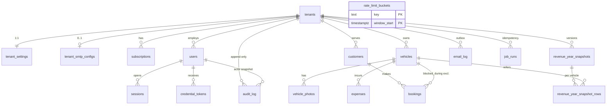

# Database: RentCar (modello dati, sicurezza, migrazioni, backup)

Versione 1.0 · 2026-11-01 · Autore: database-architect · Fase 4, onda A (solo analisi, nessuna migrazione scritta)
Input letti: `docs/03b-struttura-codice.md`, `docs/03-architettura.md`, ADR-0002/0003/0004/0005/0007/0008/0010/0013/0014, `docs/02-requisiti.md` v1.2, `docs/spec/car-rental-spec.md` §9, `docs/03-inputs/security-constraints.md`, `docs/security/sign-off.md`, piu i messaggi del coordinatore (campi tenant: `shortDescription`, indirizzo strutturato, titolo max 45, chiave immagine Open Graph, `countryCode`, `dpaSignedAt`) e `docs/04a-ux.md` / `docs/09-seo.md` solo per questi campi. Allineato a `docs/08-security.md` (requisiti `SR-*`, sezione 0.1).
Lingua: documento in italiano; nomi di tabelle, colonne, policy, ruoli e SQL in inglese.

Verifica sperimentale: le affermazioni marcate **[V]** sono state eseguite su PostgreSQL 16.15 (container `postgres:16`, 2026-11-01); le marcate **[NV]** non sono verificate e hanno un controllo associato (sezione 15).

---

## 0. Sintesi delle decisioni

1. PostgreSQL 16 confermato (relazionale, un solo motore). Provider di produzione ancora agnostico (ADR-0010 resta "proposta"); sezione 1 fissa i requisiti minimi che qualunque provider deve soddisfare.
2. 22 tabelle (18 di dominio/operative + `security_event`, `platform_audit`, `slug_tombstone`, `deletion_ledger` richieste da 08-security). Ogni tabella con dati di tenant ha `tenant_id`, `ENABLE` + `FORCE ROW LEVEL SECURITY`, una policy `tenant_isolation`, e FK **composite** `(tenant_id, x_id)` verso il padre, cosi un record non puo mai puntare a una riga di un altro tenant nemmeno con RLS aggirata [V].
3. **TD-4 risolto** (sezione 4): i percorsi senza tenant usano `withSystem(actor)` che imposta `app.scope` (`resolve | system_auth | system | job | bootstrap`, allineato a SR-DB-05 e ad ADR-0003), non un unico "system". Ogni tipo vede solo le tabelle/comandi della matrice 4.5. La risoluzione dello slug (percorso pubblico piu frequente) puo leggere **solo** `tenants` (SR-DB-05).
4. Le policy usano `NULLIF(current_setting(..., true), '')::uuid`: **la forma di ADR-0003 senza `NULLIF` fallisce** con `invalid input syntax for type uuid: ""` su una connessione di pool riusata dopo una transazione [V].
5. Doppia prenotazione: `EXCLUDE USING gist (vehicle_id WITH =, blocked_during WITH &&) WHERE (status <> 'cancelled')` con `blocked_during` mantenuto da trigger [V: buffer 60 min, 10:30 in conflitto, 11:00 libero; 60 insert paralleli = 1 vincitore]. In piu un advisory lock transazionale per veicolo per evitare deadlock (sezione 6).
6. Audit log append-only a livello DB: solo `INSERT/SELECT` al ruolo runtime, nessuna policy di UPDATE/DELETE, trigger che blocca UPDATE/DELETE anche al proprietario [V]. Cancellazioni (retention 24 mesi, eliminazione tenant) solo tramite due funzioni `SECURITY DEFINER`.
7. Eliminazione hard del tenant a 90 giorni: funzione generica `purge_tenant_data(uuid)` che ordina le tabelle dal grafo delle FK [V: 4 righe cancellate, altro tenant intatto], lascia solo la riga "tombstone" in `tenants`.
8. Migrazioni: `drizzle-kit generate` + migrazioni SQL custom per cio che Drizzle non modella; runner su `DIRECT_DATABASE_URL`; forward-only con script di rollback separati per le migrazioni di espansione; ruoli creati da uno script di bootstrap (non da Drizzle).
9. Backup: `pg_dump -Fc --enable-row-security` con ruolo read-only dedicato (BYPASSRLS dove il provider lo consente, SR-DB-01; altrimenti policy `backup_read`, equivalente [V]), confronto dei conteggi di riga nel test di restore (SR-DB-09), cifrato con `age`, 30 giorni; restore come proprietario su tabelle con FORCE RLS **funziona** [V].
10. Allineamento a 08-security: codice prenotazione di 10 caratteri Crockford (50 bit, SR-VAL-09), unico per tenant; email di credenziali mai salvate ne ritentate (SR-EML-02); registro delle cancellazioni da rieseguire dopo ogni restore (SR-GDPR-08); funzione di eliminazione tenant protetta (SR-GDPR-07); retention `security_event` 12 mesi e destinatario email azzerato a 90 giorni (SR-GDPR-05); IP solo come prefisso + HMAC (SR-LOG-03).
11. Snapshot annuali versionati e append-only (nessun UPDATE/DELETE concesso); riconciliazione notturna come rete di sicurezza.

### 0.1 Allineamento a `docs/08-security.md` (requisiti SR-* che toccano il database)

| SR | Requisito (sintesi) | Dove e recepito | Note / scostamenti |
|---|---|---|---|
| SR-DB-01 | ruoli creati da SQL: owner, migrator, app, backup | 4.1 | owner `NOLOGIN`, `rentcar_migrator` fa `SET ROLE rentcar_owner` (SET ROLE e proprieta degli oggetti da verificare in M1, NV7) |
| SR-DB-02 | `FORCE RLS`, policy con `nullif(current_setting('app.tenant_id', true), '')::uuid` | 4.2, 4.3 | provato [V]: senza `NULLIF` errore su connessione riusata |
| SR-DB-03 | `withTenant`: `set_config('app.tenant_id', ..., true)` + `app.scope='tenant'`, `release(true)` se il ROLLBACK fallisce | 4.2 | |
| SR-DB-04 | test di catalogo e spike S1 | 8.1, 12 | |
| SR-DB-05 | scope `tenant`, `resolve`, `job`, `system`; nessuna policy di sistema su clienti/prenotazioni/veicoli/spese/snapshot/media | 4.5 | aggiunti `system_auth` (login systemadmin) e `bootstrap` (CLI) |
| SR-DB-06 | grant espliciti, tabelle append-only INSERT/SELECT, `EXECUTE` solo alle funzioni di retention/hard delete | 4.4 | |
| SR-DB-07 | timeout di ruolo 10 s / 3 s / 15 s | 4.1 | |
| SR-DB-08 | TLS `verify-full`, DB solo su 127.0.0.1 in compose | 1, 8.1 | |
| SR-DB-09 | dump con `rentcar_backup`, `age`, 30 giorni, restore con confronto conteggi e replay del registro | 10 | BYPASSRLS richiesto da SR-DB-01: recepito dove consentito, policy `backup_read` come alternativa portabile gia verificata |
| SR-DB-10 | migrazioni SQL riviste, advisory lock, seed solo dev | 8 | |
| SR-AUD-01..05 | tre archivi append-only (`audit_log`, `platform_audit`, `security_event`), immutabilita a livello DB, valori senza PII, retention 24 mesi / 12 mesi / 6 anni | 5.14, 5.19, 5.20 | trigger piu severo di SR-AUD-03: richiede `current_user = rentcar_owner` **e** GUC di retention |
| SR-LOG-03 | `security_event` con IP solo prefisso + HMAC, retention 12 mesi | 5.19 | |
| SR-SES-01/06/07 | hash SHA-256, user agent coarse, revoca = DELETE della riga, `last_seen` max 1/min | 5.6 | |
| SR-AUT-04 | consumo atomico del token su POST | 5.7 | |
| SR-EML-02/06 | email di credenziali non salvate ne ritentate; destinatario azzerato dopo 90 giorni | 5.15 | |
| SR-GDPR-04 | anonimizzazione incl. snapshot su prenotazioni e destinatari in `email_log` | 5.12, 9.3 | aggiunto `bookings.customer_email` come snapshot |
| SR-GDPR-05 | retention: sessioni 7 g, token 7 g, rate-limit <= 24 h, chiavi idempotenza 48 h, email log 12 mesi con destinatario azzerato a 90 g, `job_run` 12 mesi | 9.2 | sostituisce la mia stima precedente (90 g / 180 g) |
| SR-GDPR-07 | eliminazione hard con funzione `SECURITY DEFINER`, tombstone slug 12 mesi, riga in `platform_audit` e nel registro | 9.3, 5.20-5.22 | |
| SR-GDPR-08 | registro delle cancellazioni, replay obbligatorio dopo ogni restore | 5.22, 9.3, 10 | |
| SR-RL-03 | chiavi rate-limit = HMAC, righe <= 24 h | 5.17 | |
| SR-ACC-07 | slug ASCII, riservati, immutabile, tombstone 12 mesi | 5.1, 5.21 | |
| SR-VAL-09 / PB-04 / decisione 5.8 | codice prenotazione `^[0-9A-HJKMNP-TV-Z]{10}$` (50 bit), unico per tenant | 5.12, 6.2 | **cambia A-12** (8 caratteri, 31 simboli) |
| SR-PDF-02 | lookup per (slug, codice) nel tenant | 5.12, 7.6 | |
| SR-JOB-03 | idempotenza `(job, tenant, period)` + `pg_try_advisory_xact_lock` | 5.16 | |
| SR-CRY-01/03 | formato `v1.<kid>.<nonce>.<ct+tag>`, AAD `rc:v1:smtp_password:{tenantId}` | 5.3 | |
| SR-CFG-02 | l'avvio rifiuta un ruolo runtime superuser/owner/BYPASSRLS (una query) | 4.1 | |

---

## 1. Scelta del DB e hosting

**Conferma**: PostgreSQL 16. Motivi verificabili: esclusione GiST con `tstzrange` (AC4/KPI-3) e RLS (ADR-0003) non esistono in MySQL/MariaDB o in store documentali; SQLite non copre pooling serverless ne RLS; un document store renderebbe i report ricavi (aggregazioni per mese nel fuso del tenant) piu complessi. Cache/Redis/search non servono (ADR-0013/0014); full text non richiesto (ricerche per nome/telefono su poche migliaia di righe per tenant: `ILIKE` con `tenant_id`, nessuna estensione).

**Hosting (non rideciso qui)**: Neon Frankfurt Launch (raccomandato da ADR-0010), Supabase Pro, Postgres su VPS (opzione C). Costi e piani restano quelli di ADR-0010/`devops-costs.md` (Neon Launch stimato 5-15 USD/mese al lancio, 10-25 al mese 12). Il database e progettato per funzionare identico su tutti: variano solo `DATABASE_URL` / `DIRECT_DATABASE_URL`.

**Requisiti minimi del provider** (checklist da verificare con lo spike S1 e in fase GATE 4, qualunque provider):

| # | Requisito | Perche |
|---|---|---|
| P1 | PostgreSQL >= 15 (test in CI su 16; job notturno su 17) | usiamo `UNIQUE ... NULLS NOT DISTINCT` (15), `security_invoker` (15), `SET NULL (col)` non usato |
| P2 | Estensione `btree_gist` installabile da un ruolo non superuser (estensione "trusted" da PG13) | esclusione prenotazioni [V: creata da ruolo proprietario non superuser] |
| P3 | Possibilita di creare ruoli `NOSUPERUSER NOBYPASSRLS` e di usarli per l'app | RLS efficace; i ruoli di default di alcuni provider (Neon console, Supabase) possono bypassare RLS [NV, sign-off punto 5] |
| P4 | Pooler in transaction mode, TLS `verify-full`, regione UE | ADR-0003/0010 |
| P5 | `ALTER ROLE ... SET` (timeout) e `pg_dump` con ruolo non superuser | sezione 4.3 e 10 |
| P6 | Backup/PITR del provider (Neon Launch 7 giorni) in aggiunta al dump notturno | NFR-BKP-01 |

Se P3 non e soddisfatto la RLS e inutile: ricade nell'eccezione gia accettata in ADR-0003 (solo scoping + test), da far riaccettare all'utente.

---

## 2. Modello concettuale e logico

### 2.1 Diagramma ER



`rate_limit_buckets` non ha relazioni (chiavi HMAC senza tenant in chiaro). `security_event`, `platform_audit`, `slug_tombstone` e `deletion_ledger` sono archivi di piattaforma: usano `subject_tenant_id` (senza FK, per sopravvivere all'eliminazione del tenant) e **non** hanno una colonna `tenant_id`, quindi la funzione di eliminazione (che scopre le tabelle dalla colonna `tenant_id`) non li tocca.

### 2.2 Regole di integrita (cardinalita e vincoli di dominio)

| Regola | Dove e applicata |
|---|---|
| Uno slug unico, immutabile, 3-40 caratteri | `UNIQUE` + `CHECK` + trigger `tenants_slug_immutable` |
| Un solo admin attivo/in attesa per tenant (FR-SYS-15, REQ-16) | indice univoco parziale `users_one_admin_per_tenant` |
| Username unico per tenant; systemadmin unico globale (A-1) | due indici univoci (tenant e `tenant_id IS NULL`) |
| Una sola sottoscrizione non annullata per intervallo (A-6) | `EXCLUDE ... daterange(start_date,end_date,'[]')` |
| Nessuna prenotazione non annullata sovrapposta per veicolo (FR-BKG-08) | esclusione GiST |
| Prenotazione, veicolo, cliente sempre dello stesso tenant | FK composite |
| Codice prenotazione unico per tenant (SR-PDF-02, decisione 5.8) | `UNIQUE (tenant_id, code)` |
| Pagamento coerente: pagato implica metodo, non pagato implica importo 0 | `CHECK` |
| Snapshot immutabile e versione n+1 senza buchi | solo `INSERT`, `UNIQUE (tenant_id, year, version)` |
| Audit non modificabile | grant + policy + trigger |
| Stato `expired` della sottoscrizione NON e salvato (e derivato, FR-SYS-07) | colonna `status` ammette solo `active`, `cancelled` |

---

## 3. Convenzioni

- Tabelle plurale `snake_case`, colonne `snake_case`; `id uuid` (UUIDv7 dall'`IdGenerator` applicativo; default `gen_random_uuid()` solo come rete per SQL manuale e seed); `tenant_id` subito dopo `id`. Eccezioni documentate: tabelle 1:1 (`tenant_settings`, `tenant_smtp_configs`) hanno `tenant_id` come PK; tabelle "miste" (`users`, `sessions`, `credential_tokens`, `audit_log`, `email_log`, `job_runs`) hanno `tenant_id` nullable per i record di piattaforma.
- `created_at`, `updated_at` `timestamptz NOT NULL DEFAULT now()`; `updated_at` tenuto da trigger `set_updated_at()`.
- Enum come `text` + `CHECK ... IN (...)` (non enum nativi): il migratore di Drizzle applica le migrazioni pendenti in una sola transazione [NV, da verificare in M1] e `ALTER TYPE ADD VALUE` ha limiti dentro una transazione; i `CHECK` si aggiornano con drop/add. Il tipo TS e l'unione corrispondente.
- Importi: `bigint` in unita minori + `CHECK (x >= 0)` e tetto `< 10^12`; la valuta sta sul tenant (bloccata dopo il primo dato, A-14); gli snapshot salvano anche `currency`. Il driver `pg` restituisce `int8` come stringa: impostare `types.setTypeParser(20, Number)` (sicuro grazie al tetto) e `.mapWith(Number)` sulle aggregazioni.
- FK: tutte con `ON DELETE` esplicito. Regola: verso `tenants` e tra tabelle di tenant `NO ACTION` (nessuna cancellazione a cascata silenziosa); `CASCADE` solo `vehicle_photos -> vehicles`.
- Soft/hard delete: nessun `deleted_at` generico. Veicoli: `archived_at` (o delete se senza storico); clienti: anonimizzazione; utenti: `status='deactivated'`; prenotazioni: `status='cancelled'`; sottoscrizioni: `status='cancelled'`; spese: delete; tenant: tombstone.
- Date/tempo: istanti in `timestamptz` (UTC); date di calendario pure (`expense_date`, `start_date`, `end_date`) in `date` nel fuso del tenant. **Attribuzione a mese/anno dei ricavi calcolata in SQL** con `AT TIME ZONE tenants.time_zone` (unica fonte: tzdata di Postgres); `shared/time` serve per input e visualizzazione.
- Multilingua: lingua unica `en`, nessuna tabella di traduzioni (YAGNI). Quando arrivera una seconda lingua, i testi scritti dal tenant (privacy, termini, descrizione) richiederanno `tenant_content_translations (tenant_id, locale, ...)`: aggiunta in espansione, nessun impatto sullo schema attuale.

---

## 4. Sicurezza dei dati: ruoli, grant, RLS

### 4.1 Ruoli

| Ruolo | Attributi | Uso | Credenziale |
|---|---|---|---|
| `rentcar_admin` | superuser/CREATEROLE del provider o del container | **solo** bootstrap una tantum (ruoli, database, estensione) | fuori dall'app |
| `rentcar_owner` | `NOLOGIN NOSUPERUSER NOBYPASSRLS`; proprietario di DB e oggetti | non e un login runtime; proprietario delle funzioni `SECURITY DEFINER` (retention, eliminazione tenant) | nessuna |
| `rentcar_migrator` | `LOGIN NOSUPERUSER NOBYPASSRLS`, membro di `rentcar_owner` | CI e servizio `migrate` (`DIRECT_DATABASE_URL`): il runner esegue `SET ROLE rentcar_owner` a inizio sessione cosi gli oggetti creati hanno il proprietario giusto (SR-DB-01, SR-DB-10) | solo CI/compose, mai nel processo runtime |
| `rentcar_app` | `LOGIN NOSUPERUSER NOBYPASSRLS NOCREATEDB NOCREATEROLE`, non proprietario, nessun DDL | runtime (`DATABASE_URL`, pooler) | secret manager dell'hosting |
| `rentcar_backup` | `LOGIN NOSUPERUSER`, `default_transaction_read_only=on`, `SELECT` su tutto; `BYPASSRLS` (SR-DB-01) **dove il provider permette di concederlo**, altrimenti `NOBYPASSRLS` + policy `backup_read` (4.3) | `pg_dump` notturno (`BACKUP_DATABASE_URL`, diretta) | secret del workflow di backup |

Impostazioni di ruolo (SR-DB-07): `ALTER ROLE rentcar_app SET statement_timeout='10s', lock_timeout='3s', idle_in_transaction_session_timeout='15s'`; `rentcar_migrator`: `lock_timeout='5s'`, `statement_timeout='120s'` impostati dal runner. Nessuna chiamata di rete (SMTP, S3) dentro una transazione DB.

Controlli all'avvio (`readyz`, non per parsing dell'URL): `current_user = 'rentcar_app'`, `rolsuper = false`, `rolbypassrls = false`; fallisce chiuso. Il superuser ignora sempre la RLS anche con FORCE: l'immagine Compose NON usa `POSTGRES_USER=rentcar_owner`, ma un superuser di bootstrap separato e uno script `docker-entrypoint-initdb.d/10-roles.sh` che crea i quattro ruoli con password da env. Il controllo di avvio e quello di SR-CFG-02 (una query su `pg_roles`: non superuser, non proprietario, non BYPASSRLS).

`public`: `REVOKE ALL ON SCHEMA public FROM PUBLIC; GRANT USAGE ... TO rentcar_app, rentcar_backup`. Nessun `ALTER DEFAULT PRIVILEGES`: ogni grant e esplicito nella migrazione della tabella (un grant dimenticato produce `permission denied` e un test lo intercetta). Schema `drizzle`: `rentcar_app` ha solo `USAGE` + `SELECT` su `__drizzle_migrations` (per `readyz`: numero di righe >= numero di voci nel journal della build).

### 4.2 Variabili di sessione (GUC) e funzioni helper

Tutte transaction-local (`set_config(name, value, true)`), mai di sessione (pooler):

| GUC | Impostata da | Significato |
|---|---|---|
| `app.tenant_id` | `withTenant(scope)` (con `app.scope='tenant'`) | uuid del tenant |
| `app.scope` | `withTenant` = `tenant`; `withSystemTx(purpose)` (nome di SR-DB-05, `withSystem` in 03b) = `resolve`, `system_auth`, `system`, `job`, `bootstrap` | contesto d'accesso; ogni `purpose` (enum chiuso, test di architettura) corrisponde a un solo scope; ogni uso scrive `system.context.used` in `security_event` (fuori dalla transazione di lavoro) |
| `app.actor_id` | `withSystemTx` | uuid utente systemadmin o vuoto (job) |
| `app.purge_mode` | solo le funzioni `SECURITY DEFINER` di retention/eliminazione | autorizza il DELETE sugli archivi append-only (`'retention'` o l'uuid del tenant in eliminazione) |

`withTenant` e `withSystemTx` sono mutuamente esclusivi: la seconda non imposta `app.tenant_id`. Il valore `tenant_id` e validato come uuid prima di `set_config`; `ROLLBACK` fallito -> `release(true)` (SR-DB-03).

```sql
CREATE FUNCTION app_tenant_id() RETURNS uuid LANGUAGE sql STABLE
  AS $$ SELECT NULLIF(current_setting('app.tenant_id', true), '')::uuid $$;
CREATE FUNCTION app_scope() RETURNS text LANGUAGE sql STABLE
  AS $$ SELECT NULLIF(current_setting('app.scope', true), '') $$;
```

La forma `NULLIF(..., '')` e quella di SR-DB-02 [V]. Le policy chiamano `(SELECT app_tenant_id())` (sub-select: valutata una volta per statement, non per riga). Un valore non-uuid in `app.tenant_id` produce errore, cioe nega (fail closed). Limite noto: la RLS qui protegge da errori applicativi (filtro dimenticato), **non** da una SQL injection con controllo completo dello statement, che potrebbe chiamare `set_config`; la difesa contro la injection sono le query parametrizzate e le regole Semgrep di 03b.

### 4.3 Baseline RLS per ogni tabella

Helper `rls_baseline(p_table regclass, p_tenant_scoped boolean)` (creato nella migrazione `0000`, non eseguibile da `rentcar_app`) applica:

```sql
ALTER TABLE t ENABLE ROW LEVEL SECURITY;  ALTER TABLE t FORCE ROW LEVEL SECURITY;
CREATE POLICY owner_all   ON t TO rentcar_owner USING (true) WITH CHECK (true);   -- migrazioni/backfill/purge
CREATE POLICY backup_read ON t FOR SELECT TO rentcar_backup USING (true);          -- pg_dump --enable-row-security
-- se tenant-scoped:
CREATE POLICY tenant_isolation ON t
  USING (tenant_id = (SELECT app_tenant_id())) WITH CHECK (tenant_id = (SELECT app_tenant_id()));
```

Note oneste: (a) `owner_all` rende il proprietario di fatto esente (serve a migrazioni con backfill e alle funzioni definer); la protezione e che la credenziale owner non arriva mai al runtime (controllo `readyz`). (b) `backup_read` e l'alternativa portabile a `BYPASSRLS` (che alcuni provider non permettono di concedere): il dump non e filtrato dalla RLS in nessuno dei due casi, e il test di restore confronta i conteggi di riga per tabella (SR-DB-09, ABU-M6-06). Entrambe verificate [V]. Test di catalogo: ogni tabella con RLS ha le policy `owner_all` e `backup_read`; ogni tabella con `tenant_id` ha `tenant_isolation` oppure e nell'elenco "miste" con policy esplicite.

**Eccezioni documentate** (elenco chiuso controllato dal test di catalogo, SR-DB-02): `rate_limit_buckets` senza RLS (solo HMAC e contatori; richiesta prima di sapere il tenant). Gli archivi di piattaforma (`security_event`, `platform_audit`, `slug_tombstone`, `deletion_ledger`) hanno RLS con policy per scope (non per tenant). Nessuna vista su tabelle di tenant senza `security_invoker = true` (una vista definer aggirerebbe la RLS): test di catalogo.

### 4.4 Grant al ruolo runtime (`rentcar_app`)

S=SELECT I=INSERT U=UPDATE D=DELETE. Nessun TRUNCATE/REFERENCES/TRIGGER. Nessuna sequenza (chiavi uuid).

| Tabella | S | I | U | D | Nota |
|---|---|---|---|---|---|
| tenants | x | x | x | | tombstone via funzione definer |
| tenant_settings | x | x | x | | |
| tenant_smtp_configs | x | x | x | x | D = rimozione config |
| subscriptions | x | x | x | | annullo = status |
| users | x | x | x | | niente delete |
| sessions | x | x | x | x | D = logout/revoca (SR-SES-06) e purge |
| credential_tokens | x | x | x | x | D = purge |
| vehicles | x | x | x | x | D solo senza storico (FK lo impone) |
| vehicle_photos | x | x | x | x | |
| expenses | x | x | x | x | |
| customers | x | x | x | | anonimizza = UPDATE |
| bookings | x | x | x | | annulla = UPDATE |
| revenue_year_snapshots | x | x | | | immutabili |
| revenue_year_snapshot_rows | x | x | | | immutabili |
| audit_log | x | x | | | append-only |
| security_event | x | x | | | append-only; lettura solo scope `system` |
| platform_audit | x | x | | | append-only; scope `system` |
| slug_tombstone | x | x | | | solo INSERT/SELECT; scadenza via funzione di retention |
| deletion_ledger | x | x | | | append-only |
| email_log | x | x | x | x | D = retention |
| job_runs | x | x | x | x | D = retention |
| rate_limit_buckets | x | x | x | x | |

`EXECUTE` su `purge_tenant_data(uuid)`, `purge_expired_records()` (retention di `audit_log`, `security_event`, `slug_tombstone`), `platform_kpis(...)`: solo `rentcar_app` (`REVOKE ... FROM PUBLIC`). Un test di catalogo confronta i privilegi reali con questa tabella (dichiarata in `tests/security/grants-matrix.ts`).

### 4.5 Matrice delle policy per i percorsi senza tenant (risolve TD-4)

Colonne = valore di `app.scope`: `R`=resolve, `A`=system_auth (login systemadmin, non ancora autenticato), `S`=system (console systemadmin autenticata), `J`=job, `B`=bootstrap (CLI di creazione systemadmin). Una cella vuota = nessuna policy = negato. Il percorso tenant (`app.tenant_id`) ha sempre `tenant_isolation` su tutti i comandi tranne dove indicato.

| Tabella | R | A | S | J | B |
|---|---|---|---|---|---|
| tenants | S | | S,I,U | S | |
| tenant_settings | | | S,I,U | | |
| tenant_smtp_configs | | | S,I,U | | |
| subscriptions | | | S,I,U | S | |
| users | | S,U dove `role='systemadmin'` | S,U dove `role IN ('admin','systemadmin')`; I dove `role='admin'` | | S,I dove `role='systemadmin'` |
| sessions | | S,I,D dove `tenant_id IS NULL` | S,D (revoca per sospensione/sostituzione admin) | D dove scadute da > 7 giorni | |
| credential_tokens | | S,I,U dove `tenant_id IS NULL` | S,I,U | D dove scaduti da > 7 giorni | I dove `tenant_id IS NULL` |
| audit_log | | I | S dove `tenant_id IS NULL OR entity_type IN ('tenant','subscription','admin_account')`; I | I | I |
| security_event | | I | S,I | I | I |
| platform_audit | | | S,I | I | I |
| slug_tombstone | S | | S,I | | |
| deletion_ledger | | | S,I | | |
| email_log | | I dove `tenant_id IS NULL` | S,I,U | S, I, U dove `created_at < now() - 90 days` (azzeramento destinatario), D dove `created_at < now() - 12 months`, U dove `tenant_id IS NULL` | I dove `tenant_id IS NULL` |
| job_runs | | | S | S,I,U,D | |
| vehicles, vehicle_photos, expenses, customers, bookings, snapshots (2), rate_limit | nessun accesso (R,A,S,J,B) | | | | |

Note: `tenants` in `R` serve a risolvere lo slug; `slug_tombstone` in `R` serve a rispondere con lo stesso 404 generico ai slug riservati dalla cancellazione (SR-ACC-07). Gli eventi `security_event` vanno scritti in una transazione separata e breve, cosi un `ROLLBACK` del lavoro (es. accesso negato) non li perde.

Conseguenze verificabili: nessun percorso di sistema legge prenotazioni o clienti (A-13); la risoluzione dello slug non puo toccare utenti o sessioni; i job lavorano nei tenant con `withTenant` per ogni passo (la lista dei tenant arriva da `J`). `systemadmin` non cancella nulla: l'eliminazione di un tenant passa dalla funzione definer (sezione 9.3). La matrice e dichiarata in `tests/security/rls-matrix.ts` e un test genera per ogni (tipo, tabella, comando) il risultato atteso confrontandolo con `pg_policies`.

**Dati aggregati per KPI-7**: la console del systemadmin mostra solo conteggio prenotazioni per tenant (decisione del coordinatore, 04a). Si espone con `platform_kpis(p_from timestamptz, p_to timestamptz)`, funzione `SECURITY DEFINER` che richiede `app_scope() = 'system'` e restituisce per tenant solo `tenant_id, bookings_created, bookings_completed`. Ricavi per tenant NON inclusi (ASSUNZIONE DB-A7: KPI-7 li citava, il coordinatore ha ridotto a conteggi; si aggiungono dopo conferma).

---

## 5. Dizionario dati

Legenda: PK, FK, U=unique, NN=not null. `tenant_id` e sempre FK `tenants(id) ON DELETE NO ACTION`. Colonne `created_at`/`updated_at` non ripetute. "Privacy": P=dato personale, S=segreto, `-`=nessuno.

### 5.1 tenants (realm piattaforma, leggibile dal tenant per la propria riga)

| Colonna | Tipo | Vincoli | Privacy / note |
|---|---|---|---|
| id | uuid | PK | |
| slug | text | NN, U `tenants_slug_key`, CHECK `~ '^[a-z0-9][a-z0-9-]{1,38}[a-z0-9]$'` | immutabile (trigger, SR-ACC-07), tranne la rinomina `deleted-<id>` fatta dalla funzione di eliminazione (`current_user = rentcar_owner`); alla cancellazione lo slug originale passa in `slug_tombstone` (12 mesi, 5.21); parole riservate nel codice (test sulle rotte) |
| name | text | NN, 1..120 | dopo l'eliminazione: `deleted-<8 char id>` |
| status | text | NN default `active`, CHECK in (`active`,`suspended`,`terminated`,`deleted`) | |
| country_code | char(2) | NN default `'IT'`, CHECK `~ '^[A-Z]{2}$'` | ASSUNZIONE DB-A1 (04a, UXA-6): ISO 3166-1, serve alla normalizzazione dei telefoni (REQ-10); **distinto** dal paese dell'indirizzo |
| time_zone | text | NN default `'Europe/Rome'` | trigger `tenants_validate_tz` verifica contro `pg_timezone_names` (un valore errato romperebbe le query `AT TIME ZONE`) |
| currency | char(3) | NN default `'EUR'`, CHECK `~ '^[A-Z]{3}$'` | esponente decimale derivato da tabella ISO in `shared/money` |
| dpa_signed_at | timestamptz | NULL | ASSUNZIONE DB-A2 (UX-9, in attesa dell'utente): spuntato a mano dal systemadmin (solo percorso `S`); non e prerequisito tecnico |
| terminated_at | timestamptz | NULL | |
| deletion_due_at | timestamptz | NULL | `terminated_at + 90 giorni` (calcolato dall'app, vincolato da CHECK `deletion_due_at >= terminated_at`) |
| export_delivered_at | timestamptz | NULL | US-066: senza, l'eliminazione e bloccata |
| export_storage_key | text | NULL | chiave sotto `tenants/{id}/exports/` |
| deletion_override_reason | text | NULL, <= 500 | permette l'eliminazione senza export consegnato |
| deleted_at | timestamptz | NULL | |

CHECK di coerenza: `(status IN ('terminated','deleted')) = (terminated_at IS NOT NULL)`; `(status = 'deleted') = (deleted_at IS NOT NULL)`.
Indici: PK, `tenants_slug_key`; indice parziale `(deletion_due_at) WHERE status = 'terminated'` (promemoria prima dell'eliminazione). Trigger: `tenants_slug_immutable`, `tenants_validate_tz`, `set_updated_at`.
RLS: `tenant_isolation` solo SELECT (`id = app_tenant_id()`), piu policy di sistema della 4.5. Il tenant non puo modificare mai la propria riga (nessuna policy UPDATE per `tenant`): tutto cio che il tenant admin modifica sta in `tenant_settings`.

### 5.2 tenant_settings (1:1, modificabile dal tenant admin e dal systemadmin)

| Colonna | Tipo | Vincoli | Privacy / note |
|---|---|---|---|
| tenant_id | uuid | PK, FK tenants | |
| title | text | NN, CHECK `char_length(title) BETWEEN 1 AND 45` | decisione utente: max 45; iniziale = nome |
| short_description | text | NULL, CHECK `char_length <= 160` | decisione utente; meta description (SEO) |
| contact_email | text | NN, <= 254 | dato dell'azienda (anche pubblico) |
| contact_phone | text | NN, <= 32 | idem |
| address_street, address_postal_code, address_city | text | NULL | indirizzo strutturato opzionale |
| address_country_code | char(2) | NULL, CHECK `~ '^[A-Z]{2}$'` | distinto da `tenants.country_code` |
| (vincolo indirizzo) | | CHECK: i quattro campi indirizzo sono **tutti NULL o tutti NN** | ASSUNZIONE DB-A3: un indirizzo parziale non serve a SEO/PDF |
| logo_storage_key | text | NULL | |
| logo_alt | text | NULL, CHECK `logo_storage_key IS NULL OR char_length(logo_alt) > 0` | FR-BRD-08 |
| og_image_key | text | NULL, CHECK `og_image_key IS NULL OR logo_storage_key IS NOT NULL` | decisione utente + 09-seo: immagine 1200x630 derivata dal logo al salvataggio; l'app la rigenera e cancella la precedente a ogni cambio logo |
| color_primary, color_secondary, color_accent, color_background, color_text | char(7) | NULL, CHECK `~ '^#[0-9a-fA-F]{6}$'` | NULL = default di piattaforma (nessun duplicato dei token nel DB) |
| font_key | text | NN default `inter`, CHECK in (`inter`,`manrope`,`plus_jakarta_sans`) | |
| theme_mode | text | NN default `auto`, CHECK in (`auto`,`light`,`dark`) | |
| theme_version | integer | NN default 1 | cache-buster di `theme.css?v=` |
| min_rental_days | smallint | NN default 1, CHECK >= 1 | |
| max_rental_days | smallint | NN default 30, CHECK `>= min_rental_days` | |
| lead_time_minutes | integer | NN default 0, CHECK 0..43200 | tetto = ASSUNZIONE DB-A4 |
| buffer_minutes | integer | NN default 0, CHECK 0..1440 | tetto = ASSUNZIONE DB-A4 (range finito per il vincolo di esclusione) |
| privacy_notice_url, rental_terms_url | text | NULL, CHECK `~ '^https://'`, <= 2048 | REQ-12 |
| privacy_notice_text, rental_terms_text | text | NULL, <= 20000 | |
| notify_new_booking | boolean | NN default true | FR-MAIL-07 |

Indici: solo PK. RLS: `tenant_isolation` (tutti i comandi) + `S` (S,I,U). Il tenant e il systemadmin scrivono entrambi: ogni scrittura produce una riga audit con l'attore.

### 5.3 tenant_smtp_configs (1:1, segreto separato)

| Colonna | Tipo | Vincoli | Privacy / note |
|---|---|---|---|
| tenant_id | uuid | PK, FK | assenza di riga = "SMTP non configurato" (FR-MAIL-03) |
| host | text | NN, <= 255 | validato dal guardrail SSRF a salvataggio, test e invio |
| port | integer | NN, CHECK in (25,465,587,2525) | |
| security | text | NN, CHECK in (`tls`,`starttls`) | TLS sempre verificato |
| username | text | NN | S |
| password_enc | text | NN, CHECK `~ '^v1\.[0-9a-f]{8}\.'` | S (SR-CRY-01/03/04): AES-256-GCM, formato `v1.<kid>.<nonce_b64url>.<ct+tag_b64url>`, AAD = `rc:v1:smtp_password:{tenantId}`; la rotazione re-cifra a lotti; mai in log/audit/CSV; tabella separata cosi le letture di `tenant_settings` non la caricano |
| from_address | text | NN | |
| from_name | text | NULL | |
| last_test_at, last_test_ok, last_test_error | timestamptz, boolean, text | NULL; errore <= 500, ripulito | |

RLS: `tenant_isolation` + `S` (S,I,U). Il dump contiene solo il testo cifrato; la chiave `APP_ENCRYPTION_KEY` non deve mai stare con i dump (sezione 10).

### 5.4 subscriptions

| Colonna | Tipo | Vincoli | Note |
|---|---|---|---|
| id | uuid | PK, U `(tenant_id, id)` | |
| tenant_id | uuid | NN, FK | |
| max_vehicles, max_operators | integer | NN, CHECK >= 0 | |
| start_date, end_date | date | NN, CHECK `end_date >= start_date` | `end_date` inclusivo, fine giornata nel fuso del tenant |
| price_minor | bigint | NN, CHECK >= 0 | informativo (FR-SYS-11) |
| price_currency | char(3) | NN | indipendente dal tenant (A-14) |
| status | text | NN default `active`, CHECK in (`active`,`cancelled`) | `expired` derivato, non salvato (deviazione consapevole da spec §5) |
| cancelled_at | timestamptz | NULL, CHECK `(status='cancelled') = (cancelled_at IS NOT NULL)` | |

Vincolo: `EXCLUDE USING gist (tenant_id WITH =, daterange(start_date, end_date, '[]') WITH &&) WHERE (status <> 'cancelled')` (A-6, US-012). Indice: `(tenant_id, end_date DESC)` (sottoscrizione corrente). Promemoria di rinnovo: nessuna tabella di marker, basta `job_runs` con `period_key = 'sub:<id>:<end_date>'` (se si estende la data, nasce una nuova chiave e un nuovo promemoria).
Limiti piano: serializzati con `pg_advisory_xact_lock(hashtextextended('limit:vehicles:' || tenant_id, 0))` prima del conteggio (US-013, vale anche per operatori).
RLS: `tenant_isolation` (solo SELECT per il percorso tenant: l'admin non si modifica il piano; policy `FOR SELECT`), `S` (S,I,U), `J` (S).

### 5.5 users

| Colonna | Tipo | Vincoli | Privacy / note |
|---|---|---|---|
| id | uuid | PK, U `(tenant_id, id)` | |
| tenant_id | uuid | NULL, FK | NULL = systemadmin |
| role | text | NN, CHECK in (`systemadmin`,`admin`,`operator`), CHECK `(role='systemadmin') = (tenant_id IS NULL)` | |
| username | text | NN, CHECK `username = lower(username) AND username ~ '^[a-z0-9._-]{3,64}$'` | P; normalizzato dall'app; unico anche tra utenti disattivati (A-39: lo storico resta sotto lo stesso username) |
| display_name | text | NN, 1..120 | P |
| email | text | NN, <= 254 | P; non unica |
| password_hash | text | NULL | S: stringa argon2id con parametri; NULL finche non attivato |
| status | text | NN default `pending`, CHECK in (`pending`,`active`,`deactivated`), CHECK `status <> 'active' OR password_hash IS NOT NULL` | "attivazione non consegnata" derivata da `email_log` |
| must_change_password | boolean | NN default false | |
| password_changed_at, last_login_at, deactivated_at | timestamptz | NULL | |

Indici: `users_username_per_tenant UNIQUE (tenant_id, username) WHERE tenant_id IS NOT NULL`; `users_username_system UNIQUE (username) WHERE tenant_id IS NULL`; `users_one_admin_per_tenant UNIQUE (tenant_id) WHERE role='admin' AND status IN ('pending','active')` (sostituzione: prima disattivare il vecchio, poi inserire il nuovo, nella stessa transazione); `(tenant_id, role, status)` per il conteggio operatori. Nessun contatore di login falliti qui: il blocco usa `rate_limit_buckets` (ADR-0005).
RLS: `tenant_isolation` con `tenant_id IS NOT NULL AND tenant_id = app_tenant_id()` (le righe systemadmin non sono mai visibili a un tenant) + matrice 4.5.

### 5.6 sessions

| Colonna | Tipo | Vincoli | Note |
|---|---|---|---|
| id | uuid | PK | |
| tenant_id | uuid | NULL, FK | |
| realm | text | NN, CHECK in (`tenant`,`system`), CHECK `(realm='system') = (tenant_id IS NULL)` | |
| user_id | uuid | NN, FK `users(id)` NO ACTION; FK composita `(tenant_id, user_id) -> users(tenant_id, id)` (attiva solo se tenant_id non nullo) | sessione e utente nello stesso tenant |
| token_hash | bytea | NN, U, CHECK `octet_length = 32` | SHA-256 del token a 256 bit; il token non e mai salvato |
| assurance_level | smallint | NN default 1, CHECK in (1,2) | punto di estensione MFA (ADR-0005) |
| last_seen_at | timestamptz | NN | aggiornato al massimo una volta al minuto (evita una scrittura per richiesta) |
| idle_expires_at, absolute_expires_at | timestamptz | NN | 30 min / 12 h tenant; 15 min / 8 h systemadmin (A-4, SR-SES-07) |
| user_agent_summary | text | NULL, <= 80 | sintesi grossolana ("Chrome / macOS") per l'elenco sessioni (SR-SES-01/08); nessun IP |
| password_changed_at (su `users`) | | | la guardia confronta `users.password_changed_at` con `sessions.created_at` (SR-SES-06) |

Revoca = `DELETE` della riga (logout, disattivazione, sospensione, cambio password, sostituzione admin: SR-SES-06); nessun IP salvato, solo la sintesi dello user agent. Indici: `UNIQUE (token_hash)`, `(user_id)` (revoca di tutte le sessioni), `(absolute_expires_at)` (purge giornaliero: elimina le righe scadute/revocate da > 7 giorni).

### 5.7 credential_tokens (link di impostazione password e reset)

| Colonna | Tipo | Vincoli | Note |
|---|---|---|---|
| id | uuid | PK | |
| tenant_id | uuid | NULL, FK | |
| user_id | uuid | NN, FK come per `sessions` | |
| purpose | text | NN, CHECK in (`activation`,`password_reset`) | |
| token_hash | bytea | NN, U, `octet_length = 32` | SHA-256; token a 256 bit |
| expires_at | timestamptz | NN | 24 h attivazione, 60 min reset |
| used_at, superseded_at | timestamptz | NULL | |
| created_by_user_id | uuid | NULL, FK users | chi ha emesso il link |

Indice: `credential_tokens_one_live UNIQUE (user_id, purpose) WHERE used_at IS NULL AND superseded_at IS NULL` (riemettere invalida il precedente: prima `superseded_at`, poi insert). Consumo atomico, nella stessa transazione che imposta la password:
`UPDATE credential_tokens SET used_at = now() WHERE token_hash = $1 AND used_at IS NULL AND superseded_at IS NULL AND expires_at > now() RETURNING user_id`.
Retention: purge giornaliero a 7 giorni da scadenza/uso.

### 5.8 vehicles

| Colonna | Tipo | Vincoli | Note |
|---|---|---|---|
| id | uuid | PK, U `(tenant_id, id)` | |
| tenant_id | uuid | NN, FK | |
| name | text | NN, 1..120 | ordinamento naturale in app (poche decine di righe) |
| plate | text | NN, <= 20 | |
| plate_normalized | text | generata: `upper(regexp_replace(plate,'[^A-Za-z0-9]','','g'))` STORED | |
| make, model | text | NN, <= 80 | |
| category | text | NN, CHECK in (`city`,`compact`,`sedan`,`suv`,`van`,`convertible`,`luxury`,`other`) | A-20 |
| fuel_type | text | NN, CHECK in (`petrol`,`diesel`,`hybrid`,`plug_in_hybrid`,`electric`,`lpg_cng`) | |
| seats | smallint | NN, CHECK 1..20 | |
| daily_price_minor | bigint | NN, CHECK >= 0 | |
| status | text | NN default `available`, CHECK in (`available`,`maintenance`) | `rented` derivato |
| archived_at | timestamptz | NULL | non conta per `max_vehicles` (A-18) |
| notes | text | NULL, <= 2000 | avviso FR-DAT-01 in UI; P potenziale |

Indici: `UNIQUE (tenant_id, plate_normalized)` (ASSUNZIONE DB-A5: unica anche tra archiviati; la stessa targa in altro tenant e ammessa); `(tenant_id, lower(name))`; parziale `(tenant_id) WHERE archived_at IS NULL` (conteggio limite). FK entranti: `bookings`, `expenses`, `vehicle_photos` impediscono la cancellazione di un veicolo con storico (si archivia).

### 5.9 vehicle_photos

| Colonna | Tipo | Vincoli | Note |
|---|---|---|---|
| id | uuid | PK | |
| tenant_id, vehicle_id | uuid | NN; FK composita `(tenant_id, vehicle_id) -> vehicles(tenant_id,id) ON DELETE CASCADE` | |
| storage_key | text | NN, U | chiave base `tenants/{tenantId}/vehicles/{vehicleId}/{uuid}`; le varianti 480/1280 WebP derivano dal nome |
| byte_size, width, height | integer | NN, CHECK > 0 | |
| position | smallint | NN, CHECK 0..9 | il CHECK + unicita impone il massimo di 10 foto (A-23) |
| is_cover | boolean | NN default false | |

Indici: `UNIQUE (vehicle_id, position) DEFERRABLE INITIALLY DEFERRED` (riordino con scambi); `UNIQUE (vehicle_id) WHERE is_cover`. Gli oggetti nello storage si cancellano dopo il commit; un job di riconciliazione elenca i prefissi per tenant e rimuove gli orfani (bassa priorita).

### 5.10 expenses

| Colonna | Tipo | Vincoli | Note |
|---|---|---|---|
| id | uuid | PK | |
| tenant_id, vehicle_id | uuid | NN; FK composita verso `vehicles` NO ACTION | |
| expense_date | date | NN | data di calendario del tenant |
| category | text | NN, CHECK in (`purchase`,`repair`,`maintenance`,`other`) | |
| amount_minor | bigint | NN, CHECK `> 0` | |
| description | text | NULL, <= 500 | avviso FR-DAT-01 |
| created_by_user_id | uuid | NULL, FK users | |

Indici: `(tenant_id, expense_date) INCLUDE (vehicle_id, amount_minor)` (ricavi/spese globali per mese, index-only), `(tenant_id, vehicle_id, expense_date)` (per veicolo e FK).

### 5.11 customers

| Colonna | Tipo | Vincoli | Privacy / note |
|---|---|---|---|
| id | uuid | PK, U `(tenant_id, id)` | |
| tenant_id | uuid | NN, FK | |
| first_name, last_name | text | NN, 1..80 | P |
| phone | text | NN, CHECK `phone ~ '^\+[1-9][0-9]{6,14}$' OR anonymized_at IS NOT NULL` | P: E.164 normalizzato con `tenants.country_code` |
| email | text | NULL, <= 254 | P |
| anonymized_at | timestamptz | NULL | |

Indici: `UNIQUE (tenant_id, phone)` (de-duplica FR-CUS-03; concorrenza con `INSERT ... ON CONFLICT (tenant_id, phone) DO NOTHING` poi SELECT; i segnaposto anonimi `anon-<id senza trattini>` sono unici per costruzione); `(tenant_id, created_at DESC)`. Nessun campo note cliente (minimizzazione). Stesso telefono in due tenant = due clienti (FR-CUS-08).

### 5.12 bookings

| Colonna | Tipo | Vincoli | Privacy / note |
|---|---|---|---|
| id | uuid | PK, U `(tenant_id, id)` | |
| tenant_id | uuid | NN, FK | |
| code | text | NN, U `bookings_tenant_code_key (tenant_id, code)`, CHECK `~ '^[0-9A-HJKMNP-TV-Z]{10}$'` | SR-VAL-09 e decisione 5.8 di 08-security: Crockford base32 (32 simboli, senza I,L,O,U), 10 caratteri = 50 bit, CSPRNG; unico **per tenant**, lookup sempre `(tenant_id, code)` (SR-PDF-02); la visualizzazione a gruppi e della UI. Cambia A-12 |
| vehicle_id | uuid | NN, FK composita `(tenant_id, vehicle_id)` NO ACTION | |
| customer_id | uuid | NN, FK composita `(tenant_id, customer_id)` NO ACTION | |
| customer_first_name, customer_last_name | text | NN | P: nomi come inseriti (FR-CUS-03); anonimizzati con il cliente (SR-GDPR-04) |
| customer_email | text | NULL, <= 254 | P: email indicata per la conferma (puo differire da `customers.email`, mai sovrascritta: ABU-M2-07); azzerata con l'anonimizzazione. Il telefono coincide per costruzione con `customers.phone` (chiave di abbinamento) |
| start_at, end_at | timestamptz | NN, CHECK `end_at > start_at` | `end_at` = rientro effettivo = data di attribuzione dei ricavi |
| buffer_minutes | integer | NN default 0, CHECK 0..1440 | istantanea del buffer; vedi 6.2 |
| blocked_during | tstzrange | NN default `'empty'`, CHECK `NOT isempty(blocked_during)` | gestita **solo** dal trigger `bookings_set_blocked_during`; il default `empty` esiste solo perche Drizzle tratti la colonna come facoltativa; il CHECK garantisce che il trigger sia scattato |
| status | text | NN default `confirmed`, CHECK in (`confirmed`,`active`,`completed`,`cancelled`) | |
| status_changed_at | timestamptz | NN default now() | |
| daily_price_minor | bigint | NN, CHECK >= 0 | istantanea (FR-BKG-05) |
| billed_days | smallint | NN, CHECK >= 1 | |
| total_minor | bigint | NN, CHECK >= 0 | nessun CHECK `total = prezzo x giorni`: promozioni future (FR-PUB-12) lo romperebbero; l'autorita e la funzione `pricing()` |
| payment_method | text | NULL, CHECK in (`card`,`cash`) | |
| is_paid | boolean | NN default false | |
| paid_amount_minor | bigint | NN default 0, CHECK >= 0 | |
| (pagamento) | | CHECK `NOT is_paid OR payment_method IS NOT NULL`; CHECK `is_paid OR paid_amount_minor = 0` | saldo = total - paid, derivato |
| paid_at | timestamptz | NULL | |
| source | text | NN, CHECK in (`public`,`admin`) | |
| notes | text | NULL, <= 2000 | P potenziale; vedi DB-2 |
| cancelled_at | timestamptz | NULL | |
| cancel_reason | text | NULL, <= 500 | |
| (annullo) | | CHECK `(status='cancelled') = (cancelled_at IS NOT NULL)` | |
| created_by_user_id | uuid | NULL, FK users | NULL = cliente pubblico |
| idempotency_key | text | NULL, <= 64 | FR-BKG-11; azzerata dal job dopo 48 h (SR-GDPR-05) |
| version | integer | NN default 1 | blocco ottimistico (FR-BKG-19): `UPDATE ... WHERE id=$1 AND version=$2` |

Indici (ognuno ha una query, sezione 7):

| Indice | Uso |
|---|---|
| `bookings_tenant_code_key UNIQUE (tenant_id, code)` | lookup per codice (conferma, PDF), unicita per tenant |
| `bookings_tenant_idempotency_key UNIQUE (tenant_id, idempotency_key) WHERE idempotency_key IS NOT NULL` | replay sicuro |
| `bookings_vehicle_id_blocked_during_excl` (GiST parziale, creato dal vincolo) | doppia prenotazione e ricerca disponibilita |
| `(tenant_id, start_at DESC)` | elenco prenotazioni, calendario |
| `(tenant_id, end_at)` | ricavi per mese, calendario futuro |
| `(tenant_id, vehicle_id, start_at DESC)` | storico veicolo, FK |
| `(tenant_id, customer_id, start_at DESC)` | storico cliente, limite 3 aperte per telefono, promemoria privacy |
| `bookings_open_idx (tenant_id, start_at) WHERE status IN ('confirmed','active')` | job transizioni (indice minuscolo) |

Trigger: `bookings_set_blocked_during` (BEFORE INSERT OR UPDATE OF start_at,end_at,buffer_minutes), `set_updated_at`.
Stato effettivo (letto con il tempo, A-25), usato da liste, calendario, ricavi:
```sql
CASE WHEN status IN ('confirmed','active') AND end_at <= now() THEN 'completed'
     WHEN status = 'confirmed' AND start_at <= now() THEN 'active'
     ELSE status END
```

### 5.13 revenue_year_snapshots e revenue_year_snapshot_rows

`revenue_year_snapshots` (testata = totale globale):

| Colonna | Tipo | Vincoli | Note |
|---|---|---|---|
| id | uuid | PK, U `(tenant_id, id)` | |
| tenant_id | uuid | NN, FK | |
| year | smallint | NN | anno nel fuso del tenant |
| version | integer | NN, CHECK >= 1 | |
| currency | char(3) | NN | congelata con i numeri |
| revenue_minor, collected_minor, expenses_minor, net_minor | bigint | NN; CHECK `net_minor = revenue_minor - expenses_minor` | |
| bookings_count | integer | NN, CHECK >= 0 | |
| frozen_at | timestamptz | NN | |
| corrected_at | timestamptz | NULL | |
| corrected_by_user_id | uuid | NULL, FK users | |
| reason | text | NULL, <= 300 | es. `expense:created:<id>`, `booking:updated:<code>`, `reconciliation` |
| (versione) | | CHECK `(version = 1) = (corrected_at IS NULL)`; `UNIQUE (tenant_id, year, version)` | |

`revenue_year_snapshot_rows` (per veicolo): PK `(snapshot_id, vehicle_id)`; `tenant_id`; FK composita `(tenant_id, snapshot_id)` e `(tenant_id, vehicle_id)` NO ACTION; stesse cinque colonne numeriche (revenue, collected, expenses, net, bookings_count). ASSUNZIONE DB-A6: lo snapshot salva solo totali annuali (globale + per veicolo), non il dettaglio mensile (FR-REV-06 confronta anni; il mese si ricalcola dal vivo) — vedi DB-5.
Immutabilita: ai due oggetti sono concessi solo SELECT/INSERT; la versione n+1 si crea con `pg_advisory_xact_lock(hashtextextended('snapshot:'||tenant_id||':'||year,0))` e l'unicita su `(tenant_id, year, version)` come rete. Ultima versione: `ORDER BY version DESC LIMIT 1` (coperta dall'indice univoco). Somma righe veicolo = riga globale (FR-REV-10): garantita dalla stessa query e verificata da test.

### 5.14 audit_log

| Colonna | Tipo | Vincoli | Note |
|---|---|---|---|
| id | uuid | PK (UUIDv7) | cursore `(created_at, id)` |
| tenant_id | uuid | NULL, FK | NULL = evento di piattaforma |
| created_at | timestamptz | NN default now() | |
| actor_type | text | NN, CHECK in (`user`,`system`,`public`) | |
| actor_user_id | uuid | NULL, FK users NO ACTION | |
| actor_username, actor_role | text | NULL | istantanea (A-39) |
| action | text | NN | es. `booking.updated` |
| entity_type | text | NN | `booking`, `payment`, `settings`, `subscription`, `tenant`, `admin_account`, `snapshot`, `customer`, `export` |
| entity_id | uuid | NULL | |
| entity_ref | text | NULL | riferimento umano non personale (codice prenotazione) |
| changes | jsonb | NN default `'{}'`, CHECK `pg_column_size(changes) <= 16384` | `{campo: {old, new}}`; **allowlist per azione** nel codice (`AuditLog.record`): mai nomi/telefoni/email, mai segreti; canary test |
| request_id | text | NULL | |

Indici: `(tenant_id, created_at DESC, id DESC)` (viewer), `(tenant_id, entity_type, entity_id, created_at DESC)` (storico prenotazione), `BRIN (created_at)` (retention globale).
Append-only, quattro livelli [V per trigger, privilegi, policy]: (1) grant solo `SELECT, INSERT`; (2) nessuna policy UPDATE/DELETE per `tenant`/sistema; (3) trigger `append_only_guard('24 months')` (funzione generica, parametro = eta minima) BEFORE UPDATE/DELETE e BEFORE TRUNCATE che alza `append-only` anche al proprietario, **salvo** DELETE quando `current_user = 'rentcar_owner'` (cioe dentro le funzioni definer, SR-AUD-03) **e** `app.purge_mode = <tenant_id della riga>` (eliminazione tenant) oppure `= 'retention'` con `OLD.created_at < now() - 24 mesi`; (4) la GUC la impostano solo le funzioni definer, e `rentcar_app` non ha comunque il privilegio DELETE. Valori (SR-AUD-04): identificatori, enumerazioni, numeri, date; per i campi di testo libero solo un marcatore `changed` con la lunghezza. Retention 24 mesi (SR-AUD-05).

### 5.15 email_log (outbox, ADR-0008; SR-EML-02/06, SR-GDPR-05)

| Colonna | Tipo | Vincoli | Privacy / note |
|---|---|---|---|
| id | uuid | PK | |
| tenant_id | uuid | NULL, FK | NULL = mail del proprietario (SYSTEM_ADMIN_EMAIL), visibile solo al sistema |
| channel | text | NN, CHECK in (`tenant_smtp`,`system_smtp`) | |
| category | text | NN, CHECK in (`transactional`,`credential`) | `credential` = attivazione, reset, sostituzione admin |
| template | text | NN | |
| related_type, related_id | text, uuid | NN | riferimento polimorfico (nessuna FK; l'eliminazione per tenant lo copre) |
| recipient | text | NULL, <= 254 | P: indirizzo del destinatario; **azzerato (NULL) 90 giorni dopo l'ultimo tentativo** e all'anonimizzazione del cliente (SR-GDPR-04/05); `recipient_scrubbed_at` ne tiene traccia |
| recipient_scrubbed_at | timestamptz | NULL | |
| status | text | NN default `pending`, CHECK in (`pending`,`sending`,`sent`,`failed`,`abandoned`) | |
| attempts, max_attempts | smallint | NN default 0 / 5; CHECK `category <> 'credential' OR max_attempts = 1` | **nessun ritentativo automatico per le mail di credenziali** (SR-EML-02): il token in chiaro non e mai salvato (solo l'hash in `credential_tokens`), il messaggio e generato al momento dell'invio e il creatore riemette il link (FR-AUTH-04). Una riga `credential` ancora `pending` dopo 15 min diventa `failed` ("attivazione non consegnata") |
| next_attempt_at, locked_until, last_attempt_at, sent_at | timestamptz | NULL | `sending` con `locked_until` scaduto torna disponibile (solo `transactional`) |
| last_error | text | NULL, <= 500 | solo categoria grossolana, ripulita (SR-SSRF-05) |

Il log tiene destinatario, template, stato, categoria e timestamp, **mai** corpo, PDF o token: il PDF si rigenera dall'id della prenotazione a ogni tentativo (SR-EML-06, A-30); un ritentativo risolve l'indirizzo dalla riga collegata se `recipient` fosse gia azzerato (altrimenti `abandoned`). Indici: parziale `(next_attempt_at) WHERE status IN ('pending','failed') AND category = 'transactional'`; `(tenant_id, related_type, related_id)`; `(created_at)` (azzeramento a 90 giorni, cancellazione a 12 mesi). Claim: `SELECT ... FOR UPDATE SKIP LOCKED`; invio fuori dalla transazione DB. Semantica at-least-once (accettata). Tetto di righe per tenant al giorno (SR-EML-05) applicato dal servizio con un conteggio su `(tenant_id, created_at)`.

### 5.16 job_runs

| Colonna | Tipo | Vincoli | Note |
|---|---|---|---|
| id | uuid | PK | |
| job | text | NN | |
| tenant_id | uuid | NULL, FK | NULL = job di piattaforma |
| period_key | text | NN | `2026-11-01T13` (orario), `2026-11-01`, `year:2026`, `sub:<id>:<end_date>` |
| status | text | NN, CHECK in (`succeeded`,`failed`,`skipped`) | |
| attempt | integer | NN default 1 | |
| started_at, finished_at | timestamptz | NN | |
| counts | jsonb | NN default `'{}'` | |
| error | text | NULL, <= 500 | ripulito |

`CREATE UNIQUE INDEX job_runs_idempotency ON job_runs (job, tenant_id, period_key) NULLS NOT DISTINCT` (PG15+). Protocollo senza stato `running` (a prova di crash): in **una** transazione: `INSERT ... ON CONFLICT (job, tenant_id, period_key) DO UPDATE SET attempt = job_runs.attempt + 1, status = 'succeeded', ... WHERE job_runs.status = 'failed'` + lavoro + commit; un secondo chiamante concorrente resta in attesa sull'indice univoco e poi non ottiene righe, quindi salta. Se il lavoro fallisce, rollback e una seconda transazione registra `failed`. Come previsto da SR-JOB-03/ADR-0007 il passo del job prende anche `pg_try_advisory_xact_lock(hashtextextended('job:'||job||':'||period_key,0))` (se non ottenuto: salta). Indice `(started_at DESC)` per la vista del proprietario; retention 12 mesi (SR-GDPR-05).

### 5.17 rate_limit_buckets (senza RLS, vedi 4.3)

`key text` (HMAC-SHA256 hex di `tenant:scope:identita`, chiave derivata con HKDF, SR-RL-03; 64 caratteri, CHECK; nessun IP in chiaro), `window_start timestamptz`, `count integer NN`, `expires_at timestamptz NN`; PK `(key, window_start)`; indice `(expires_at)`. Upsert: `INSERT ... ON CONFLICT (key, window_start) DO UPDATE SET count = rate_limit_buckets.count + 1 RETURNING count`, eseguibile in un solo round trip. Purge orario: righe con `expires_at < now()` (finestra + 1 h, sempre < 24 h, NFR-GDPR-02). Tabella LOGGED (UNLOGGED non consigliata su Neon: si svuota alla sospensione del compute).

### 5.18 Tabelle non create

Nessuna tabella `notification_markers` (coperta da `job_runs`), nessuna `password_reset_tokens` (coperta da `credential_tokens`), nessuna `tenant_exports` (bastano `export_*` su `tenants`).


### 5.19 security_event (SR-LOG-03, archivio di piattaforma)

| Colonna | Tipo | Vincoli | Note |
|---|---|---|---|
| id | uuid | PK | |
| created_at | timestamptz | NN default now() | |
| event | text | NN | tassonomia di SR-LOG-03 (`auth.login.failure`, `tenant.mismatch`, `system.context.used`, ...) |
| realm | text | NN, CHECK in (`tenant`,`system`,`public`,`job`) | |
| subject_tenant_id | uuid | NULL | contesto, **senza FK e senza colonna `tenant_id`** |
| actor_id | uuid | NULL | |
| outcome, reason_code | text | NN / NULL | codici, mai testo di eccezione |
| ip_prefix | text | NULL | /24 per IPv4, /48 per IPv6 |
| ip_hmac | text | NULL, 64 | HMAC dell'IP completo con chiave derivata |
| request_id | text | NULL | |

Nessun IP completo ne dato personale. Append-only (`append_only_guard('12 months')`), INSERT da qualunque scope, SELECT solo scope `system` (SR-AUD-02). Indici: `(created_at DESC)`, `(event, created_at DESC)`. Retention 12 mesi (SR-GDPR-05) via `purge_expired_records()`.

### 5.20 platform_audit (SR-AUD-02)

`id`, `created_at`, `actor_user_id` (FK `users`, il systemadmin), `action` (`tenant.created|suspended|terminated|hard_deleted`, `admin.reset|replaced`, `subscription.*`), `subject_tenant_id` (senza FK), `entity_ref`, `changes jsonb` (stesse regole di 5.14), `request_id`. Solo scope `system` (e `bootstrap`/`job`/funzioni definer in INSERT); append-only con `append_only_guard('never')` (retention 6 anni o durata del contratto: nessuna cancellazione automatica, SR-AUD-05). Nessun dato personale: solo id.

### 5.21 slug_tombstone (SR-ACC-07, SR-GDPR-07)

`slug text PK`, `subject_tenant_id uuid NN`, `reserved_until timestamptz NN` (= eliminazione + 12 mesi), `created_at`. Scritta dalla funzione di eliminazione; la creazione di un tenant (trigger `tenants_slug_not_tombstoned`) e la risoluzione dello slug la consultano: slug riservato, sconosciuto o in tombstone danno lo stesso 404 generico. Le righe scadute le rimuove `purge_expired_records()`.

### 5.22 deletion_ledger (SR-GDPR-08)

`id uuid PK`, `kind text CHECK in ('customer_anonymised','tenant_hard_deleted')`, `subject_tenant_id uuid NN`, `subject_customer_id uuid NULL` (CHECK: obbligatorio per `customer_anonymised`), `occurred_at timestamptz NN`. Solo id e date, nessun dato personale. Append-only (`append_only_guard('never')`), INSERT dalla transazione di anonimizzazione (scope `tenant`: ammesso con `subject_tenant_id = app_tenant_id()`) e dalla funzione di eliminazione. Poiche un restore riporta il database indietro nel tempo, **il registro vive anche fuori dal DB**: il workflow di backup ne esporta le righe degli ultimi 35 giorni, cifrate con `age`, nel bucket dei dump (sezione 10). Il replay dopo un restore esegue di nuovo anonimizzazioni (idempotente) ed eliminazioni.

---

## 6. Doppia prenotazione e codice prenotazione

### 6.1 Vincolo (ADR-0004, verificato [V] su PostgreSQL 16.15)

```sql
CREATE EXTENSION IF NOT EXISTS btree_gist;
ALTER TABLE bookings ADD CONSTRAINT bookings_vehicle_id_blocked_during_excl
  EXCLUDE USING gist (vehicle_id WITH =, blocked_during WITH &&) WHERE (status <> 'cancelled');

CREATE FUNCTION bookings_set_blocked_during() RETURNS trigger LANGUAGE plpgsql AS $$
BEGIN
  NEW.blocked_during := tstzrange(NEW.start_at, NEW.end_at + make_interval(mins => NEW.buffer_minutes), '[)');
  RETURN NEW;
END $$;
CREATE TRIGGER bookings_blocked_during BEFORE INSERT OR UPDATE OF start_at, end_at, buffer_minutes
  ON bookings FOR EACH ROW EXECUTE FUNCTION bookings_set_blocked_during();
```

- **Filtro di stato**: `status <> 'cancelled'`. Tutte le transizioni tra `confirmed`/`active`/`completed` non toccano il vincolo; annullare libera il veicolo subito; una modifica che porta una prenotazione fuori da `cancelled` non esiste (annullata e finale). Le query di lettura devono contenere letteralmente `status <> 'cancelled'` perche il planner usi l'indice parziale.
- **Estremi**: intervalli semiaperti, `end_at` uguale a `start_at` successivo con buffer 0 = ammesso [V per buffer 60: 10:30 rifiutato 23P01, 11:00 accettato].
- **Buffer**: ogni prenotazione porta il buffer in vigore alla sua creazione. Quindi "buffer" = tempo di rimessa a posto *dopo* il rientro di ciascuna prenotazione. Se tutte le prenotazioni hanno lo stesso `b` coincide con A-22 (simmetrico); se il tenant cambia buffer, le prenotazioni esistenti non cambiano (AS-3). Ad una **modifica** di date/veicolo il buffer si ricalcola con quello corrente del tenant (ASSUNZIONE, DB-4).
- **Errori da mappare**: `23P01` -> `BookingConflict`. Inoltre `40P01` (deadlock) e `40001` -> un solo retry, che poi vedra il vincitore e dara `23P01`. In 60 inserimenti paralleli identici ho osservato 59 x `23P01` e nessun `40P01` [V], ma il deadlock tra inserimenti incrociati non e escluso dal motore [NV]: lo spike S5 deve provarlo con e senza lock.
- **Serializzazione consigliata** (cintura e bretelle): prima di insert/update su prenotazioni, `pg_advisory_xact_lock(hashtextextended('veh:'||vehicle_id,0))` per ogni veicolo coinvolto **in ordine di id crescente** (modifica con cambio veicolo: vecchio e nuovo). Il vincolo resta la garanzia non aggirabile; il lock elimina deadlock e attese incrociate. Solo lock transazionali (ADR-0010).
- **Idempotenza**: `INSERT ... ON CONFLICT (tenant_id, idempotency_key) WHERE idempotency_key IS NOT NULL DO NOTHING RETURNING`; se non torna nulla si legge la riga esistente. Distinguere i `23505` dal nome del vincolo (`bookings_tenant_code_key` vs idempotenza).

### 6.2 Codice prenotazione (decisione 5.8 di 08-security, SR-VAL-09, PB-04)

- Formato: 10 caratteri dall'alfabeto Crockford base32 `0123456789ABCDEFGHJKMNPQRSTVWXYZ` (32 simboli) = **50 bit**, generati con CSPRNG e campionamento senza bias (32 e potenza di 2: si usano 5 bit per carattere). Mai sequenziale. CHECK DB `^[0-9A-HJKMNP-TV-Z]{10}$`. Unico per tenant (`UNIQUE (tenant_id, code)`), lookup sempre `(tenant_id, code)`: nessun oracolo di esistenza tra tenant e coerente con la route `/{slug}/...`.
- Collisioni: insert con retry (max 5) su `23505` del vincolo `bookings_tenant_code_key`.
- **Scostamento dai requisiti**: A-12 prevedeva 8 caratteri, 31 simboli (39,6 bit) e unicita globale; NFR-SEC-07 chiede >= 40 bit. La decisione di sicurezza (50 bit, perche il codice e una *capability* per PDF e pagina di conferma, UX-7) sostituisce A-12: da aggiornare nei requisiti. Con 32 simboli compaiono `0` e `1`: l'input utente va normalizzato (`O->0`, `I,L->1`) come nello standard Crockford.
- La pagina di conferma e il PDF non devono mostrare telefono/email completi; le ricerche per codice sono a rate limit (SR-RL-01, SR-PDF-02).

---

## 7. Query critiche, indici e ricavi

### 7.1 Disponibilita pubblica (NFR-PERF-02: p95 <= 500 ms con 50 veicoli, 5.000 prenotazioni)

```sql
-- $1 tenant, $2 pickup, $3 return + current tenant buffer (computed in the app)
SELECT v.id, v.name, v.daily_price_minor
FROM vehicles v
WHERE v.tenant_id = $1 AND v.archived_at IS NULL AND v.status = 'available'
  AND NOT EXISTS (
    SELECT 1 FROM bookings b
    WHERE b.vehicle_id = v.id AND b.status <> 'cancelled'
      AND b.blocked_during && tstzrange($2, $3, '[)'));
```
Usa l'indice GiST dell'esclusione (ricerca per `vehicle_id` + sovrapposizione). Il conflitto da mostrare in modifica (US-141) usa la stessa predicata con `AND b.id <> $self` e restituisce `code`.

### 7.2 Calendario (NFR-PERF-04) e liste

`vehicles` del tenant ordinati in app + `bookings WHERE tenant_id=$1 AND start_at < $range_end AND end_at > $range_start` (indice `(tenant_id, end_at)`). Elenco prenotazioni: paginazione keyset `(start_at, id) < ($a, $b)` con filtri status (stato effettivo, 5.12), intervallo e veicolo; indice `(tenant_id, start_at DESC)`. Se un tenant supera ~50.000 prenotazioni si valuta un indice GiST su `(tenant_id, tstzrange(start_at,end_at))`: non ora.

### 7.3 Job di transizione (idempotente)

```sql
UPDATE bookings SET status = 'completed', status_changed_at = now()
 WHERE tenant_id = $1 AND status IN ('confirmed','active') AND end_at <= now();
UPDATE bookings SET status = 'active', status_changed_at = now()
 WHERE tenant_id = $1 AND status = 'confirmed' AND start_at <= now();
```
(Ordine: prima `completed`.) Mai all'indietro, mai su `cancelled` e il vincolo di esclusione non viene toccato. Usa `bookings_open_idx`.

### 7.4 Ricavi per mese, per veicolo e globali (FR-REV-01/02/10, NFR-PERF-05)

Ricavo = prenotazioni **effettivamente completate** per `end_at` (anche se il job non e girato: RK-9), mese nel fuso del tenant:

```sql
-- $1 tenant, $2 year
WITH t AS (
  SELECT time_zone, make_timestamptz($2, 1, 1, 0, 0, 0, time_zone) AS y_start,
         make_timestamptz($2 + 1, 1, 1, 0, 0, 0, time_zone) AS y_end
  FROM tenants WHERE id = $1)
SELECT vehicle_id, month, SUM(revenue)::bigint AS revenue, SUM(collected)::bigint AS collected,
       SUM(expenses)::bigint AS expenses, SUM(n)::int AS bookings,
       GROUPING(vehicle_id) AS g_vehicle, GROUPING(month) AS g_month
FROM (
  SELECT b.vehicle_id, date_trunc('month', b.end_at AT TIME ZONE t.time_zone)::date AS month,
         b.total_minor AS revenue, b.paid_amount_minor AS collected, 0::bigint AS expenses, 1 AS n
  FROM bookings b, t
  WHERE b.tenant_id = $1 AND b.end_at >= t.y_start AND b.end_at < t.y_end
    AND b.status IN ('confirmed','active','completed') AND b.end_at <= now()
  UNION ALL
  SELECT e.vehicle_id, date_trunc('month', e.expense_date)::date, 0, 0, e.amount_minor, 0
  FROM expenses e, t
  WHERE e.tenant_id = $1 AND e.expense_date >= (t.y_start AT TIME ZONE t.time_zone)::date
    AND e.expense_date < (t.y_end AT TIME ZONE t.time_zone)::date
) x
GROUP BY GROUPING SETS ((vehicle_id, month), (month), (vehicle_id), ());
```
Una sola scansione produce per-veicolo/mese, globale/mese, totale per veicolo e totale generale: per costruzione la somma dei veicoli e il globale (FR-REV-10). I limiti `end_at >= y_start` sono sargable su `(tenant_id, end_at)`. Netto = ricavi - spese; "incassato" = `paid_amount_minor`; "da incassare" = ricavo - incassato. Un booking che finisce il 31/12 alle 23:30 locali cade in dicembre (US-081) perche il confronto usa gli istanti di inizio/fine anno locali.

### 7.5 Snapshot annuali e versioni (REQ-4, FR-REV-05/07)

- Anno "chiuso" = ora locale del tenant >= 1 gennaio dell'anno successivo. Creazione v1: job giornaliero + creazione pigra: `INSERT ... ON CONFLICT (tenant_id, year, version) DO NOTHING` (esattamente una v1 anche con job doppio o rilanciato, US-084).
- **Correzione**: nella stessa transazione della modifica (spesa/prenotazione completata) per ogni anno chiuso toccato (anno vecchio e nuovo se `end_at` cambia anno): (1) **prima** della modifica, se per quell'anno non esiste alcuna v1, crearla dallo stato precedente (altrimenti la v1 nascerebbe gia corretta e si perderebbe la traccia); (2) applicare la modifica; (3) ricalcolare con la query 7.4; (4) se i totali differiscono dall'ultima versione, inserire versione n+1 (`corrected_at`, `corrected_by_user_id`, `reason`) sotto l'advisory lock; se uguali non crea nulla (US-085 ultimo scenario).
- **Riconciliazione notturna** (`snapshot_reconcile`, idempotente): ricalcola gli anni chiusi e, se trova differenza con l'ultima versione (modifica fatta da un percorso dimenticato o SQL manuale), crea una versione con `reason='reconciliation'`. Alternativa scartata: trigger sulle tabelle sorgente (complessita e dipendenza dal fuso, stessi risultati con 24 h di ritardo massimo).
- Confronto tra anni: ultima versione di ciascun anno (`DISTINCT ON (year) ... ORDER BY year, version DESC`), badge "corrected" se `version > 1`.

### 7.6 Altre query

| Query | Indice |
|---|---|
| Validazione sessione: `sessions JOIN users` per `token_hash`, non revocata, scadenze > now() | `UNIQUE (token_hash)` |
| Limite 3 prenotazioni aperte per telefono | `customers (tenant_id, phone)` + `(tenant_id, customer_id, start_at DESC)` |
| Promemoria privacy (clienti senza prenotazioni da 24 mesi) | `NOT EXISTS` su `(tenant_id, customer_id, start_at DESC)` con `end_at > now() - 24 months` |
| Viewer audit | `(tenant_id, created_at DESC, id DESC)` |
| Rate limit | PK `(key, window_start)` |
| Conteggio limiti piano | indici parziali `vehicles`, `users (tenant_id, role, status)` |

---

## 8. Migrazioni e seed

### 8.1 Strumenti e flusso

- `drizzle-kit generate` crea le migrazioni SQL dallo schema TS (`modules/*/infrastructure/schema.ts`); `drizzle-kit generate --custom --name=...` crea il file vuoto per ci che Drizzle non modella (estensioni, esclusione, trigger, funzioni, **tutta la RLS e le policy**, grant, indici parziali/GiST). La RLS e solo in SQL a mano (Drizzle `pgPolicy` non copre `FORCE` ne le policy per ruolo): una sola fonte di verita.
- Una commit per task = schema TS + migrazione generata + migrazione custom + test (03b §15). Mai modificare una migrazione applicata: se ne crea una nuova.
- **Nome file**: `NNNN_<modulo>_<cambiamento>.sql`, es. `0001_tenancy_core.sql` (generata), `0002_tenancy_rls_constraints.sql` (custom). Intestazione obbligatoria `-- generated by drizzle-kit` oppure `-- custom: <perche>`.
- **Runner** `scripts/migrate.ts`: usa `DIRECT_DATABASE_URL` (ruolo `rentcar_migrator`, poi `SET ROLE rentcar_owner`), `SET lock_timeout='5s'`, `pg_advisory_lock` di sessione (ammesso solo qui, connessione diretta), migrazioni di Drizzle, poi **verifiche post-migrazione** (catalogo RLS, policy, grant, indici FK; le stesse del test di CI) e rilascio del lock. Compose: servizio `migrate` one-shot, `app` con `depends_on: migrate: service_completed_successfully` (AC1); produzione: passo di CI prima della promozione del deploy (ADR-0002).
- **Ruoli e DB** fuori da Drizzle (SR-DB-01): `scripts/db-bootstrap.sql` (idempotente) eseguito da `rentcar_admin`: ruoli (owner, migrator, app, backup), database, `CREATE EXTENSION btree_gist` (anche `IF NOT EXISTS` nella `0000`), `REVOKE` su `public`. Compose lo esegue nell'init del container; in produzione una volta, da runbook.
- **Reversibilita**: Drizzle e solo "avanti". Politica: ogni migrazione di *espansione* ha `drizzle/rollback/NNNN_name.down.sql` (ignorato dal migratore) e un test CI "su -> giu -> su" su database vuoto; le migrazioni di *contrazione* (drop/rename) sono dichiarate irreversibili e il vero rollback e il ripristino (dump pre-migrazione, sezione 10). Dump `pg_dump` mirato prima di ogni migrazione con la riga `-- destructive`.
- **Migrazioni nella stessa transazione** [NV]: se il migratore esegue tutte le pendenti in una sola transazione, niente `CREATE INDEX CONCURRENTLY` e niente `ALTER TYPE ADD VALUE` seguito da uso. A questa scala (tabelle < 10^6 righe) i lock durano millisecondi; `lock_timeout` fa fallire la migrazione invece di bloccare il traffico.
- **Espansione/contrazione** (serverless: vecchia e nuova versione convivono): rilascio N solo additivo (colonne nullable o con default, nuove tabelle, nuovi indici, `CHECK ... NOT VALID` poi `VALIDATE`), backfill in script idempotente (loop per tenant con `withTenant`, o migrazione custom come `rentcar_owner`), passaggio del codice, rilascio N+1 con NOT NULL/drop. Rinomina = aggiungi nuova, doppia scrittura, sposta, rimuovi. Ogni nuova tabella di tenant porta RLS+grant+FK composite nella **stessa** migrazione.
- **Controlli CI**: (a) migrazioni da zero su database pulito con ruoli reali; (b) `drizzle-kit generate` non deve produrre differenze (schema TS == oggetti modellati); (c) test di catalogo: RLS abilitata e forzata ovunque tranne l'eccezione, policy `owner_all`/`backup_read`/`tenant_isolation`, grant == matrice 4.4, ogni FK ha indice, nessuna vista senza `security_invoker`, nessun `SECURITY DEFINER` fuori elenco, `search_path` fissato nelle funzioni definer; (d) su/giu/su; (e) smoke con connessione pooled e diretta.
- Piano iniziale (allineato a M1-M4): `0000_platform_foundations` (estensione, helper, trigger `set_updated_at`, `rls_baseline`, revoke), `0001/0002 tenancy` (tenants, settings, smtp, subscriptions), `0003/0004 auth` (users, sessions, credential_tokens), `0005 platform_ops` (audit_log + guard + funzioni di purge, job_runs, email_log, rate_limit_buckets), `0006/0007 fleet` (vehicles, photos), `0008/0009 customers_bookings` (+ esclusione, trigger), `0010/0011 finance` (expenses, snapshots).

### 8.2 Seed

- **Sviluppo** (`seed` profile di Compose; rifiuta `APP_ENV` staging/production, FR-PLT-02): crea un systemadmin con `SEED_SYSTEMADMIN_USERNAME`, `SYSTEM_ADMIN_EMAIL`, `SEED_SYSTEMADMIN_PASSWORD` (nomi proposti; confermano backend/security), password hashata con argon2id al volo, stato `active`, idempotente (`ON CONFLICT DO NOTHING` sull'indice systemadmin). Come da SR-DB-10 i seed sono solo dev e usano il ruolo migrator (`SET ROLE rentcar_owner`), non il runtime.
- **Dati demo/E2E**: tenant sintetici `demo-a` e `demo-b` con dati *gemelli* (stessi username, targhe, telefoni, date) piu un tenant vuoto e uno terminato, generati dai builder deterministici (`FakeClock`, id sequenziali); mai contengono dati reali.
- **Produzione** (A-33): `scripts/create-systemadmin.ts` legge username/email da env, crea l'utente in stato `pending` e un `credential_token` di attivazione; il link viene inviato con SMTP di sistema e, se l'invio fallisce, stampato una sola volta su stdout. Nessuna password in env. Esegue con `scope='bootstrap'` (runtime role). ASSUNZIONE DB-A8 da confermare con il security-engineer (A-33 parla di "valori d'ambiente"; AU-11 vuole il CLI una tantum).
- Migrazione da sistemi esistenti: nessuna (greenfield, requisiti 6.3).

---

## 9. Dati personali, retention e ciclo di vita

### 9.1 Classificazione

| Dato | Tabella.colonna | Classe | Trattamento |
|---|---|---|---|
| Nome, cognome, telefono, email cliente | `customers.*`, `bookings.customer_first_name/last_name/email` | Personale | minimizzazione (solo questi campi), niente documenti/carte (SEC-5), anonimizzazione, export |
| Note libere | `vehicles.notes`, `bookings.notes`, `expenses.description` | Potenzialmente personale | avviso in UI, lunghezza limitata; `bookings.notes` azzerate con l'anonimizzazione (DB-2) |
| Username, nome, email staff | `users.*` | Personale (lavoratori) | conservati finche il tenant esiste; cancellati con il tenant |
| Hash password, hash token | `users.password_hash`, `sessions/credential_tokens.token_hash` | Segreto | argon2id / SHA-256; esclusi dal dump: sessioni e token |
| Password SMTP | `tenant_smtp_configs.password_enc` | Segreto | AES-256-GCM, chiave fuori dal DB |
| Indirizzo destinatario email | `email_log.recipient` | Personale | azzerato a 90 giorni dall'ultimo tentativo e all'anonimizzazione (SR-GDPR-05); mai nelle mail di credenziali oltre l'indirizzo; nessun corpo salvato |
| IP | mai in chiaro: solo prefisso + HMAC in `security_event` (12 mesi); solo HMAC in `rate_limit_buckets` (<= 24 h) | Pseudonimo | SR-LOG-03, SR-RL-03 |
| Audit | `audit_log`, `platform_audit`, `security_event`, `deletion_ledger` | Identificativi, nessuna PII oltre id/codici | 24 mesi / 6 anni / 12 mesi / 6 anni |

### 9.2 Retention

| Dato | Conservazione | Meccanismo |
|---|---|---|
| Clienti e prenotazioni | finche il tenant esiste o anonimizza; promemoria annuale (FR-CUS-09), nessuna cancellazione automatica | job di gennaio |
| `audit_log` (24 mesi), `security_event` (12 mesi), `slug_tombstone` (alla scadenza) | come indicato (SR-AUD-05, SR-GDPR-05) | job orario/giornaliero `purge_expired_records()` (funzione definer che imposta `app.purge_mode='retention'`) |
| `platform_audit`, `deletion_ledger` | 6 anni o durata del contratto, solo id | nessuna cancellazione automatica |
| `email_log` | destinatario azzerato a 90 giorni, riga cancellata a 12 mesi (SR-GDPR-05) | job giornaliero scope `job` |
| chiavi di idempotenza (`bookings.idempotency_key`) | 48 ore | job orario per tenant |
| `job_runs` | 12 mesi | job giornaliero |
| `rate_limit_buckets` | <= 24 h (di fatto finestra + 1 h) | job orario |
| `sessions`, `credential_tokens` | 7 giorni dopo scadenza/uso (le sessioni revocate si cancellano subito) | job giornaliero |
| Snapshot | finche il tenant esiste | - |
| Tenant terminato | 90 giorni poi eliminazione (9.3); resta il tombstone | procedura systemadmin |
| Backup | 30 giorni (<= 35, A-31) | lifecycle del bucket |
| Log applicativi | <= 30 giorni | OPS |

### 9.3 Cicli di vita

**Anonimizzazione cliente** (FR-CUS-06, una transazione `withTenant`): (1) rifiuta se ha prenotazioni *effettivamente* confermate/attive; (2) `customers`: nome `Anonymised`/`Customer`, `phone = 'anon-' || replace(id::text,'-','')` (valore casuale derivato dall'uuid, mai un hash o un troncamento del dato originale: SR-GDPR-04), `email = NULL`, `anonymized_at = now()`; (3) `bookings` del cliente: nomi come sopra, `customer_email = NULL`, `notes = NULL` (DB-2); (4) `email_log` collegati (via `related_id` delle prenotazioni e dei token): `recipient = NULL`; (5) riga audit `customer.anonymised` (solo id) e riga in `deletion_ledger`. Test: ricerca dei valori originali in **tutte** le tabelle (e nello storage). Importi, date e ricavi restano. Nei backup il dato esiste fino a 30 giorni (poi sparisce) e il **registro delle cancellazioni** (sotto) permette di rifarla dopo un restore.

**Export cliente** (FR-CUS-07): letture parametrizzate `customers` + `bookings`, audit `export`. **Export tenant** (FR-SYS-16): CSV a cursore dalle tabelle, in `tenants/{id}/exports/`; consegna registrata in `export_delivered_at`.

**Terminazione ed eliminazione tenant** (SEC-7, US-066, SR-GDPR-06/07):
1. Giorno 0 (scope `system`): `status='terminated'`, `terminated_at`, `deletion_due_at = +90 giorni`; sessioni del tenant cancellate; accesso bloccato; riga `platform_audit`.
2. L'export del tenant lo produce un job in scope `tenant` (mai una lettura di sistema); consegna registrata in `export_delivered_at`.
3. Promemoria prima della scadenza (job `J` sull'indice parziale).
4. Giorno >= 90, la UI richiede lo slug digitato e la password del systemadmin: l'app cancella prima i prefissi dello storage (`tenants/{id}/`, `private/{id}/`) e verifica che siano vuoti, poi chiama `purge_tenant_data(tenant_id)`.
5. `purge_tenant_data` (`SECURITY DEFINER`, proprietario `rentcar_owner`, `SET search_path = pg_catalog, public`, `REVOKE ... FROM PUBLIC`, `EXECUTE` a `rentcar_app`): rifiuta se non `app_scope() = 'system'`, se `status <> 'terminated'`, se `deletion_due_at > now()` (i 90 giorni non si aggirano) o se manca sia `export_delivered_at` sia `deletion_override_reason`; imposta `app.purge_mode`; scopre da `pg_class`/`pg_attribute` tutte le tabelle con colonna `tenant_id` e le svuota **in ordine topologico delle FK** (foglie per prime, errore se ciclo; l'elenco e generato dal catalogo e confrontato in un test); rinomina lo slug del tenant in `deleted-<id>` e lo inserisce in `slug_tombstone` (12 mesi); porta `tenants` a `deleted` (nome `deleted-<id>`); inserisce `platform_audit` (`tenant.hard_deleted`) e `deletion_ledger` (`tenant_hard_deleted`), e `security_event` e scritto dall'app (`tenant.hard_deleted`). Provata [V] (versione di base): cancellate 4 righe di un tenant, l'altro intatto, chiamata con scope sbagliato rifiutata. Test permanente: dopo la funzione, zero righe in **ogni** tabella con `tenant_id`.
6. Resta il tombstone in `tenants` (id, stato, date, nome/slug neutralizzati). `security_event`, `platform_audit` e il registro non contengono dati dei clienti e seguono la loro retention (da citare nel DPA).

**Registro delle cancellazioni e restore** (SR-GDPR-08): vedi 5.22 e 10. Anonimizzazioni ed eliminazioni sono ripetibili (idempotenti) cosi il replay dopo un ripristino da backup/PITR non puo far risorgere dati cancellati; i backup scadono entro 35 giorni e il DPA lo dichiara.

---

## 10. Backup e ripristino

| Aspetto | Decisione |
|---|---|
| Frequenza | notturno (GitHub Actions, ADR-0010) + PITR del provider se presente (Neon Launch 7 giorni) |
| Comando | `pg_dump -Fc --enable-row-security --no-owner --exclude-table-data=sessions --exclude-table-data=credential_tokens --exclude-table-data=rate_limit_buckets` con `BACKUP_DATABASE_URL` (connessione diretta, ruolo `rentcar_backup`) [V: anche senza BYPASSRLS il ruolo legge tutto grazie a `backup_read`; con BYPASSRLS il comportamento e lo stesso]. Il workflow esporta inoltre `deletion_ledger` degli ultimi 35 giorni (`COPY ... TO` o CSV) cifrato con `age` nello stesso bucket |
| Cifratura | `age -r <chiave pubblica>` sul runner; chiave privata custodita fuori da GitHub (CSM-2); la KEK `APP_ENCRYPTION_KEY` mai nello stesso posto dei dump |
| Destinazione/retention | bucket di un **provider diverso**, regola di ciclo di vita a 30 giorni; nome `rentcar-<UTC>.dump.age` + checksum |
| RPO / RTO | RPO <= 24 h col solo dump (minuti con PITR); RTO <= 4 h obiettivo (NFR-BKP-01 chiede <= 24 h); database stimato < 1 GB, ripristino in minuti |
| Restore | in un database nuovo con ruoli gia presenti: `pg_restore --no-owner --role=rentcar_owner -d <db>` (collegato come `rentcar_migrator`); **provato [V]**: con `FORCE RLS`, trigger, policy ed esclusione il ripristino come proprietario riesce perche dati prima, RLS/policy/trigger dopo (post-data), e i grant sono ripristinati |
| Verifica post-restore (SR-DB-09, ABU-M6-06) | script `verify-restore`: **conteggi di riga per tabella confrontati con la sorgente** (un dump filtrato dalla RLS darebbe zeri), FK valide, esclusione ricostruita, suite di catalogo RLS/grant, login di prova, e **replay obbligatorio del registro delle cancellazioni** (passo bloccante del runbook di restore e di ogni ripristino PITR) |
| Test | prima del go-live e poi trimestrale (NFR-BKP-01), in un database di prova (Compose o ramo del provider), con esito archiviato |
| Pre-migrazione | dump mirato (o punto di ripristino del provider) prima di ogni migrazione `-- destructive` |
| Costo | GitHub Actions entro i minuti gratuiti; storage dei dump: 30 copie x (<= 250 MB compressi nel caso massimo) = pochi euro/mese al massimo (stima, non verificata col prezzo del bucket scelto) |

Rischi collegati: il job fallisce in silenzio (nessun alerting, D14) -> serve l'heartbeat via email del workflow (CSM-1, ambito OPS); se il restore come proprietario non riuscisse su un provider (P3/P5), ripetere con un ruolo con `BYPASSRLS`/superuser del provider.

---

## 11. Volumi e crescita

Ipotesi: dimensione riga media 400 B per prenotazione (indici x2), audit 350 B, 4 eventi di audit per prenotazione.

| Scenario | Prenotazioni/anno | Audit a regime (24 mesi) | Dimensione stimata |
|---|---|---|---|
| Atteso anno 1 (10 tenant x 25 veicoli x 60 prenotazioni) | 15.000 | ~120.000 righe | ~50 MB |
| Tetto di progetto (50 tenant x 50 veicoli x 80 prenotazioni) | 200.000 | ~1,6 milioni | ~1 GB totale (prenotazioni ~250 MB/anno con indici, audit ~560 MB) |

Nessun partizionamento (soglia di rivalutazione: `audit_log` > 20 milioni di righe o `bookings` > 5 milioni). Il tetto per tenant del test di carico: 50 veicoli, 10.000 prenotazioni (NFR-PERF-05); `seed:perf` genera il dataset (50 tenant) e il test controlla con `EXPLAIN` che le query 7.1/7.4 usino gli indici attesi. Autovacuum di default basta (`bookings` e `sessions` sono le sole tabelle con molti UPDATE); `sessions.last_seen_at` aggiornato al massimo 1/min riduce il rumore.

---

## 12. Strategia dei dati di test (matrice cross-tenant)

Allineata a 03b §14 (template DB con le migrazioni reali, connessione col ruolo runtime).

1. **Fixture gemelle**: builder deterministici creano tenant A e B con gli stessi username, targhe, telefoni, nomi e date; un tenant C vuoto (rileva fughe verso insiemi vuoti), un tenant D terminato e un utente systemadmin. I dati sono caricati nel template come `rentcar_owner`, i test girano come `rentcar_app`.
2. **Registro da catalogo**: la lista delle tabelle con `tenant_id` si legge da `information_schema`; il test fallisce se una non e nella matrice (e se non e in `MIXED_TABLES` con policy esplicite).
3. **Per ogni tabella e per i due tenant** (generato): (a) senza GUC -> 0 righe; (b) GUC A -> esattamente le righe di A; (c) INSERT con `tenant_id` di B sotto A -> `42501`; (d) UPDATE/DELETE di un id di B sotto A -> 0 righe; (e) come owner: inserimento prenotazione di A con veicolo di B -> `23503` (FK composita) [V].
4. **Matrice dei tipi di sistema** (4.5): per ogni (tipo, tabella, comando) l'esito atteso e confrontato con `pg_policies`; un tipo non dichiarato deve ottenere 0 righe/`42501`.
5. **Append-only** su `audit_log`, `security_event`, `platform_audit`, `deletion_ledger`, snapshot (ABU-M0-07): UPDATE/DELETE/TRUNCATE come app -> `42501`; come owner senza GUC -> eccezione del trigger [V]; DELETE valido solo dentro le funzioni definer.
5b. **Ruolo runtime** (ABU-M0-01): non superuser, non proprietario di tabelle/funzioni, senza BYPASSRLS ne CREATE; snapshot dei grant == matrice 4.4 (ABU-M0-08); pool `max=1`: dopo commit, rollback ed errore la GUC e vuota e nessuna riga e visibile (ABU-M0-04).
5c. **Email di credenziali**: dopo l'invio non esiste alcun token, link o corpo in `email_log`, `job_runs`, audit, log (canary, ABU-M0-15); `max_attempts = 1`.
6. **Esclusione**: 50 inserimenti e 50 modifiche paralleli -> un vincitore (con e senza advisory lock, conteggio dei `40P01`); casi limite: estremi uguali, buffer 60, annullata esclusa, modifica con cambio veicolo.
7. **Purge** (ABU-M6-01): tenant attivo / terminato da 30 giorni / da 91 giorni / slug sbagliato / come admin di tenant -> rifiutato, rifiutato, riuscito, rifiutato, 403; dopo l'eliminazione zero righe con `tenant_id = A` ovunque, conteggi di B invariati, tombstone, `slug_tombstone`, `platform_audit` e `deletion_ledger` presenti. **Restore** (ABU-M6-06): conteggi uguali alla sorgente e replay del registro.
8. **Bleed GUC**: 1.000 transazioni interleaved su 3 tenant con pool piccolo (spike S1 come test permanente, volume ridotto in CI); verifica anche `current_setting('app.tenant_id', true)` vuoto dopo il commit.
9. **Integrazione job/outbox**: idempotenza di `job_runs`, credenziali mai ritentate, snapshot v1 unica, versione n+1 solo se i totali cambiano.
10. **Performance**: dataset `seed:perf`, esecuzione notturna.

---

## 13. Audit e monitoraggio del database

Eventi di audit sensibili elencati nel dizionario (5.14) coincidono con FR-AUD-01; azioni DB privilegiate (ruoli, DDL) non sono in `audit_log`: sono tracciate dai log del provider/CI (la credenziale owner si usa solo in CI). Metriche (pannello del proprietario e/o log, accordo con l'observability-engineer, nessun alerting): connessioni usate vs limite e transazioni idle-in-transaction; deadlock (`pg_stat_database.deadlocks`) e conteggio applicativo `booking_conflict_total` (23P01) e `40P01`; durata query > 500 ms (log applicativo; `pg_stat_statements` dove disponibile); dimensione di `audit_log`, `email_log`, `bookings`; `email_log` in `pending/failed` piu vecchie di 1 h; `job_runs` fallite; eta dell'ultimo backup (heartbeat OPS); tuple morte/autovacuum; tempo di cold start del compute (Neon).

---

## 14. Impatti su altri documenti

| Documento | Modifica richiesta | Responsabile |
|---|---|---|
| ADR-0003 | policy con `NULLIF(current_setting(...,true),'')::uuid` [V del guasto]; `app.scope='system'` sostituito da `app.scope` + matrice 4.5 | solution-architect |
| 03b §7 e TD-4 | `withSystem(actor)` imposta `app.scope`/`app.actor_id` (non `app.system_actor`); lo scope ha 5 valori (`resolve`, `system_auth`, `system`, `job`, `bootstrap`); la funzione si chiama `withSystemTx(purpose)` in SR-DB-05; TD-4 chiuso con questo documento | solution-architect |
| ADR-0004 | mappare anche `40P01`/`40001`; advisory lock per veicolo; semantica del buffer "dopo il rientro" e ricalcolo alla modifica | solution-architect |
| ADR-0002 | "reversibili": politica forward-only + file `rollback/` (8.1); migrazioni a cura del ruolo `rentcar_owner` | solution-architect |
| ADR-0008 | `email_log` senza corpo ne token; mail di credenziali mai ritentate (`category='credential'`, `max_attempts=1`); destinatario azzerato a 90 giorni | solution-architect, security-engineer |
| Requisiti A-12 / NFR-SEC-07 | codice prenotazione: 10 caratteri Crockford (50 bit), unico per tenant (decisione 5.8 di 08-security) invece di 8 caratteri/31 simboli/globale | requirements-analyst |
| 08-security SR-DB-01 | backup role: BYPASSRLS dove concesso, altrimenti policy `backup_read` (equivalente, provata); `rentcar_owner` NOLOGIN + `rentcar_migrator` | security-engineer |
| 08-security SR-AUD-03 | trigger append-only richiede owner **e** GUC (piu severo); funzione unica `purge_expired_records()` | security-engineer |
| 08-security SR-GDPR-05 | `EmailLog`: destinatario salvato e azzerato a 90 giorni (invece di non salvarlo: scelta precedente di questo documento, ritirata) | security-engineer |
| Requisiti FR-SYS-07 | lo stato `expired` e solo derivato (gia scritto), nel DB solo `active/cancelled` | requirements-analyst |
| Requisiti 6.1 | campi tenant aggiunti: `country_code`, `dpa_signed_at`, `short_description`, indirizzo, `og_image_key`, titolo max 45; "contatori di login falliti" non nel DB (ADR-0005) | requirements-analyst |
| Spec §9 | indice `Booking(vehicleId,startAt,endAt)` sostituito dall'esclusione GiST | - |
| 08-security / 09-seo | conferma pagina di conferma come capability link (UX-7); `og_image_key` rigenerata a ogni cambio logo | security-engineer, seo-specialist |

---

## 15. Assunzioni, rischi e verifiche

### 15.1 Verifiche eseguite [V] (PostgreSQL 16.15, container locale, script nella cartella di lavoro temporanea)

1. Proprietario non superuser crea `btree_gist`. 2. RLS+FORCE: senza GUC 0 righe, con GUC solo le righe del tenant, INSERT cross-tenant -> `42501`. 3. GUC vuota dopo il commit: policy con `NULLIF` -> 0 righe; cast diretto -> errore. 4. Scope `resolve` vede `tenants` e 0 righe di `vehicles`. 5. Esclusione con trigger e buffer: 10:30 rifiutata (23P01), 11:00 ammessa; 60 insert concorrenti -> 1 vincitore, 59 x 23P01, 0 x 40P01. 6. FK composita blocca prenotazione di A su veicolo di B anche per il proprietario. 7. Audit: UPDATE/DELETE bloccati per app (privilegi) e per owner (trigger). 8. `purge_tenant_data` dinamica: rifiuta ruolo non autorizzato, cancella solo il tenant indicato. 9. `pg_dump --enable-row-security` con ruolo non-BYPASSRLS e `pg_restore` come proprietario con FORCE RLS: dati, policy, trigger, vincolo di esclusione e grant ripristinati.

### 15.2 Non verificato [NV] e controllo

| # | Punto | Controllo |
|---|---|---|
| NV1 | Il migratore Drizzle applica le pendenti in una transazione unica | M1, lettura codice/prova; la strategia vale in entrambi i casi |
| NV2 | Ruoli `NOBYPASSRLS` e `ALTER ROLE SET` sul pooler del provider scelto | spike S1 su Neon / provider; checklist P3-P5 |
| NV3 | Deadlock tra inserimenti incrociati sull'esclusione | spike S5 con/senza advisory lock |
| NV4 | Compatibilita di Drizzle con colonne `tstzrange` custom e indici parziali nel diff | CI `generate` senza differenze |
| NV5 | Stime di volume e costo dei dump | misura al lancio |
| NV7 | `SET ROLE rentcar_owner` da `rentcar_migrator`: proprietario degli oggetti creati dal migratore Drizzle (incluso `drizzle.__drizzle_migrations`) e policy `TO rentcar_owner` efficaci con `current_user` | M1, test di catalogo |
| NV6 | `date-fns` e tzdata di Postgres coincidono nei casi limite DST | test DST su ricavi e snapshot (NFR-TZ-01) |

### 15.3 Assunzioni (da confermare)

DB-A1 `country_code` obbligatorio sul tenant, default `IT`. DB-A2 `dpa_signed_at` solo informativo, modificabile dal solo systemadmin. DB-A3 indirizzo tutto-o-niente. DB-A4 tetti: buffer 0-1440 min, anticipo 0-43200 min. DB-A5 targa unica anche tra veicoli archiviati. DB-A6 snapshot solo totali annuali. DB-A7 KPI del proprietario: solo conteggi prenotazioni. DB-A8 bootstrap systemadmin in produzione via link di attivazione. DB-A9 (superata da SR-GDPR-08) registro delle cancellazioni anche nel bucket dei backup. DB-A10 UUIDv7 generati dall'app; nessuna colonna `locale`. DB-A11 postgres 16 in CI piu job notturno su 17. DB-A12 `security_event`, `platform_audit` e `deletion_ledger` restano dopo l'eliminazione del tenant (solo id, IP come prefisso+HMAC) con la propria retention: da riportare nel DPA. DB-A13 il valore dello scope `tenant` e impostato anche da `withTenant` (SR-DB-03) ma le policy dei tenant non lo leggono.

### 15.4 Rischi

| Rischio | Gravita |
|---|---|
| Provider i cui ruoli possono bypassare la RLS (P3): la difesa in profondita cade | alta |
| Credenziale `rentcar_owner` (con policy `owner_all`) esposta fuori da CI | alta |
| Un percorso di scrittura dimentica la correzione dello snapshot (mitigato da riconciliazione notturna, ritardo <= 24 h) | media |
| Deadlock sull'esclusione senza advisory lock | media |
| Funzioni `SECURITY DEFINER` (purge, KPI) sono superficie di privilegio: test di catalogo e revisione del security-engineer | media |
| Dump che contiene `password_enc` insieme alla chiave (se mal custodita) | media |
| Un restore da backup vecchio fa risorgere dati cancellati senza il registro (DB-A9, ora recepito come tabella `deletion_ledger` + export nel bucket, SR-GDPR-08) | media |
| Postgres 17+ in produzione con funzionalita diverse dalla 16 di sviluppo | bassa |

---

## Esito

- **Stato**: completato (solo analisi; nessuna migrazione scritta; nessuna approvazione modificata)
- **File prodotti/modificati**: `/Users/ermaaga/Work/RentCar/docs/05-database.md`
- **Sintesi**:
  1. PostgreSQL 16 confermato; 22 tabelle con dizionario completo, FK composite `(tenant_id, x_id)`, RLS `ENABLE+FORCE` ovunque tranne `rate_limit_buckets`; ruoli `rentcar_owner` (NOLOGIN) / `rentcar_migrator` / `rentcar_app` / `rentcar_backup` e matrice dei grant.
  2. TD-4 risolto: `app.scope` con cinque valori non-tenant (resolve, system_auth, system, job, bootstrap) e matrice 4.5 per tabella/comando; scoperto e documentato che la policy di ADR-0003 senza `NULLIF` fallisce su connessioni di pool riusate.
  3. Esclusione GiST con filtro `status <> 'cancelled'`, `blocked_during` da trigger, buffer snapshot, advisory lock per veicolo, mapping di 23P01/40P01; codice prenotazione a 10 caratteri Crockford (50 bit, unico per tenant) come da 08-security, che sostituisce A-12.
  4. Ricavi calcolati in SQL nel fuso del tenant con `GROUPING SETS`; snapshot append-only versionati, regola "crea v1 prima di modificare", riconciliazione notturna.
  5. Audit append-only su quattro livelli; eliminazione tenant con funzione `purge_tenant_data` generica e verificata; retention definite per ogni dato; `email_log` senza corpo ne token, destinatario azzerato a 90 giorni, mail di credenziali mai ritentate; archivi `security_event`/`platform_audit`/`deletion_ledger`/`slug_tombstone` per SR-AUD/SR-GDPR.
  6. Migrazioni: drizzle-kit + SQL custom per RLS/vincoli, runner su connessione diretta, forward-only con script di rollback per le espansioni, ruoli da script di bootstrap; seed dev da env e bootstrap produzione per link.
  7. Backup `pg_dump` cifrato 30 giorni con ruolo read-only (BYPASSRLS dove concesso, altrimenti policy `backup_read` provata); restore con FORCE RLS provato, confronto dei conteggi di riga e replay obbligatorio del registro delle cancellazioni.
  8. Allineamento a 08-security: tabella SR-* nella sezione 0.1 (SR-DB-01..10, SR-AUD, SR-GDPR-04/05/07/08, SR-EML-02/06, SR-SES, SR-LOG-03, SR-VAL-09); scostamenti dichiarati: backup role via policy se BYPASSRLS non concedibile, trigger append-only piu severo.
  9. Integrati i campi tenant richiesti: `short_description` (160), indirizzo strutturato (tutto-o-niente), titolo max 45, `og_image_key`, `country_code` (distinto dal paese dell'indirizzo), `dpa_signed_at`.
- **Assunzioni**: DB-A1..DB-A13 (sezione 15.3), tra cui country_code obbligatorio, DPA solo informativo, snapshot solo totali annuali, KPI del proprietario a soli conteggi, bootstrap produzione via link, archivi di piattaforma conservati dopo l'eliminazione del tenant (solo id).
- **Rischi**: provider con ruoli che bypassano la RLS (alta); provider che non concede BYPASSRLS al ruolo di backup (media, mitigato da `backup_read`); esposizione credenziale owner (alta); snapshot non corretto da percorso dimenticato (media); deadlock esclusione senza lock (media); funzioni definer (media); restore che resuscita dati cancellati (media).
- **Rilievi bloccanti**: nessuno (analisi).
- **Criteri non verificati**: nessun Must bloccato; i punti NV1-NV7 della sezione 15.2 sono controlli di M1/spike S1/S5 gia pianificati. Strumenti usati: `postgres:16` in Docker (avviato dopo aver avviato Docker Desktop), `psql`, `pg_dump`, `pg_restore`.

## Domande per l'utente

| ID | Domanda | Opzioni (la prima è raccomandata) | Perché conta / impatto | Bloccante |
|---|---|---|---|---|
| DB-2 | Quando si anonimizza un cliente, si cancellano anche le note libere scritte sulle sue prenotazioni? | A (raccomandata): si, le note vengono svuotate / B: no, restano | Le note possono contenere per errore nomi o dettagli personali; con A si perde qualche annotazione operativa sulle prenotazioni passate, con B resta il rischio di dati personali residui | no |
| DB-4 | Se si modifica una prenotazione esistente (date o veicolo) dopo che il tenant ha cambiato il tempo di pausa tra noleggi, quale pausa vale? | A (raccomandata): quella attuale del tenant / B: quella che aveva la prenotazione quando fu creata | Con A le regole sono sempre aggiornate ma una modifica puo essere rifiutata per una pausa piu lunga; con B nessuna sorpresa ma regole miste nello stesso veicolo | no |
| DB-5 | Gli archivi annuali (snapshot) devono contenere anche il dettaglio mese per mese? | A (raccomandata): no, solo totali annuali (globale e per veicolo); i mesi si ricalcolano dai dati / B: si, salvare anche 12 mesi per veicolo | A basta per confrontare gli anni; B permette confronti mensili "congelati" ma aumenta dati e lavoro di correzione | no |
