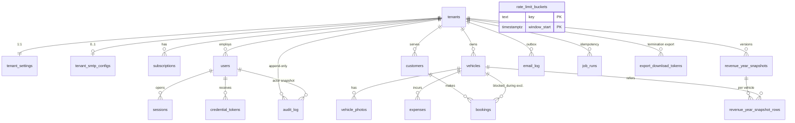

# Database: RentCar (data model, security, migrations, backup)

Version 1.0 · 2026-11-01 · Author: database-architect · Phase 4, wave A (analysis only, no migrations written)
Inputs read: `docs/03b-struttura-codice.md`, `docs/03-architettura.md`, ADR-0002/0003/0004/0005/0007/0008/0010/0013/0014, `docs/02-requisiti.md` v1.2, `docs/spec/car-rental-spec.md` §9, `docs/03-inputs/security-constraints.md`, `docs/security/sign-off.md`, plus the coordinator's messages (tenant fields: `shortDescription`, structured address, title max 45, Open Graph image key, `countryCode`, `dpaSignedAt`) and `docs/04a-ux.md` / `docs/09-seo.md` only for those fields. Aligned with `docs/08-security.md` (`SR-*` requirements, section 0.1).
Language: English (user decision 2026-11-01: all documentation in `docs/` is in English); table, column, policy and role names and SQL are in English. Questions to the user are in Italian (user request).

Change log:
- v1.0 (2026-11-01): first version.
- v1.1 (2026-11-01): requests from the backend analysis (06-backend-api §1.2 X7/X8) and the observability design (12-osservabilita, `/system/status`): (a) definer function `platform_tenant_usage()` (4.5, 4.6); (b) new table `export_download_tokens` for the termination-export download link, SR-GDPR-06 (5.23); (c) decision on cross-tenant reads of `job_runs` and `email_log` by scope `system`: `job_runs` yes (no personal data), `email_log` **no** row access, aggregate definer functions `platform_email_health()` and `platform_undelivered_credentials()` instead (4.5, 4.6); (d) tables 22 -> 23.

Experimental verification: statements marked **[V]** were executed on PostgreSQL 16.15 (container `postgres:16`, 2026-11-01); statements marked **[NV]** are not verified and have an associated check (section 15).

---

## 0. Summary of decisions

1. PostgreSQL 16 confirmed (relational, a single engine). The production provider is still agnostic (ADR-0010 stays "proposed"); section 1 sets the minimum requirements any provider must meet.
2. 23 tables (19 domain/operational including `export_download_tokens` + `security_event`, `platform_audit`, `slug_tombstone`, `deletion_ledger` required by 08-security). Every table holding tenant data has `tenant_id`, `ENABLE` + `FORCE ROW LEVEL SECURITY`, a `tenant_isolation` policy, and **composite** FKs `(tenant_id, x_id)` to the parent, so a record can never point to a row of another tenant even with RLS bypassed [V].
3. **TD-4 resolved** (section 4): tenant-less paths use `withSystem(actor)`, which sets `app.scope` (`resolve | system_auth | system | job | bootstrap`, aligned with SR-DB-05 and ADR-0003), not a single "system". Each scope sees only the tables/commands of matrix 4.5. Slug resolution (the most frequent public path) can read **only** `tenants` (SR-DB-05).
4. Policies use `NULLIF(current_setting(..., true), '')::uuid`: **the ADR-0003 form without `NULLIF` fails** with `invalid input syntax for type uuid: ""` on a pooled connection reused after a transaction [V].
5. Double booking: `EXCLUDE USING gist (vehicle_id WITH =, blocked_during WITH &&) WHERE (status <> 'cancelled')` with `blocked_during` maintained by a trigger [V: 60-minute buffer, 10:30 conflicts, 11:00 free; 60 parallel inserts = 1 winner]. Plus a per-vehicle transactional advisory lock to avoid deadlocks (section 6).
6. Append-only audit log at DB level: only `INSERT/SELECT` for the runtime role, no UPDATE/DELETE policy, a trigger that blocks UPDATE/DELETE even for the owner [V]. Deletions (24-month retention, tenant deletion) only through `SECURITY DEFINER` functions.
7. Hard delete of a tenant at 90 days: generic function `purge_tenant_data(uuid)` that orders tables from the FK graph [V: 4 rows deleted, other tenant intact], leaving only the "tombstone" row in `tenants`.
8. Migrations: `drizzle-kit generate` + custom SQL migrations for what Drizzle does not model; runner on `DIRECT_DATABASE_URL`; forward-only with separate rollback scripts for expand migrations; roles created by a bootstrap script (not by Drizzle).
9. Backup: `pg_dump -Fc --enable-row-security` with a dedicated read-only role (BYPASSRLS where the provider allows it, SR-DB-01; otherwise `backup_read` policy, equivalent [V]), row-count comparison in the restore test (SR-DB-09), encrypted with `age`, 30 days; restore as owner on tables with FORCE RLS **works** [V].
10. Alignment with 08-security: booking code of 10 Crockford characters (50 bit, SR-VAL-09), unique per tenant; credential emails never stored nor retried (SR-EML-02); deletion ledger replayed after every restore (SR-GDPR-08); guarded tenant deletion function (SR-GDPR-07); `security_event` retention 12 months and email recipient nulled at 90 days (SR-GDPR-05); IPs only as prefix + HMAC (SR-LOG-03).
11. Versioned, append-only yearly snapshots (no UPDATE/DELETE granted); nightly reconciliation as a safety net.

### 0.1 Alignment with `docs/08-security.md` (SR-* requirements that touch the database)

| SR | Requirement (summary) | Where covered | Notes / deviations |
|---|---|---|---|
| SR-DB-01 | roles created by SQL: owner, migrator, app, backup | 4.1 | owner `NOLOGIN`, `rentcar_migrator` does `SET ROLE rentcar_owner` (SET ROLE and object ownership to be verified in M1, NV7) |
| SR-DB-02 | `FORCE RLS`, policy with `nullif(current_setting('app.tenant_id', true), '')::uuid` | 4.2, 4.3 | proven [V]: without `NULLIF` an error on a reused connection |
| SR-DB-03 | `withTenant`: `set_config('app.tenant_id', ..., true)` + `app.scope='tenant'`, `release(true)` if ROLLBACK fails | 4.2 | |
| SR-DB-04 | catalog tests and spike S1 | 8.1, 12 | |
| SR-DB-05 | scopes `tenant`, `resolve`, `job`, `system`; no system policy on customers/bookings/vehicles/expenses/snapshots/media | 4.5 | added `system_auth` (systemadmin login) and `bootstrap` (CLI) |
| SR-DB-06 | explicit grants, append-only tables INSERT/SELECT, `EXECUTE` only on retention/hard-delete functions | 4.4 | |
| SR-DB-07 | role timeouts 10 s / 3 s / 15 s | 4.1 | |
| SR-DB-08 | TLS `verify-full`, DB only on 127.0.0.1 in compose | 1, 8.1 | |
| SR-DB-09 | dump with `rentcar_backup`, `age`, 30 days, restore with count comparison and ledger replay | 10 | BYPASSRLS required by SR-DB-01: adopted where allowed, `backup_read` policy as a portable alternative already verified |
| SR-DB-10 | reviewed SQL migrations, advisory lock, dev-only seeds | 8 | |
| SR-AUD-01..05 | three append-only stores (`audit_log`, `platform_audit`, `security_event`), DB-level immutability, values without PII, retention 24 months / 12 months / 6 years | 5.14, 5.19, 5.20 | trigger stricter than SR-AUD-03: requires `current_user = rentcar_owner` **and** the retention GUC |
| SR-LOG-03 | `security_event` with IP only as prefix + HMAC, retention 12 months | 5.19 | |
| SR-SES-01/06/07 | SHA-256 hash, coarse user agent, revocation = row DELETE, `last_seen` max 1/min | 5.6 | |
| SR-AUT-04 | atomic token consumption on POST | 5.7 | |
| SR-EML-02/06 | credential emails not stored nor retried; recipient nulled after 90 days | 5.15 | |
| SR-GDPR-04 | anonymisation incl. booking snapshots and recipients in `email_log` | 5.12, 9.3 | added `bookings.customer_email` as snapshot |
| SR-GDPR-05 | retention: sessions 7 d, tokens 7 d, rate-limit <= 24 h, idempotency keys 48 h, email log 12 months with recipient nulled at 90 d, `job_run` 12 months | 9.2 | replaces my earlier estimate (90 d / 180 d) |
| SR-GDPR-07 | hard delete with a `SECURITY DEFINER` function, slug tombstone 12 months, row in `platform_audit` and in the ledger | 9.3, 5.20-5.22 | |
| SR-GDPR-08 | deletion ledger, mandatory replay after every restore | 5.22, 9.3, 10 | |
| SR-GDPR-06 | termination export download: hashed single-purpose token, expiry 7 days, 3 downloads | 5.23 | dedicated table (not `credential_tokens`) |
| SR-RL-03 | rate-limit keys = HMAC, rows <= 24 h | 5.17 | |
| SR-ACC-07 | ASCII slug, reserved, immutable, tombstone 12 months | 5.1, 5.21 | |
| SR-VAL-09 / PB-04 / decision 5.8 | booking code `^[0-9A-HJKMNP-TV-Z]{10}$` (50 bit), unique per tenant | 5.12, 6.2 | **changes A-12** (8 characters, 31 symbols) |
| SR-PDF-02 | lookup by (slug, code) within the tenant | 5.12, 7.6 | |
| SR-JOB-03 | idempotency `(job, tenant, period)` + `pg_try_advisory_xact_lock` | 5.16 | |
| SR-CRY-01/03 | format `v1.<kid>.<nonce>.<ct+tag>`, AAD `rc:v1:smtp_password:{tenantId}` | 5.3 | |
| SR-CFG-02 | startup rejects a runtime role that is superuser/owner/BYPASSRLS (one query) | 4.1 | |

---

## 1. DB choice and hosting

**Confirmation**: PostgreSQL 16. Verifiable reasons: GiST exclusion with `tstzrange` (AC4/KPI-3) and RLS (ADR-0003) do not exist in MySQL/MariaDB or document stores; SQLite covers neither serverless pooling nor RLS; a document store would make revenue reports (per-month aggregations in the tenant time zone) more complex. Cache/Redis/search are not needed (ADR-0013/0014); full text is not required (searches by name/phone over a few thousand rows per tenant: `ILIKE` with `tenant_id`, no extension).

**Hosting (not re-decided here)**: Neon Frankfurt Launch (recommended by ADR-0010), Supabase Pro, Postgres on a VPS (option C). Costs and plans remain those of ADR-0010/`devops-costs.md` (Neon Launch estimated 5-15 USD/month at launch, 10-25 at month 12). The database is designed to work identically on all of them: only `DATABASE_URL` / `DIRECT_DATABASE_URL` vary.

**Minimum provider requirements** (checklist to verify with spike S1 and at GATE 4, for any provider):

| # | Requirement | Why |
|---|---|---|
| P1 | PostgreSQL >= 15 (CI tests on 16; nightly job on 17) | we use `UNIQUE ... NULLS NOT DISTINCT` (15), `security_invoker` (15), `SET NULL (col)` not used |
| P2 | `btree_gist` extension installable by a non-superuser role ("trusted" extension since PG13) | booking exclusion [V: created by a non-superuser owner role] |
| P3 | Ability to create `NOSUPERUSER NOBYPASSRLS` roles and use them for the app | effective RLS; the default roles of some providers (Neon console, Supabase) may bypass RLS [NV, sign-off point 5] |
| P4 | Transaction-mode pooler, TLS `verify-full`, EU region | ADR-0003/0010 |
| P5 | `ALTER ROLE ... SET` (timeouts) and `pg_dump` with a non-superuser role | sections 4.3 and 10 |
| P6 | Provider backup/PITR (Neon Launch 7 days) in addition to the nightly dump | NFR-BKP-01 |

If P3 is not met, RLS is useless: we fall back to the exception already accepted in ADR-0003 (scoping + tests only), which must be re-accepted by the user.

---

## 2. Conceptual and logical model

### 2.1 ER diagram



`rate_limit_buckets` has no relations (HMAC keys without a plain tenant). `security_event`, `platform_audit`, `slug_tombstone` and `deletion_ledger` are platform archives: they use `subject_tenant_id` (no FK, to survive tenant deletion) and have **no** `tenant_id` column, so the deletion function (which discovers tables from the `tenant_id` column) does not touch them.

### 2.2 Integrity rules (cardinalities and domain constraints)

| Rule | Where enforced |
|---|---|
| A unique, immutable slug, 3-40 characters | `UNIQUE` + `CHECK` + trigger `tenants_slug_immutable` |
| Only one active/pending admin per tenant (FR-SYS-15, REQ-16) | partial unique index `users_one_admin_per_tenant` |
| Username unique per tenant; systemadmin unique globally (A-1) | two unique indexes (tenant and `tenant_id IS NULL`) |
| Only one non-cancelled subscription per interval (A-6) | `EXCLUDE ... daterange(start_date,end_date,'[]')` |
| No overlapping non-cancelled bookings per vehicle (FR-BKG-08) | GiST exclusion |
| Booking, vehicle, customer always of the same tenant | composite FKs |
| Booking code unique per tenant (SR-PDF-02, decision 5.8) | `UNIQUE (tenant_id, code)` |
| Consistent payment: paid implies method, not paid implies amount 0 | `CHECK` |
| Immutable snapshot and version n+1 with no gaps | `INSERT` only, `UNIQUE (tenant_id, year, version)` |
| Non-modifiable audit | grant + policy + trigger |
| Subscription `expired` state is NOT stored (it is derived, FR-SYS-07) | `status` column allows only `active`, `cancelled` |

---

## 3. Conventions

- Plural `snake_case` tables, `snake_case` columns; `id uuid` (UUIDv7 from the application `IdGenerator`; default `gen_random_uuid()` only as a safety net for manual SQL and seeds); `tenant_id` right after `id`. Documented exceptions: 1:1 tables (`tenant_settings`, `tenant_smtp_configs`) have `tenant_id` as PK; "mixed" tables (`users`, `sessions`, `credential_tokens`, `audit_log`, `email_log`, `job_runs`) have a nullable `tenant_id` for platform records.
- `created_at`, `updated_at` `timestamptz NOT NULL DEFAULT now()`; `updated_at` maintained by trigger `set_updated_at()`.
- Enums as `text` + `CHECK ... IN (...)` (not native enums): the Drizzle migrator applies pending migrations in a single transaction [NV, to verify in M1] and `ALTER TYPE ADD VALUE` has limits inside a transaction; `CHECK`s are updated with drop/add. The TS type is the matching union.
- Amounts: `bigint` in minor units + `CHECK (x >= 0)` and a cap `< 10^12`; the currency lives on the tenant (locked after the first data, A-14); snapshots also store `currency`. The `pg` driver returns `int8` as a string: set `types.setTypeParser(20, Number)` (safe thanks to the cap) and `.mapWith(Number)` on aggregations.
- FKs: all with explicit `ON DELETE`. Rule: towards `tenants` and between tenant tables `NO ACTION` (no silent cascade deletion); `CASCADE` only `vehicle_photos -> vehicles`.
- Soft/hard delete: no generic `deleted_at`. Vehicles: `archived_at` (or delete if no history); customers: anonymisation; users: `status='deactivated'`; bookings: `status='cancelled'`; subscriptions: `status='cancelled'`; expenses: delete; tenant: tombstone.
- Date/time: instants in `timestamptz` (UTC); pure calendar dates (`expense_date`, `start_date`, `end_date`) in `date` in the tenant time zone. **Month/year attribution of revenue is computed in SQL** with `AT TIME ZONE tenants.time_zone` (single source: Postgres tzdata); `shared/time` serves input and display.
- Multilingual: single locale `en`, no translation tables (YAGNI). When a second language arrives, tenant-written texts (privacy, terms, description) will require `tenant_content_translations (tenant_id, locale, ...)`: an expand-only addition, no impact on the current schema.

---

## 4. Data security: roles, grants, RLS

### 4.1 Roles

| Role | Attributes | Use | Credential |
|---|---|---|---|
| `rentcar_admin` | provider/container superuser/CREATEROLE | **only** one-off bootstrap (roles, database, extension) | outside the app |
| `rentcar_owner` | `NOLOGIN NOSUPERUSER NOBYPASSRLS`; owner of DB and objects | not a runtime login; owner of the `SECURITY DEFINER` functions (retention, tenant deletion) | none |
| `rentcar_migrator` | `LOGIN NOSUPERUSER NOBYPASSRLS`, member of `rentcar_owner` | CI and `migrate` service (`DIRECT_DATABASE_URL`): the runner executes `SET ROLE rentcar_owner` at session start so created objects have the right owner (SR-DB-01, SR-DB-10) | CI/compose only, never in the runtime process |
| `rentcar_app` | `LOGIN NOSUPERUSER NOBYPASSRLS NOCREATEDB NOCREATEROLE`, not an owner, no DDL | runtime (`DATABASE_URL`, pooler) | hosting secret manager |
| `rentcar_backup` | `LOGIN NOSUPERUSER`, `default_transaction_read_only=on`, `SELECT` on everything; `BYPASSRLS` (SR-DB-01) **where the provider allows granting it**, otherwise `NOBYPASSRLS` + `backup_read` policy (4.3) | nightly `pg_dump` (`BACKUP_DATABASE_URL`, direct) | backup workflow secret |

Role settings (SR-DB-07): `ALTER ROLE rentcar_app SET statement_timeout='10s', lock_timeout='3s', idle_in_transaction_session_timeout='15s'`; `rentcar_migrator`: `lock_timeout='5s'`, `statement_timeout='120s'` set by the runner. No network call (SMTP, S3) inside a DB transaction.

Startup checks (`readyz`, not by parsing the URL): `current_user = 'rentcar_app'`, `rolsuper = false`, `rolbypassrls = false`; fails closed. A superuser always ignores RLS even with FORCE: the Compose image does NOT use `POSTGRES_USER=rentcar_owner`, but a separate bootstrap superuser and a `docker-entrypoint-initdb.d/10-roles.sh` script that creates the four roles with passwords from env. The startup check is the one in SR-CFG-02 (one query on `pg_roles`: not superuser, not owner, not BYPASSRLS).

`public`: `REVOKE ALL ON SCHEMA public FROM PUBLIC; GRANT USAGE ... TO rentcar_app, rentcar_backup`. No `ALTER DEFAULT PRIVILEGES`: every grant is explicit in the table's migration (a forgotten grant produces `permission denied` and a test catches it). Schema `drizzle`: `rentcar_app` has only `USAGE` + `SELECT` on `__drizzle_migrations` (for `readyz`: row count >= number of entries in the build's journal).

### 4.2 Session variables (GUC) and helper functions

All transaction-local (`set_config(name, value, true)`), never session-level (pooler):

| GUC | Set by | Meaning |
|---|---|---|
| `app.tenant_id` | `withTenant(scope)` (with `app.scope='tenant'`) | tenant uuid |
| `app.scope` | `withTenant` = `tenant`; `withSystemTx(purpose)` (SR-DB-05 name, `withSystem` in 03b) = `resolve`, `system_auth`, `system`, `job`, `bootstrap` | access context; each `purpose` (closed enum, architecture test) maps to a single scope; each use writes `system.context.used` in `security_event` (outside the work transaction) |
| `app.actor_id` | `withSystemTx` | systemadmin user uuid or empty (job) |
| `app.purge_mode` | only the retention/deletion `SECURITY DEFINER` functions | authorises DELETE on append-only archives (`'retention'` or the uuid of the tenant being deleted) |

`withTenant` and `withSystemTx` are mutually exclusive: the latter does not set `app.tenant_id`. The `tenant_id` value is validated as a uuid before `set_config`; failed `ROLLBACK` -> `release(true)` (SR-DB-03).

```sql
CREATE FUNCTION app_tenant_id() RETURNS uuid LANGUAGE sql STABLE
  AS $$ SELECT NULLIF(current_setting('app.tenant_id', true), '')::uuid $$;
CREATE FUNCTION app_scope() RETURNS text LANGUAGE sql STABLE
  AS $$ SELECT NULLIF(current_setting('app.scope', true), '') $$;
```

The `NULLIF(..., '')` form is the one in SR-DB-02 [V]. Policies call `(SELECT app_tenant_id())` (sub-select: evaluated once per statement, not per row). A non-uuid value in `app.tenant_id` raises an error, i.e. denies (fail closed). Known limit: RLS here protects from application errors (forgotten filter), **not** from SQL injection with full control of the statement, which could call `set_config`; the defence against injection is parameterised queries and the Semgrep rules of 03b.

### 4.3 RLS baseline for every table

Helper `rls_baseline(p_table regclass, p_tenant_scoped boolean)` (created in migration `0000`, not executable by `rentcar_app`) applies:

```sql
ALTER TABLE t ENABLE ROW LEVEL SECURITY;  ALTER TABLE t FORCE ROW LEVEL SECURITY;
CREATE POLICY owner_all   ON t TO rentcar_owner USING (true) WITH CHECK (true);   -- migrations/backfill/purge
CREATE POLICY backup_read ON t FOR SELECT TO rentcar_backup USING (true);          -- pg_dump --enable-row-security
-- if tenant-scoped:
CREATE POLICY tenant_isolation ON t
  USING (tenant_id = (SELECT app_tenant_id())) WITH CHECK (tenant_id = (SELECT app_tenant_id()));
```

Honest notes: (a) `owner_all` makes the owner effectively exempt (needed by migrations with backfill and by definer functions); the protection is that the owner credential never reaches the runtime (`readyz` check). (b) `backup_read` is the portable alternative to `BYPASSRLS` (which some providers do not allow granting): the dump is not filtered by RLS in either case, and the restore test compares row counts per table (SR-DB-09, ABU-M6-06). Both verified [V]. Catalog test: every table with RLS has the `owner_all` and `backup_read` policies; every table with `tenant_id` has `tenant_isolation` or is in the "mixed" list with explicit policies.

**Documented exceptions** (closed list checked by the catalog test, SR-DB-02): `rate_limit_buckets` without RLS (only HMACs and counters; needed before the tenant is known). The platform archives (`security_event`, `platform_audit`, `slug_tombstone`, `deletion_ledger`) have RLS with per-scope policies (not per tenant). No view over tenant tables without `security_invoker = true` (a definer view would bypass RLS): catalog test.

### 4.4 Grants to the runtime role (`rentcar_app`)

S=SELECT I=INSERT U=UPDATE D=DELETE. No TRUNCATE/REFERENCES/TRIGGER. No sequences (uuid keys).

| Table | S | I | U | D | Note |
|---|---|---|---|---|---|
| tenants | x | x | x | | tombstone via definer function |
| tenant_settings | x | x | x | | |
| tenant_smtp_configs | x | x | x | x | D = config removal |
| subscriptions | x | x | x | | cancellation = status |
| users | x | x | x | | no delete |
| sessions | x | x | x | x | D = logout/revocation (SR-SES-06) and purge |
| credential_tokens | x | x | x | x | D = purge |
| vehicles | x | x | x | x | D only without history (FK enforces it) |
| vehicle_photos | x | x | x | x | |
| expenses | x | x | x | x | |
| customers | x | x | x | | anonymise = UPDATE |
| bookings | x | x | x | | cancel = UPDATE |
| revenue_year_snapshots | x | x | | | immutable |
| revenue_year_snapshot_rows | x | x | | | immutable |
| audit_log | x | x | | | append-only |
| security_event | x | x | | | append-only; read only in scope `system` |
| platform_audit | x | x | | | append-only; scope `system` |
| slug_tombstone | x | x | | | INSERT/SELECT only; expiry via retention function |
| deletion_ledger | x | x | | | append-only |
| export_download_tokens | x | x | x | x | D = purge at 14 days and on tenant deletion |
| email_log | x | x | x | x | D = retention |
| job_runs | x | x | x | x | D = retention |
| rate_limit_buckets | x | x | x | x | |

`EXECUTE` on `purge_tenant_data(uuid)`, `purge_expired_records()` (retention of `audit_log`, `security_event`, `slug_tombstone`), `platform_kpis(...)`, `platform_tenant_usage()`, `platform_email_health(...)`, `platform_undelivered_credentials(...)` (4.6): only `rentcar_app` (`REVOKE ... FROM PUBLIC`). A catalog test compares actual privileges with this table (declared in `tests/security/grants-matrix.ts`).

### 4.5 Policy matrix for tenant-less paths (resolves TD-4)

Columns = value of `app.scope`: `R`=resolve, `A`=system_auth (systemadmin login, not yet authenticated), `S`=system (authenticated systemadmin console), `J`=job, `B`=bootstrap (systemadmin creation CLI). An empty cell = no policy = denied. The tenant path (`app.tenant_id`) always has `tenant_isolation` on all commands except where noted.

| Table | R | A | S | J | B |
|---|---|---|---|---|---|
| tenants | S | | S,I,U | S | |
| tenant_settings | | | S,I,U | | |
| tenant_smtp_configs | | | S,I,U | | |
| subscriptions | | | S,I,U | S | |
| users | | S,U where `role='systemadmin'` | S,U where `role IN ('admin','systemadmin')`; I where `role='admin'` | | S,I where `role='systemadmin'` |
| sessions | | S,I,D where `tenant_id IS NULL` | S,D (revocation on suspension/admin replacement) | D where expired for > 7 days | |
| credential_tokens | | S,I,U where `tenant_id IS NULL` | S,I,U | D where expired for > 7 days | I where `tenant_id IS NULL` |
| audit_log | | I | S where `tenant_id IS NULL OR entity_type IN ('tenant','subscription','admin_account')`; I | I | I |
| security_event | | I | S,I | I | I |
| platform_audit | | | S,I | I | I |
| slug_tombstone | S | | S,I | | |
| deletion_ledger | | | S,I | | |
| email_log | | I where `tenant_id IS NULL` | I; S,U where `channel = 'system_smtp'` (own mails: owner notifications and admin activation/reset) | S, I, U where `created_at < now() - 90 days` (recipient nulling), D where `created_at < now() - 12 months`, U where `tenant_id IS NULL` | I where `tenant_id IS NULL` |
| job_runs | | | S | S,I,U,D | |
| export_download_tokens | | | | | |
| vehicles, vehicle_photos, expenses, customers, bookings, snapshots (2), rate_limit | no access (R,A,S,J,B) | | | | |

Notes: `job_runs` is readable by `S` across tenants (confirmed): it holds only job names, period keys, counters and scrubbed error codes, no personal data, and `/system/status` needs it (12-osservabilita, Q1/Q1b). `email_log` is **not** readable by `S` across tenants: it carries recipient addresses of customers and staff of the tenants (SR-GDPR-05) and A-13 forbids the systemadmin from seeing customer data; `S` reads only its own system-SMTP mails and the console gets everything else through the aggregate definer functions of 4.6. `export_download_tokens` has no system-scope policy at all (the download route uses the tenant scope). `tenants` in `R` serves slug resolution; `slug_tombstone` in `R` serves answering with the same generic 404 for slugs reserved by deletion (SR-ACC-07). `security_event` events must be written in a separate, short transaction so a `ROLLBACK` of the work (e.g. access denied) does not lose them.

Verifiable consequences: no system path reads bookings or customers (A-13); slug resolution cannot touch users or sessions; jobs work inside tenants with `withTenant` for each step (the tenant list comes from `J`). `systemadmin` deletes nothing: tenant deletion goes through the definer function (section 9.3). The matrix is declared in `tests/security/rls-matrix.ts` and a test generates, for each (scope, table, command), the expected outcome and compares it with `pg_policies`.

**Aggregated data for KPI-7**: the systemadmin console shows only the booking count per tenant (coordinator decision, 04a). It is exposed through `platform_kpis(p_from timestamptz, p_to timestamptz)`, a `SECURITY DEFINER` function that requires `app_scope() = 'system'` and returns per tenant only `tenant_id, bookings_created, bookings_completed`. Revenue per tenant is NOT included (ASSUMPTION DB-A7: KPI-7 mentioned it, the coordinator reduced it to counts; to be added after confirmation).

### 4.6 Read-only definer functions for the system console

All `SECURITY DEFINER`, owner `rentcar_owner`, `SET search_path = pg_catalog, public`, `REVOKE ... FROM PUBLIC`, `EXECUTE` to `rentcar_app`, and the first statement raises an exception unless `app_scope() = 'system'` (a tenant, `resolve`, `job` or missing scope gets an error, not zero rows, so a wrong call is visible). They return aggregates only, never a personal column. Each has a catalog test (listed in the allowed `SECURITY DEFINER` set) and a scope test.

| Function | Returns | Used by |
|---|---|---|
| `platform_tenant_usage()` | per tenant (all statuses except `deleted`): `tenant_id`, `vehicle_count` (vehicles with `archived_at IS NULL`, the figure compared with `max_vehicles`), `operator_count` (users with `role='operator'` and `status IN ('pending','active')`, compared with `max_operators`), `has_vehicles` (any vehicle, archived included), `has_bookings` (any booking, any status). Nothing else | FR-SYS-01 list (06-backend-api TEN-09) and the lock of time zone/currency "once a vehicle or booking exists" (A-14, FR-BRD-09): the service allows the change only if `has_vehicles = false AND has_bookings = false` (06-backend-api TEN-04, X7). For a single tenant the caller filters the result by id (about 50 rows at most) |
| `platform_email_health(p_since timestamptz)` | `category`, `template`, `status`, `count` over `email_log.created_at >= p_since` (all tenants, no recipient, no tenant id) | `/system/status` section B (Q2); the delivery rate is computed by the caller on `category='transactional'` |
| `platform_undelivered_credentials(p_since timestamptz)` | `tenant_id`, `related_id`, `last_attempt_at` of `email_log` rows with `category='credential'` and `status IN ('failed','abandoned')` | `/system/status` Q2b ("activation not delivered"); the admin then re-issues the link |
| `platform_kpis(p_from, p_to)` | see above | `/system/status` section C |

`platform_tenant_usage()` is not a materialised view: the underlying counts are cheap at this scale (<= 50 tenants x tens of vehicles, indexes `(tenant_id) WHERE archived_at IS NULL` on `vehicles`, `(tenant_id, role, status)` on `users`, `(tenant_id, start_at)` on `bookings` for the `EXISTS`).

---

## 5. Data dictionary

Legend: PK, FK, U=unique, NN=not null. `tenant_id` is always an FK `tenants(id) ON DELETE NO ACTION`. `created_at`/`updated_at` columns are not repeated. "Privacy": P=personal data, S=secret, `-`=none.

### 5.1 tenants (platform realm, readable by the tenant for its own row)

| Column | Type | Constraints | Privacy / notes |
|---|---|---|---|
| id | uuid | PK | |
| slug | text | NN, U `tenants_slug_key`, CHECK `~ '^[a-z0-9][a-z0-9-]{1,38}[a-z0-9]$'` | immutable (trigger, SR-ACC-07), except the `deleted-<id>` rename done by the deletion function (`current_user = rentcar_owner`); on deletion the original slug moves to `slug_tombstone` (12 months, 5.21); reserved words in code (route test) |
| name | text | NN, 1..120 | after deletion: `deleted-<8 char id>` |
| status | text | NN default `active`, CHECK in (`active`,`suspended`,`terminated`,`deleted`) | |
| country_code | char(2) | NN default `'IT'`, CHECK `~ '^[A-Z]{2}$'` | ASSUMPTION DB-A1 (04a, UXA-6): ISO 3166-1, used for phone normalisation (REQ-10); **distinct** from the address country |
| time_zone | text | NN default `'Europe/Rome'` | trigger `tenants_validate_tz` checks against `pg_timezone_names` (a wrong value would break `AT TIME ZONE` queries) |
| currency | char(3) | NN default `'EUR'`, CHECK `~ '^[A-Z]{3}$'` | decimal exponent derived from an ISO table in `shared/money` |
| dpa_signed_at | timestamptz | NULL | ASSUMPTION DB-A2 (UX-9, awaiting the user): ticked manually by the systemadmin (path `S` only); not a technical prerequisite |
| terminated_at | timestamptz | NULL | |
| deletion_due_at | timestamptz | NULL | `terminated_at + 90 days` (computed by the app, constrained by CHECK `deletion_due_at >= terminated_at`) |
| export_delivered_at | timestamptz | NULL | US-066: without it, deletion is blocked |
| export_storage_key | text | NULL | key under `tenants/{id}/exports/` |
| deletion_override_reason | text | NULL, <= 500 | allows deletion without a delivered export |
| deleted_at | timestamptz | NULL | |

Consistency CHECKs: `(status IN ('terminated','deleted')) = (terminated_at IS NOT NULL)`; `(status = 'deleted') = (deleted_at IS NOT NULL)`.
Indexes: PK, `tenants_slug_key`; partial index `(deletion_due_at) WHERE status = 'terminated'` (reminder before deletion). Triggers: `tenants_slug_immutable`, `tenants_validate_tz`, `set_updated_at`.
RLS: `tenant_isolation` SELECT only (`id = app_tenant_id()`), plus the system policies of 4.5. The tenant can never modify its own row (no UPDATE policy for `tenant`): everything the tenant admin edits lives in `tenant_settings`.

### 5.2 tenant_settings (1:1, editable by the tenant admin and the systemadmin)

| Column | Type | Constraints | Privacy / notes |
|---|---|---|---|
| tenant_id | uuid | PK, FK tenants | |
| title | text | NN, CHECK `char_length(title) BETWEEN 1 AND 45` | user decision: max 45; initially = name |
| short_description | text | NULL, CHECK `char_length <= 160` | user decision; meta description (SEO) |
| contact_email | text | NN, <= 254 | business data (also public) |
| contact_phone | text | NN, <= 32 | same |
| address_street, address_postal_code, address_city | text | NULL | optional structured address |
| address_country_code | char(2) | NULL, CHECK `~ '^[A-Z]{2}$'` | distinct from `tenants.country_code` |
| (address constraint) | | CHECK: the four address fields are **all NULL or all NN** | ASSUMPTION DB-A3: a partial address is of no use to SEO/PDF |
| logo_storage_key | text | NULL | |
| logo_alt | text | NULL, CHECK `logo_storage_key IS NULL OR char_length(logo_alt) > 0` | FR-BRD-08 |
| og_image_key | text | NULL, CHECK `og_image_key IS NULL OR logo_storage_key IS NOT NULL` | user decision + 09-seo: 1200x630 image derived from the logo on save; the app regenerates it and deletes the previous one on every logo change |
| color_primary, color_secondary, color_accent, color_background, color_text | char(7) | NULL, CHECK `~ '^#[0-9a-fA-F]{6}$'` | NULL = platform default (no duplicated tokens in the DB) |
| font_key | text | NN default `inter`, CHECK in (`inter`,`manrope`,`plus_jakarta_sans`) | |
| theme_mode | text | NN default `auto`, CHECK in (`auto`,`light`,`dark`) | |
| theme_version | integer | NN default 1 | cache-buster for `theme.css?v=` |
| min_rental_days | smallint | NN default 1, CHECK >= 1 | |
| max_rental_days | smallint | NN default 30, CHECK `>= min_rental_days` | |
| lead_time_minutes | integer | NN default 0, CHECK 0..43200 | cap = ASSUMPTION DB-A4 |
| buffer_minutes | integer | NN default 0, CHECK 0..1440 | cap = ASSUMPTION DB-A4 (finite range for the exclusion constraint) |
| privacy_notice_url, rental_terms_url | text | NULL, CHECK `~ '^https://'`, <= 2048 | REQ-12 |
| privacy_notice_text, rental_terms_text | text | NULL, <= 20000 | |
| notify_new_booking | boolean | NN default true | FR-MAIL-07 |

Indexes: PK only. RLS: `tenant_isolation` (all commands) + `S` (S,I,U). Both the tenant and the systemadmin write: every write produces an audit row with the actor.

### 5.3 tenant_smtp_configs (1:1, separate secret)

| Column | Type | Constraints | Privacy / notes |
|---|---|---|---|
| tenant_id | uuid | PK, FK | no row = "SMTP not configured" (FR-MAIL-03) |
| host | text | NN, <= 255 | validated by the SSRF guard on save, test and send |
| port | integer | NN, CHECK in (25,465,587,2525) | |
| security | text | NN, CHECK in (`tls`,`starttls`) | TLS always verified |
| username | text | NN | S |
| password_enc | text | NN, CHECK `~ '^v1\.[0-9a-f]{8}\.'` | S (SR-CRY-01/03/04): AES-256-GCM, format `v1.<kid>.<nonce_b64url>.<ct+tag_b64url>`, AAD = `rc:v1:smtp_password:{tenantId}`; rotation re-encrypts in batches; never in log/audit/CSV; separate table so reads of `tenant_settings` do not load it |
| from_address | text | NN | |
| from_name | text | NULL | |
| last_test_at, last_test_ok, last_test_error | timestamptz, boolean, text | NULL; error <= 500, scrubbed | |

RLS: `tenant_isolation` + `S` (S,I,U). The dump contains only ciphertext; the `APP_ENCRYPTION_KEY` key must never be stored with the dumps (section 10).

### 5.4 subscriptions

| Column | Type | Constraints | Notes |
|---|---|---|---|
| id | uuid | PK, U `(tenant_id, id)` | |
| tenant_id | uuid | NN, FK | |
| max_vehicles, max_operators | integer | NN, CHECK >= 0 | |
| start_date, end_date | date | NN, CHECK `end_date >= start_date` | `end_date` inclusive, end of day in the tenant time zone |
| price_minor | bigint | NN, CHECK >= 0 | informational (FR-SYS-11) |
| price_currency | char(3) | NN | independent from the tenant (A-14) |
| status | text | NN default `active`, CHECK in (`active`,`cancelled`) | `expired` derived, not stored (conscious deviation from spec §5) |
| cancelled_at | timestamptz | NULL, CHECK `(status='cancelled') = (cancelled_at IS NOT NULL)` | |

Constraint: `EXCLUDE USING gist (tenant_id WITH =, daterange(start_date, end_date, '[]') WITH &&) WHERE (status <> 'cancelled')` (A-6, US-012). Index: `(tenant_id, end_date DESC)` (current subscription). Renewal reminder: no marker table, `job_runs` with `period_key = 'sub:<id>:<end_date>'` is enough (if the date is extended, a new key and a new reminder arise).
Plan limits: serialised with `pg_advisory_xact_lock(hashtextextended('limit:vehicles:' || tenant_id, 0))` before the count (US-013, also valid for operators).
RLS: `tenant_isolation` (SELECT only for the tenant path: the admin does not edit their own plan; policy `FOR SELECT`), `S` (S,I,U), `J` (S).

### 5.5 users

| Column | Type | Constraints | Privacy / notes |
|---|---|---|---|
| id | uuid | PK, U `(tenant_id, id)` | |
| tenant_id | uuid | NULL, FK | NULL = systemadmin |
| role | text | NN, CHECK in (`systemadmin`,`admin`,`operator`), CHECK `(role='systemadmin') = (tenant_id IS NULL)` | |
| username | text | NN, CHECK `username = lower(username) AND username ~ '^[a-z0-9._-]{3,64}$'` | P; normalised by the app; unique also among deactivated users (A-39: history stays under the same username) |
| display_name | text | NN, 1..120 | P |
| email | text | NN, <= 254 | P; not unique |
| password_hash | text | NULL | S: argon2id string with parameters; NULL until activated |
| status | text | NN default `pending`, CHECK in (`pending`,`active`,`deactivated`), CHECK `status <> 'active' OR password_hash IS NOT NULL` | "activation not delivered" derived from `email_log` |
| must_change_password | boolean | NN default false | |
| password_changed_at, last_login_at, deactivated_at | timestamptz | NULL | |

Indexes: `users_username_per_tenant UNIQUE (tenant_id, username) WHERE tenant_id IS NOT NULL`; `users_username_system UNIQUE (username) WHERE tenant_id IS NULL`; `users_one_admin_per_tenant UNIQUE (tenant_id) WHERE role='admin' AND status IN ('pending','active')` (replacement: first deactivate the old one, then insert the new one, in the same transaction); `(tenant_id, role, status)` for the operator count. No failed-login counter here: lockout uses `rate_limit_buckets` (ADR-0005).
RLS: `tenant_isolation` with `tenant_id IS NOT NULL AND tenant_id = app_tenant_id()` (systemadmin rows are never visible to a tenant) + matrix 4.5.

### 5.6 sessions

| Column | Type | Constraints | Notes |
|---|---|---|---|
| id | uuid | PK | |
| tenant_id | uuid | NULL, FK | |
| realm | text | NN, CHECK in (`tenant`,`system`), CHECK `(realm='system') = (tenant_id IS NULL)` | |
| user_id | uuid | NN, FK `users(id)` NO ACTION; composite FK `(tenant_id, user_id) -> users(tenant_id, id)` (active only when tenant_id is not null) | session and user in the same tenant |
| token_hash | bytea | NN, U, CHECK `octet_length = 32` | SHA-256 of the 256-bit token; the token is never stored |
| assurance_level | smallint | NN default 1, CHECK in (1,2) | MFA extension point (ADR-0005) |
| last_seen_at | timestamptz | NN | updated at most once per minute (avoids a write per request) |
| idle_expires_at, absolute_expires_at | timestamptz | NN | 30 min / 12 h tenant; 15 min / 8 h systemadmin (A-4, SR-SES-07) |
| user_agent_summary | text | NULL, <= 80 | coarse summary ("Chrome / macOS") for the session list (SR-SES-01/08); no IP |
| password_changed_at (on `users`) | | | the guard compares `users.password_changed_at` with `sessions.created_at` (SR-SES-06) |

Revocation = `DELETE` of the row (logout, deactivation, suspension, password change, admin replacement: SR-SES-06); no IP stored, only the user-agent summary. Indexes: `UNIQUE (token_hash)`, `(user_id)` (revoke all sessions), `(absolute_expires_at)` (daily purge: removes rows expired/revoked for > 7 days).

### 5.7 credential_tokens (set-password and reset links)

| Column | Type | Constraints | Notes |
|---|---|---|---|
| id | uuid | PK | |
| tenant_id | uuid | NULL, FK | |
| user_id | uuid | NN, FK as for `sessions` | |
| purpose | text | NN, CHECK in (`activation`,`password_reset`) | |
| token_hash | bytea | NN, U, `octet_length = 32` | SHA-256; 256-bit token |
| expires_at | timestamptz | NN | 24 h activation, 60 min reset |
| used_at, superseded_at | timestamptz | NULL | |
| created_by_user_id | uuid | NULL, FK users | who issued the link |

Index: `credential_tokens_one_live UNIQUE (user_id, purpose) WHERE used_at IS NULL AND superseded_at IS NULL` (re-issuing invalidates the previous one: first `superseded_at`, then insert). Atomic consumption, in the same transaction that sets the password:
`UPDATE credential_tokens SET used_at = now() WHERE token_hash = $1 AND used_at IS NULL AND superseded_at IS NULL AND expires_at > now() RETURNING user_id`.
Retention: daily purge 7 days after expiry/use.

### 5.8 vehicles

| Column | Type | Constraints | Notes |
|---|---|---|---|
| id | uuid | PK, U `(tenant_id, id)` | |
| tenant_id | uuid | NN, FK | |
| name | text | NN, 1..120 | natural sorting in the app (a few dozen rows) |
| plate | text | NN, <= 20 | |
| plate_normalized | text | generated: `upper(regexp_replace(plate,'[^A-Za-z0-9]','','g'))` STORED | |
| make, model | text | NN, <= 80 | |
| category | text | NN, CHECK in (`city`,`compact`,`sedan`,`suv`,`van`,`convertible`,`luxury`,`other`) | A-20 |
| fuel_type | text | NN, CHECK in (`petrol`,`diesel`,`hybrid`,`plug_in_hybrid`,`electric`,`lpg_cng`) | |
| seats | smallint | NN, CHECK 1..20 | |
| daily_price_minor | bigint | NN, CHECK >= 0 | |
| status | text | NN default `available`, CHECK in (`available`,`maintenance`) | `rented` derived |
| archived_at | timestamptz | NULL | does not count toward `max_vehicles` (A-18) |
| notes | text | NULL, <= 2000 | FR-DAT-01 warning in UI; potential P |

Indexes: `UNIQUE (tenant_id, plate_normalized)` (ASSUMPTION DB-A5: unique also among archived; the same plate in another tenant is allowed); `(tenant_id, lower(name))`; partial `(tenant_id) WHERE archived_at IS NULL` (limit count). Incoming FKs: `bookings`, `expenses`, `vehicle_photos` prevent deleting a vehicle with history (it is archived).

### 5.9 vehicle_photos

| Column | Type | Constraints | Notes |
|---|---|---|---|
| id | uuid | PK | |
| tenant_id, vehicle_id | uuid | NN; composite FK `(tenant_id, vehicle_id) -> vehicles(tenant_id,id) ON DELETE CASCADE` | |
| storage_key | text | NN, U | base key `tenants/{tenantId}/vehicles/{vehicleId}/{uuid}`; the 480/1280 WebP variants derive from the name |
| byte_size, width, height | integer | NN, CHECK > 0 | |
| position | smallint | NN, CHECK 0..9 | CHECK + uniqueness enforces the maximum of 10 photos (A-23) |
| is_cover | boolean | NN default false | |

Indexes: `UNIQUE (vehicle_id, position) DEFERRABLE INITIALLY DEFERRED` (reordering with swaps); `UNIQUE (vehicle_id) WHERE is_cover`. Storage objects are deleted after commit; a reconciliation job lists the per-tenant prefixes and removes orphans (low priority).

### 5.10 expenses

| Column | Type | Constraints | Notes |
|---|---|---|---|
| id | uuid | PK | |
| tenant_id, vehicle_id | uuid | NN; composite FK to `vehicles` NO ACTION | |
| expense_date | date | NN | tenant calendar date |
| category | text | NN, CHECK in (`purchase`,`repair`,`maintenance`,`other`) | |
| amount_minor | bigint | NN, CHECK `> 0` | |
| description | text | NULL, <= 500 | FR-DAT-01 warning |
| created_by_user_id | uuid | NULL, FK users | |

Indexes: `(tenant_id, expense_date) INCLUDE (vehicle_id, amount_minor)` (global revenue/expenses per month, index-only), `(tenant_id, vehicle_id, expense_date)` (per vehicle and FK).

### 5.11 customers

| Column | Type | Constraints | Privacy / notes |
|---|---|---|---|
| id | uuid | PK, U `(tenant_id, id)` | |
| tenant_id | uuid | NN, FK | |
| first_name, last_name | text | NN, 1..80 | P |
| phone | text | NN, CHECK `phone ~ '^\+[1-9][0-9]{6,14}$' OR anonymized_at IS NOT NULL` | P: E.164 normalised with `tenants.country_code` |
| email | text | NULL, <= 254 | P |
| anonymized_at | timestamptz | NULL | |

Indexes: `UNIQUE (tenant_id, phone)` (de-duplication FR-CUS-03; concurrency with `INSERT ... ON CONFLICT (tenant_id, phone) DO NOTHING` then SELECT; anonymous placeholders `anon-<id without dashes>` are unique by construction); `(tenant_id, created_at DESC)`. No customer notes field (minimisation). Same phone in two tenants = two customers (FR-CUS-08).

### 5.12 bookings

| Column | Type | Constraints | Privacy / notes |
|---|---|---|---|
| id | uuid | PK, U `(tenant_id, id)` | |
| tenant_id | uuid | NN, FK | |
| code | text | NN, U `bookings_tenant_code_key (tenant_id, code)`, CHECK `~ '^[0-9A-HJKMNP-TV-Z]{10}$'` | SR-VAL-09 and decision 5.8 of 08-security: Crockford base32 (32 symbols, without I,L,O,U), 10 characters = 50 bit, CSPRNG; unique **per tenant**, lookup always `(tenant_id, code)` (SR-PDF-02); grouped display is a UI concern. Changes A-12 |
| vehicle_id | uuid | NN, composite FK `(tenant_id, vehicle_id)` NO ACTION | |
| customer_id | uuid | NN, composite FK `(tenant_id, customer_id)` NO ACTION | |
| customer_first_name, customer_last_name | text | NN | P: names as entered (FR-CUS-03); anonymised with the customer (SR-GDPR-04) |
| customer_email | text | NULL, <= 254 | P: email given for the confirmation (may differ from `customers.email`, never overwritten: ABU-M2-07); nulled on anonymisation. The phone coincides by construction with `customers.phone` (matching key) |
| start_at, end_at | timestamptz | NN, CHECK `end_at > start_at` | `end_at` = effective return = revenue attribution date |
| buffer_minutes | integer | NN default 0, CHECK 0..1440 | buffer snapshot; see 6.1 |
| blocked_during | tstzrange | NN default `'empty'`, CHECK `NOT isempty(blocked_during)` | managed **only** by trigger `bookings_set_blocked_during`; the `empty` default exists only so Drizzle treats the column as optional; the CHECK guarantees the trigger fired |
| status | text | NN default `confirmed`, CHECK in (`confirmed`,`active`,`completed`,`cancelled`) | |
| status_changed_at | timestamptz | NN default now() | |
| daily_price_minor | bigint | NN, CHECK >= 0 | snapshot (FR-BKG-05) |
| billed_days | smallint | NN, CHECK >= 1 | |
| total_minor | bigint | NN, CHECK >= 0 | no `total = price x days` CHECK: future promotions (FR-PUB-12) would break it; the authority is the `pricing()` function |
| payment_method | text | NULL, CHECK in (`card`,`cash`) | |
| is_paid | boolean | NN default false | |
| paid_amount_minor | bigint | NN default 0, CHECK >= 0 | |
| (payment) | | CHECK `NOT is_paid OR payment_method IS NOT NULL`; CHECK `is_paid OR paid_amount_minor = 0` | balance = total - paid, derived |
| paid_at | timestamptz | NULL | |
| source | text | NN, CHECK in (`public`,`admin`) | |
| notes | text | NULL, <= 2000 | potential P; see DB-2 |
| cancelled_at | timestamptz | NULL | |
| cancel_reason | text | NULL, <= 500 | |
| (cancellation) | | CHECK `(status='cancelled') = (cancelled_at IS NOT NULL)` | |
| created_by_user_id | uuid | NULL, FK users | NULL = public customer |
| idempotency_key | text | NULL, <= 64 | FR-BKG-11; nulled by the job after 48 h (SR-GDPR-05) |
| version | integer | NN default 1 | optimistic lock (FR-BKG-19): `UPDATE ... WHERE id=$1 AND version=$2` |

Indexes (each has a query, section 7):

| Index | Use |
|---|---|
| `bookings_tenant_code_key UNIQUE (tenant_id, code)` | lookup by code (confirmation, PDF), per-tenant uniqueness |
| `bookings_tenant_idempotency_key UNIQUE (tenant_id, idempotency_key) WHERE idempotency_key IS NOT NULL` | safe replay |
| `bookings_vehicle_id_blocked_during_excl` (partial GiST, created by the constraint) | double booking and availability search |
| `(tenant_id, start_at DESC)` | booking list, calendar |
| `(tenant_id, end_at)` | revenue per month, future calendar |
| `(tenant_id, vehicle_id, start_at DESC)` | vehicle history, FK |
| `(tenant_id, customer_id, start_at DESC)` | customer history, limit of 3 open bookings per phone, privacy reminder |
| `bookings_open_idx (tenant_id, start_at) WHERE status IN ('confirmed','active')` | transition job (tiny index) |

Triggers: `bookings_set_blocked_during` (BEFORE INSERT OR UPDATE OF start_at,end_at,buffer_minutes), `set_updated_at`.
Effective status (read against time, A-25), used by lists, calendar, revenue:
```sql
CASE WHEN status IN ('confirmed','active') AND end_at <= now() THEN 'completed'
     WHEN status = 'confirmed' AND start_at <= now() THEN 'active'
     ELSE status END
```

### 5.13 revenue_year_snapshots and revenue_year_snapshot_rows

`revenue_year_snapshots` (header = global total):

| Column | Type | Constraints | Notes |
|---|---|---|---|
| id | uuid | PK, U `(tenant_id, id)` | |
| tenant_id | uuid | NN, FK | |
| year | smallint | NN | year in the tenant time zone |
| version | integer | NN, CHECK >= 1 | |
| currency | char(3) | NN | frozen with the numbers |
| revenue_minor, collected_minor, expenses_minor, net_minor | bigint | NN; CHECK `net_minor = revenue_minor - expenses_minor` | |
| bookings_count | integer | NN, CHECK >= 0 | |
| frozen_at | timestamptz | NN | |
| corrected_at | timestamptz | NULL | |
| corrected_by_user_id | uuid | NULL, FK users | |
| reason | text | NULL, <= 300 | e.g. `expense:created:<id>`, `booking:updated:<code>`, `reconciliation` |
| (version) | | CHECK `(version = 1) = (corrected_at IS NULL)`; `UNIQUE (tenant_id, year, version)` | |

`revenue_year_snapshot_rows` (per vehicle): PK `(snapshot_id, vehicle_id)`; `tenant_id`; composite FKs `(tenant_id, snapshot_id)` and `(tenant_id, vehicle_id)` NO ACTION; the same five numeric columns (revenue, collected, expenses, net, bookings_count). ASSUMPTION DB-A6: the snapshot stores only yearly totals (global + per vehicle), not the monthly detail (FR-REV-06 compares years; the month is recomputed live) — see DB-5.
Immutability: only SELECT/INSERT are granted on both objects; version n+1 is created under `pg_advisory_xact_lock(hashtextextended('snapshot:'||tenant_id||':'||year,0))` with uniqueness on `(tenant_id, year, version)` as a safety net. Latest version: `ORDER BY version DESC LIMIT 1` (covered by the unique index). Sum of vehicle rows = global row (FR-REV-10): guaranteed by the same query and verified by a test.

### 5.14 audit_log

| Column | Type | Constraints | Notes |
|---|---|---|---|
| id | uuid | PK (UUIDv7) | cursor `(created_at, id)` |
| tenant_id | uuid | NULL, FK | NULL = platform event |
| created_at | timestamptz | NN default now() | |
| actor_type | text | NN, CHECK in (`user`,`system`,`public`) | |
| actor_user_id | uuid | NULL, FK users NO ACTION | |
| actor_username, actor_role | text | NULL | snapshot (A-39) |
| action | text | NN | e.g. `booking.updated` |
| entity_type | text | NN | `booking`, `payment`, `settings`, `subscription`, `tenant`, `admin_account`, `snapshot`, `customer`, `export` |
| entity_id | uuid | NULL | |
| entity_ref | text | NULL | non-personal human reference (booking code) |
| changes | jsonb | NN default `'{}'`, CHECK `pg_column_size(changes) <= 16384` | `{field: {old, new}}`; **per-action allowlist** in code (`AuditLog.record`): never names/phones/emails, never secrets; canary test |
| request_id | text | NULL | |

Indexes: `(tenant_id, created_at DESC, id DESC)` (viewer), `(tenant_id, entity_type, entity_id, created_at DESC)` (booking history), `BRIN (created_at)` (global retention).
Append-only, four levels [V for trigger, privileges, policy]: (1) grant only `SELECT, INSERT`; (2) no UPDATE/DELETE policy for `tenant`/system; (3) trigger `append_only_guard('24 months')` (generic function, parameter = minimum age) BEFORE UPDATE/DELETE and BEFORE TRUNCATE that raises `append-only` even for the owner, **except** DELETE when `current_user = 'rentcar_owner'` (i.e. inside the definer functions, SR-AUD-03) **and** `app.purge_mode = <row's tenant_id>` (tenant deletion) or `= 'retention'` with `OLD.created_at < now() - 24 months`; (4) the GUC is set only by definer functions, and `rentcar_app` has no DELETE privilege anyway. Values (SR-AUD-04): identifiers, enumerations, numbers, dates; for free-text fields only a `changed` marker with the length. Retention 24 months (SR-AUD-05).

### 5.15 email_log (outbox, ADR-0008; SR-EML-02/06, SR-GDPR-05)

| Column | Type | Constraints | Privacy / notes |
|---|---|---|---|
| id | uuid | PK | |
| tenant_id | uuid | NULL, FK | NULL = owner mail (SYSTEM_ADMIN_EMAIL), visible to the system only |
| channel | text | NN, CHECK in (`tenant_smtp`,`system_smtp`) | |
| category | text | NN, CHECK in (`transactional`,`credential`) | `credential` = activation, reset, admin replacement |
| template | text | NN | |
| related_type, related_id | text, uuid | NN | polymorphic reference (no FK; per-tenant deletion covers it) |
| recipient | text | NULL, <= 254 | P: recipient address; **nulled (NULL) 90 days after the last attempt** and on customer anonymisation (SR-GDPR-04/05); `recipient_scrubbed_at` tracks it |
| recipient_scrubbed_at | timestamptz | NULL | |
| status | text | NN default `pending`, CHECK in (`pending`,`sending`,`sent`,`failed`,`abandoned`) | |
| attempts, max_attempts | smallint | NN default 0 / 5; CHECK `category <> 'credential' OR max_attempts = 1` | **no automatic retry for credential emails** (SR-EML-02): the plaintext token is never stored (only the hash in `credential_tokens`), the message is generated at send time and the creator re-issues the link (FR-AUTH-04). A `credential` row still `pending` after 15 min becomes `failed` ("activation not delivered") |
| next_attempt_at, locked_until, last_attempt_at, sent_at | timestamptz | NULL | `sending` with expired `locked_until` becomes available again (`transactional` only) |
| last_error | text | NULL, <= 500 | coarse category only, scrubbed (SR-SSRF-05) |

The log keeps recipient, template, status, category and timestamps, **never** body, PDF or token: the PDF is regenerated from the booking id at every attempt (SR-EML-06, A-30); a retry resolves the address from the related row if `recipient` was already nulled (otherwise `abandoned`). Indexes: partial `(next_attempt_at) WHERE status IN ('pending','failed') AND category = 'transactional'`; `(tenant_id, related_type, related_id)`; `(created_at)` (nulling at 90 days, deletion at 12 months). Claim: `SELECT ... FOR UPDATE SKIP LOCKED`; send outside the DB transaction. At-least-once semantics (accepted). Per-tenant daily row cap (SR-EML-05) enforced by the service with a count on `(tenant_id, created_at)`.

### 5.16 job_runs

| Column | Type | Constraints | Notes |
|---|---|---|---|
| id | uuid | PK | |
| job | text | NN | |
| tenant_id | uuid | NULL, FK | NULL = platform job |
| period_key | text | NN | `2026-11-01T13` (hourly), `2026-11-01`, `year:2026`, `sub:<id>:<end_date>` |
| status | text | NN, CHECK in (`succeeded`,`failed`,`skipped`) | |
| attempt | integer | NN default 1 | |
| started_at, finished_at | timestamptz | NN | |
| counts | jsonb | NN default `'{}'` | |
| error | text | NULL, <= 500 | scrubbed |

`CREATE UNIQUE INDEX job_runs_idempotency ON job_runs (job, tenant_id, period_key) NULLS NOT DISTINCT` (PG15+). Crash-proof protocol with no `running` state: in **one** transaction: `INSERT ... ON CONFLICT (job, tenant_id, period_key) DO UPDATE SET attempt = job_runs.attempt + 1, status = 'succeeded', ... WHERE job_runs.status = 'failed'` + work + commit; a concurrent second caller waits on the unique index and then gets no rows, so it skips. If the work fails, rollback and a second transaction records `failed`. As required by SR-JOB-03/ADR-0007 the job step also takes `pg_try_advisory_xact_lock(hashtextextended('job:'||job||':'||period_key,0))` (if not obtained: skip). Index `(started_at DESC)` for the owner's view; retention 12 months (SR-GDPR-05).

### 5.17 rate_limit_buckets (no RLS, see 4.3)

`key text` (HMAC-SHA256 hex of `tenant:scope:identity`, key derived with HKDF, SR-RL-03; 64 characters, CHECK; no plain IP), `window_start timestamptz`, `count integer NN`, `expires_at timestamptz NN`; PK `(key, window_start)`; index `(expires_at)`. Upsert: `INSERT ... ON CONFLICT (key, window_start) DO UPDATE SET count = rate_limit_buckets.count + 1 RETURNING count`, executable in a single round trip. Hourly purge: rows with `expires_at < now()` (window + 1 h, always < 24 h, NFR-GDPR-02). LOGGED table (UNLOGGED not recommended on Neon: it is emptied when the compute suspends).

### 5.18 Tables not created

No `notification_markers` table (covered by `job_runs`), no `password_reset_tokens` (covered by `credential_tokens`), no `tenant_exports` (the `export_*` columns on `tenants` record the export; the download link is stored in `export_download_tokens`, 5.23).


### 5.19 security_event (SR-LOG-03, platform archive)

| Column | Type | Constraints | Notes |
|---|---|---|---|
| id | uuid | PK | |
| created_at | timestamptz | NN default now() | |
| event | text | NN | SR-LOG-03 taxonomy (`auth.login.failure`, `tenant.mismatch`, `system.context.used`, ...) |
| realm | text | NN, CHECK in (`tenant`,`system`,`public`,`job`) | |
| subject_tenant_id | uuid | NULL | context, **no FK and no `tenant_id` column** |
| actor_id | uuid | NULL | |
| outcome, reason_code | text | NN / NULL | codes, never exception text |
| ip_prefix | text | NULL | /24 for IPv4, /48 for IPv6 |
| ip_hmac | text | NULL, 64 | HMAC of the full IP with a derived key |
| request_id | text | NULL | |

No full IP nor personal data. Append-only (`append_only_guard('12 months')`), INSERT from any scope, SELECT only in scope `system` (SR-AUD-02). Indexes: `(created_at DESC)`, `(event, created_at DESC)`. Retention 12 months (SR-GDPR-05) via `purge_expired_records()`.

### 5.20 platform_audit (SR-AUD-02)

`id`, `created_at`, `actor_user_id` (FK `users`, the systemadmin), `action` (`tenant.created|suspended|terminated|hard_deleted`, `admin.reset|replaced`, `subscription.*`), `subject_tenant_id` (no FK), `entity_ref`, `changes jsonb` (same rules as 5.14), `request_id`. Only scope `system` (and `bootstrap`/`job`/definer functions for INSERT); append-only with `append_only_guard('never')` (retention 6 years or contract life: no automatic deletion, SR-AUD-05). No personal data: ids only.

### 5.21 slug_tombstone (SR-ACC-07, SR-GDPR-07)

`slug text PK`, `subject_tenant_id uuid NN`, `reserved_until timestamptz NN` (= deletion + 12 months), `created_at`. Written by the deletion function; tenant creation (trigger `tenants_slug_not_tombstoned`) and slug resolution consult it: a reserved, unknown or tombstoned slug gives the same generic 404. Expired rows are removed by `purge_expired_records()`.

### 5.22 deletion_ledger (SR-GDPR-08)

`id uuid PK`, `kind text CHECK in ('customer_anonymised','tenant_hard_deleted')`, `subject_tenant_id uuid NN`, `subject_customer_id uuid NULL` (CHECK: mandatory for `customer_anonymised`), `occurred_at timestamptz NN`. Ids and dates only, no personal data. Append-only (`append_only_guard('never')`), INSERT from the anonymisation transaction (scope `tenant`: allowed with `subject_tenant_id = app_tenant_id()`) and from the deletion function. Because a restore takes the database back in time, **the ledger also lives outside the DB**: the backup workflow exports the rows of the last 35 days, encrypted with `age`, to the dump bucket (section 10). The replay after a restore executes anonymisations (idempotent) and deletions again.

### 5.23 export_download_tokens (termination export link, SR-GDPR-06, X8)

Dedicated table rather than a new purpose in `credential_tokens`: that table is bound to a user (`user_id NOT NULL`, composite FK to `users`), keeps one live token per `(user_id, purpose)` and has no counters, while this link belongs to the tenant, is not a credential and needs a download counter.

| Column | Type | Constraints | Notes |
|---|---|---|---|
| id | uuid | PK | |
| tenant_id | uuid | NN, FK | |
| token_hash | bytea | NN, U, CHECK `octet_length = 32` | SHA-256 of a 256-bit token; the plaintext link exists only in the email sent to the tenant admin (not retried if it fails: the systemadmin re-issues, which sets `superseded_at` on the previous one) |
| storage_key | text | NN | object `private/{tenantId}/exports/{uuid}.zip`, never served by `/media`; the route streams it after checking the token |
| expires_at | timestamptz | NN, CHECK `expires_at > created_at` | `created_at + 7 days` (set by the app) |
| download_count | smallint | NN default 0, CHECK `download_count <= max_downloads` | |
| max_downloads | smallint | NN default 3, CHECK `max_downloads BETWEEN 1 AND 3` | |
| superseded_at | timestamptz | NULL | |
| created_by_user_id | uuid | NULL, FK users | the systemadmin who terminated or re-issued |
| created_at | timestamptz | NN default now() | |

Indexes: `UNIQUE (token_hash)`; `export_download_tokens_one_live UNIQUE (tenant_id) WHERE superseded_at IS NULL`; `(created_at)` for the purge. Atomic consumption (the counter increments only if a download is still allowed):
`UPDATE export_download_tokens SET download_count = download_count + 1 WHERE token_hash = $1 AND superseded_at IS NULL AND expires_at > now() AND download_count < max_downloads RETURNING storage_key`.
The route runs in the tenant scope resolved from the slug (also for a `terminated` tenant: the resolver returns the scope, the status check only blocks staff and public pages), is rate limited, and writes an `audit_log` row `export.downloaded` (ids only) in the same transaction. RLS: `tenant_isolation` only, no system policy. Retention: the daily job deletes rows and the object 14 days after creation (SR-GDPR-06: "deleted at expiry or after 14 days"); the tenant deletion function removes any remaining row because the table has a `tenant_id` column.

---

## 6. Double booking and booking code

### 6.1 Constraint (ADR-0004, verified [V] on PostgreSQL 16.15)

```sql
CREATE EXTENSION IF NOT EXISTS btree_gist;
ALTER TABLE bookings ADD CONSTRAINT bookings_vehicle_id_blocked_during_excl
  EXCLUDE USING gist (vehicle_id WITH =, blocked_during WITH &&) WHERE (status <> 'cancelled');

CREATE FUNCTION bookings_set_blocked_during() RETURNS trigger LANGUAGE plpgsql AS $$
BEGIN
  NEW.blocked_during := tstzrange(NEW.start_at, NEW.end_at + make_interval(mins => NEW.buffer_minutes), '[)');
  RETURN NEW;
END $$;
CREATE TRIGGER bookings_blocked_during BEFORE INSERT OR UPDATE OF start_at, end_at, buffer_minutes
  ON bookings FOR EACH ROW EXECUTE FUNCTION bookings_set_blocked_during();
```

- **Status filter**: `status <> 'cancelled'`. All transitions between `confirmed`/`active`/`completed` do not touch the constraint; cancelling frees the vehicle immediately; a change that takes a booking out of `cancelled` does not exist (cancelled is final). Read queries must literally contain `status <> 'cancelled'` so the planner uses the partial index.
- **Endpoints**: half-open intervals, `end_at` equal to the next `start_at` with buffer 0 = allowed [V for buffer 60: 10:30 rejected 23P01, 11:00 accepted].
- **Buffer**: each booking carries the buffer in force when it was created. So "buffer" = tidy-up time *after* each booking's return. If all bookings have the same `b` it coincides with A-22 (symmetric); if the tenant changes the buffer, existing bookings do not change (AS-3). On an **edit** of dates/vehicle the buffer is recomputed with the tenant's current one (ASSUMPTION, DB-4).
- **Errors to map**: `23P01` -> `BookingConflict`. Also `40P01` (deadlock) and `40001` -> a single retry, which will then see the winner and give `23P01`. In 60 identical parallel inserts I observed 59 x `23P01` and no `40P01` [V], but a deadlock between crossing inserts is not ruled out by the engine [NV]: spike S5 must prove it with and without the lock.
- **Recommended serialisation** (belt and braces): before insert/update on bookings, `pg_advisory_xact_lock(hashtextextended('veh:'||vehicle_id,0))` for each vehicle involved **in ascending id order** (edit with vehicle change: old and new). The constraint remains the unbypassable guarantee; the lock removes deadlocks and crossing waits. Transaction-level locks only (ADR-0010).
- **Idempotency**: `INSERT ... ON CONFLICT (tenant_id, idempotency_key) WHERE idempotency_key IS NOT NULL DO NOTHING RETURNING`; if nothing is returned the existing row is read. Tell `23505`s apart by constraint name (`bookings_tenant_code_key` vs idempotency).

### 6.2 Booking code (decision 5.8 of 08-security, SR-VAL-09, PB-04)

- Format: 10 characters from the Crockford base32 alphabet `0123456789ABCDEFGHJKMNPQRSTVWXYZ` (32 symbols) = **50 bit**, generated with a CSPRNG and unbiased sampling (32 is a power of 2: 5 bits per character). Never sequential. DB CHECK `^[0-9A-HJKMNP-TV-Z]{10}$`. Unique per tenant (`UNIQUE (tenant_id, code)`), lookup always `(tenant_id, code)`: no existence oracle across tenants, consistent with the `/{slug}/...` route.
- Collisions: insert with retry (max 5) on `23505` of constraint `bookings_tenant_code_key`.
- **Deviation from requirements**: A-12 foresaw 8 characters, 31 symbols (39.6 bit) and global uniqueness; NFR-SEC-07 asks >= 40 bit. The security decision (50 bit, because the code is a *capability* for the PDF and the confirmation page, UX-7) replaces A-12: to be updated in the requirements. With 32 symbols `0` and `1` appear: user input must be normalised (`O->0`, `I,L->1`) as in the Crockford standard.
- The confirmation page and the PDF must not show the full phone/email; lookups by code are rate limited (SR-RL-01, SR-PDF-02).

---

## 7. Critical queries, indexes and revenue

### 7.1 Public availability (NFR-PERF-02: p95 <= 500 ms with 50 vehicles, 5,000 bookings)

```sql
-- $1 tenant, $2 pickup, $3 return + current tenant buffer (computed in the app)
SELECT v.id, v.name, v.daily_price_minor
FROM vehicles v
WHERE v.tenant_id = $1 AND v.archived_at IS NULL AND v.status = 'available'
  AND NOT EXISTS (
    SELECT 1 FROM bookings b
    WHERE b.vehicle_id = v.id AND b.status <> 'cancelled'
      AND b.blocked_during && tstzrange($2, $3, '[)'));
```
It uses the exclusion's GiST index (lookup by `vehicle_id` + overlap). The conflict to show on edit (US-141) uses the same predicate with `AND b.id <> $self` and returns `code`.

### 7.2 Calendar (NFR-PERF-04) and lists

The tenant's `vehicles` sorted in the app + `bookings WHERE tenant_id=$1 AND start_at < $range_end AND end_at > $range_start` (index `(tenant_id, end_at)`). Booking list: keyset pagination `(start_at, id) < ($a, $b)` with status filters (effective status, 5.12), range and vehicle; index `(tenant_id, start_at DESC)`. If a tenant exceeds ~50,000 bookings, a GiST index on `(tenant_id, tstzrange(start_at,end_at))` is considered: not now.

### 7.3 Transition job (idempotent)

```sql
UPDATE bookings SET status = 'completed', status_changed_at = now()
 WHERE tenant_id = $1 AND status IN ('confirmed','active') AND end_at <= now();
UPDATE bookings SET status = 'active', status_changed_at = now()
 WHERE tenant_id = $1 AND status = 'confirmed' AND start_at <= now();
```
(Order: `completed` first.) Never backwards, never on `cancelled`, and the exclusion constraint is not touched. Uses `bookings_open_idx`.

### 7.4 Revenue per month, per vehicle and global (FR-REV-01/02/10, NFR-PERF-05)

Revenue = **effectively completed** bookings by `end_at` (even if the job has not run: RK-9), month in the tenant time zone:

```sql
-- $1 tenant, $2 year
WITH t AS (
  SELECT time_zone, make_timestamptz($2, 1, 1, 0, 0, 0, time_zone) AS y_start,
         make_timestamptz($2 + 1, 1, 1, 0, 0, 0, time_zone) AS y_end
  FROM tenants WHERE id = $1)
SELECT vehicle_id, month, SUM(revenue)::bigint AS revenue, SUM(collected)::bigint AS collected,
       SUM(expenses)::bigint AS expenses, SUM(n)::int AS bookings,
       GROUPING(vehicle_id) AS g_vehicle, GROUPING(month) AS g_month
FROM (
  SELECT b.vehicle_id, date_trunc('month', b.end_at AT TIME ZONE t.time_zone)::date AS month,
         b.total_minor AS revenue, b.paid_amount_minor AS collected, 0::bigint AS expenses, 1 AS n
  FROM bookings b, t
  WHERE b.tenant_id = $1 AND b.end_at >= t.y_start AND b.end_at < t.y_end
    AND b.status IN ('confirmed','active','completed') AND b.end_at <= now()
  UNION ALL
  SELECT e.vehicle_id, date_trunc('month', e.expense_date)::date, 0, 0, e.amount_minor, 0
  FROM expenses e, t
  WHERE e.tenant_id = $1 AND e.expense_date >= (t.y_start AT TIME ZONE t.time_zone)::date
    AND e.expense_date < (t.y_end AT TIME ZONE t.time_zone)::date
) x
GROUP BY GROUPING SETS ((vehicle_id, month), (month), (vehicle_id), ());
```
A single scan produces per-vehicle/month, global/month, per-vehicle total and grand total: by construction the sum of the vehicles is the global figure (FR-REV-10). The `end_at >= y_start` bounds are sargable on `(tenant_id, end_at)`. Net = revenue - expenses; "collected" = `paid_amount_minor`; "outstanding" = revenue - collected. A booking ending 31/12 at 23:30 local falls in December (US-081) because the comparison uses the local start/end-of-year instants.

### 7.5 Yearly snapshots and versions (REQ-4, FR-REV-05/07)

- "Closed" year = tenant local time >= 1 January of the following year. v1 creation: daily job + lazy creation: `INSERT ... ON CONFLICT (tenant_id, year, version) DO NOTHING` (exactly one v1 even with a doubled or re-run job, US-084).
- **Correction**: in the same transaction as the change (expense/completed booking) for every closed year touched (old and new year if `end_at` changes year): (1) **before** the change, if no v1 exists for that year, create it from the previous state (otherwise v1 would be born already corrected and the trace would be lost); (2) apply the change; (3) recompute with query 7.4; (4) if the totals differ from the latest version, insert version n+1 (`corrected_at`, `corrected_by_user_id`, `reason`) under the advisory lock; if equal, create nothing (US-085 last scenario).
- **Nightly reconciliation** (`snapshot_reconcile`, idempotent): recomputes the closed years and, if it finds a difference with the latest version (change made through a forgotten path or manual SQL), creates a version with `reason='reconciliation'`. Discarded alternative: triggers on the source tables (complexity and time-zone dependency, same results with at most 24 h delay).
- Year comparison: latest version of each year (`DISTINCT ON (year) ... ORDER BY year, version DESC`), "corrected" badge if `version > 1`.

### 7.6 Other queries

| Query | Index |
|---|---|
| Session validation: `sessions JOIN users` by `token_hash`, not revoked, expiries > now() | `UNIQUE (token_hash)` |
| Limit of 3 open bookings per phone | `customers (tenant_id, phone)` + `(tenant_id, customer_id, start_at DESC)` |
| Privacy reminder (customers with no bookings for 24 months) | `NOT EXISTS` on `(tenant_id, customer_id, start_at DESC)` with `end_at > now() - 24 months` |
| Audit viewer | `(tenant_id, created_at DESC, id DESC)` |
| Rate limit | PK `(key, window_start)` |
| Plan limit count | partial indexes `vehicles`, `users (tenant_id, role, status)` |

---

## 8. Migrations and seed

### 8.1 Tools and flow

- `drizzle-kit generate` creates the SQL migrations from the TS schema (`modules/*/infrastructure/schema.ts`); `drizzle-kit generate --custom --name=...` creates the empty file for what Drizzle does not model (extensions, exclusion, triggers, functions, **all RLS and policies**, grants, partial/GiST indexes). RLS is hand-written SQL only (Drizzle `pgPolicy` does not cover `FORCE` nor per-role policies): a single source of truth.
- One commit per task = TS schema + generated migration + custom migration + tests (03b §15). Never modify an applied migration: create a new one.
- **File name**: `NNNN_<module>_<change>.sql`, e.g. `0001_tenancy_core.sql` (generated), `0002_tenancy_rls_constraints.sql` (custom). Mandatory header `-- generated by drizzle-kit` or `-- custom: <why>`.
- **Runner** `scripts/migrate.ts`: uses `DIRECT_DATABASE_URL` (role `rentcar_migrator`, then `SET ROLE rentcar_owner`), `SET lock_timeout='5s'`, session-level `pg_advisory_lock` (allowed only here, direct connection), Drizzle migrations, then **post-migration checks** (RLS catalog, policies, grants, FK indexes; the same as the CI test) and lock release. Compose: one-shot `migrate` service, `app` with `depends_on: migrate: service_completed_successfully` (AC1); production: CI step before promoting the deployment (ADR-0002).
- **Roles and DB** outside Drizzle (SR-DB-01): `scripts/db-bootstrap.sql` (idempotent) run by `rentcar_admin`: roles (owner, migrator, app, backup), database, `CREATE EXTENSION btree_gist` (also `IF NOT EXISTS` in `0000`), `REVOKE` on `public`. Compose runs it in the container init; in production once, from a runbook.
- **Reversibility**: Drizzle is "forward only". Policy: every *expand* migration has `drizzle/rollback/NNNN_name.down.sql` (ignored by the migrator) and a CI "up -> down -> up" test on an empty database; *contract* migrations (drop/rename) are declared irreversible and the real rollback is restore (pre-migration dump, section 10). A targeted `pg_dump` before every migration carrying the `-- destructive` line.
- **Migrations in the same transaction** [NV]: if the migrator runs all pending ones in a single transaction, no `CREATE INDEX CONCURRENTLY` and no `ALTER TYPE ADD VALUE` followed by use. At this scale (tables < 10^6 rows) locks last milliseconds; `lock_timeout` makes the migration fail instead of blocking traffic.
- **Expand/contract** (serverless: old and new versions coexist): release N additive only (nullable columns or with default, new tables, new indexes, `CHECK ... NOT VALID` then `VALIDATE`), backfill in an idempotent script (loop per tenant with `withTenant`, or a custom migration as `rentcar_owner`), code switch, release N+1 with NOT NULL/drop. Rename = add new, double write, move, remove. Every new tenant table carries RLS+grants+composite FKs in the **same** migration.
- **CI checks**: (a) migrations from scratch on a clean database with real roles; (b) `drizzle-kit generate` must produce no diff (TS schema == modelled objects); (c) catalog tests: RLS enabled and forced everywhere except the exception, `owner_all`/`backup_read`/`tenant_isolation` policies, grants == matrix 4.4, every FK has an index, no view without `security_invoker`, no `SECURITY DEFINER` outside the list, `search_path` pinned in definer functions; (d) up/down/up; (e) smoke with pooled and direct connection.
- Initial plan (aligned with M1-M4): `0000_platform_foundations` (extension, helpers, trigger `set_updated_at`, `rls_baseline`, revoke), `0001/0002 tenancy` (tenants, settings, smtp, subscriptions), `0003/0004 auth` (users, sessions, credential_tokens), `0005 platform_ops` (audit_log + guard + purge functions, job_runs, email_log, rate_limit_buckets), `0006/0007 fleet` (vehicles, photos), `0008/0009 customers_bookings` (+ exclusion, trigger), `0010/0011 finance` (expenses, snapshots).

### 8.2 Seed

- **Development** (Compose `seed` profile; refuses `APP_ENV` staging/production, FR-PLT-02): creates a systemadmin with `SEED_SYSTEMADMIN_USERNAME`, `SYSTEM_ADMIN_EMAIL`, `SEED_SYSTEMADMIN_PASSWORD` (proposed names; backend/security to confirm), password hashed with argon2id on the fly, status `active`, idempotent (`ON CONFLICT DO NOTHING` on the systemadmin index). As per SR-DB-10 seeds are dev-only and use the migrator role (`SET ROLE rentcar_owner`), not the runtime.
- **Demo/E2E data**: synthetic tenants `demo-a` and `demo-b` with *twin* data (same usernames, plates, phones, dates) plus an empty tenant and a terminated one, generated by deterministic builders (`FakeClock`, sequential ids); they never contain real data.
- **Production** (A-33): `scripts/create-systemadmin.ts` reads username/email from env, creates the user in `pending` status and an activation `credential_token`; the link is sent via the system SMTP and, if sending fails, printed once on stdout. No password in env. Runs with `scope='bootstrap'` (runtime role). ASSUMPTION DB-A8 to confirm with the security-engineer (A-33 speaks of "environment values"; AU-11 wants the one-off CLI).
- Migration from existing systems: none (greenfield, requirements 6.3).

---

## 9. Personal data, retention and lifecycle

### 9.1 Classification

| Data | Table.column | Class | Handling |
|---|---|---|---|
| Customer first name, last name, phone, email | `customers.*`, `bookings.customer_first_name/last_name/email` | Personal | minimisation (only these fields), no documents/cards (SEC-5), anonymisation, export |
| Free notes | `vehicles.notes`, `bookings.notes`, `expenses.description` | Potentially personal | UI warning, limited length; `bookings.notes` cleared on anonymisation (DB-2) |
| Staff username, name, email | `users.*` | Personal (workers) | kept while the tenant exists; deleted with the tenant |
| Password hash, token hash | `users.password_hash`, `sessions/credential_tokens.token_hash` | Secret | argon2id / SHA-256; excluded from the dump: sessions and tokens |
| SMTP password | `tenant_smtp_configs.password_enc` | Secret | AES-256-GCM, key outside the DB |
| Email recipient address | `email_log.recipient` | Personal | nulled 90 days after the last attempt and on anonymisation (SR-GDPR-05); never in credential emails beyond the address; no body stored |
| IP | never in clear: only prefix + HMAC in `security_event` (12 months); only HMAC in `rate_limit_buckets` (<= 24 h) | Pseudonymous | SR-LOG-03, SR-RL-03 |
| Audit | `audit_log`, `platform_audit`, `security_event`, `deletion_ledger` | Identifiers, no PII beyond ids/codes | 24 months / 6 years / 12 months / 6 years |

### 9.2 Retention

| Data | Retention | Mechanism |
|---|---|---|
| Customers and bookings | while the tenant exists or anonymises; yearly reminder (FR-CUS-09), no automatic deletion | January job |
| `audit_log` (24 months), `security_event` (12 months), `slug_tombstone` (at expiry) | as indicated (SR-AUD-05, SR-GDPR-05) | hourly/daily job `purge_expired_records()` (definer function that sets `app.purge_mode='retention'`) |
| `platform_audit`, `deletion_ledger` | 6 years or contract life, ids only | no automatic deletion |
| `email_log` | recipient nulled at 90 days, row deleted at 12 months (SR-GDPR-05) | daily job, scope `job` |
| idempotency keys (`bookings.idempotency_key`) | 48 hours | hourly per-tenant job |
| `job_runs` | 12 months | daily job |
| `rate_limit_buckets` | <= 24 h (in practice window + 1 h) | hourly job |
| `export_download_tokens` and the export object | 14 days after creation (link valid 7 days, 3 downloads) | daily job |
| `sessions`, `credential_tokens` | 7 days after expiry/use (revoked sessions are deleted immediately) | daily job |
| Snapshots | while the tenant exists | - |
| Terminated tenant | 90 days then deletion (9.3); the tombstone remains | systemadmin procedure |
| Backups | 30 days (<= 35, A-31) | bucket lifecycle |
| Application logs | <= 30 days | OPS |

### 9.3 Lifecycles

**Customer anonymisation** (FR-CUS-06, one `withTenant` transaction): (1) refuse if the customer has *effectively* confirmed/active bookings; (2) `customers`: name `Anonymised`/`Customer`, `phone = 'anon-' || replace(id::text,'-','')` (random value derived from the uuid, never a hash or truncation of the original data: SR-GDPR-04), `email = NULL`, `anonymized_at = now()`; (3) the customer's `bookings`: names as above, `customer_email = NULL`, `notes = NULL` (DB-2); (4) linked `email_log` rows (via `related_id` of bookings and tokens): `recipient = NULL`; (5) audit row `customer.anonymised` (id only) and a row in `deletion_ledger`. Test: search for the original values in **all** tables (and in storage). Amounts, dates and revenue remain. In backups the data exists for up to 30 days (then disappears) and the **deletion ledger** (below) allows redoing it after a restore.

**Customer export** (FR-CUS-07): parameterised reads of `customers` + `bookings`, audit `export`. **Tenant export** (FR-SYS-16): cursor-based CSV from the tables, in `tenants/{id}/exports/`; delivery recorded in `export_delivered_at`.

**Tenant termination and deletion** (SEC-7, US-066, SR-GDPR-06/07):
1. Day 0 (scope `system`): `status='terminated'`, `terminated_at`, `deletion_due_at = +90 days`; tenant sessions deleted; access blocked; `platform_audit` row.
2. The tenant export is produced by a job in scope `tenant` (never a system read); the download link is a row of `export_download_tokens` (5.23) emailed to the tenant admin; delivery recorded in `export_delivered_at`.
3. Reminder before the deadline (job `J` on the partial index).
4. Day >= 90, the UI requires the typed slug and the systemadmin password: the app first deletes the storage prefixes (`tenants/{id}/`, `private/{id}/`) and verifies they are empty, then calls `purge_tenant_data(tenant_id)`.
5. `purge_tenant_data` (`SECURITY DEFINER`, owner `rentcar_owner`, `SET search_path = pg_catalog, public`, `REVOKE ... FROM PUBLIC`, `EXECUTE` to `rentcar_app`): refuses if not `app_scope() = 'system'`, if `status <> 'terminated'`, if `deletion_due_at > now()` (the 90 days cannot be bypassed) or if both `export_delivered_at` and `deletion_override_reason` are missing; sets `app.purge_mode`; discovers from `pg_class`/`pg_attribute` all tables with a `tenant_id` column and empties them **in FK topological order** (leaves first, error on a cycle; the list is generated from the catalog and compared in a test); renames the tenant's slug to `deleted-<id>` and inserts it into `slug_tombstone` (12 months); moves `tenants` to `deleted` (name `deleted-<id>`); inserts `platform_audit` (`tenant.hard_deleted`) and `deletion_ledger` (`tenant_hard_deleted`), while `security_event` is written by the app (`tenant.hard_deleted`). Proven [V] (basic version): 4 rows of one tenant deleted, the other intact, call with the wrong scope refused. Permanent test: after the function, zero rows in **every** table with `tenant_id`.
6. The tombstone remains in `tenants` (id, status, dates, neutralised name/slug). `security_event`, `platform_audit` and the ledger contain no customer data and follow their own retention (to be cited in the DPA).

**Deletion ledger and restore** (SR-GDPR-08): see 5.22 and 10. Anonymisations and deletions are repeatable (idempotent) so the replay after a restore from backup/PITR cannot bring deleted data back; backups expire within 35 days and the DPA states it.

---

## 10. Backup and restore

| Aspect | Decision |
|---|---|
| Frequency | nightly (GitHub Actions, ADR-0010) + provider PITR if present (Neon Launch 7 days) |
| Command | `pg_dump -Fc --enable-row-security --no-owner --exclude-table-data=sessions --exclude-table-data=credential_tokens --exclude-table-data=rate_limit_buckets` with `BACKUP_DATABASE_URL` (direct connection, role `rentcar_backup`) [V: even without BYPASSRLS the role reads everything thanks to `backup_read`; with BYPASSRLS the behaviour is the same]. The workflow also exports `deletion_ledger` of the last 35 days (`COPY ... TO` or CSV) encrypted with `age` into the same bucket |
| Encryption | `age -r <public key>` on the runner; private key held outside GitHub (CSM-2); the `APP_ENCRYPTION_KEY` KEK never in the same place as the dumps |
| Destination/retention | bucket at a **different provider**, 30-day lifecycle rule; name `rentcar-<UTC>.dump.age` + checksum |
| RPO / RTO | RPO <= 24 h with the dump alone (minutes with PITR); RTO <= 4 h target (NFR-BKP-01 asks <= 24 h); database estimated < 1 GB, restore in minutes |
| Restore | into a new database with roles already present: `pg_restore --no-owner --role=rentcar_owner -d <db>` (connected as `rentcar_migrator`); **proven [V]**: with `FORCE RLS`, triggers, policies and exclusion constraint, restoring as owner works because data comes first and RLS/policies/triggers after (post-data), and grants are restored |
| Post-restore check (SR-DB-09, ABU-M6-06) | `verify-restore` script: **per-table row counts compared with the source** (a dump filtered by RLS would show zeros), valid FKs, exclusion rebuilt, RLS/grant catalog suite, test login, and **mandatory replay of the deletion ledger** (blocking step of the restore runbook and of every PITR recovery) |
| Test | before go-live and then quarterly (NFR-BKP-01), in a test database (Compose or provider branch), with the result archived |
| Pre-migration | targeted dump (or provider restore point) before every `-- destructive` migration |
| Cost | GitHub Actions within free minutes; dump storage: 30 copies x (<= 250 MB compressed in the worst case) = a few euros/month at most (estimate, not verified against the chosen bucket's price) |

Related risks: the job fails silently (no alerting, D14) -> the workflow's email heartbeat is needed (CSM-1, OPS scope); if restore as owner failed on a provider (P3/P5), repeat with a provider `BYPASSRLS`/superuser role.

---

## 11. Volumes and growth

Assumptions: average row size 400 B per booking (indexes x2), audit 350 B, 4 audit events per booking.

| Scenario | Bookings/year | Audit at steady state (24 months) | Estimated size |
|---|---|---|---|
| Expected year 1 (10 tenants x 25 vehicles x 60 bookings) | 15,000 | ~120,000 rows | ~50 MB |
| Design ceiling (50 tenants x 50 vehicles x 80 bookings) | 200,000 | ~1.6 million | ~1 GB total (bookings ~250 MB/year with indexes, audit ~560 MB) |

No partitioning (re-evaluation threshold: `audit_log` > 20 million rows or `bookings` > 5 million). The per-tenant ceiling of the load test: 50 vehicles, 10,000 bookings (NFR-PERF-05); `seed:perf` generates the dataset (50 tenants) and the test checks with `EXPLAIN` that queries 7.1/7.4 use the expected indexes. Default autovacuum is enough (`bookings` and `sessions` are the only tables with many UPDATEs); `sessions.last_seen_at` updated at most once per minute reduces noise.

---

## 12. Test data strategy (cross-tenant matrix)

Aligned with 03b §14 (template DB with the real migrations, connection with the runtime role).

1. **Twin fixtures**: deterministic builders create tenants A and B with the same usernames, plates, phones, names and dates; an empty tenant C (detects leaks into empty sets), a terminated tenant D and a systemadmin user. Data is loaded into the template as `rentcar_owner`, tests run as `rentcar_app`.
2. **Catalog registry**: the list of tables with `tenant_id` is read from `information_schema`; the test fails if one is not in the matrix (and not in `MIXED_TABLES` with explicit policies).
3. **For each table and for the two tenants** (generated): (a) without GUC -> 0 rows; (b) GUC A -> exactly A's rows; (c) INSERT with B's `tenant_id` under A -> `42501`; (d) UPDATE/DELETE of a B id under A -> 0 rows; (e) as owner: inserting a booking of A with a vehicle of B -> `23503` (composite FK) [V].
4. **System scope matrix** (4.5): for each (scope, table, command) the expected outcome is compared with `pg_policies`; an undeclared scope must get 0 rows/`42501`.
5. **Append-only** on `audit_log`, `security_event`, `platform_audit`, `deletion_ledger`, snapshots (ABU-M0-07): UPDATE/DELETE/TRUNCATE as app -> `42501`; as owner without GUC -> trigger exception [V]; DELETE valid only inside the definer functions.
5b. **Runtime role** (ABU-M0-01): not superuser, not owner of tables/functions, without BYPASSRLS nor CREATE; grant snapshot == matrix 4.4 (ABU-M0-08); pool `max=1`: after commit, rollback and error the GUC is empty and no row is visible (ABU-M0-04).
5c. **Credential emails**: after sending, no token, link or body exists in `email_log`, `job_runs`, audit, logs (canary, ABU-M0-15); `max_attempts = 1`.
6. **Exclusion**: 50 parallel inserts and 50 parallel edits -> one winner (with and without advisory lock, `40P01` count); edge cases: equal endpoints, buffer 60, cancelled excluded, edit with vehicle change.
7. **Purge** (ABU-M6-01): active tenant / terminated 30 days ago / 91 days ago / wrong slug / as tenant admin -> refused, refused, succeeds, refused, 403; after deletion zero rows with `tenant_id = A` everywhere, B's counts unchanged, tombstone, `slug_tombstone`, `platform_audit` and `deletion_ledger` present. **Restore** (ABU-M6-06): counts equal to the source and ledger replay.
8. **GUC bleed**: 1,000 interleaved transactions over 3 tenants with a small pool (spike S1 as a permanent test, reduced volume in CI); also checks `current_setting('app.tenant_id', true)` is empty after commit.
9. **Job/outbox integration**: `job_runs` idempotency, credentials never retried, a single v1 snapshot, version n+1 only if totals change.
10. **Performance**: `seed:perf` dataset, nightly run.
11. **Console functions** (4.6): each `platform_*` function raises unless the scope is `system`, returns the expected per-tenant counts on the twin fixtures (including `has_bookings` for a tenant with only cancelled bookings), and `email_log` rows of tenant SMTP are invisible to a `system` scope `SELECT` (0 rows).
12. **Export link** (5.23): 4th download, expired, superseded and wrong-tenant tokens are refused; the counter is exact under 10 concurrent downloads of a token with 2 remaining.

---

## 13. Audit and database monitoring

The sensitive audit events listed in the dictionary (5.14) coincide with FR-AUD-01; privileged DB actions (roles, DDL) are not in `audit_log`: they are tracked by provider/CI logs (the owner credential is used only in CI). Metrics (owner's panel and/or logs, agreed with the observability-engineer, no alerting): connections used vs limit and idle-in-transaction transactions; deadlocks (`pg_stat_database.deadlocks`) and application counts `booking_conflict_total` (23P01) and `40P01`; query duration > 500 ms (application log; `pg_stat_statements` where available); size of `audit_log`, `email_log`, `bookings`; `email_log` rows in `pending/failed` older than 1 h; failed `job_runs`; age of the last backup (OPS heartbeat); dead tuples/autovacuum; compute cold-start time (Neon).

---

## 14. Impact on other documents

| Document | Requested change | Owner |
|---|---|---|
| ADR-0003 | policy with `NULLIF(current_setting(...,true),'')::uuid` [V of the failure]; `app.scope='system'` replaced by `app.scope` + matrix 4.5 | solution-architect |
| 03b §7 and TD-4 | `withSystem(actor)` sets `app.scope`/`app.actor_id` (not `app.system_actor`); the scope has 5 values (`resolve`, `system_auth`, `system`, `job`, `bootstrap`); the function is called `withSystemTx(purpose)` in SR-DB-05; TD-4 closed by this document | solution-architect |
| ADR-0004 | also map `40P01`/`40001`; per-vehicle advisory lock; "after return" buffer semantics and recomputation on edit | solution-architect |
| ADR-0002 | "reversible": forward-only policy + `rollback/` files (8.1); migrations run by role `rentcar_owner` | solution-architect |
| ADR-0008 | `email_log` without body nor token; credential emails never retried (`category='credential'`, `max_attempts=1`); recipient nulled at 90 days | solution-architect, security-engineer |
| Requirements A-12 / NFR-SEC-07 | booking code: 10 Crockford characters (50 bit), unique per tenant (decision 5.8 of 08-security) instead of 8 characters/31 symbols/global | requirements-analyst |
| 08-security SR-DB-01 | backup role: BYPASSRLS where granted, otherwise `backup_read` policy (equivalent, proven); `rentcar_owner` NOLOGIN + `rentcar_migrator` | security-engineer |
| 08-security SR-AUD-03 | append-only trigger requires owner **and** GUC (stricter); single function `purge_expired_records()` | security-engineer |
| 08-security SR-GDPR-05 | `EmailLog`: recipient stored and nulled at 90 days (instead of not storing it: this document's earlier choice, withdrawn) | security-engineer |
| Requirements FR-SYS-07 | the `expired` state is only derived (already written), in the DB only `active/cancelled` | requirements-analyst |
| Requirements 6.1 | added tenant fields: `country_code`, `dpa_signed_at`, `short_description`, address, `og_image_key`, title max 45; "failed-login counters" not in the DB (ADR-0005) | requirements-analyst |
| 06-backend-api (X7, X8) | `platform_tenant_usage()` implemented as in 4.6 (columns `vehicle_count`, `operator_count`, `has_vehicles`, `has_bookings`); export link stored in the dedicated table `export_download_tokens` instead of columns on `tenants` or a `credential_tokens` purpose | backend-developer |
| 12-osservabilita (`/system/status`) | `job_runs` readable cross-tenant in scope `system` (direct queries Q1/Q1b are fine); `email_log` is not: use `platform_email_health()` and `platform_undelivered_credentials()` instead of Q2/Q2b | observability-engineer |
| Spec §9 | index `Booking(vehicleId,startAt,endAt)` replaced by the GiST exclusion | - |
| 08-security / 09-seo | confirmation page as a capability link (UX-7); `og_image_key` regenerated on every logo change | security-engineer, seo-specialist |

---

## 15. Assumptions, risks and verifications

### 15.1 Verifications performed [V] (PostgreSQL 16.15, local container, scripts in the temporary working folder)

1. A non-superuser owner creates `btree_gist`. 2. RLS+FORCE: without GUC 0 rows, with GUC only the tenant's rows, cross-tenant INSERT -> `42501`. 3. Empty GUC after commit: policy with `NULLIF` -> 0 rows; direct cast -> error. 4. Scope `resolve` sees `tenants` and 0 rows of `vehicles`. 5. Exclusion with trigger and buffer: 10:30 rejected (23P01), 11:00 allowed; 60 concurrent inserts -> 1 winner, 59 x 23P01, 0 x 40P01. 6. Composite FK blocks a booking of A on a vehicle of B even for the owner. 7. Audit: UPDATE/DELETE blocked for app (privileges) and for owner (trigger). 8. Dynamic `purge_tenant_data`: refuses an unauthorised role, deletes only the indicated tenant. 9. `pg_dump --enable-row-security` with a non-BYPASSRLS role and `pg_restore` as owner with FORCE RLS: data, policies, triggers, exclusion constraint and grants restored.

### 15.2 Not verified [NV] and check

| # | Point | Check |
|---|---|---|
| NV1 | The Drizzle migrator applies the pending migrations in a single transaction | M1, code reading/test; the strategy holds either way |
| NV2 | `NOBYPASSRLS` roles and `ALTER ROLE SET` on the chosen provider's pooler | spike S1 on Neon / provider; checklist P3-P5 |
| NV3 | Deadlock between crossing inserts on the exclusion | spike S5 with/without advisory lock |
| NV4 | Drizzle compatibility with custom `tstzrange` columns and partial indexes in the diff | CI `generate` with no diff |
| NV5 | Volume and dump cost estimates | measure at launch |
| NV7 | `SET ROLE rentcar_owner` from `rentcar_migrator`: owner of the objects created by the Drizzle migrator (including `drizzle.__drizzle_migrations`) and `TO rentcar_owner` policies effective with `current_user` | M1, catalog test |
| NV6 | `date-fns` and Postgres tzdata agree in DST edge cases | DST tests on revenue and snapshots (NFR-TZ-01) |

### 15.3 Assumptions (to confirm)

DB-A1 `country_code` mandatory on the tenant, default `IT`. DB-A2 `dpa_signed_at` informational only, editable by the systemadmin only. DB-A3 address all-or-none. DB-A4 caps: buffer 0-1440 min, lead time 0-43200 min. DB-A5 plate unique also among archived vehicles. DB-A6 snapshot yearly totals only. DB-A7 owner KPI: booking counts only. DB-A8 production systemadmin bootstrap via activation link. DB-A9 (superseded by SR-GDPR-08) deletion ledger also in the backup bucket. DB-A10 UUIDv7 generated by the app; no `locale` column. DB-A11 postgres 16 in CI plus a nightly job on 17. DB-A12 `security_event`, `platform_audit` and `deletion_ledger` remain after tenant deletion (ids only, IP as prefix+HMAC) with their own retention: to be stated in the DPA. DB-A14 `has_bookings` counts bookings of any status (a cancelled booking still locks time zone and currency). DB-A15 export link: 7 days, 3 downloads, row and object deleted at 14 days. DB-A13 the `tenant` scope value is also set by `withTenant` (SR-DB-03) but the tenant policies do not read it.

### 15.4 Risks

| Risk | Severity |
|---|---|
| Provider whose roles can bypass RLS (P3): defence in depth falls | high |
| `rentcar_owner` credential (with the `owner_all` policy) exposed outside CI | high |
| A write path forgets the snapshot correction (mitigated by nightly reconciliation, delay <= 24 h) | medium |
| Deadlock on the exclusion without advisory lock | medium |
| `SECURITY DEFINER` functions (purge, KPI) are privilege surface: catalog test and security-engineer review | medium |
| A definer function in 4.6 returns more than documented (privilege creep): catalog test lists the allowed set and the return columns are reviewed | low |
| Dump containing `password_enc` together with the key (if badly held) | medium |
| A restore from an old backup brings deleted data back without the ledger (DB-A9, now adopted as the `deletion_ledger` table + export to the bucket, SR-GDPR-08) | medium |
| Postgres 17+ in production with features different from the development 16 | low |

---

## Esito

- **Stato**: completato (solo analisi; nessuna migrazione scritta; nessuna approvazione modificata)
- **File prodotti/modificati**: `/Users/ermaaga/Work/RentCar/docs/05-database.md`
- **Sintesi**:
  1. PostgreSQL 16 confermato; 23 tabelle con dizionario completo, FK composite `(tenant_id, x_id)`, RLS `ENABLE+FORCE` ovunque tranne `rate_limit_buckets`; ruoli `rentcar_owner` (NOLOGIN) / `rentcar_migrator` / `rentcar_app` / `rentcar_backup` e matrice dei grant.
  2. TD-4 risolto: `app.scope` con cinque valori non-tenant (resolve, system_auth, system, job, bootstrap) e matrice 4.5 per tabella/comando; scoperto e documentato che la policy di ADR-0003 senza `NULLIF` fallisce su connessioni di pool riusate.
  3. Esclusione GiST con filtro `status <> 'cancelled'`, `blocked_during` da trigger, buffer snapshot, advisory lock per veicolo, mapping di 23P01/40P01; codice prenotazione a 10 caratteri Crockford (50 bit, unico per tenant) come da 08-security, che sostituisce A-12.
  4. Ricavi calcolati in SQL nel fuso del tenant con `GROUPING SETS`; snapshot append-only versionati, regola "crea v1 prima di modificare", riconciliazione notturna.
  5. Audit append-only su quattro livelli; eliminazione tenant con funzione `purge_tenant_data` generica e verificata; retention definite per ogni dato; `email_log` senza corpo ne token, destinatario azzerato a 90 giorni, mail di credenziali mai ritentate; archivi `security_event`/`platform_audit`/`deletion_ledger`/`slug_tombstone` per SR-AUD/SR-GDPR.
  6. Migrazioni: drizzle-kit + SQL custom per RLS/vincoli, runner su connessione diretta, forward-only con script di rollback per le espansioni, ruoli da script di bootstrap; seed dev da env e bootstrap produzione per link.
  7. Backup `pg_dump` cifrato 30 giorni con ruolo read-only (BYPASSRLS dove concesso, altrimenti policy `backup_read` provata); restore con FORCE RLS provato, confronto dei conteggi di riga e replay obbligatorio del registro delle cancellazioni.
  8. Allineamento a 08-security: tabella SR-* nella sezione 0.1 (SR-DB-01..10, SR-AUD, SR-GDPR-04/05/07/08, SR-EML-02/06, SR-SES, SR-LOG-03, SR-VAL-09); scostamenti dichiarati: backup role via policy se BYPASSRLS non concedibile, trigger append-only piu severo.
  9. Integrati i campi tenant richiesti: `short_description` (160), indirizzo strutturato (tutto-o-niente), titolo max 45, `og_image_key`, `country_code` (distinto dal paese dell'indirizzo), `dpa_signed_at`.
- **Assunzioni**: DB-A1..DB-A15 (sezione 15.3; v1.1: funzioni definer per la console di sistema, tabella `export_download_tokens`, `email_log` non leggibile cross-tenant dallo scope `system`), tra cui country_code obbligatorio, DPA solo informativo, snapshot solo totali annuali, KPI del proprietario a soli conteggi, bootstrap produzione via link, archivi di piattaforma conservati dopo l'eliminazione del tenant (solo id).
- **Rischi**: provider con ruoli che bypassano la RLS (alta); provider che non concede BYPASSRLS al ruolo di backup (media, mitigato da `backup_read`); esposizione credenziale owner (alta); snapshot non corretto da percorso dimenticato (media); deadlock esclusione senza lock (media); funzioni definer (media); restore che resuscita dati cancellati (media).
- **Rilievi bloccanti**: nessuno (analisi).
- **Criteri non verificati**: nessun Must bloccato; i punti NV1-NV7 della sezione 15.2 sono controlli di M1/spike S1/S5 gia pianificati. Strumenti usati: `postgres:16` in Docker (avviato dopo aver avviato Docker Desktop), `psql`, `pg_dump`, `pg_restore`.

## Domande per l'utente

| ID | Domanda | Opzioni (la prima è raccomandata) | Perché conta / impatto | Bloccante |
|---|---|---|---|---|
| DB-2 | Quando si anonimizza un cliente, si cancellano anche le note libere scritte sulle sue prenotazioni? | A (raccomandata): sì, le note vengono svuotate / B: no, restano | Le note possono contenere per errore nomi o dettagli personali; con A si perde qualche annotazione operativa sulle prenotazioni passate, con B resta il rischio di dati personali residui | no |
| DB-4 | Se si modifica una prenotazione esistente (date o veicolo) dopo che il tenant ha cambiato il tempo di pausa tra noleggi, quale pausa vale? | A (raccomandata): quella attuale del tenant / B: quella che aveva la prenotazione quando fu creata | Con A le regole sono sempre aggiornate ma una modifica può essere rifiutata per una pausa più lunga; con B nessuna sorpresa ma regole miste nello stesso veicolo | no |
| DB-5 | Gli archivi annuali (snapshot) devono contenere anche il dettaglio mese per mese? | A (raccomandata): no, solo totali annuali (globale e per veicolo); i mesi si ricalcolano dai dati / B: sì, salvare anche 12 mesi per veicolo | A basta per confrontare gli anni; B permette confronti mensili "congelati" ma aumenta dati e lavoro di correzione | no |
