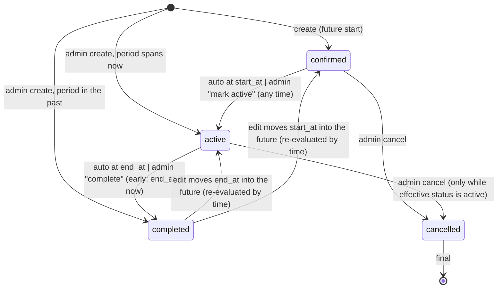

# Backend design: RentCar (application services, entry points, auth, jobs, email, PDF, CSV, errors)

Version 1.0 · 2026-11-01 · Owner: backend-developer · Phase 4 wave B · Mode: **analysis only** (no code; `APPROVAZIONE_IMPLEMENTAZIONE: IN_ATTESA`)
Inputs read: `docs/02-requisiti.md` v1.3, `docs/03-architettura.md`, `docs/03b-struttura-codice.md` (binding), ADR-0001..0015, `docs/04a-ux.md`, `docs/05-database.md`, `docs/08-security.md` (SR-*, ABU-*), `docs/09-seo.md`, `docs/03-inputs/observability-options.md`.
Companion file: `docs/openapi.yaml` (public HTTP route handlers only; server actions are described here, not in OpenAPI).
Language: all code, identifiers, error codes, event names and message keys in English. User-visible text only as message keys (section 14).

> Reading guide. Section 1 lists decisions and discrepancies found between documents. Section 2 is the module/service map (what to build, which ports, how it is wired). Section 3 is the request pipeline every entry point shares. Sections 4 and 5 are authentication/authorisation and the domain algorithms. Section 6 is the use-case catalogue (the contract). Sections 7 to 14 cover entry-point map, jobs, email, PDF/CSV/uploads, registries, error codes, observability, i18n and configuration. Section 15 maps requirements and abuse cases to use cases. Section 16 has effort, risks, assumptions, requests to other documents and the questions (IDs `BE-n`).

---

## 1. Binding decisions taken here and discrepancies found

### 1.1 Decisions (BE-D*, all can be reversed by an ADR or by the user; none changes scope)

| ID | Decision | Why |
|---|---|---|
| BE-D1 | **Public booking, admin forms, auth, status changes, payments: server actions.** **Everything that is a file, a stream, a binary body, a machine caller or must be fetchable by URL: route handler.** Exports are **POST** route handlers (not GET): SR-CSRF-03/ABU-M1-17 forbid state change on GET and an export writes an audit row before the first byte. | 03b section 6.3 + 08-security |
| BE-D2 | Uploads are **raw-body POST route handlers** (body = image bytes, one file by construction, no multipart parser). The browser already downscales to a Blob, so `fetch(url, {method:'POST', body: blob})` works. Size is enforced while streaming (SR-UPL-02). | Removes the multipart parser dependency and the "more than one file part" class of bugs; compatible with SR-UPL-01 |
| BE-D3 | Server actions always return HTTP 200 with `ActionResult`; route handlers return HTTP status + RFC 9457 `application/problem+json`. Both carry the same stable `code`, a `messageKey`, optional `params`, `fieldErrors`, and `requestId`. The HTTP status is looked up from the error code registry (section 12), never decided by the caller. | One translator (03b 6.1) |
| BE-D4 | Local date-times from the UI (`2026-06-01T10:00`, no offset) are interpreted **in the tenant time zone** by the server. A non-existent local time (DST gap) is rejected (`INVALID_LOCAL_TIME`); an ambiguous one (DST overlap) resolves to the **first** occurrence. Outputs carry the UTC instant and the tenant-local string. Time inputs are in 15-minute steps (A-11), except instants the system creates itself (e.g. early completion = `now`). | NFR-TZ-01, A-11, A-19 |
| BE-D5 | **Offset pagination** (`page`, `pageSize` 1..100, default 25, hard ceiling page*pageSize <= 10,000) for admin lists (UX URLs carry `page=`); **keyset cursor** for the audit log and for CSV exports. Deviation from 05-database 7.2 (keyset for bookings): numbered pages are required by the UX; the ceiling plus indexes on `(tenant_id, start_at DESC)` keep it within NFR-PERF-04. Totals via one `count(*)` bounded by the same filters. | UX 4.2 |
| BE-D6 | **Credential emails are awaited** (budget 8 s total, then reported as failed); **booking and notification emails are sent in `after()`**, with the hourly job as fallback. Switch `EMAIL_DISPATCH_MODE=after\|await` applies to the second group only (spike S4). | US-010/FR-OPR-05 need the immediate "email failed" result; ADR-0008 allows await behind the same port |
| BE-D7 | Tenant settings, branding and SMTP have **two entry points** (tenant realm for the admin, system realm for FR-SYS-03) that share one validation + diff + audit function. The system entry point uses `withSystemTx('system')` and `System*Repository` classes (explicit `tenantId`, listed in `tests/security/system-paths.md`), **never** `withTenant` on the target tenant, so decision 5.11 (no system read path to customer data) stays enforced by the database. | 08-security 5.11, 05-database 4.5 |
| BE-D8 | Orchestration across modules uses ports declared by the **lower** module and wired in `composition/`: `createTenant` (tenancy) calls `SubscriptionProvisioner` (implemented by subscriptions) and `TenantAdminProvisioner` (implemented by auth) inside one `SystemTx`; booking edits call `RevenueImpactPort` (declared in booking, implemented by finance); every module that triggers an email declares a `*Notifier` port implemented by notifications; notifications renders through `EmailDataSource`s registered by the data-owning modules (section 2.3). | 03b section 4, no import cycles |
| BE-D9 | Six additional rate-limit scopes beyond the SR-RL table (RL-16..RL-21, section 3.9) and two new methods on `RateLimitStore` (`peek`, `lease`). | Needed for lockout "refuse even the right password" and "1 concurrent export" |
| BE-D10 | Hash-derived keys: HMAC keys for rate limit and form tokens are HKDF-derived from `APP_ENCRYPTION_KEY` (SR-CRY-02). The variables `RATE_LIMIT_HMAC_KEY` and `SESSION_*` named in 03b section 9 are **not needed** (sessions are opaque DB tokens; nothing is signed). | Fewer secrets; conflicts with 03b, see 1.2 |

### 1.2 Discrepancies between documents (the choice made here; owners please align)

| # | Discrepancy | Choice in this document | Owner to align |
|---|---|---|---|
| X1 | `PUBLIC_BASE_URL` (03b section 9) vs `APP_BASE_URL` (spec, US-120, 08-security SR-AUT-08, SR-CFG-02) | `APP_BASE_URL` | solution-architect (03b) |
| X2 | 03b places `media/[...key]` under `app/api/`; ADR-0009 and SR-UPL-06 serve `/media/*` | Public URL `/media/...` (reserved slug `media`); file at `src/app/media/[...key]/route.ts` | solution-architect |
| X3 | 03b lists `SESSION_*`, `RATE_LIMIT_HMAC_KEY`; 08-security SR-CRY-02 derives purpose keys by HKDF | HKDF only (BE-D10) | solution-architect |
| X4 | Log field names: 03b section 11 says `requestId`, `tenantId`; SR-LOG-01 allowlist is snake_case (`request_id`, `tenant_id`) | snake_case (security allowlist is a binding requirement) | observability-engineer |
| X5 | Set-password link: ADR-0005 says `GET /set-password?token=`; UX uses `/{slug}/admin/activate?token=`, `/reset-password?token=`, and asks the server to "consume the token and redirect"; SR-AUT-04 forbids consuming on GET | Three page URLs as in UX (activate, reset-password, same for `/system`). GET renders a form via `peekCredentialLink` (read-only). The page removes the token from the address bar (`history.replaceState`) and posts it from memory. Nothing is consumed before the POST. | ux-designer, security-engineer |
| X6 | SR-AUT-04 says "every other case fails with the same generic page"; UX F-22 wants distinct messages (used / expired) | `peekCredentialLink` (GET, needs the 256-bit token) may return `used`, `expired`, `invalid`; the **POST** failure body is always the generic `CREDENTIAL_LINK_INVALID` | security-engineer to confirm |
| X7 | FR-SYS-01 needs vehicle/operator counts per tenant and FR-BRD-09 locks time zone/currency "once a vehicle or booking exists", but the system scope has no policy on `vehicles` or on operator rows (05-database 4.5) | Request a `SECURITY DEFINER` function `platform_tenant_usage()` (system scope only; returns per tenant `vehicle_count`, `operator_count`, `has_bookings` and nothing else), like `platform_kpis` | database-architect |
| X8 | SR-GDPR-06 needs a hashed single-purpose download token with expiry and 3-download cap for the termination export; 05-database 5.18 says no table was needed | Request columns on `tenants` (`export_token_hash bytea`, `export_expires_at`, `export_downloads smallint`) or a purpose `export_download` in `credential_tokens` | database-architect |
| X9 | FR-ENF-01 lists the operations allowed in read-only; it does not mention customer anonymisation, customer export, resend of a confirmation email | Customer export and exports are allowed (FR-CSV-03 says exports work read-only); **anonymisation and resend are treated as blocked until the user answers BE-1** | user (BE-1) |
| X10 | A-35 limits the audit log to the FR-AUD-01 list: vehicle, expense, operator events are not audited | Followed. Operator lifecycle is recorded as `security_event` (`auth.token.issued`, `auth.session.revoked`) only | requirements-analyst if they want more |
| X11 | 03b section 8 names `RateLimitStore.hit(key, window, limit)`; lockout requires a read without increment, exports require a lease | Add `peek(key, window)` and `lease(key, ttlSeconds)` to the port (contract tests cover both adapters) | solution-architect (03b) |

---

## 2. Module and service map

### 2.1 Services per module (factories wired in `composition/container.ts`)

Each service is `createXService(deps): XService`, returns `Result`, receives `tx`/`scope`/`actor` as explicit parameters (03b 5). `T` = takes a `TenantTx`; `S` = takes a `SystemTx`.

| Module | Services (public API in `index.ts`) | Ports it declares | Ports/services it consumes |
|---|---|---|---|
| `tenancy` | `TenantService` (create/update/suspend/reactivate/terminate/hard-delete, settings writes, public profile), `TenantResolver`, `tenantUrl()`, `TenantScope`, `ReservedSlugs` | `TenantAdminProvisioner`, `SubscriptionProvisioner`, `TenantUsagePort`, `TenantLifecycleNotifier`, `StoragePurger` | `AuditLog`, `Clock`, `IdGenerator` |
| `auth` | `AuthService` (login, logout, credential links, password change, sessions), `StaffService` (operators, admin recovery/replacement), `Guard` (`requireSession`, `requireRole`, `assertWritable`), `PasswordPolicy`, `PasswordHasher` (argon2id behind a semaphore) | `CredentialNotifier`, `SecondFactorVerifier`, `CredentialIssuer` | `TenantResolver`, `AuditLog`, `RateLimitStore`, `Clock`, `IdGenerator`, `crypto` |
| `subscriptions` | `SubscriptionService` (create/update/cancel, `getEffectiveAccess`, `assertWithinLimit`), job `subscription_renewal_reminder`, `subscription_expiry_notice` | `SubscriptionNotifier` | `TenantResolver`, `AuditLog`, `Clock` |
| `fleet` | `FleetService` (vehicles, maintenance, archive, photos), `VehicleReadModel` (public search source) | `PhotoStorage` (thin wrapper over `StoragePort` with key rules) | `SubscriptionService`, `AuditLog`, `StoragePort`, image pipeline (`sharp` adapter in `fleet/infrastructure`) |
| `customers` | `CustomerService` (list, detail, update, anonymise, export, `resolveForBooking`) , job `privacy_reminder` | `PrivacyReminderNotifier` | `AuditLog`, `Clock` |
| `booking` | `BookingService` (public submit, admin create/edit/status/payment, queries), `AvailabilityQuery`, `CalendarQuery`, `BookingDocuments` (PDF model + render), `pricing()`, `deriveStatus()` (pure), jobs `booking_status_advance`, `idempotency_key_purge` | `BookingNotifier`, `RevenueImpactPort`, `BookingCodeGenerator` | `FleetService`/`VehicleReadModel`, `CustomerService`, `SubscriptionService`, `AuditLog`, `PdfRenderer`, `StoragePort` (logo bytes), `RateLimitStore`, `Clock`, `IdGenerator` |
| `finance` | `FinanceService` (expenses, revenue, snapshots, corrections, comparison, CSV), `SnapshotCorrector` (implements `RevenueImpactPort`), jobs `yearly_snapshot_create`, `snapshot_reconcile` | none | `RevenueSource` (query over bookings, implemented in `booking/infrastructure` and passed in), `fleet` read model, `AuditLog`, `Clock` |
| `branding` | `BrandingService` (colours, font, mode, title, alt, logo, reset), `deriveTheme`, `renderThemeCss`, `evaluateContrast` (pure), OG image builder | none | `StoragePort`, image pipeline, `AuditLog` |
| `notifications` | `NotificationService` (outbox enqueue, dispatch, retry, resend, SMTP settings, test mail), `TemplateCatalog`, implements `BookingNotifier`, `CredentialNotifier`, `SubscriptionNotifier`, `PrivacyReminderNotifier`, `TenantLifecycleNotifier` | `EmailDataSource` (per template) | `Mailer`, `Encryptor`, `SsrfGuard`, `Clock`, `i18n` |
| `audit` | `AuditLog.record(tx, event)` (port + implementation), `AuditQuery` | `AuditLog` | `Clock`, `IdGenerator` |
| `jobs` | `JobRunner.runDueJobs(now, opts)`, `registerJob`, `JobRunStore`, `PlatformKpiQuery` | none | all modules' public job functions, wired in `composition/` |

### 2.2 Platform pieces this design adds or extends (all under `src/platform/`, same pattern as existing adapters)

| Piece | Responsibility | Note |
|---|---|---|
| `http/define-action.ts`, `http/define-route.ts` | The only way to create an entry point (section 3) | exists in 03b |
| `http/after.ts` | `runAfterResponse(task)` wrapper over Next `after()`; in `await` mode (BE-D6) it runs the task inline with a timeout. Modules never import `next/server` | new, small |
| `http/csv-stream.ts` | `csvResponse(asyncRows, columns)`: RFC 4180, BOM, `csvSafeText`, backpressure | new |
| `db/with-retry.ts` | `withTenantRetry(scope, fn)`: one automatic retry of the whole transaction on `40P01`/`40001` (ADR-0004) | extends `withTenant` |
| `image/` | `ImageProcessor` port (`sharp` adapter): validate magic bytes, decode with limits, produce variants, strip metadata, OG image | new port because `sharp` is only allowed in infrastructure/platform (03b ban 1); used by fleet and branding |
| `mailer/ssrf-guard.ts` | `guardedSmtpTarget(host, port)` (SR-SSRF-01..04) | exists in 03b |
| `rate-limit/port.ts` | add `peek`, `lease` (X11) | extension |
| `pdf/` | `PdfRenderer.render(model)` with semaphore 2, timeout 5 s | exists |

### 2.3 Cross-module wiring rules used by this design

1. **Email data sources.** `notifications` owns the outbox, the template catalogue (subject/body keys, layout, branding wrapper) and delivery. A module that owns the data for a template registers an `EmailDataSource` in `composition/`: `load(tx, relatedId) -> { recipient?, variables, attachments?: [{filename, render()}], tenantBranding }`. Example: `booking` registers `booking.confirmation`, whose attachment `render()` calls `BookingDocuments.renderConfirmation` (regenerates the PDF from the booking id on every attempt, SR-EML-06). `notifications` therefore never imports `booking`.
2. **Revenue impact.** `booking` declares `RevenueImpactPort.withCorrection(tx, { affectedYears, reason, actor }, mutate)`. `finance` implements it (`SnapshotCorrector`). The booking edit service computes `affectedYears` (section 5.5) and runs its UPDATE inside `mutate`. Expenses call the same function from `finance` itself.
3. **Effective access.** `Guard` asks `SubscriptionService.getEffectiveAccess(tenantRow, subscriptionRow, now)` (pure function over data already loaded by `TenantResolver`) once per request; the result is part of `ResolvedTenant` and is the only input to the read-only policy (section 4.4).
4. **System-scope repositories.** `TenantRepository`, `SystemUserRepository`, `SubscriptionSystemRepository`, `SystemSettingsRepository`, `SystemSmtpRepository`, `PlatformAuditRepository`, `SecurityEventRepository`, `JobRunRepository`, `EmailLogSystemRepository` take a `SystemTx`; each is listed in `tests/security/system-paths.md`.

---

## 3. Request pipeline shared by every entry point

### 3.1 Contexts and types (in `shared/` and `platform/http`)

```ts
type Actor =
  | { kind: 'public' }
  | { kind: 'user'; userId: UserId; role: 'operator' | 'admin' | 'systemadmin'; tenantId: TenantId | null;
      username: string; sessionId: SessionId; mustChangePassword: boolean }
  | { kind: 'job' };                                   // the scheduler (valid CRON_SECRET)

type ResolvedTenant = {
  scope: TenantScope;                                  // opaque, only from TenantResolver
  status: 'active' | 'suspended' | 'terminated';       // 'deleted' resolves to not-found/410
  access: EffectiveAccess;                             // section 4.4
  createdAt: Date; settings: PublicTenantSettings;     // title, contact, rules, legal, theme version (no secrets)
};

type ActionContext = { requestId: string; now: Date; logger: Logger; ip: ClientIp /* hmac + prefix, never raw in logs */;
                       tenant?: ResolvedTenant; actor: Actor };

type ActionResult<T> =
  | { ok: true; data: T }
  | { ok: false; error: { code: ErrorCode; messageKey: MessageKey; params?: Record<string, string | number>;
                          fieldErrors?: Array<{ field: string; code: ErrorCode; messageKey: MessageKey; params?: object }>;
                          retryAfterSeconds?: number; requestId: string } };
```

`Result<T, AppError>` is what services return; `defineAction` maps it to `ActionResult`, `defineRoute` to HTTP.

### 3.2 `defineAction` / `defineRoute` order of operations (fail closed at each step)

1. Request context: `requestId` (`x-request-id` if it matches `^[A-Za-z0-9-]{8,64}$`, else UUID), AsyncLocalStorage logger.
2. **Origin check** (routes with non-GET; server actions use Next's check plus `allowedOrigins`) - SR-CSRF-01/02. The job route is exempt (Bearer only).
3. **Body size and content type** (JSON <= 1 MB, auth <= 8 KB, uploads per route). Wrong type -> 415.
4. Tenant resolution from the route slug via `TenantResolver` (never from input) -> `ResolvedTenant` or generic not-found; suspended/terminated -> `TENANT_UNAVAILABLE`.
5. **Rate limit** declared by the entry point (fail mode per scope, section 3.9), *before* any expensive work (argon2, DB-heavy queries).
6. **Authentication/authorisation**: `Guard.requireSession(realm)` then `requireRole(minRole)`; session revalidation per SR-SES-06; tenant/realm mismatch -> uniform not-found + `tenant.mismatch` event; `mustChangePassword` -> `MUST_CHANGE_PASSWORD` for everything except `changePassword`, `logout`, `touchSession`.
7. **Write policy**: `assertWritable(access, policyClass)` (section 4.4). Applies to every entry point whose declared `writeClass` is not `read`.
8. Zod parse with `.strict()` (unknown keys, wrong types, arrays-for-scalars -> `VALIDATION_FAILED` with `fieldErrors`). Errors carry message keys, never text.
9. Handler -> `Result`. Services never throw for expected outcomes; infrastructure failures throw and are captured by `ErrorReporter`, answered as `INTERNAL_ERROR` with the request id (SR-LOG-05).
10. Response mapping and header class (SR-HDR matrix) set centrally; `X-Request-Id` on every response.

Every entry point registers in the **route registry** at import time: `{ id, kind: 'action'|'route', realm: 'public'|'tenant'|'system'|'scheduler', minRole, resource?, writeClass: 'read'|'write'|'ro_allowed', rateLimit?, reason? }`. An architecture test fails for any unregistered handler or any `public` without `reason` (SR-ACC-01, ABU-M0-13). The generated abuse matrices (401/403/404/read-only/CSRF) iterate this registry.

### 3.3 Transactions and side effects

| Rule | Detail |
|---|---|
| One use case = one `withTenant`/`withSystemTx` callback | The callback is the unit of work; repositories receive the `tx`. Nested wrappers are forbidden (03b 7). |
| Retry | Use cases that write bookings run in `withTenantRetry`: `40P01`/`40001` -> the whole callback is retried once; a second failure -> `SERVICE_UNAVAILABLE`. `23P01` is never retried: it is the answer (`BOOKING_CONFLICT`). |
| No network inside a transaction | SMTP, S3/storage, PDF rendering, DNS and argon2 hashing run **outside** DB transactions (SR-DB-07; `idle_in_transaction_session_timeout` 15 s). Pattern: compute outside -> short tx -> side effects after commit. |
| Outbox | Email rows are inserted in the business transaction (`pending`); delivery happens after commit via `runAfterResponse` (or awaited for credential mails); the hourly job picks up leftovers. |
| Storage | Put new objects **before** the tx; update DB pointers in the tx; delete replaced/removed objects **after** commit; failures leave orphans that `storage_orphan_cleanup` removes (24 h). If the tx fails after a put, delete the new object in a `finally` (best effort). |
| Advisory locks (transaction level only) | `veh:{vehicleId}` (ascending order, ADR-0004); `limit:vehicles:{tenant}` / `limit:operators:{tenant}` (US-013); `snapshot:{tenant}:{year}` (version n+1); `phone:{tenant}:{phone}` (open-bookings-per-phone check); `idem:{tenant}:{key}` (idempotent replay); `job:{job}:{period}` (try-lock). Always `pg_advisory_xact_lock(hashtextextended(key, 0))`. |
| Optimistic concurrency | `bookings.version`: updates use `WHERE id = $1 AND version = $2` and increment; zero rows -> `BOOKING_STALE` (FR-BKG-19). Settings forms use `updated_at` echo (`expectedUpdatedAt`) for the same message; vehicle edits too. |
| Idempotency | Public submit and admin create accept an `idempotencyKey` (UUID, <= 64 chars). Replays within 48 h return the original booking (same code, same DTO) if `{vehicleId,startAt,endAt,phone}` match, else `IDEMPOTENCY_KEY_REUSED`. Tenant creation relies on the unique slug and the pending button state (US-010). Job runs: `job_runs(job, tenant_id, period_key)`. |

### 3.4 Input primitives (`shared/zod/`, all strict, caps from SR-VAL)

| Primitive | Rule |
|---|---|
| `uuid` | `z.string().uuid()` |
| `slug` | `^[a-z0-9](?:[a-z0-9-]{1,38}[a-z0-9])$` + reserved list (`system api media exports _next static assets admin login robots.txt favicon.ico sitemap.xml healthz readyz` and similar; the list lives in `tenancy/domain/reserved-slugs.ts`) |
| `username` | `^[a-z0-9._-]{3,40}$` after lowercasing; case-insensitive uniqueness per tenant |
| `password` | 12..128 chars after NFKC, spaces kept, never truncated; policy rules in `PasswordPolicy` return `rules[]` of failed rule codes: `too_short`, `too_long`, `equals_username`, `contains_email_local`, `common` |
| `text(min,max)` | NFC, trim, reject control chars except `\n` in multi-line fields, NUL, bidi controls U+202A-202E/U+2066-2069, stray zero-width joiners (SR-VAL-04); optional `rejectCardNumbers` refinement (SR-VAL-11, pending SEC-16) |
| `personName` | 1..80 chars, `\p{L}\p{M}`, space, apostrophe, hyphen, period |
| `phone` | `libphonenumber-js` parse with the tenant `country_code` as default region; output E.164 `^\+[1-9][0-9]{6,14}$`, <= 16 chars |
| `email` | `z.string().email()` + <= 254 + no CR/LF |
| `localDateTime` | `^\d{4}-\d{2}-\d{2}T\d{2}:(00\|15\|30\|45)$`, converted by `shared/time.parseLocal(tz)` (BE-D4); year between now-10 and now+2 |
| `money` | integer minor units, `z.number().int().safe()`, bounds per field (expense 1..99,999,999; vehicle daily price 0..99,999,999); currency is **never input** (taken from tenant) |
| `hexColour` | `^#[0-9a-fA-F]{6}$` |
| `bookingCode` | normalise (uppercase, `O->0`, `I,L->1`, strip spaces/hyphens) then `^[0-9A-HJKMNP-TV-Z]{10}$` |
| `pageParams` | `{ page: 1..400, pageSize: 1..100 = 25, sort?: enum per endpoint, dir?: asc\|desc }` |
| `search q` | <= 64 chars, `%`, `_`, `\` escaped before ILIKE |

### 3.5 Pagination and list envelope

`{ items: T[], page, pageSize, total }` for offset lists (cap in BE-D5); `{ items, nextCursor | null }` for audit log. Sort keys are enum whitelists per endpoint; secrets/hashes are never selectable (ABU-M3-11).

### 3.6 DTO rules

Output DTOs are plain objects built by `toXxxDto` mappers (SR-VAL-02): ISO-8601 UTC strings plus tenant-local strings for display, money as `{ amountMinor, currency }`, booking codes formatted for display by the UI (`K7M2-9QXA`), no foreign keys of other tenants, no hashes, no `tenantId` (the UI never needs it), no `version` except where the client must echo it (`booking.version`, `updatedAt`).

### 3.7 Error handling

See section 12 for the registry. Services return `err(AppError)`; repositories translate SQLSTATE at the boundary (`23P01`, `23505` by constraint name, `23514`, `23503`, `40P01`, `40001`, `57014` statement timeout -> `SERVICE_UNAVAILABLE`); anything unknown is rethrown and reported.

### 3.8 Idempotent and safe repeat behaviour (summary)

Safe to repeat without extra effect: `logout`, `setMaintenance`, `changeBookingStatus` to the current status (no-op `ok`), `setPayment` to the same state, `anonymiseCustomer` on an anonymised customer, `suspendTenant`/`reactivateTenant` on the same state, all jobs.

### 3.9 Rate limits (key = HMAC of `tenant:scope:identity`; 429 + `Retry-After`; fixed windows; all counts from the Postgres store)

| ID | Scope | Identity | Limit | Fail mode | Entry point |
|---|---|---|---|---|---|
| RL-01 | `public.search` | tenant + IP | 5/min | open | BKG-01 |
| RL-02 | `public.booking_submit` | tenant + IP | 10/h | **closed** | BKG-03 |
| RL-03 | `public.pdf_miss` | tenant + IP | 10/h (misses only) | open | BKG-05, BKG-04 (confirmation page) |
| RL-04 | `auth.login_failure.account` | tenant + username (system realm: username) | 5/15 min, then refuse even the right password | closed | AUT-01/02 |
| RL-05 | `auth.login_failure.ip` | IP | 20/15 min (system realm 10) | closed | AUT-01/02 |
| RL-06 | `auth.reset.account` | account | 3/h | closed | AUT-06/07 |
| RL-07 | `auth.reset.ip` | IP | 10/h | closed | AUT-06/07 |
| RL-08 | `auth.setpassword_failure.ip` | IP | 10/h | closed | AUT-05 |
| RL-09 | `auth.credential_issued` | tenant | 20/h | closed | AUT-12/15/17/18, TEN-03 |
| RL-10 | `notify.smtp_test` | tenant | 5/h | closed | NTF-02 |
| RL-11 | `export.run` | tenant | 10/h and 1 concurrent (`lease`) | closed | BKG-17, FIN-10, CUS-05 |
| RL-12 | `upload` | user | 30/h | closed | FLT-07, BRD-02 |
| RL-13 | `job.auth_failure` | IP | 10/min | open (still 401) | JOB-01 |
| RL-14 | `api.generic` | user | 300/min (backstop) | open | all authenticated entry points |
| RL-15 | `mail.confirmation_per_address` | tenant + recipient address | 3/day (excess: booking OK, mail skipped, recorded `failed/rate_limited`) | closed | BKG-03 |
| RL-16 *(new)* | `auth.credential_peek.ip` | IP | 60/h | closed | AUT-04 |
| RL-17 *(new)* | `public.confirmation_view` | tenant + IP | shares RL-03 (misses) | open | BKG-04 |
| RL-18 *(new)* | `system.slug_check` | user | 60/min | open | TEN-02 |
| RL-19 *(new)* | `email.tenant_daily_cap` | tenant | `EMAIL_DAILY_CAP_PER_TENANT` rows/day (default 300) | closed | notifications enqueue (SR-EML-05) |
| RL-20 *(new)* | `session.revoke` | user | 20/h | closed | AUT-10 |
| RL-21 *(new)* | `public.prepare` | tenant + IP | shares RL-01 | open | BKG-02 |

`RATE_LIMIT_DISABLED` does not exist; tests use `APP_ENV=ci` with in-memory store and raised limits only (decision 5.10).

---

## 4. Authentication and authorisation

### 4.1 Realms, sessions, cookies (ADR-0005, SR-SES)

| Item | Rule |
|---|---|
| Realms | `tenant` (operator, admin; cookie `__Host-rc_tenant`, `SameSite=Lax`) and `system` (systemadmin; `__Host-rc_system`, `SameSite=Strict`). `Secure` and the `__Host-` prefix are dropped only when `APP_ENV=local` on `http://localhost`. No `Domain`, no `Max-Age`. |
| Token | 32 bytes `randomBytes`, base64url. Only SHA-256 stored in `sessions.token_hash`. New token on login, set-password completion, password change, reset. Incoming session cookies are ignored by login handlers (fixation). |
| Lifetimes | tenant staff 30 min idle / 12 h absolute; systemadmin 15 min idle / 8 h absolute (constants in `auth/domain/session-policy.ts`). `last_seen_at` and `idle_expires_at` are updated at most once per 60 s via a conditional `UPDATE ... WHERE last_seen_at < now() - interval '60 seconds'`; `idle_expires_at = least(now + idle, absolute_expires_at)`. |
| Validation per request (`Guard.requireSession`) | One query: session row by hash joined to the user. Reject when: not found, idle or absolute expired, `users.status <> 'active'`, `users.password_changed_at > sessions.created_at`, realm or tenant differs from the route (-> uniform not-found/redirect + `tenant.mismatch`), tenant `suspended`/`terminated`. Any exception in the guard denies (SR-ACC-06). |
| Which DB scope validates a session | Tenant realm: `withTenant(scope from the route slug)`. System realm: `withSystemTx('system_auth')` (the only scope that can read `sessions`/`users` before the actor is known), then console operations use `withSystemTx('system')`. |
| Revocation | `DELETE` rows: logout, deactivation, suspension/termination (all tenant sessions), password change/reset/redeem (all other sessions), admin reset/replacement. Expired rows purged by the `retention_daily` job. |
| `SecondFactorVerifier` | Called on the login path after the password check; `NoopSecondFactorVerifier` returns "not required"; `sessions.assurance_level = 1`. A unit test uses a fake that demands a factor to prove the seam (SR-AUT-14). |
| Extension point `CredentialIssuer` | Default `SetPasswordLinkIssuer`. `TemporaryPasswordIssuer` is not wired. |

### 4.2 Flows

#### 4.2.1 Login (tenant staff and systemadmin) - UC-AUT-01/02
1. Entry `loginStaff`/`loginSystem` (public action, realm picks counters). Resolve tenant from slug (staff). Unknown/tombstoned/reserved slug: generic not-found page (SR-ACC-07).
2. RL-05 then RL-04 `peek`; if over limit: refuse **without hashing**, `RATE_LIMITED` + `retryAfterSeconds` (the correct password is refused as well, SR-AUT-05). Counters fail closed (SR-RL-04).
3. Acquire the argon2 semaphore (default 4 per instance; excess -> `RATE_LIMITED`/503 within 1 s, SR-AUT-09).
4. Find user by `(tenant_id, username)`. If missing, `pending` or `deactivated`: verify the submitted password against a **fixed dummy hash with the same parameters** (so exactly one verify runs on every path), record a failure (`hit` on RL-04 and RL-05), emit `auth.login.failure` (reason code only), return the single generic `INVALID_CREDENTIALS`.
5. Verify hash. On failure: same as 4. On success: check tenant status. Suspended/terminated tenant **after valid credentials**: `TENANT_UNAVAILABLE` (clear message, FR-SYS-12); the system realm has no tenant.
6. `SecondFactorVerifier.isRequired` (never true now). Rehash if parameters outdated (inside the same short tx as the session insert).
7. `withTenant`: insert session (new token), `users.last_login_at`; emit `auth.login.success`; set cookie; return `{ redirectTo }` (default `/{slug}/admin`; `next` accepted only if relative, single `/`, same realm, SR-VAL-08).
8. If `must_change_password`: result carries `mustChangePassword: true`; the guard blocks everything else until `changePassword`.

#### 4.2.2 Set-password link (activation 24 h, reset 60 min) - UC-AUT-04/05
- **Issue** (any creator): inside the creator's tx: mark the live token of `(user, purpose)` `superseded_at = now()`, insert the new hash (CSPRNG 32 bytes), RL-09, emit `auth.token.issued`. The plaintext token is returned to the caller **in memory only**, handed to `CredentialNotifier.sendCredentialLink({ userId, purpose, token })`, which renders and awaits the send (BE-D6). The link is built from `APP_BASE_URL` (`credentialUrl(realm, purpose, slug, token)`), never from request headers. Never stored, logged, audited, or placed in `job_runs`/`email_log`.
- **Peek** (`peekCredentialLink({ token })`, called by the page render): RL-16, hash lookup, **read only**: returns `{ state: 'valid' | 'used' | 'expired' | 'invalid', purpose?, username?, tenantTitle?, contact? }` (X6). The page then strips the token from the URL and keeps it in memory. No state change, so scanners that GET the link cannot burn it.
- **Redeem** (`redeemCredentialLink({ token, password })`): RL-08, RL-14. Steps: (1) peek-equivalent read to load the user (username, email) for the policy; (2) `PasswordPolicy.check` first: a failure returns `PASSWORD_POLICY_FAILED` with `rules[]` and does **not** consume the token; (3) hash with argon2 **outside** the tx (semaphore); (4) one tx: `UPDATE credential_tokens SET used_at = now() WHERE token_hash = $1 AND used_at IS NULL AND superseded_at IS NULL AND expires_at > now() RETURNING user_id, purpose` (zero rows -> generic `CREDENTIAL_LINK_INVALID`); check user not deactivated and tenant not suspended/terminated; set `password_hash`, `password_changed_at`, `status = 'active'`, `must_change_password = false`; delete all the user's sessions; insert a new session (activation: log in; reset: also log in, UX shows success on login page - UI choice, the action returns `{ sessionStarted: boolean }` configurable per purpose = activation true, reset false to force a clean login); `auth.token.redeemed`. (5) After commit: notice email (reset only) `notice.password_reset_completed` (no secret, no link, SR-AUT-10).
- Two concurrent POSTs: exactly one wins (single `UPDATE ... RETURNING`), the other gets the generic error (ABU-M1-13).

#### 4.2.3 Password reset request - UC-AUT-06/07
Generic action `requestPasswordReset({ identifier })` (identifier = username or email, <= 254 chars). Always the same `{ accepted: true }` response with equal work done *before* returning: RL-06/RL-07, input validation, a constant-time delay is **not** used; instead all variable work (lookup, token issue, mail) runs in `runAfterResponse`. After response: find matching **active** accounts in the tenant (username equality or lower(email) equality, max 3), issue a `password_reset` token per account, send. Channel: tenant admin and systemadmin -> **system SMTP**; operator -> tenant SMTP (assumption 5.7 of 08-security, pending SEC-12). If the tenant SMTP is missing or fails: row `email_log.failed` with `last_error = 'no_smtp'|category`, shown to the admin in Settings > Email, never to the requester (US-002).

#### 4.2.4 Change password, sessions - UC-AUT-08/09/10/11
`changePassword({ currentPassword, newPassword, signOutOthers = true })`: current password required (verify under the same semaphore and RL-04-style account counter), policy, new hash, delete other sessions (default), new session token for the caller, notice email `notice.password_changed`. `listSessions` (own sessions: created, last seen, coarse UA, current flag), `revokeSessions({ sessionId | 'others', password })` requires re-entering the password (SR-SES-08, RL-20). `touchSession` extends idle expiry on the UX "stay signed in" dialog (read-write on `sessions` only; exempt from read-only).

#### 4.2.5 Operators and admin recovery - UC-AUT-12..18
Create operator: lock `limit:operators:{tenant}`, count `users` with `role='operator' AND status IN ('pending','active')`, compare with `subscriptions.max_operators` (US-013 concurrency), insert `pending` user, issue activation token, commit, send link via **tenant SMTP**, return `{ operator, activationEmail: 'sent'|'failed'|'no_smtp' }`; the operator list derives "Activation not delivered" from the latest `email_log` row (UX 6.2). Deactivate: set status, delete sessions, free the slot (US-072). System recovery: *issue access link* (same admin: `password_hash = NULL`, `status = 'pending'`, sessions deleted, fresh activation token, old address notified) and *replace admin* (one tx: deactivate old -> insert new -> issue token; unique index guarantees one active admin; old address notified; `platform_audit` + tenant `audit_log` `admin_account.replaced`). Concurrent replace: the second fails on `users_one_admin_per_tenant` -> `CONFLICT_ADMIN_EXISTS` (ABU-M1-32).

#### 4.2.6 Bootstrap systemadmin - UC-AUT-20 (CLI, not HTTP)
`scripts/create-systemadmin.ts` (scope `bootstrap`): reads username/email from env or prompts; creates a `pending` systemadmin and an `activation` token; sends the link through the system SMTP and, if that fails, prints it **once** to stdout (the operator running the CLI is the owner; DB-A8, SR-AUT-13). Dev seed sets the password hash directly, refused when `APP_ENV` is production-like.

### 4.3 Authorisation matrix (role x capability x resource rule)

Legend: **P** public (no session), **O** operator, **A** admin, **S** systemadmin, `-` denied (403, or uniform 404 for foreign ids). `RO` = column "allowed in read-only?" (policy class `ro_allowed`), `W` = blocked in read-only (`write`), `R` = read (never blocked). Resource rule = how object-level access is enforced (always: tenant from session/route, id looked up through a repository bound to `TenantTx`; foreign or missing id -> same `NOT_FOUND`).

| Capability (use cases) | P | O | A | S | Read-only | Resource rule |
|---|---|---|---|---|---|---|
| Public site, search, prepare, submit, confirmation, public PDF (BKG-01..05, TEN-16) | Y | - | - | - | n/a (tenant state decides, 4.4) | Tenant from slug only; vehicle/booking must belong to it; PDF needs slug **and** code |
| Login/logout/reset/set-password (AUT-01..07) | Y | Y | Y | Y | RO | Account is tenant-scoped by slug |
| Change password, sessions, touch (AUT-08..11) | - | Y | Y | Y | RO | Own user and own sessions only |
| Calendar, today, bookings list/detail, booking PDF (BKG-11..14, 16) | - | Y (with customer contacts, REQ-11) | Y | - | R | Booking by `(tenant, id/code)` |
| Create/edit booking (BKG-06..08) | - | - | Y | - | **W** | Vehicle and customer must belong to the tenant |
| Status change: active, complete, cancel (BKG-09) | - | - | Y | - | **RO** | Booking in tenant; effective status rules |
| Payment (BKG-10) | - | - | Y | - | **RO** | same |
| Resend confirmation (BKG-15) | - | - | Y | - | W until BE-1 | same |
| Vehicles list/detail (no expenses) (FLT-05/06) | - | Y | Y | - | R | |
| Vehicle create/edit/maintenance/archive/photos (FLT-01..04, 07..10) | - | - | Y | - | **W** | Vehicle in tenant |
| Expenses CRUD (FIN-01..04) | - | - | Y | - | **W** | Expense and vehicle in tenant |
| Revenue, snapshots, compare (FIN-05..08) | - | - | Y | - | R (lazy snapshot creation still allowed: system-originated) | |
| Customers list/detail/update (CUS-01..03, 07) | - | - | Y | - | R / W (update) | Customer in tenant |
| Anonymise customer (CUS-04) | - | - | Y | - | W until BE-1 | Customer in tenant |
| Exports: bookings/customers/revenue/customer (BKG-17, FIN-10, CUS-05) | - | - | Y | - | **RO** | Filters parsed by schema; tenant scope |
| Operators (AUT-12..16) | - | - | Y | - | **W** | Users with `role='operator'` of the tenant only |
| Settings: rules, contact, legal, notifications, branding, SMTP (TEN-11..15, BRD-*, NTF-01..04) | - | - | Y | Y (via system entry point, BE-D7) | **W** (tenant realm); system entry point unaffected | Own tenant row |
| Audit log of tenant (AUD-02) | - | - | Y | - | R | |
| Tenants, subscriptions, admin recovery, suspend/terminate/delete, platform audit, security events, KPIs, job runs (TEN-02..10, SUB-*, AUT-17/18, AUD-03/04, JOB-02/03) | - | - | - | Y | n/a | System scopes only; no tenant customer/booking data reachable (5.11) |
| Scheduler (`/api/jobs/run`) | Bearer `CRON_SECRET` only | | | | n/a | Job scope lists tenants then each tenant in its own tx |

### 4.4 Subscription state and the central read-only policy (FR-ENF-01, REQ-5)

`getEffectiveAccess(tenant, subscriptions, now)` is a **pure function** (domain, unit-tested with `FakeClock` including DST/year boundaries). All dates are evaluated in the tenant time zone; `end_date` is inclusive (expires at 00:00 local of `end_date + 1 day`).

| Input condition | `state` | `canTakeBookings` | `canWrite` | Banner (UX 6.3) |
|---|---|---|---|---|
| `tenants.status = 'suspended'` or `'terminated'` | `suspended` / `terminated` | no | no (sessions revoked, login refused) | n/a |
| Current subscription active, `now < end - 14 days` | `active` | yes | yes | none |
| Active, within 14 days before end | `renewal_due` (`daysLeft`) | yes | yes | info |
| Ended, `now < end + 7 days` | `grace` (`graceEndsAt`) | yes | yes | warning |
| Ended, `now >= end + 7 days` | `read_only_expired` | **no** | read-only | error-level |
| Subscription `cancelled` (no grace, A-8) | `read_only_cancelled` | no | read-only | error-level |
| No subscription row | `read_only_no_subscription` | no | read-only | error-level |
| `start_date` in the future | treated as `active` (assumption: onboarding must not block) | yes | yes | none |

"Current subscription" = the non-cancelled subscription containing today in tenant time; if none, the non-cancelled one with the latest `end_date`; if all are cancelled, `cancelled`.

**One policy function** `assertWritable(access, policyClass, actor)` is called by `defineAction/defineRoute` step 7:

| `writeClass` | In `read_only_*` | In `suspended`/`terminated` |
|---|---|---|
| `read` | allowed | refused (`TENANT_UNAVAILABLE`) |
| `write` | refused `TENANT_READ_ONLY` (HTTP 403, key `errors.tenant.readOnly`) | refused |
| `ro_allowed` | allowed | refused |

`ro_allowed` set (exact, from FR-ENF-01): login, logout, change own password, reset request/redeem, touchSession, session list/revoke, `setPayment`, `changeBookingStatus` (mark active, complete, cancel), automatic transitions, CSV and customer exports. The public booking path uses `canTakeBookings`, not `canWrite`. System-originated writes (jobs, lazy snapshot creation, lazy status materialisation) are not subject to the policy (US-084). The list is data in the route registry; a test generates the allowed/blocked matrix per entry point (ABU-M3-03). Changing it requires a registry edit plus a requirement change.

### 4.5 Public tenant states and HTTP status (09-seo section 5, for the frontend and the resolver)

`TenantResolver.resolve` returns a discriminated result consumed by pages: `notFound` (unknown, reserved or malformed slug -> 404), `gone` (tombstone -> 410), `unavailable` (suspended/terminated -> 503), `ok` (with `access`; `read_only_*` -> page 200 "bookings unavailable"). Same generic page for unknown and reserved. No cross-request cache; `React.cache` memoises within one request only.

---

## 5. Domain rules (pure functions in `modules/*/domain`, no I/O, `now` passed in)

### 5.1 Pricing - `booking/domain/pricing.ts` (FR-PUB-12, FR-BKG-12, REQ-1, A-11)

```ts
type PricingInput = {
  startAt: Date; endAt: Date;               // instants, half-open [startAt, endAt)
  dailyPriceMinor: number; currency: string; timeZone: string;
  adjusters?: ReadonlyArray<PriceAdjuster>; // extension point (promotions), empty today
};
type PriceLine = { kind: 'base' | 'adjustment'; labelKey: MessageKey; quantity: number; unitMinor: number; amountMinor: number };
type PriceBreakdown = { billedDays: number; dailyPriceMinor: number; lines: PriceLine[]; totalMinor: number; currency: string };
type PriceAdjuster = (b: PriceBreakdown, ctx: PricingInput) => PriceBreakdown;

billedDays(startAt, endAt, timeZone): number
price(input): Result<PriceBreakdown, PricingError>      // endAt > startAt, price >= 0, overflow-safe
```

Algorithm for `billedDays`: `firstDay = civilDate(startAt, tz)`; `lastDay = civilDate(endAt - 1 ms, tz)`; `billedDays = daysBetween(firstDay, lastDay) + 1`, where `civilDate` is the tenant-local calendar date and `daysBetween` is integer arithmetic on civil dates (so 23- and 25-hour DST days count as one day). Total = `billedDays x dailyPriceMinor` then adjusters. The `-1 ms` implements "a return at exactly 00:00 does not touch the new day".

Mandatory test vectors (Europe/Rome unless noted): 1 Jun 10:00 -> 3 Jun 10:30 = 3; -> 3 Jun 09:00 = 3; 1 Jun 10:00 -> 1 Jun 18:00 = 1; 1 Jun 10:00 -> 2 Jun 00:00 = 1; 28 Mar 2026 22:00 -> 29 Mar 2026 (spring-forward) 03:30 = 2; 24 Oct 22:00 -> 26 Oct 01:00 (fall-back) = 3; 31 Dec 23:30 -> 1 Jan 00:30 = 2; end = start + 1 ms = 1; Pacific/Auckland and America/Los_Angeles repeat the DST cases; price 40.00 x 3 = 12000 minor units.

Min/max rental length (REQ-8) are measured in `billedDays`, lead time and buffer in minutes. The price shown at search, form, confirmation, PDF and admin edit always comes from this function (never from the client; `expectedTotalMinor` from the client is compared, not trusted, FR-PUB-11).

### 5.2 Availability - `booking/application/availability-query.ts`, rule in `domain/availability.ts`

A vehicle is *offered* for `[pickup, return)` iff: `archived_at IS NULL`, `status = 'available'` (not maintenance), and no booking with `status <> 'cancelled'` has `blocked_during && tstzrange(pickup, return + tenant.buffer_minutes, '[)')` (05-database 7.1; the literal `status <> 'cancelled'` is required for the partial GiST index). The new booking stores the buffer in force (`buffer_minutes`), so after its return the vehicle is blocked for `buffer` minutes. The exclusion constraint is the guarantee; the query only informs (and names the conflicting booking for admins). Validation order (each failure is a field error, no search runs): `RETURN_BEFORE_PICKUP`, `PICKUP_IN_PAST` (pickup < now), `LEAD_TIME_NOT_MET` (pickup < now + lead_time; params: earliest local time, hours), `PERIOD_TOO_FAR` (pickup > now + 2 years), `DURATION_TOO_SHORT`/`DURATION_TOO_LONG` (billed days vs min/max), `INVALID_LOCAL_TIME`. Results: sorted price asc/desc then name; filters `category[]`, `fuel`, `seats` (minimum); each item carries `billedDays`, `totalMinor` from `price()`.

Maintenance and archive checks stay in the service (benign race, ADR-0004). Admin rules (A-24): future bookings on a vehicle in maintenance are rejected when `endAt > now` (assumption: a booking that spans now counts as future); a period entirely in the past is exempt.

### 5.3 Booking state machine

Stored statuses: `confirmed`, `active`, `completed`, `cancelled`. **Effective status** (what every read and every rule uses) is derived from time:

```
effective(b, now) =
  b.status in (confirmed, active) and b.end_at   <= now -> completed
  b.status = confirmed            and b.start_at <= now -> active
  else b.status
```
(the same expression as 05-database 5.12; used in SQL for lists/calendar/revenue and in `deriveStatus()` for rules). Writes first *materialise* the effective status of the booking they touch inside their transaction (`status`, `status_changed_at`, audit `booking.status_changed` with `auto: true`), so rules never see a stale stored value.



| Transition | Trigger | Preconditions | Effects (same tx) |
|---|---|---|---|
| auto confirmed->active | job `booking_status_advance` (hourly) or lazy materialisation | `start_at <= now` | audit `booking.status_changed` (actor system, `auto`) |
| auto active->completed | same | `end_at <= now` (`completed` is applied first so a booking passing both bounds ends `completed`) | audit; revenue now counts it (already counted live, see 5.5) |
| manual mark active | `changeBookingStatus(target:'active')` | effective status `confirmed`; admin; allowed in read-only | `status='active'`; the job never reverts it (never backwards) |
| manual complete | `changeBookingStatus(target:'complete')` | effective `active` (a `confirmed` booking whose start has passed is materialised to `active` first); `now > start_at` else `BOOKING_COMPLETE_BEFORE_START` | if `now < end_at`: `end_at = now`, re-price with `price()` (days touched from start to now; **current vehicle daily price**, FR-BKG-04 -> FR-BKG-16; assumption A-BE-3), audit `booking.updated` + status change; if `now >= end_at`: `end_at` unchanged; paid flag and `paidAmount` kept, balance recomputed |
| cancel | `changeBookingStatus(target:'cancel', reason?)` | effective `confirmed` or `active`; `completed` -> `BOOKING_INVALID_TRANSITION` ("edit instead"); allowed in read-only | `status='cancelled'`, `cancelled_at`, `cancel_reason`; vehicle freed (constraint ignores cancelled); not revenue; audit `booking.cancelled` |
| edit | `updateBooking` | per FR-BKG-17, 5.4 | status re-derived, price re-computed, audit `booking.updated`, closed-year correction if needed |
| repeat to current status | any | - | no-op `ok` |
| any change of a `cancelled` booking | - | - | `BOOKING_NOT_EDITABLE` / `BOOKING_INVALID_TRANSITION` |

Automatic transitions never move backwards and never touch `cancelled`; lazy derivation and the job give identical results (property test: for random bookings and clocks, `job(now)` then `effective` equals `effective(now)` without the job).

### 5.4 Edit rules (FR-BKG-16/17, REQ-15) - `updateBooking`, `previewBookingChange`

Inputs: `{ code, expectedVersion, changes: { startAt?, endAt?, vehicleId?, notes? }, acknowledgeImpact? }`. `previewBookingChange` runs the same logic in a read tx and returns the **changes panel** without writing: `{ old, new, billedDays, dailyPriceMinor, totalMinor, balanceMinor, statusAfter, conflict?: { code, vehicleName, start, end }, affectsClosedYears: number[], needsImpactConfirmation }`. `updateBooking` requires `acknowledgeImpact: true` whenever `needsImpactConfirmation` (completed booking, paid booking with changed total, or a closed year affected), else `IMPACT_CONFIRMATION_REQUIRED` with the same impact payload.

| Effective status | start | end | vehicle | Status after | Notes |
|---|---|---|---|---|---|
| `confirmed` | free | free | free | `deriveStatus(newStart,newEnd)` | lead time applies only if the new start is changed to a future time |
| `active` | **locked** (`BOOKING_START_LOCKED`) | editable, `>= now` (`BOOKING_END_IN_PAST`) - extension or early return | swap allowed (semantics pending BE-2; default A: the new vehicle must be free for the **whole** booking period) | `active` | |
| `completed` | free | free | free | re-evaluated by time (end in future -> `active`; start in future -> `confirmed`) | revenue and closed-year snapshot recomputed |
| `cancelled` | - | - | - | - | `BOOKING_NOT_EDITABLE` |

Common steps (all inside one `withTenantRetry`): lock vehicles `veh:` in ascending id order (old and new); `SELECT ... FOR UPDATE` the booking; compare `version`; materialise effective status; validate (min/max days, archived/maintenance target, 15-minute steps, local time validity); pre-check conflict with `AND b.id <> $self` to name the conflicting booking (admin sees the code); `price()` with the **current daily price of the target vehicle**; recompute `buffer_minutes` with the **current** tenant buffer when dates or vehicle change (DB-4) and let the trigger recompute `blocked_during`; compute `affectedYears` (5.5); run `RevenueImpactPort.withCorrection(...)` around the UPDATE (`SET ..., version = version + 1 WHERE id AND version = $v`); map `23P01` -> `BOOKING_CONFLICT`; audit `booking.updated` with `{ startAt, endAt, vehicleId, billedDays, dailyPriceMinor, totalMinor, status }` old/new (SR-AUD-04; notes -> `changed` marker + length). Payment fields are untouched; the DTO shows `balanceMinor = total - paidAmount` (positive "amount due", negative "overpaid"; no automatic refund, US-143).

### 5.5 Revenue and snapshot recompute paths (REQ-3, REQ-4, FR-REV-*) - `finance`

Definitions: a booking counts as revenue iff `effective(b, now) = completed` (live, even if the job has not run, RK-9) **and** `status <> 'cancelled'`; attribution = tenant-local month/year of `end_at`; collected = `paid_amount_minor`; outstanding = revenue - collected; net = revenue - expenses; expenses by `expense_date`. One query (05-database 7.4, `GROUPING SETS`) produces per-vehicle/month, global/month, per-vehicle total and grand total, so per-vehicle sums equal the global figure by construction (FR-REV-10).

A year `Y` is **closed** when `now >= local 1 Jan Y+1 00:00` in the tenant time zone.

| Change path | Where it happens | Years that may need a correction |
|---|---|---|
| Expense create / update / delete | `FIN-01..03` | local year of old and new `expense_date` (if closed) |
| Edit of a booking that was or will be counted as revenue | `BKG-08` | local year of old `end_at` if the booking was effectively completed before; local year of new `end_at` if it is effectively completed after (an edit may move it in or out of a year) |
| Manual early completion | `BKG-09` | none in practice (`end_at = now`, current year); computed anyway by the same function |
| Booking cancelled | `BKG-09` | none (a completed booking cannot be cancelled; active/confirmed are not revenue) |
| Payment recorded/cleared (`collected` column) | `BKG-10` | **proposal: none** (payments never create versions; a later version captures the current collected). Pending user decision BE-3 |
| Vehicle archive, customer anonymisation | - | none (amounts unchanged) |
| Any path forgotten (manual SQL) | nightly `snapshot_reconcile` | all closed years, `reason = 'reconciliation'` |

`SnapshotCorrector.withCorrection(tx, { years, reason, actor }, mutate)`: for each closed year in `years` (distinct, ascending): (1) take `pg_advisory_xact_lock('snapshot:{tenant}:{year}')`; (2) **if no version 1 exists**, create it from the *pre-change* state (otherwise v1 would be born already corrected); (3) run `mutate()` once after all v1s exist; (4) recompute the year with the grouping-sets query; (5) if global totals, bookings count or any per-vehicle row differ from the latest version, insert version `n+1` (`corrected_at`, `corrected_by_user_id`, `reason = 'expense:updated:<id>' | 'booking:updated:<code>' | ...`, `frozen_at`), plus rows, and audit `snapshot.corrected` (ids, years, versions, deltas as numbers); otherwise insert nothing (US-085 last scenario). Everything commits with the change or not at all. Cost: one aggregate query per affected year (NFR-PERF-05: <= 2 s).

Lazy and job creation: `ensureYearSnapshots(tx, now)` inserts version 1 for every closed year from `year(tenants.created_at, tz)` to the last closed year that has none, `ON CONFLICT (tenant_id, year, version) DO NOTHING`, under the snapshot lock; triggered by the daily job and on the first revenue/compare access (a separate short write tx by the system, not subject to the read-only policy; its failure only logs `warn` and the page renders live figures). Comparison uses the latest version per year (`DISTINCT ON (year) ... ORDER BY year, version DESC`); `corrected` badge when `version > 1`; version history lists all versions with reasons.

### 5.6 Customer matching and anonymisation rules

`resolveForBooking(tx, { firstName, lastName, phone, email })`: `INSERT ... ON CONFLICT (tenant_id, phone) DO NOTHING`, then `SELECT`; an existing customer is **never overwritten**; the booking stores the names/email as submitted (snapshots, FR-CUS-03, ABU-M2-07). Public responses never echo stored customer data other than what the same caller just submitted. Anonymisation per 05-database 9.3 in one `withTenant` tx; blocked while effective `confirmed`/`active` bookings exist (`CUSTOMER_HAS_OPEN_BOOKINGS`); placeholder phone `anon-<uuid without hyphens>`; booking snapshots, `email_log.recipient` of related rows, booking `notes` cleared; `deletion_ledger` row; audit `customer.anonymised` (ids only).

---

## 6. Use-case catalogue (the contract)

Notation: **Entry** `A` = server action (`app/actions/<module>/<verbNoun>.ts`), `R` = route handler, `Q` = server-component query (service called directly from a page, no action), `I` = internal (service-to-service), `J` = job, `C` = CLI. **Auth** = `realm:minRole` + policy class (`read`/`write`/`ro_allowed`), see 4.4. **Tx** = `T` (`withTenant`), `S:<scope>` (`withSystemTx`), `-` none. All inputs are `z.object({...}).strict()`; `ctx` always supplies tenant, actor, now. Errors are codes from section 12; every entry point can additionally return `VALIDATION_FAILED`, `UNAUTHENTICATED`, `FORBIDDEN`, `RATE_LIMITED`, `TENANT_UNAVAILABLE`, `TENANT_READ_ONLY` (for `write` class) and `INTERNAL_ERROR`; these are not repeated. "ABU" lists the abuse cases of `docs/08-security.md` section 4 that the use case must pass (each is an automated test, section 15).

### 6.1 tenancy (EP-02, EP-10 settings, EP-13)

| ID · Entry | Input | Auth | Tx · side effects | Output | Errors · refs · ABU |
|---|---|---|---|---|---|
| **TEN-01** `TenantResolver.resolve({host,pathname})` · I | path `/{slug}/...` (later host) | none | `S:resolve` (tenants SELECT limited columns, slug_tombstone); current subscription read under `T` only when the tenant is active (settings public columns) | `ResolvedTenant` or `notFound`/`gone`/`unavailable` | uniform 404 for unknown, reserved, tombstoned (SR-ACC-07) · FR-PUB-01, FR-PLT-04, US-122, US-025 · M1-30/31, M5-06 |
| **TEN-02** `checkSlugAvailability` · A | `{ slug }` | system:systemadmin · read | `S:system` read of `tenants`, `slug_tombstone` | `{ available, reason?: 'taken'|'reserved'|'invalid' }`, plus `url` preview | RL-18 · FR-SYS-02 (UX F-19) · M1-31 |
| **TEN-03** `createTenant` · A | `{ name(1..120), slug, contact:{email,phone}, title(1..45), shortDescription?(<=160), address?:{street,postalCode,city,countryCode}(all or none), countryCode, timeZone(IANA, validated against `Intl.supportedValuesOf`), currency(ISO 4217), dpaSigned:true (required literal), subscription:{maxVehicles,maxOperators,startDate,endDate,priceMinor,priceCurrency}, admin:{displayName,username,email} }` | system:systemadmin · write (not subject to tenant policy) | One `S:system` tx: insert tenant (`active`), default `tenant_settings`, subscription (via `SubscriptionProvisioner`, overlap constraint), admin `pending` (via `TenantAdminProvisioner`) + activation token, `dpa_signed_at = now`, `platform_audit tenant.created`, tenant `audit_log` entries. After commit: **await** activation email via system SMTP (BE-D6); `after()` owner mail `owner.tenant_created` (to `SYSTEM_ADMIN_EMAIL`). | `{ tenantId, slug, tenantUrl, adminActivationEmail: 'sent'|'failed' }` | `SLUG_TAKEN`, `SLUG_RESERVED`, `SUBSCRIPTION_INVALID_PERIOD`, `USERNAME_TAKEN`(n/a first admin) · slug taken => nothing created · FR-SYS-02/05/09, US-010 (double submit: unique slug + pending UI), KPI-1 · M1-31, M1-16 |
| **TEN-04** `updateTenantProfile` · A | `{ slug, name?, contact?, title?, shortDescription?, address?, countryCode?, timeZone?, currency?, dpaSigned? }` (slug in path only to identify; never changes) | system:systemadmin · write | `S:system`; time zone and currency may change only when `TenantUsagePort` reports no vehicle and no booking (X7) else `TENANT_LOCKED_FIELD`; audit `tenant.updated` (changed fields) | `TenantDetailDto` | `TENANT_LOCKED_FIELD`, `NOT_FOUND` · FR-SYS-03, A-14 |
| **TEN-05** `suspendTenant` · A | `{ slug, confirm:true }` | system:systemadmin | `S:system`: `status='suspended'`; delete all tenant sessions; `platform_audit tenant.suspended`; audit tenant event. Effect is immediate (no cache) | `{ status }` | `NOT_FOUND`, `TENANT_ALREADY_IN_STATE`(no-op ok) · FR-SYS-04/12, US-011 · M1-30 |
| **TEN-06** `reactivateTenant` · A | `{ slug }` | system:systemadmin | `S:system`: `status='active'` (effective access then follows the subscription); audits | `{ status, access.state }` | as above |
| **TEN-07** `terminateTenant` · A | `{ slug, confirmSlug }` | system:systemadmin | `S:system`: `status='terminated'`, `terminated_at=now`, `deletion_due_at=now+90d`; delete sessions; `platform_audit tenant.terminated`; the export is built by the job `termination_export` (tenant-scoped, SR-GDPR-06) | `{ deletionDueAt }` | `CONFIRMATION_MISMATCH` · FR-SYS-16, US-066 |
| **TEN-08** `hardDeleteTenant` · A | `{ slug, confirmSlug, systemadminPassword, overrideReason?(<=500) }` | system:systemadmin | Pre: re-verify password (argon2 semaphore, RL-04-style counter); precondition `status='terminated'`, `deletion_due_at <= now`, `export_delivered_at` or `overrideReason`. Steps: (1) `StoragePurger` deletes prefixes `tenants/{id}/` and `private/{id}/` and verifies empty (outside tx); (2) `S:system` call `purge_tenant_data(tenant_id)` (definer function does all deletes, tombstone, ledger, `platform_audit`); (3) `security_event tenant.hard_deleted` | `{ deleted:true }` | `TENANT_NOT_TERMINATED`, `DELETION_NOT_DUE`, `EXPORT_NOT_DELIVERED`, `CONFIRMATION_MISMATCH`, `PASSWORD_INVALID`, `SERVICE_UNAVAILABLE` (storage not empty) · FR-SYS-16, US-066 · M6-01 |
| **TEN-09** `listTenants` · Q | `{ q?(<=64), status?, sub?: 'active'\|'renewal_due'\|'grace'\|'read_only'\|'cancelled', sort?: 'name'\|'slug'\|'endDate'\|'createdAt', dir, page, pageSize }` | system:systemadmin · read | `S:system`: tenants + current subscription (`J`/`S` policies) + `platform_tenant_usage()` (X7) | `Page<TenantRowDto>` with `usage:{vehicles,operators}` | FR-SYS-01, US-010 |
| **TEN-10** `getTenantDetail` · Q | `{ slug }` | system:systemadmin · read | `S:system`: tenant, settings (S policy), SMTP *status only* (host, port, from, lastTest; never the password), subscription history, admin account state, email log summary, recent platform audit | `TenantDetailDto` | `NOT_FOUND` · FR-SYS-*, W-S3 · M1-28 |
| **TEN-11** `updateBookingRules` · A | `{ minRentalDays(>=1), maxRentalDays(>=min, <=365), leadTimeMinutes(0..43200), bufferMinutes(0..1440), expectedUpdatedAt }` | tenant:admin · write / system entry point | `T` (or `S:system` via `SystemSettingsRepository`, BE-D7); audit `settings.booking_rules_updated`; buffer change does **not** touch existing bookings (AS-3) | `SettingsDto` | `BOOKING_RULES_INVALID`(min>max), `STALE_RECORD` · FR-BRD-09, US-094 |
| **TEN-12** `updateContactSettings` · A | `{ contactEmail, contactPhone(<=32), shortDescription?(<=160), address?(all-or-none), expectedUpdatedAt }` | tenant:admin · write / system | as TEN-11; audit `settings.contact_updated` | `SettingsDto` | · FR-BRD-09, FR-PUB-14 |
| **TEN-13** `updateLegalSettings` · A | `{ privacyNotice: {kind:'url',url(https,<=2048)}\|{kind:'text',text(<=20000)}\|null, rentalTerms: same, expectedUpdatedAt }` | tenant:admin · write / system | plain text only (decision 5.4); audit `settings.legal_updated` with `changed` + length | `SettingsDto` | `URL_NOT_ALLOWED` (non-https) · FR-BRD-09/14, US-095 · M5-03 |
| **TEN-14** `setNewBookingNotification` · A | `{ enabled }` | tenant:admin · write / system | audit `settings.notifications_updated` | `{ enabled }` | FR-MAIL-07 |
| **TEN-15** `getAdminSettings` · Q | - | tenant:admin · read (operator: none) | `T` | `SettingsDto` (no secrets; SMTP summarised without password) | FR-BRD-* |
| **TEN-16** `getPublicTenantProfile` · Q | - | public | from `ResolvedTenant` (no extra query): title, description, contact, address, logo URL, theme version, rules (min/max days, lead time) for helper text, legal links or template flag | `PublicTenantDto` | FR-PUB-01/05, FR-BRD-14 · M5-06 |

### 6.2 subscriptions (EP-02)

| ID · Entry | Input | Auth | Tx · side effects | Output | Errors · refs · ABU |
|---|---|---|---|---|---|
| **SUB-01** `createSubscription` · I/A | in TEN-03, or `{ slug, maxVehicles, maxOperators, startDate, endDate, priceMinor, priceCurrency }` | system:systemadmin | `S:system`; overlap guarded by the exclusion constraint (`23P01` -> `SUBSCRIPTION_OVERLAP`); audit `subscription.created` | `SubscriptionDto` | `SUBSCRIPTION_OVERLAP`, `SUBSCRIPTION_INVALID_PERIOD` · FR-SYS-05, A-6 |
| **SUB-02** `updateSubscription` · A | `{ slug, subscriptionId, maxVehicles?, maxOperators?, endDate?, priceMinor?, priceCurrency?, status?: 'cancelled' }` | system:systemadmin | `S:system`; renew = extend `endDate` or create next non-overlapping period; lowering limits below usage deletes nothing; audit `subscription.updated/renewed/cancelled`; lifts read-only on the next request (no cache, US-012) | `SubscriptionDto`, new `access.state` | `SUBSCRIPTION_OVERLAP`, `NOT_FOUND` · FR-SYS-06/07/08, US-012 |
| **SUB-03** `getEffectiveAccess` · I | pure function (4.4) | - | none | `EffectiveAccess { state, canTakeBookings, canWrite, daysLeft?, graceEndsAt?, endsAt }` | FR-SYS-12/13, FR-ENF-01, US-014 |
| **SUB-04** `assertWithinLimit` · I | `{ resource:'vehicles'\|'operators' }` | called inside FLT-01 / AUT-12 / AUT-14 reactivation | takes `limit:{resource}:{tenant}` advisory lock, counts (non-archived vehicles; `pending`+`active` operators), compares to `subscriptions.max_*` (the tenant realm may read its own subscription) | ok or `PLAN_LIMIT_REACHED {resource, used, max}` | `PLAN_LIMIT_REACHED` · FR-SYS-08, US-013 (concurrency test: 2 parallel at limit-1 => 1 success) |
| **SUB-05** `getSubscriptionSummary` · Q | - | tenant:O/A read | `T`: read-only select of the tenant's subscription (policy: SELECT) | `{ state, endsAt, graceEndsAt, maxVehicles, usedVehicles, maxOperators, usedOperators }` (limits shown to the admin; operator sees state only) | FR-SYS-13 banner |

### 6.3 auth (EP-01, EP-08) - flows in 4.2

| ID · Entry | Input | Auth | Tx · side effects | Output | Errors · refs · ABU |
|---|---|---|---|---|---|
| **AUT-01** `loginStaff` · A | `{ username, password(<=128), next? }` | public (slug) | 4.2.1; `T` | `{ redirectTo, mustChangePassword }` + `Set-Cookie` | `INVALID_CREDENTIALS`, `RATE_LIMITED`, `TENANT_UNAVAILABLE` · FR-AUTH-01/08/10, US-003 · M1-04..11, M1-33 |
| **AUT-02** `loginSystem` · A | `{ username, password }` | public | `S:system_auth` | same | same · FR-AUTH-02 |
| **AUT-03** `logout` · A | `{}` | any session · ro_allowed | delete session row; clear cookie; `auth.logout` | `{}` | FR-AUTH-09 · M1-11 |
| **AUT-04** `peekCredentialLink` · Q | `{ token(43 base64url chars) }` | public (slug or system) | read-only hash lookup | `{ state, purpose?, username?, tenantTitle?, whoCanHelp? }` | RL-16 · FR-AUTH-03/04, US-001 · M1-12 |
| **AUT-05** `redeemCredentialLink` · A | `{ token, password(12..128) }` | public | 4.2.2 | `{ sessionStarted, redirectTo }` | `CREDENTIAL_LINK_INVALID`, `PASSWORD_POLICY_FAILED{rules}` (token stays usable), `RATE_LIMITED` · FR-AUTH-03/04/07/11, SR-AUT-03/04 · M1-12..14 |
| **AUT-06** `requestPasswordReset` · A | `{ identifier(<=254) }` | public (slug) | 4.2.3 | `{ accepted:true }` always | RL-06/07 · FR-AUTH-05/06, US-002 · M1-15 |
| **AUT-07** `requestSystemPasswordReset` · A | `{ identifier }` | public | same, system SMTP | `{ accepted:true }` | same |
| **AUT-08** `changePassword` · A | `{ currentPassword, newPassword, signOutOthers? }` | any · ro_allowed | 4.2.4 | `{ sessionRotated:true }` | `CURRENT_PASSWORD_INVALID`, `PASSWORD_POLICY_FAILED` · SR-AUT-10/12 · M1-34 |
| **AUT-09** `listSessions` · Q | - | any · read | own sessions | `SessionDto[]` (created, lastSeen, `userAgentSummary`, `isCurrent`) | SR-SES-08 · M3-12 |
| **AUT-10** `revokeSessions` · A | `{ target: uuid \| 'others', password }` | any · ro_allowed | delete rows of **own** user only | `{ revoked }` | `PASSWORD_INVALID`, `NOT_FOUND` · M3-12 |
| **AUT-11** `touchSession` · A | `{}` | any · ro_allowed | conditional extension (4.1) | `{ idleExpiresAt }` | UX 4.4 flag 4 |
| **AUT-12** `createOperator` · A | `{ displayName(1..120), username, email }` | tenant:admin · write | 4.2.5; limit lock; `T`; await link via tenant SMTP | `{ operator: OperatorDto, activationEmail }` | `USERNAME_TAKEN`, `PLAN_LIMIT_REACHED`, `SMTP_NOT_CONFIGURED`(returned as `activationEmail:'no_smtp'`, operator still created pending) · FR-OPR-01/04/05, US-070 · M3-08 |
| **AUT-13** `updateOperator` · A | `{ id, displayName?, email? }` | tenant:admin · write | notice email to previous address on email change (SR-AUT-10) | `OperatorDto` | `NOT_FOUND` (id must be an operator of this tenant: admin ids not matchable) · FR-OPR-03 |
| **AUT-14** `setOperatorActive` · A | `{ id, active }` | tenant:admin · write | deactivate: status + delete sessions; reactivate: limit check | `OperatorDto` | `PLAN_LIMIT_REACHED` · US-072 · M1-11 |
| **AUT-15** `reissueOperatorLink` · A | `{ id }` | tenant:admin · write | supersede previous token, new link via tenant SMTP (awaited), RL-09 | `{ activationEmail }` | · FR-AUTH-04, US-070 |
| **AUT-16** `listOperators` · Q | `pageParams` | tenant:admin · read | `T` | `Page<OperatorDto>` with status incl. `activation_not_delivered` derived from `email_log` | W-D9 |
| **AUT-17** `issueAdminAccessLink` · A | `{ slug }` | system:systemadmin | 4.2.5: pending admin -> re-issue activation; active admin -> reset (password cleared, sessions deleted); old address notified; `platform_audit admin.reset`; tenant audit `admin_account.reset` | `{ email: 'sent'\|'failed' }` | · FR-SYS-15, US-016 · M1-32 |
| **AUT-18** `replaceAdmin` · A | `{ slug, newAdmin:{displayName,username,email}, confirm:true }` | system:systemadmin | 4.2.5 | `{ email }` | `CONFLICT_ADMIN_EXISTS` (race), `USERNAME_TAKEN` · FR-SYS-15, REQ-16 · M1-32 |
| **AUT-19** `anonymiseUser` · A | `{ userId }` (operators by admin, admins by systemadmin) | admin / systemadmin · write | name/email/username -> placeholders, keeps id; sessions deleted | `{}` | SR-GDPR-09 (Should) |
| **AUT-20** bootstrap · C | env/prompt | owner shell | 4.2.6 | stdout | SR-AUT-13 · M1-29 |
| **AUT-21** `Guard` · I | cookie, route | - | `requireSession(realm)`, `requireRole(min)`, `assertWritable` | `Actor` | SR-ACC-01..06, SR-SES-05/06 · M1-01..03 |

### 6.4 fleet (EP-05)

| ID · Entry | Input | Auth | Tx · side effects | Output | Errors · refs · ABU |
|---|---|---|---|---|---|
| **FLT-01** `createVehicle` · A | `{ name(1..80), plate(2..16,[A-Za-z0-9 -]), make, model, category: enum8, fuelType: enum6, seats(1..20), dailyPriceMinor(0..99,999,999), notes?(<=1000, card-number refinement SEC-16) }` | tenant:admin · write | `T`: `SUB-04` limit (locked), insert; `23505 vehicles_tenant_plate_key` -> `PLATE_TAKEN` | `VehicleDto` (never exposes other tenants) | `PLATE_TAKEN`, `PLAN_LIMIT_REACHED` · FR-VEH-01/02, US-040, US-013 · M2-18 |
| **FLT-02** `updateVehicle` · A | same fields optional + `{ id, expectedUpdatedAt }`; price change affects new bookings only | tenant:admin · write | `T`; plate uniqueness | `VehicleDto` | `PLATE_TAKEN`, `NOT_FOUND`, `STALE_RECORD`→`STALE_RECORD` · FR-VEH-07 |
| **FLT-03** `setMaintenance` · A | `{ id, on }` | tenant:admin · write | `T`; when turning on, returns the list of future/active bookings of the vehicle (read inside tx) | `{ vehicle, affectedBookings:[{code,start,end}] }` (they stay confirmed) | `NOT_FOUND` · FR-VEH-03/04, US-041 |
| **FLT-04** `deleteOrArchiveVehicle` · A | `{ id, mode: 'delete'\|'archive' }` | tenant:admin · write | `T`: delete only if no bookings/expenses/FK rows (else `VEHICLE_HAS_HISTORY`, UI offers archive); archive sets `archived_at`; storage objects removed after commit | `{ result }` | `VEHICLE_HAS_HISTORY` · FR-VEH-08, US-042 · M2-18 |
| **FLT-05** `listVehicles` · Q | `{ q?, status?: available\|maintenance\|rented\|archived, category?, includeArchived?, pageParams }` | tenant:O/A · read | `T`; `rented` derived from an effective-active booking | `Page<VehicleRowDto>` (operator DTO has no cost data) | FR-VEH-06 |
| **FLT-06** `getVehicle` · Q | `{ id }` | tenant:O/A · read | `T`; `expensesSummary` only for admin | `VehicleDetailDto` | `NOT_FOUND` · M2-18 |
| **FLT-07** `uploadVehiclePhoto` · **R** `POST /{slug}/admin/vehicles/{vehicleId}/photos` | raw image bytes <= `UPLOAD_MAX_BYTES` | tenant:admin · write; RL-12 | 5-step pipeline in 10.3; `T` insert row with `position` = next, first photo becomes cover; <= 10 (vehicle row `FOR UPDATE`) | `201 PhotoDto` (urls of variants) | `UPLOAD_UNSUPPORTED_TYPE`, `UPLOAD_TOO_LARGE`, `UPLOAD_DECODE_FAILED`, `PHOTO_LIMIT_REACHED`, `NOT_FOUND` · FR-VEH-05, US-040 · M2-14/15 |
| **FLT-08** `reorderPhotos` · A | `{ vehicleId, orderedIds: uuid[] }` (must be a permutation of the vehicle's photos) | tenant:admin · write | `T`; deferrable unique `(vehicle_id, position)` | `PhotoDto[]` | `VALIDATION_FAILED` |
| **FLT-09** `setCoverPhoto` · A | `{ vehicleId, photoId }` | admin · write | single `UPDATE` swapping cover flag | `PhotoDto[]` | `NOT_FOUND` |
| **FLT-10** `deletePhoto` · A | `{ vehicleId, photoId }` | admin · write | row deleted in tx; objects removed after commit; cover reassigned to position 0 | `PhotoDto[]` | `NOT_FOUND` |
| **FLT-11** `VehicleReadModel.searchAvailable` · I | `{ pickup, return, buffer, filters }` | called by BKG-01 | `T`; SQL of 05-database 7.1 | `VehicleCandidate[]` | M2-01 |

### 6.5 customers (EP-07)

| ID · Entry | Input | Auth | Tx · side effects | Output | Errors · refs · ABU |
|---|---|---|---|---|---|
| **CUS-01** `listCustomers` · Q | `{ q?, sort?: name\|lastBooking\|bookings, pageParams }` | tenant:admin · read | `T`; aggregates bookings count / last booking | `Page<CustomerRowDto>` | FR-CUS-01 · M3-01 |
| **CUS-02** `getCustomer` · Q | `{ id }` | admin · read | `T`; history newest first | `CustomerDetailDto` | `NOT_FOUND` · FR-CUS-02, US-060 |
| **CUS-03** `updateCustomer` · A | `{ id, firstName?, lastName?, phone?, email?\|null, expectedUpdatedAt }` | admin · write | `T`; anonymised -> `CUSTOMER_ANONYMISED`; phone unique | `CustomerDto` | `CUSTOMER_PHONE_TAKEN`, `CUSTOMER_ANONYMISED` · FR-CUS-04 |
| **CUS-04** `anonymiseCustomer` · A | `{ id, confirm:true }` | admin · write (BE-1) | 5.6, one `T` tx; audit + ledger; storage untouched | `{ anonymisedAt }` | `CUSTOMER_HAS_OPEN_BOOKINGS` · FR-CUS-06, US-062, SR-GDPR-04 · M3-06 |
| **CUS-05** `exportCustomer` · **R** `POST /{slug}/admin/exports/customers/{customerId}` | form field `format=csv\|json` | admin · ro_allowed; RL-11 | `T`; not stored; audit `export.created` before first byte | file stream | `NOT_FOUND` · FR-CUS-07, US-065 · M3-07 |
| **CUS-06** `resolveForBooking` · I | 5.6 | in BKG tx | | `{ customerId }` | FR-CUS-03 · M2-07 |
| **CUS-07** `suggestCustomers` · Q | `{ q(2..64) }` | admin · read | `T`; name/phone ILIKE (escaped), limit 8; phone match first | `CustomerSuggestionDto[]` | UX F-10 |
| **CUS-08** `countInactiveCustomers` · I | `{ monthsWithoutBooking:24 }` | job `privacy_reminder` | `T`; `NOT EXISTS` (05-database 7.6) | `{ count }` | FR-CUS-09 |

### 6.6 booking (EP-03, EP-04, EP-06)

| ID · Entry | Input | Auth | Tx · side effects | Output | Errors · refs · ABU |
|---|---|---|---|---|---|
| **BKG-01** `searchAvailability` · Q (page loads from URL) | `{ pickup: localDateTime, return: localDateTime, sort?: 'price-asc'\|'price-desc', category?: enum[], fuel?: enum, seats?: 1..20 }` (URL query, strict, arrays only where declared) | public; RL-01; `canTakeBookings` else `BOOKINGS_UNAVAILABLE` | `T` read; validation per 5.2; `price()` per result | `{ items: [{ vehicle(public fields), photos, billedDays, totalMinor, currency }], rulesApplied }` | search rule codes (5.2), `BOOKINGS_UNAVAILABLE` · FR-PUB-02..04, US-020/021 · M2-01, M2-21 |
| **BKG-02** `prepareBooking` · Q | `{ vehicleId, pickup, return }` | public; RL-21 | `T` read: re-check vehicle availability and price; issue form token `HMAC(tenant, iat, key)` carrying the idempotency key | `{ vehicle, billedDays, totalMinor, priceVersionHash, formToken, rules, legalLinks, timeNotice }` | `VEHICLE_TAKEN`, search rule codes · FR-PUB-05/11, W-P3 |
| **BKG-03** `submitPublicBooking` · A | `{ formToken, vehicleId, pickup, return, expectedTotalMinor, firstName, lastName, phone, email?, website?(honeypot, must be empty), acknowledge:true }` | public; RL-02 (closed), RL-15; `canTakeBookings` | Pre-tx: token/honeypot/min fill time 3 s (silent decoy success otherwise, SR-RL-05), Zod. `withTenantRetry`: (1) `idem:` lock + replay lookup; (2) `veh:` lock; (3) load vehicle (available, not archived); (4) re-validate rules (5.2); (5) `price()` vs `expectedTotalMinor` -> `PRICE_CHANGED`; (6) `phone:` lock + open-bookings count (confirmed/active, `end_at > now`) >= 3 -> `PHONE_BOOKING_LIMIT`; (7) `CUS-06`; (8) generate code (`BookingCodeGenerator`, `ON CONFLICT (tenant_id, code) DO NOTHING`, retry <= 5); (9) INSERT booking `source='public'`, status `confirmed`, snapshots; `23P01` -> `VEHICLE_TAKEN`; (10) audit `booking.created` (actor public); (11) `BookingNotifier.bookingCreated` enqueues `email_log` rows (confirmation if email + SMTP + RL-15; admin notification if `notify_new_booking` + SMTP). COMMIT. After commit `runAfterResponse(dispatch ids)`. | `{ code, confirmation: PublicConfirmationDto, emailStatus: 'queued'\|'not_requested'\|'no_smtp'\|'skipped_limit', pdfUrl }` | `VEHICLE_TAKEN`, `PRICE_CHANGED{old,new,total}`, `PHONE_BOOKING_LIMIT{phone}`, `IDEMPOTENCY_KEY_REUSED`, `BOOKINGS_UNAVAILABLE`, search rule codes · FR-PUB-05..11, FR-BKG-08/10/11, US-022/023/024 · M2-01..09, M2-19/20 |
| **BKG-04** `getPublicConfirmation` · Q | `{ code }` | public; RL-03 on miss | `T` lookup `(tenant, code)`; shows vehicle, dates, price, **first name only** (no phone/email, UX-7) | `PublicConfirmationDto` | `NOT_FOUND` (identical for every miss) · FR-PUB-07 · M2-11 |
| **BKG-05** `downloadConfirmationPdf` · **R** `GET /{slug}/booking/{code}/pdf` | path | public; RL-03 | `T` read -> `BookingDocuments.renderConfirmation` (10.1) | `application/pdf` attachment `booking-{code}.pdf`, header class F | `NOT_FOUND` (identical 404 body/headers for wrong code, other tenant, suspended tenant), 429 · FR-PDF-01..05 · M2-11/12 |
| **BKG-06** `createAdminBooking` · A | `{ vehicleId, startAt, endAt: localDateTime, customer: {existingId} \| {firstName,lastName,phone,email?}, payment?: {method:'card'\|'cash', markPaid:true}, notes?, idempotencyKey? }` | tenant:admin · write | As BKG-03 steps 1..10 but: no lead time for past starts, lead time for future starts (A-24); maintenance rule (5.2); `source='admin'`; status = `deriveStatus` (past -> `completed`, spanning now -> `active`); payment sets `is_paid`, `paid_amount = total`; **no customer notification**; conflict pre-check names the conflicting booking | `BookingDetailDto` | `BOOKING_CONFLICT{code,...}`, `VEHICLE_IN_MAINTENANCE`, `VEHICLE_ARCHIVED`, `PHONE_BOOKING_LIMIT` (not applied to admin), `IDEMPOTENCY_KEY_REUSED`, rule codes · FR-BKG-06/08, US-051, US-055 · M3-01/04 |
| **BKG-07** `previewBookingChange` · Q | `{ code, changes }` | admin · read | read tx, same logic as BKG-08 without writes (5.4) | changes panel DTO | rule codes, `BOOKING_CONFLICT`, `BOOKING_NOT_EDITABLE` · UX J3, W-D5 |
| **BKG-08** `updateBooking` · A | `{ code, expectedVersion, changes:{startAt?,endAt?,vehicleId?,notes?}, acknowledgeImpact? }` | admin · write | 5.4 (`withTenantRetry`, `RevenueImpactPort`) | `BookingDetailDto` | `BOOKING_STALE`, `BOOKING_CONFLICT`, `BOOKING_NOT_EDITABLE`, `BOOKING_START_LOCKED`, `BOOKING_END_IN_PAST`, `IMPACT_CONFIRMATION_REQUIRED`, `VEHICLE_IN_MAINTENANCE`, rule codes · FR-BKG-16/17/18/19, US-140..143 · M3-04/05 |
| **BKG-09** `changeBookingStatus` · A | `{ code, expectedVersion, target:'active'\|'complete'\|'cancel', reason?(<=500) }` | admin · **ro_allowed** | 5.3; one `T` tx; audit `booking.status_changed`/`booking.cancelled`/`booking.updated`; `cancel` of a paid booking returns `refundOutsideSystem:true` so the UI can warn | `BookingDetailDto` | `BOOKING_INVALID_TRANSITION`, `BOOKING_COMPLETE_BEFORE_START`, `BOOKING_STALE` · FR-BKG-03/04/09, US-053/054 |
| **BKG-10** `setPayment` · A | `{ code, expectedVersion, paid: true, method:'card'\|'cash' } \| { paid:false, confirm:true }` | admin · **ro_allowed** | one tx; `paid=true`: `is_paid`, method, `paid_amount_minor = total_minor`, `paid_at = now` (re-marking after an edit sets paid to the current total, US-143); `paid=false` needs `confirm:true`; audit `payment.recorded/cleared` with previous state | `BookingDetailDto` | `BOOKING_NOT_EDITABLE` (cancelled), `PAYMENT_CONFIRMATION_REQUIRED`, `BOOKING_STALE` · FR-BKG-07, US-052 |
| **BKG-11** `listBookings` · Q | `{ status?: effective-status[], from?, to?, vehicleId?, q?(code/name/phone <=64), sort?: 'start'\|'end'\|'created'\|'total', dir, pageParams }` | tenant:O/A · read | `T`; effective-status predicate in SQL; operator DTO includes customer contacts (REQ-11) | `Page<BookingRowDto>` | `VALIDATION_FAILED` (unknown sort) · FR-BKG-01, US-050 · M3-11 |
| **BKG-12** `getBooking` · Q | `{ code }` | O/A · read | `T`; includes `history` = `AUD-02` entries for the booking (admin only), email status, balance | `BookingDetailDto` | `NOT_FOUND` · FR-BKG-02, FR-BKG-14 · M3-13 |
| **BKG-13** `getCalendar` · Q | `{ view:'grid'\|'month'\|'week'\|'day'\|'agenda', date: ISO local date, includeCancelled? }` (range <= 42 days) | O/A · read | `T`; range computed in tenant tz; vehicles natural-sorted case-insensitively; archived only if bookings in range; `rented` derived; bookings with effective status | `CalendarDto { vehicles, bookings, todayLocal, range }` (<= 5,000 bookings else `RANGE_TOO_LARGE`) | `RANGE_TOO_LARGE` · FR-CAL-01..10, US-030..033, NFR-PERF-04 |
| **BKG-14** `getTodaySummary` · Q | - | O/A · read | `T`; pickups today, returns today, `needsAttention` (completed in last 14 days with balance > 0, max 20) | `TodayDto` | W-D1 |
| **BKG-15** `resendConfirmation` · A | `{ code, toEmail? }` | admin · write (BE-1) | enqueue `booking.confirmation` row (PDF regenerated), `after()` dispatch | `{ emailStatus }` | `BOOKING_HAS_NO_EMAIL`, `SMTP_NOT_CONFIGURED` · FR-BKG-15, FR-MAIL-04 |
| **BKG-16** `downloadBookingPdf` · **R** `GET /{slug}/admin/bookings/{code}/pdf` | path | O/A · read | as BKG-05 behind the guard | PDF | `NOT_FOUND` · FR-BKG-15 |
| **BKG-17** `exportBookingsCsv` · **R** `POST /{slug}/admin/exports/bookings` | form fields = BKG-11 filters | admin · ro_allowed; RL-11 | 10.2 | CSV stream | `EXPORT_ROW_CAP_EXCEEDED`, `EXPORT_IN_PROGRESS` · FR-CSV-01..03, US-132 · M4-01..04 |
| **BKG-18** `advanceStatuses` · J | `{ now }` per tenant | job | 5.3 SQL; audit per changed booking | `{ completed, activated }` | US-054 |
| **BKG-19** `findConflicts` · I | `{ vehicleId, range, excludeBookingId? }` | within tx | `blocked_during &&` query | `ConflictInfo[]` (code only returned to staff DTO) | US-141 |

### 6.7 finance (EP-05 expenses, EP-09)

| ID · Entry | Input | Auth | Tx · side effects | Output | Errors · refs · ABU |
|---|---|---|---|---|---|
| **FIN-01** `createExpense` · A | `{ vehicleId, expenseDate: ISO date (tenant calendar, >= 2000-01-01, <= today+31d), category: purchase\|repair\|maintenance\|other, amountMinor(1..99,999,999), description?(<=500, SEC-16 refinement) }` | tenant:admin · write | `T` + `SnapshotCorrector.withCorrection(years:[year(expenseDate)])` | `ExpenseDto`, `{ correctedYear?: number }` (UI shows "a corrected snapshot version will be saved") | `NOT_FOUND` (vehicle), `EXPENSE_AMOUNT_INVALID` · FR-VEH-09/11, FR-REV-07, US-043, US-085 · M4-05/07 |
| **FIN-02** `updateExpense` · A | `{ id, ...optional fields, expectedUpdatedAt }` | admin · write | years = old and new date years | `ExpenseDto` | as above |
| **FIN-03** `deleteExpense` · A | `{ id }` | admin · write | years of the deleted date | `{}` | `NOT_FOUND` · US-085 |
| **FIN-04** `listExpenses` · Q | `{ vehicleId, category?, from?, to?, pageParams }` | admin · read | `T`; totals | `Page<ExpenseDto> + total` | FR-VEH-09 (operators: 403) |
| **FIN-05** `getRevenue` · Q | `{ year?(default current), vehicleId? }` | admin · read | `T`: grouping-sets query (5.5); triggers FIN-08 | `RevenueDto { kpis{revenue,expenses,net,collected,outstanding}, byMonth[], byVehicle[], bookedNotCompleted? }` (all minor units + currency) | `YEAR_NOT_AVAILABLE` (year < tenant creation year) · FR-REV-01..04/10/11, US-080..083 |
| **FIN-06** `compareYears` · Q | `{ years: int[2..5] }` | admin · read | latest version per year; abs and % diff; `corrected` flags | `ComparisonDto` | `COMPARISON_NEEDS_TWO_YEARS` (empty-state info, not an error) · FR-REV-06, US-086 |
| **FIN-07** `getSnapshotHistory` · Q | `{ year }` | admin · read | all versions + rows | `SnapshotVersionDto[]` | `NOT_FOUND` · FR-REV-07, UX J5 |
| **FIN-08** `ensureYearSnapshots` · I/J | `{ now }` | system-originated | 5.5 lazy/job creation | `{ created: number[] }` | US-084 |
| **FIN-09** `SnapshotCorrector.withCorrection` · I | 5.5 | within tx | | | REQ-4 |
| **FIN-10** `exportRevenueCsv` · **R** `POST /{slug}/admin/exports/revenue` | `{ year, vehicleId?, grain: 'month'\|'vehicle' }` | admin · ro_allowed; RL-11 | bounded query, streamed | CSV | FR-REV-09 |
| **FIN-11** `reconcileSnapshots` · J | per tenant | job | 5.5 | `{ corrections }` | 05-database 7.5 |

### 6.8 branding (EP-10 visual part)

| ID · Entry | Input | Auth | Tx · side effects | Output | Errors · refs · ABU |
|---|---|---|---|---|---|
| **BRD-01** `updateBranding` · A | `{ title(1..45), colours:{primary?,secondary?,accent?,background?,text?: hex\|null}, fontKey: inter\|manrope\|plus_jakarta_sans, themeMode: auto\|light\|dark, logoAlt?(1..125), expectedUpdatedAt }` | tenant:admin · write / system | Server computes `evaluateContrast(palette)`; any pair < 3:1 -> `CONTRAST_TOO_LOW{pairs}` (nothing saved); pairs between 3:1 and AA are returned as `warnings`; `UPDATE ... theme_version = theme_version + 1`; regenerates OG image if logo or primary changed (outside tx, key swapped in tx, old object deleted after commit); audit `settings.branding_updated` | `{ settings, warnings:[{pair,ratio,required,suggestionHex}] }` | `CONTRAST_TOO_LOW`, `LOGO_ALT_REQUIRED`, `STALE_RECORD` · FR-BRD-01..05/07/11, US-090..092 · M5-01/02/07 |
| **BRD-02** `uploadLogo` · **R** `POST /{slug}/admin/settings/logo?alt=...` | raw bytes <= 1 MiB; `alt` query (1..125) required if no logo yet | admin · write; RL-12 | pipeline 10.3 (PNG + WebP variants); `T` sets `logo_storage_key`, `logo_alt`, `og_image_key`, `theme_version` +1 | `201 { logoUrl }` | upload codes, `LOGO_ALT_REQUIRED` · FR-BRD-08, US-090 · M5-04 |
| **BRD-03** `removeLogo` · A | `{}` | admin · write | clears key/alt/og; deletes objects after commit | settings | |
| **BRD-04** `resetBranding` · A | `{ confirm:true }` | admin · write | colours -> NULL, font -> `inter`, mode -> `auto`, `theme_version` +1 (logo kept: assumption) | settings | FR-BRD-10 |
| **BRD-05** `renderThemeCss` · **R** `GET /{slug}/theme.css?v={n}` | path + `v` | public | from `ResolvedTenant.settings` (no extra query); colours re-validated against the hex regex at render, invalid -> platform default token (SR-VAL-05); suspended/unknown -> 404 | `text/css` | M5-02/06 |
| **BRD-06** `previewContrast` · Q | `{ colours, fontKey }` | admin · read | pure `evaluateContrast`; no persistence | pairs + suggestions | FR-BRD-04 live check, US-091 |

### 6.9 notifications (EP-11)

| ID · Entry | Input | Auth | Tx · side effects | Output | Errors · refs · ABU |
|---|---|---|---|---|---|
| **NTF-01** `saveSmtpSettings` · A | `{ host, port: 25\|465\|587\|2525, security: 'tls'\|'starttls', username, password?(blank keeps), fromAddress, fromName?, expectedUpdatedAt }` | tenant:admin · write / system | SSRF guard on save (resolves DNS **outside** the tx), password AES-256-GCM encrypted (AAD `rc:v1:smtp_password:{tenantId}`), upsert, audit `settings.smtp_updated` (field names only) | `SmtpSummaryDto` (no password; `passwordSet: true`) | `SMTP_HOST_REFUSED{category}` · FR-BRD-06, US-015/093 · M1-19..24 |
| **NTF-02** `testSmtp` · A | `{}` | admin / systemadmin; RL-10 | guard + send to **the acting user's own email** (awaited, 10 s); stores `last_test_*` (category only) | `{ ok, category? }` | `SMTP_TEST_FAILED{category}`, `SMTP_NOT_CONFIGURED` · FR-SYS-10, SR-SSRF-06 · M1-22 |
| **NTF-03** `getEmailHealth` · Q | - | admin · read | `T`: SMTP configured?, last test, failed rows in last 7 days | `{ configured, lastTestOk, recentFailures }` (drives banner) | FR-MAIL-03, US-102 |
| **NTF-04** `listEmailsFor` · Q | `{ relatedType:'booking'\|'user', relatedId }` | admin · read | `T` | `EmailLogDto[]` (status, template, attempts, timestamps; **no recipient after scrub, no body**) | FR-MAIL-04 |
| **NTF-05** `dispatch` · I/J | `{ emailLogId }` | internal | 9.3 | | SR-EML-* |
| **NTF-06** `enqueue` · I | `{ tenantId?, channel, category, template, relatedType, relatedId, recipient }` | internal (called inside business tx) | insert `email_log` `pending`; RL-19 | `{ emailLogId }` | |

### 6.10 audit and jobs

| ID · Entry | Input | Auth | Tx · side effects | Output | Errors · refs · ABU |
|---|---|---|---|---|---|
| **AUD-01** `AuditLog.record(tx, event)` · I | `{ action, entityType, entityId?, entityRef?, changes (allowlist per action), actor }` | internal, same tx as the change | changes filtered by the **per-action allowlist** (section 11); free text -> `{ changed: true, length }` | | SR-AUD-01/04 · M3-09 |
| **AUD-02** `listAudit` · Q | `{ entityType?, entityRef?, userId?, from?, to?, cursor?, limit<=100 }` | tenant:admin · read | `T`; keyset `(created_at, id)` | `{ items, nextCursor }` | FR-AUD-02, US-131 · M3-10 |
| **AUD-03** `listPlatformAudit` · Q | `{ from?, to?, tenantSlug?, cursor? }` | system · read | `S:system` (`platform_audit` + tenant/subscription/admin_account events) | | FR-AUD-02 |
| **AUD-04** `listSecurityEvents` · Q | `{ event?, from?, to?, cursor? }` | system · read | `S:system` | | SR-LOG-03 · M3-10 |
| **JOB-01** `POST\|GET /api/jobs/run` · **R** | body (POST) `{ jobs?: JobName[], tenantSlug? }` | Bearer `CRON_SECRET` (constant-time on SHA-256 digests); RL-13 | 8.1 | `{ runId, counts }` only | 401 for everything else; 503 + boot failure when unset · FR-PLT-05, US-123 · M1-26/27, M6-12 |
| **JOB-02** `listJobRuns` · Q | `{ job?, status?, pageParams }` | system · read | `S:system` | `Page<JobRunDto>` (counts, error code) | NFR-OBS-03 |
| **JOB-03** `platformKpis` · Q | `{ from, to }` | system · read | `platform_kpis()` (bookings created/completed per tenant), `email_log` failure rate (S policy), last run per job | `PlatformKpiDto` | KPI-7, NFR-OBS-02 |
| **JOB-04** `GET /api/healthz`, `GET /api/readyz` · **R** | - | none | readyz: `SELECT 1` (1 s timeout) + migration journal check (applied hash count equals the bundle's); bare `{status}`; non-2xx on failure; excluded from access logs | `{status:'ok'\|'ready'\|'unavailable'}` | FR-PLT-06, SR-CFG-07 |
| **JOB-05** `GET /robots.txt` · **R** | - | public | text depends on `PUBLIC_INDEXING_ENABLED` (09-seo SR-06/07); the SEO document owns content | text | |

---

## 7. Server action versus route handler map

### 7.1 Route handlers (the only public HTTP surface; documented in `docs/openapi.yaml`)

| Method · path | File (`src/app/...`) | Realm · policy | Header class (SR-HDR) | Use case |
|---|---|---|---|---|
| `GET /api/healthz` | `api/healthz/route.ts` | none | J (`no-store`) | JOB-04 |
| `GET /api/readyz` | `api/readyz/route.ts` | none | J | JOB-04 |
| `GET, POST /api/jobs/run` | `api/jobs/run/route.ts` | Bearer `CRON_SECRET` | J | JOB-01 |
| `GET /robots.txt` | `robots.txt/route.ts` | public | text | JOB-05 |
| `GET /{slug}/theme.css` | `(public)/[slug]/theme.css/route.ts` | public, tenant state honoured | T | BRD-05 |
| `GET /media/tenants/...` | `media/[...key]/route.ts` | public (public prefixes only) | M | storage |
| `GET /{slug}/booking/{code}/pdf` | `(public)/[slug]/booking/[code]/pdf/route.ts` | public (slug + code) | F | BKG-05 |
| `GET /{slug}/admin/bookings/{code}/pdf` | `(tenant)/[slug]/admin/bookings/[code]/pdf/route.ts` | tenant:operator | F | BKG-16 |
| `POST /{slug}/admin/exports/bookings` | `(tenant)/[slug]/admin/exports/bookings/route.ts` | tenant:admin, ro_allowed | F | BKG-17 |
| `POST /{slug}/admin/exports/customers` | `.../exports/customers/route.ts` | tenant:admin, ro_allowed | F | CUS export (list) |
| `POST /{slug}/admin/exports/customers/{customerId}` | `.../exports/customers/[customerId]/route.ts` | tenant:admin, ro_allowed | F | CUS-05 |
| `POST /{slug}/admin/exports/revenue` | `.../exports/revenue/route.ts` | tenant:admin, ro_allowed | F | FIN-10 |
| `POST /{slug}/admin/vehicles/{vehicleId}/photos` | `.../vehicles/[vehicleId]/photos/route.ts` | tenant:admin, write | J | FLT-07 |
| `POST /{slug}/admin/settings/logo` | `.../settings/logo/route.ts` | tenant:admin, write | J | BRD-02 |
| `POST /system/tenants/{slug}/logo` and `.../exports` | `(system)/system/tenants/[slug]/...` | system | J/F | system entry point of BRD-02; termination export download |
| `POST /exports/{token}/download` | `exports/[token]/download/route.ts` | token (hash lookup), RL-03-like | F | termination export download (SR-GDPR-06): GET `/exports/{token}` renders a confirmation page (no counting), the POST streams and increments the counter |

Rules: each handler is built with `defineRoute`; unsupported methods return 405 (`Allow` header); `OPTIONS` is 405; no CORS headers ever; JSON handlers require `Content-Type: application/json` (415); body limits per route; all exports are POST so a mail scanner or prefetch can neither trigger nor count them.

### 7.2 Server actions (everything else that mutates)

All files in `src/app/actions/<module>/<verbNoun>.ts` wrapped by `defineAction`. Names: `loginStaff`, `loginSystem`, `logout`, `redeemCredentialLink`, `requestPasswordReset`, `requestSystemPasswordReset`, `changePassword`, `revokeSessions`, `touchSession`, `createOperator`, `updateOperator`, `setOperatorActive`, `reissueOperatorLink`, `issueAdminAccessLink`, `replaceAdmin`, `anonymiseUser`, `checkSlugAvailability`, `createTenant`, `updateTenantProfile`, `suspendTenant`, `reactivateTenant`, `terminateTenant`, `hardDeleteTenant`, `createSubscription`, `updateSubscription`, `updateBookingRules`, `updateContactSettings`, `updateLegalSettings`, `setNewBookingNotification`, `updateBranding`, `removeLogo`, `resetBranding`, `saveSmtpSettings`, `testSmtp`, `createVehicle`, `updateVehicle`, `setMaintenance`, `deleteOrArchiveVehicle`, `reorderPhotos`, `setCoverPhoto`, `deletePhoto`, `updateCustomer`, `anonymiseCustomer`, `submitPublicBooking`, `createAdminBooking`, `updateBooking`, `changeBookingStatus`, `setPayment`, `resendConfirmation`, `createExpense`, `updateExpense`, `deleteExpense`. `next.config` sets `serverActions.allowedOrigins` to the exact `APP_BASE_URL` origin(s) and `bodySizeLimit: '1mb'`.

### 7.3 Page-level queries (server components call services directly)

`searchAvailability`, `prepareBooking`, `getPublicConfirmation`, `getPublicTenantProfile`, `peekCredentialLink`, `getCalendar`, `getTodaySummary`, `listBookings`, `getBooking`, `previewBookingChange`, `listVehicles`, `getVehicle`, `listCustomers`, `getCustomer`, `suggestCustomers`, `listExpenses`, `getRevenue`, `compareYears`, `getSnapshotHistory`, `listOperators`, `getAdminSettings`, `getEmailHealth`, `listEmailsFor`, `listAudit`, `listSessions`, `getSubscriptionSummary`, `listTenants`, `getTenantDetail`, `listPlatformAudit`, `listSecurityEvents`, `listJobRuns`, `platformKpis`. Each is registered in the route registry as `read` with its realm/role (a page that forgets the guard fails the architecture test). Reads that need a mutation-style call from client components (e.g. live contrast, live slug check, suggestions) are exposed as server actions with `writeClass: 'read'` (`previewContrast`, `checkSlugAvailability`, `suggestCustomers`, `previewBookingChange`).

---

## 8. Jobs catalogue (ADR-0007, SR-JOB, FR-PLT-05)

### 8.1 Runner

- Entry: `/api/jobs/run` (GET for Vercel Cron, POST elsewhere), Bearer `CRON_SECRET`. Triggers: Vercel Cron hourly, Compose sidecar loop, GitHub Actions cron fallback (devops owns). Response: counts and error codes only.
- `JobRunner.runDueJobs(now, { jobs?, tenantSlug?, budgetMs = JOBS_TIME_BUDGET_MS (8000) })`: (1) `withSystemTx('job')` lists tenants (id, time zone, status, subscription dates) and platform-level work; (2) for each job in registry order and each tenant, take the idempotency record `job_runs(job, tenant_id, period_key)` and `pg_try_advisory_xact_lock(hashtextextended('job:'||job||':'||period_key, 0))` (not obtained -> `skipped`); (3) the tenant's work runs in **its own `withTenant`** tx with its own try/catch (one tenant's failure -> `failed` row with an error **code**, others continue, SR-JOB-04); (4) stop when the time budget is exhausted (remaining work is simply picked up by the next invocation); (5) a `succeeded` row for a period is never re-run; a `failed` row is retried (attempt+1) on the next invocation (05-database 5.16 protocol: insert-or-update in the same tx as the work).
- Jobs are also callable individually by name (`jobs: ['booking_status_advance']`), used by tests and by the lazy paths.
- Suspended, read-only and terminated tenants are still processed where the work is system-originated (status advance, snapshots, retention); mail jobs skip suspended/terminated tenants.
- Every run emits `job.started`/`job.finished`/`job.failed` events and one `job_runs` row per (job, tenant, period) (counts: processed, changed, skipped; `error` is a code).

### 8.2 Catalogue

| Job | Scope · period key | Cadence · trigger | What it does | Idempotency / safety |
|---|---|---|---|---|
| `booking_status_advance` | per tenant · `YYYY-MM-DDTHH` (UTC hour) | hourly; **lazy**: effective status derived on every read; materialised on write (5.3) | `completed` first, then `active` (05-database 7.3), audit `booking.status_changed` (actor system, `auto`) per changed row | Updates only forward; re-run is a no-op; uses `bookings_open_idx`. US-054 |
| `email_outbox_dispatch` | per tenant + platform (`tenant_id NULL`) · `YYYY-MM-DDTHH` | hourly; also `runAfterResponse` per email | Claims `transactional` rows `pending`/`failed` with `next_attempt_at <= now` and expired `sending` locks via `FOR UPDATE SKIP LOCKED`, sends outside the tx, records result (9.3). Marks `credential` rows still `pending` after 15 min as `failed` (`not_delivered`) and **never retries them** | at-least-once; max 5 attempts for transactional; DB CHECK `max_attempts = 1` for credential |
| `subscription_renewal_reminder` | per tenant · `sub:<subscriptionId>:<end_date>` | hourly (cheap check); sends once `now >= end - 14 days` and before end + grace | Emails the owner (`SYSTEM_ADMIN_EMAIL`, system SMTP) and the tenant admin (tenant SMTP if configured, else system SMTP, A-10) | `job_runs` unique key; extending `end_date` yields a new key and a new reminder (05-database 5.4). US-017 |
| `subscription_expiry_notice` | per tenant · `subexp:<subscriptionId>:<end_date>` | hourly | When the subscription has expired (derived), emits event `subscription.expired` once and records the row (no mail, no state change; expiry is derived) | idempotent by key |
| `yearly_snapshot_create` | per tenant · `year:<Y>` | daily effect (hourly check); **lazy** on first revenue/compare access | `ensureYearSnapshots` (5.5) for closed years lacking version 1 | `ON CONFLICT DO NOTHING` + snapshot advisory lock; runs for read-only/suspended tenants. US-084 |
| `snapshot_reconcile` | per tenant · `reconcile:<YYYY-MM-DD>` | nightly (first run after 02:00 UTC) | Recompute closed years; insert version n+1 with `reason='reconciliation'` when different (5.5) | no-op when equal |
| `privacy_reminder` | per tenant · `privacy:<Y>` | hourly check; acts only when tenant-local date is in 1..7 January | `CUS-08` count of customers with no booking for 24 months; if > 0 emails the tenant admin (count + link to the customers page). No deletion (REQ-12, A-37) | key per year: sent once per year. US-064 |
| `termination_export` | per terminated tenant · `export:<tenantId>:<deletion_due_at>` | hourly check | Builds the export in **tenant scope** (CSV tables streamed to `private/{tenantId}/exports/`, photos/logos copied, zipped; resumable per table via `counts`), sets `export_*` columns, emails the one-time download link (token stored hashed, expiry 7 days, 3 downloads, X8) to the tenant admin | idempotent per due date; deleted by `storage_orphan_cleanup`/`retention_daily` at expiry or day 14 |
| `termination_deletion_reminder` | platform · `delrem:<tenantId>:<deletion_due_at>` | hourly | Emails the owner 14 days and 3 days before `deletion_due_at` (two keys) | |
| `retention_hourly` | platform · `YYYY-MM-DDTHH` | hourly | Purge `rate_limit_buckets` where `expires_at < now()`; null `bookings.idempotency_key` older than 48 h; call `purge_expired_records()` (audit 24 months, security events 12 months, tombstones) | all idempotent deletes |
| `retention_daily` | platform + per tenant · `YYYY-MM-DD` | daily effect | Delete sessions/credential tokens expired > 7 days; null `email_log.recipient` older than 90 days and delete rows older than 12 months; delete `job_runs` older than 12 months; remove expired termination exports | thresholds are config constants tested with `FakeClock` (ABU-M6-03) |
| `storage_orphan_cleanup` | platform · `orphans:<YYYY-MM-DD>` | daily | Lists `tenants/{id}/...` prefixes, deletes objects older than 24 h with no row referencing them (low priority; time-budgeted) | listing per tenant prefix only |

### 8.3 Lazy evaluation triggers (state that is correct without any job having run)

| State | Where evaluated | Note |
|---|---|---|
| Booking effective status | SQL `CASE` in list/calendar/revenue; `deriveStatus()` in rules; materialised in write transactions | job only persists it |
| Subscription state and read-only | `getEffectiveAccess` once per request | no stored `expired` |
| Yearly snapshot v1 | `ensureYearSnapshots` on first revenue/compare access | job is an optimisation |
| Credential email delivery failure | operator list/detail derives "Activation not delivered" from `email_log` rows (`failed`, or `pending` older than 15 min) | job persists it |
| Current-year counters | computed by tenant-local calendar year | no reset job (FR-REV-03) |

---

## 9. Email catalogue (ADR-0008, FR-MAIL-*, SR-EML-*)

### 9.1 Transport and choice

- **Protocol**: SMTP only, via `nodemailer`, one transport per send, `Mailer.send(message, target)` where `target = { kind: 'tenant', config } | { kind: 'system' }`. Timeouts: connect 5 s, socket 10 s, total budget per send 12 s (credential and test emails are awaited with 8 s overall, BE-D6).
- **Tenant SMTP** (`tenant_smtp_configs`): host guarded by `guardedSmtpTarget` on save, test and *every* send (resolve all A/AAAA with 3 s timeout, deny list SR-SSRF-02, connect to the validated IP with `tls.servername` set, ports 25/465/587/2525, TLS 1.2+, verified certificate, STARTTLS required, no plaintext fallback). Password decrypted only inside `NotificationService.dispatch`, never logged.
- **System SMTP**: `SYSTEM_SMTP_*` env (host, port, security, user, password, from address, from name), TLS required. Provider choice is a deployment decision (BE-5); in dev Mailpit via the `local`-only override (`SMTP_DEV_ALLOW_PRIVATE`, rejected outside `APP_ENV=local`).
- **From / reply-to**: tenant mail `from` = tenant settings `from_address`/`from_name`; `reply-to` = tenant contact email; never from booking input (SR-EML-03). System mail `from` = `SYSTEM_SMTP_FROM`. One `to` address per message; header values with CR/LF/NUL rejected.
- **Content**: plain text + HTML from the message catalog with auto-escaping; branded wrapper (title, logo URL via `/media`, primary colour) for tenant mails; links only from `APP_BASE_URL`/`tenantUrl()`; no remote images other than the logo; no tracking pixels (FR-PUB-13 spirit). All wording are keys `email.<template>.*`.

### 9.2 Templates

| Template id | Category | Channel (SMTP) | Trigger (use case) | Recipient | Attachments | Delivery · retry | Notes |
|---|---|---|---|---|---|---|---|
| `credential.activation` | credential | admin: system · operator: tenant | AUT-12/15/17/18, TEN-03, AUT-20 | the new user | - | **awaited**, never stored, never auto-retried; creator re-issues | link 24 h; only link, expiry, "not you? ignore" (SR-EML-04) |
| `credential.reset` | credential | admin/systemadmin: system · operator: tenant | AUT-06/07 | the account | - | `after()` (response must be uniform), never retried | link 60 min |
| `notice.password_changed` | transactional | same channel as the account | AUT-08 | the user | - | `after()`, retry per outbox | no secret, no link (SR-AUT-10) |
| `notice.password_reset_completed` | transactional | same | AUT-05 (reset) | the user | - | as above | |
| `notice.admin_access_changed` | transactional | system | AUT-17/18 | **previous** admin address | - | as above | tells the old address that access was reset/replaced |
| `booking.confirmation` | transactional | tenant | BKG-03, BKG-15 | customer email | PDF `booking-{code}.pdf` regenerated per attempt | `after()` then outbox: 5 attempts, backoff 5 min, 30 min, 2 h, 6 h, 24 h, then `abandoned` | includes "ignore if you did not book" + tenant contact (SR-EML-04); per-address cap RL-15 |
| `booking.admin_new_booking` | transactional | tenant | BKG-03 only (not admin-created, US-103) | tenant admin email | - | same | code, vehicle, dates, customer name + phone, total; skipped if `notify_new_booking=false` |
| `owner.tenant_created` | transactional | system | TEN-03 | `SYSTEM_ADMIN_EMAIL` | - | same | `tenant_id NULL` row (owner log) |
| `subscription.renewal_reminder_owner` | transactional | system | job | `SYSTEM_ADMIN_EMAIL` | - | same | once per subscription end date |
| `subscription.renewal_reminder_admin` | transactional | tenant if configured, else system | job | tenant admin | - | same | |
| `privacy.yearly_reminder` | transactional | tenant if configured, else system | job | tenant admin | - | same | count + link |
| `tenant.termination_export_link` | transactional | system | job `termination_export` | tenant admin | - | same | link carries the one-time token (hashed in DB); body is **not stored**; because it is a credential-like link it follows the credential rule: awaited by the job, a failure leaves the export in place and the systemadmin re-triggers (see risk R-BE-8) |
| `tenant.deletion_reminder_owner` | transactional | system | job | owner | - | same | |
| `smtp.test` | transactional (not logged as customer mail) | tenant or system | NTF-02 | acting user's own address | - | awaited, no retry | result category only |

### 9.3 Outbox and dispatch algorithm (`NotificationService.dispatch(emailLogId)`)

1. **Enqueue** inside the business tx: `INSERT email_log(... status='pending', attempts=0, max_attempts = category='credential' ? 1 : 5, next_attempt_at=now)`; daily tenant cap RL-19 (excess row inserted as `abandoned/rate_limited`); per-address cap RL-15.
2. **Claim** in its own short tx: `UPDATE ... SET status='sending', locked_until = now() + interval '60 seconds', attempts = attempts + 1 WHERE id=$1 AND status IN ('pending','failed') AND (next_attempt_at IS NULL OR next_attempt_at <= now()) RETURNING ...` (row not returned -> another worker has it).
3. **Load** (read tx): the registered `EmailDataSource` returns variables and attachment renderers for `related_type/related_id`; recipient comes from the row, or (if scrubbed) from the related record; if absent -> `abandoned`.
4. **Render** template (catalog keys + variables), **render PDF** if needed (`PdfRenderer`, semaphore 2, timeout 5 s). No DB tx is open.
5. **Send** with the channel's transport and the SSRF guard. 
6. **Record**: `sent` (`sent_at`) or `failed` (`last_error` = category only: `invalid_host|blocked_address|blocked_port|dns_failed|connect_timeout|tls_failed|auth_failed|rejected|no_smtp|rate_limited|unknown`), `next_attempt_at = now + backoff[attempts]` for transactional, or `abandoned` after the last attempt.
7. Credential rows: awaited by the caller; any failure -> `failed`, no retry; the caller returns `emailStatus: 'failed'` to the UI.
8. Emit `email.sent` / `email.failed` events (no address, no subject), metric `rentcar_emails_total{template,status}`.

### 9.4 Rules recap
No body, PDF or token is ever persisted; recipient nulled after 90 days and on anonymisation; no CR/LF in headers; bounces beyond the cap are not retried; booking latency never depends on SMTP (BE-D6); a tenant without SMTP produces no tenant mail and a banner (FR-MAIL-03); system-originated reminders fall back to the system SMTP (A-10).

---

## 10. PDF, CSV and upload pipelines

### 10.1 PDF (ADR-0006, SR-PDF)

1. `BookingDocuments.renderConfirmation(tx, { tenant, code })`: one read tx loads booking (by `(tenant, code)`), vehicle name/category, customer snapshot names, tenant settings, and the logo PNG bytes through `StoragePort` (no remote URL, SR-PDF-01).
2. `buildConfirmationModel(...)` (pure): all strings preformatted via the translator and `Intl` with the tenant currency/time zone (dates `03 Jun 2026, 10:00`, "Times are in Europe/Rome"), contains code (grouped), vehicle, pickup/return, customer name, daily price, billed days, total, "Pay on site by card or cash", and the line "This document is a booking summary, not an invoice or receipt"; no VAT line; no phone/email; metadata = title + tenant name only.
3. `PdfRenderer.render(model)` (`@react-pdf/renderer`): fonts embedded from files (traced into the bundle with `outputFileTracingIncludes`), text nodes only, no `Link`/`Image` from data except the logo `Buffer`; semaphore 2, 5 s timeout, no network. Failure -> `PDF_UNAVAILABLE` (booking unaffected); event `pdf.failed`.
4. Returned as `Buffer` (< 200 KB typically); never stored (A-30); regenerated on every download/send so edits show current data.
5. Public route: tenant + code both required, identical 404 for any miss, RL-03 on misses, header class F with `Content-Disposition: attachment; filename="booking-{code}.pdf"`, `noindex`. Spike S2 validates memory/time on the serverless target.

### 10.2 CSV exports (SR-CSV, FR-CSV-*)

| Aspect | Rule |
|---|---|
| Method | `POST` route handler, form-encoded fields = the list filters (Zod strict). Same-origin check. Admin only, `ro_allowed`. |
| Order of events | (1) guard + RL-11 + `lease('export:{tenant}', 120 s)` (second parallel export -> `EXPORT_IN_PROGRESS`); (2) count rows with the filters; > 50,000 -> `EXPORT_ROW_CAP_EXCEEDED` (narrow the filters); (3) **write audit `export.created`** (type, filters, row count; no data) in its own committed tx; (4) stream. |
| Streaming | `ReadableStream` from an async generator that reads with **keyset pages of 1,000 rows**, each page in its own short `withTenant` tx (bounded memory, no long transaction, survives `idle_in_transaction_session_timeout`); backpressure respected; lease released in `finally`. |
| Encoding | UTF-8 with BOM, RFC 4180 quoting, `\r\n`, header row, ISO 8601 dates in **tenant time** with offset, amounts as decimal with dot and 2 decimals (currency column), booleans `true/false`. |
| Injection | `csvSafeText` on every string-typed cell (SR-CSV-01): prefix `'` when the first non-space char is `= + - @` TAB CR or full-width look-alikes; typed numbers/ISO dates/E.164 phones/booking codes are written from typed values (re-validated; fallback to prefix). |
| Columns | **bookings**: code, status (effective), vehicle name, plate, customer first/last name, phone, email (anonymised customers show placeholders), start, end, billed days, daily price, total, currency, paid, payment method, paid amount, balance, source, created at. **customers**: id, first/last name, phone, email, bookings count, last booking, created at, anonymised. **revenue** (`grain=month`): year, month, vehicle (or ALL), revenue, collected, outstanding, expenses, net, bookings count. **customer data export** (CUS-05): contact block + bookings table (code, vehicle, dates, total, status, paid) as CSV (two sections) or JSON. |
| Response | Header class F, `Content-Type: text/csv; charset=utf-8`, `Content-Disposition: attachment; filename="bookings-20261101.csv"` (no tenant or PII in the name), `no-store`. |
| Tests | ABU-M4-01..04, M3-07; unit test of `csvSafeText` against every payload of ABU-M4-01; spike S6 (50,000 rows, memory bound). |

### 10.3 Uploads (SR-UPL, ADR-0009) - vehicle photos and logo

Pipeline in `FLT-07` / `BRD-02` (pure orchestration in `fleet`/`branding`, `sharp` only inside the `ImageProcessor` adapter):
1. Guard (admin, writable tenant), Origin check, RL-12; reject `Content-Length` > limit (photo `UPLOAD_MAX_BYTES` default 4,194,304; logo 1,048,576) **before** reading the body (413); count bytes while streaming and abort at the cap; `Content-Type` and any filename are ignored.
2. Detect the real type with magic bytes (`file-type`): JPEG, PNG, WebP only (SVG, GIF, AVIF, PDF -> 415 `UPLOAD_UNSUPPORTED_TYPE`).
3. Decode with `sharp`: `limitInputPixels` 25,000,000, `failOn: 'error'`, single frame, 10 s timeout, global concurrency cap and a per-process upload semaphore (2). Failure -> 422 `UPLOAD_DECODE_FAILED`.
4. Apply EXIF orientation then re-encode without metadata: photo variants 480 px and 1280 px WebP; logo PNG (for PDF/OG) + WebP; originals discarded.
5. Keys generated server-side: `tenants/{tenantId}/vehicles/{vehicleId}/{uuid}-{480|1280}.webp`, `tenants/{tenantId}/branding/{uuid}.{png|webp}` (`tenantId` and `vehicleId` come from the session/route and are verified to exist in the tenant before any put).
6. Order: put objects -> `T` tx (limit 10 photos with the vehicle row locked, insert row) -> on tx failure delete the new objects. Deletions of replaced objects happen after commit. Per-tenant quota (default 1 GB, config) checked from the sum of `vehicle_photos.byte_size` plus logo.
7. OG image (1200x630): composed from the logo PNG and primary colour (flat background + centered logo, text-free) by the same adapter when logo or primary colour changes.
8. `/media/*` serving: pattern match on decoded path, key rebuilt from captured groups, `local` adapter path-containment check, header class M (immutable, `nosniff`, `default-src 'none'; sandbox`); private artefacts (`private/{tenantId}/...`) are never served by `/media`.

---

## 11. Audit and security-event registries

### 11.1 Tenant `audit_log` registry (SR-AUD-01: a test iterates this registry and asserts exactly one row per action; written in the same tx as the change)

`changes` is built by `AuditLog.record` from a **per-action allowlist**; anything else is dropped; free text becomes `{ "changed": true, "length": n }` (decision 5.9). Actor: `user` (id, username, role snapshot), `system` (jobs, lazy materialisation) or `public` (customer booking).

| Action | entity_type | Raised by | Allowlisted `changes` fields (old/new unless noted) |
|---|---|---|---|
| `booking.created` | booking | BKG-03, BKG-06 | vehicleId, startAt, endAt, billedDays, dailyPriceMinor, totalMinor, status, source, customerId (ids only) |
| `booking.updated` | booking | BKG-08, BKG-09 (early complete) | vehicleId, startAt, endAt, billedDays, dailyPriceMinor, totalMinor, status, notes (marker) |
| `booking.status_changed` | booking | BKG-09, BKG-18, lazy materialisation | status (+ `auto: true/false`) |
| `booking.cancelled` | booking | BKG-09 | status, cancelReason (marker), wasPaid |
| `payment.recorded` / `payment.cleared` | payment | BKG-10 | isPaid, method, paidAmountMinor (old = previous state) |
| `settings.branding_updated` | settings | BRD-01..04, TEN-04 (title) | field names + new non-secret values for colours/font/mode/title; logoAlt (marker) |
| `settings.booking_rules_updated` | settings | TEN-11 | minRentalDays, maxRentalDays, leadTimeMinutes, bufferMinutes |
| `settings.contact_updated` | settings | TEN-12 | field names only (contact and address are business data but kept as markers) |
| `settings.legal_updated` | settings | TEN-13 | field names + length |
| `settings.smtp_updated` | settings | NTF-01 | **field names only** (host, port, security, username, password, from) - never values for password/username |
| `settings.notifications_updated` | settings | TEN-14 | newBookingEmail |
| `subscription.created/updated/renewed/cancelled` | subscription | SUB-01/02 | maxVehicles, maxOperators, startDate, endDate, priceMinor, priceCurrency, status |
| `tenant.created/updated/suspended/reactivated/terminated` | tenant | TEN-03..07 | status, timeZone, currency, countryCode, dpaSignedAt (also in `platform_audit`) |
| `admin_account.reset/replaced` | admin_account | AUT-17/18 | userId (old/new), usernames are snapshots in actor columns only |
| `snapshot.corrected` | snapshot | `SnapshotCorrector` | year, fromVersion, toVersion, reason, revenueMinor/expensesMinor/netMinor deltas |
| `customer.anonymised` | customer | CUS-04 | customerId (id only) |
| `export.created` | export | BKG-17, CUS-05, FIN-10, tenant termination export | type, filters (enums/dates), rowCount, format |

`platform_audit` (system scope only): `tenant.created|suspended|reactivated|terminated|hard_deleted`, `admin.reset|replaced`, `subscription.*`, settings edits made through the system entry point (field names). Not audited by A-35: vehicles, expenses, operators, customers' edits (they appear through snapshot corrections and security events only).

### 11.2 `security_event` taxonomy (SR-LOG-03; INSERT-only; separate short tx so a rollback does not lose the event)

| Event | Emitted by | Reason codes / notes |
|---|---|---|
| `auth.login.success`, `auth.login.failure`, `auth.login.throttled`, `auth.logout` | AUT-01/02/03 | failure reason codes: `unknown_user`, `bad_password`, `not_active`, `tenant_unavailable` (reason is stored; **response is generic**) |
| `auth.session.revoked`, `auth.password.changed` | AUT-08/10, deactivation, suspension, replace/reset | |
| `auth.token.issued`, `auth.token.redeemed`, `auth.token.rejected` | AUT-04/05/12/15/17/18 | purpose only; never the token |
| `access.denied`, `tenant.mismatch`, `csrf.rejected` | Guard / `defineAction` | route template + role |
| `ratelimit.exceeded`, `ratelimit.store_error` | RateLimitStore | scope; burst counter for CSM-1 |
| `ssrf.blocked` | `guardedSmtpTarget` | category |
| `upload.rejected` | FLT-07, BRD-02 | reason |
| `job.auth_failed`, `job.run` | JOB-01 | |
| `crypto.decrypt_failed` | Encryptor | kid only |
| `system.context.used` | `withSystemTx` | scope + purpose |
| `export.created` | exports | type |
| `tenant.hard_deleted` | TEN-08 | |
| `config.invalid` | startup | variable names only |

---

## 12. Error code registry

Rule: codes are stable English `SCREAMING_SNAKE_CASE`, never reused. `kind` (03b 6.1): `validation | not_found | conflict | forbidden | unauthenticated | rate_limited | unavailable`. HTTP status applies to route handlers (server actions answer 200 with `ok:false`). Message keys live in `src/i18n/messages/en.ts`; `params` are ICU variables. No code contains user text or PII.

### 12.1 Generic and platform

| Code | kind | HTTP | messageKey | params |
|---|---|---|---|---|
| `VALIDATION_FAILED` | validation | 400 | `errors.validation.failed` (+ per-field keys, 12.4) | `fieldErrors[]` |
| `UNAUTHENTICATED` | unauthenticated | 401 | `errors.auth.sessionExpired` | |
| `FORBIDDEN` | forbidden | 403 | `errors.auth.forbidden` | |
| `NOT_FOUND` | not_found | 404 | `errors.generic.notFound` | (identical for foreign and missing ids) |
| `ORIGIN_REJECTED` | forbidden | 403 | `errors.generic.forbidden` | |
| `METHOD_NOT_ALLOWED` | validation | 405 | `errors.generic.methodNotAllowed` | |
| `PAYLOAD_TOO_LARGE` | validation | 413 | `errors.generic.payloadTooLarge` | |
| `UNSUPPORTED_MEDIA_TYPE` | validation | 415 | `errors.generic.unsupportedMedia` | |
| `RATE_LIMITED` | rate_limited | 429 | `errors.generic.rateLimited` | `retryAfterSeconds` |
| `SERVICE_UNAVAILABLE` | unavailable | 503 | `errors.generic.tryAgain` | |
| `INTERNAL_ERROR` | unavailable | 500 | `errors.generic.serverError` | `requestId` |
| `STALE_RECORD` | conflict | 409 | `errors.generic.staleRecord` | `changedAt` |
| `RANGE_TOO_LARGE` | validation | 400 | `errors.generic.rangeTooLarge` | |
| `INVALID_LOCAL_TIME` | validation | 400 | `errors.time.invalidLocal` | `field` |
| `TENANT_UNAVAILABLE` | unavailable | 503 | `errors.tenant.unavailable` | |
| `TENANT_READ_ONLY` | forbidden | 403 | `errors.tenant.readOnly` ("Unavailable while your subscription is read-only.") | |
| `BOOKINGS_UNAVAILABLE` | unavailable | 503 | `errors.tenant.bookingsUnavailable` | |
| `MUST_CHANGE_PASSWORD` | forbidden | 403 | `errors.auth.mustChangePassword` | |
| `PLAN_LIMIT_REACHED` | conflict | 409 | `errors.plan.limitReached` ("Vehicle limit reached ({used} of {max}).") | `resource`, `used`, `max` |

### 12.2 Auth and tenancy

| Code | kind | HTTP | messageKey | params |
|---|---|---|---|---|
| `INVALID_CREDENTIALS` | unauthenticated | 401 | `errors.auth.invalidCredentials` | |
| `CREDENTIAL_LINK_INVALID` | validation | 400 | `errors.auth.linkInvalid` | (generic for expired/used/unknown on POST) |
| `PASSWORD_POLICY_FAILED` | validation | 400 | `errors.auth.password.<rule>` for each failed rule | `rules[]`, `min` |
| `CURRENT_PASSWORD_INVALID` / `PASSWORD_INVALID` | unauthenticated | 400 / 403 | `errors.auth.currentPasswordInvalid` | |
| `USERNAME_TAKEN` | conflict | 409 | `errors.auth.usernameTaken` | |
| `CONFLICT_ADMIN_EXISTS` | conflict | 409 | `errors.auth.adminExists` | |
| `SLUG_TAKEN` / `SLUG_RESERVED` / `SLUG_INVALID` | conflict / validation | 409 / 400 | `errors.tenant.slugTaken` / `.slugReserved` / `.slugRules` | |
| `TENANT_LOCKED_FIELD` | conflict | 409 | `errors.tenant.fieldLocked` | `field` |
| `TENANT_NOT_TERMINATED`, `DELETION_NOT_DUE`, `EXPORT_NOT_DELIVERED`, `CONFIRMATION_MISMATCH` | conflict | 409 | `errors.tenant.*` | `dueAt` |
| `SUBSCRIPTION_OVERLAP`, `SUBSCRIPTION_INVALID_PERIOD` | conflict / validation | 409 / 400 | `errors.subscription.overlap`, `.invalidPeriod` | |
| `BOOKING_RULES_INVALID` | validation | 400 | `errors.settings.rulesInvalid` | |
| `URL_NOT_ALLOWED` | validation | 400 | `errors.settings.urlNotAllowed` | |

### 12.3 Booking, fleet, customers, finance, branding, notifications, exports

| Code | kind | HTTP | messageKey | params |
|---|---|---|---|---|
| `RETURN_BEFORE_PICKUP` | validation | 400 | `errors.booking.returnBeforePickup` | |
| `PICKUP_IN_PAST` | validation | 400 | `errors.booking.pickupInPast` | |
| `LEAD_TIME_NOT_MET` | validation | 400 | `errors.booking.leadTime` | `earliest`, `hours`, `tenant` |
| `PERIOD_TOO_FAR` | validation | 400 | `errors.booking.periodTooFar` | |
| `DURATION_TOO_SHORT` / `DURATION_TOO_LONG` | validation | 400 | `errors.booking.minDays` / `.maxDays` | `days` |
| `VEHICLE_TAKEN` | conflict | 409 | `errors.booking.vehicleTaken` | `vehicle` (public) |
| `BOOKING_CONFLICT` | conflict | 409 | `errors.booking.conflict` | `vehicle`, `start`, `end`, `code` (staff only) |
| `PRICE_CHANGED` | conflict | 409 | `errors.booking.priceChanged` | `old`, `new`, `total` |
| `PHONE_BOOKING_LIMIT` | conflict | 409 | `errors.booking.phoneLimit` | `tenant`, `phone` (tenant contact) |
| `IDEMPOTENCY_KEY_REUSED` | conflict | 409 | `errors.booking.idempotencyReused` | |
| `VEHICLE_IN_MAINTENANCE` | conflict | 409 | `errors.booking.vehicleInMaintenance` | `vehicle` |
| `VEHICLE_ARCHIVED`, `VEHICLE_NOT_AVAILABLE` | conflict | 409 | `errors.fleet.archived`, `errors.booking.vehicleTaken` | |
| `BOOKING_STALE` | conflict | 409 | `errors.booking.stale` | `time` |
| `BOOKING_NOT_EDITABLE` | conflict | 409 | `errors.booking.notEditable` | `status` |
| `BOOKING_START_LOCKED` / `BOOKING_END_IN_PAST` | validation | 400 | `errors.booking.startLocked` / `.endInPast` | |
| `BOOKING_INVALID_TRANSITION` / `BOOKING_COMPLETE_BEFORE_START` | conflict | 409 | `errors.booking.invalidTransition` / `.completeBeforeStart` | `from`, `to` |
| `IMPACT_CONFIRMATION_REQUIRED` | conflict | 409 | `errors.booking.impactConfirmation` | `impacts` |
| `PAYMENT_CONFIRMATION_REQUIRED` | validation | 400 | `errors.booking.paymentConfirm` | |
| `BOOKING_HAS_NO_EMAIL` | validation | 400 | `errors.booking.noEmail` | |
| `PLATE_TAKEN` | conflict | 409 | `errors.fleet.plateTaken` | |
| `VEHICLE_HAS_HISTORY` | conflict | 409 | `errors.fleet.hasHistory` | |
| `PHOTO_LIMIT_REACHED` | conflict | 409 | `errors.fleet.photoLimit` | `max` |
| `UPLOAD_UNSUPPORTED_TYPE` | validation | 415 | `errors.upload.type` | |
| `UPLOAD_TOO_LARGE` | validation | 413 | `errors.upload.photoTooBig` / `.logoTooBig` | `maxBytes` |
| `UPLOAD_DECODE_FAILED` | validation | 422 | `errors.upload.decode` | |
| `CUSTOMER_HAS_OPEN_BOOKINGS` | conflict | 409 | `errors.customer.openBookings` | |
| `CUSTOMER_PHONE_TAKEN`, `CUSTOMER_ANONYMISED` | conflict | 409 | `errors.customer.phoneTaken`, `.anonymised` | |
| `EXPENSE_AMOUNT_INVALID` | validation | 400 | `errors.expense.amount` | |
| `YEAR_NOT_AVAILABLE` | validation | 400 | `errors.revenue.yearNotAvailable` | |
| `CONTRAST_TOO_LOW` | validation | 400 | `errors.branding.contrastBlocked` | `pairs[]` (`pair`, `ratio`) |
| `LOGO_ALT_REQUIRED` | validation | 400 | `errors.branding.altRequired` | |
| `SMTP_HOST_REFUSED` | validation | 400 | `errors.smtp.hostRefused` | `category` |
| `SMTP_TEST_FAILED` | unavailable | 200 (action) / 502 | `errors.smtp.testFailed` | `category` |
| `SMTP_NOT_CONFIGURED` | conflict | 409 | `errors.smtp.notConfigured` | |
| `PDF_UNAVAILABLE` | unavailable | 503 | `errors.pdf.unavailable` | |
| `EXPORT_ROW_CAP_EXCEEDED` | validation | 422 | `errors.export.tooLarge` | `max` |
| `EXPORT_IN_PROGRESS` | conflict | 409 | `errors.export.inProgress` | |
| `EXPORT_LINK_INVALID` | not_found | 404 | `errors.export.linkInvalid` | |

### 12.4 Field-level validation keys (starting set; the UX catalogue wording is in `docs/04a-ux.md` 8.3)

`errors.validation.required` (`{field}`), `.emailInvalid`, `.phoneInvalid`, `.tooLong` (`{max}`), `.tooShort` (`{min}`), `.notAllowedChars`, `.cardNumber` (SEC-16), `.hexColour`, `.amountInvalid`, `.dateInvalid`, `.enumInvalid`, `.slugRules`, `.usernameRules`, `.addressAllOrNone`, `.minGreaterThanMax`, `.unknownField`. Zod schemas use these keys as messages; no text.

### 12.5 Success feedback keys

`feedback.booking.created/updated/cancelled/completed/activated`, `feedback.payment.recorded/cleared`, `feedback.vehicle.saved/archived/deleted`, `feedback.expense.saved/deleted`, `feedback.settings.saved`, `feedback.branding.saved`, `feedback.operator.created/updated/deactivated/linkSent`, `feedback.customer.anonymised`, `feedback.tenant.created/suspended/reactivated`, `feedback.export.started`, `feedback.email.sent`.

---

## 13. Observability (per `docs/03-inputs/observability-options.md`, ADR-0014, SR-LOG; `docs/12-osservabilita.md` owns tools, SLOs and dashboards)

### 13.1 Log record (pino, JSON, stdout, UTC)

Allowlist fields only (SR-LOG-01; see X4): `ts, level, event, message (constant English), service, env, version, request_id, tenant_id, user_id (staff only), realm, route_template, status, duration_ms, outcome, reason_code, error_code, ip_prefix, ip_hmac`. No names, phones, emails, free text, tokens, SMTP data, bodies, raw URLs or raw IPs. Redaction paths are a second line of defence; the canary test (ABU-M0-15) covers every use case that takes personal data. Levels: `error` = needs intervention; `warn` = handled anomaly; `info` = business and lifecycle events; `debug` off in production.

### 13.2 Event taxonomy (name = `domain.entity.action`, lowercase, stable)

| Event | Level | Extra fields (besides common) | Emitted by |
|---|---|---|---|
| `public.search.performed` | info | `result_count`, `billed_days` | BKG-01 |
| `public.vehicle.selected` | info | | BKG-02 |
| `public.booking.submitted` | info | `outcome` (`created|conflict|price_changed|limit|honeypot|rate_limited`) | BKG-03 |
| `booking.created` | info | `source`, `billed_days`, `total_minor` | BKG-03/06 |
| `booking.conflict` | warn | `source` | `23P01` mapping |
| `booking.failed` | error | `error_code` | unexpected failure |
| `booking.updated`, `booking.status_changed`, `booking.cancelled`, `payment.recorded` | info | `auto` | BKG-08/09/10, job |
| `booking.retry` | warn | `sqlstate` (`40P01|40001`) | `withTenantRetry` |
| `auth.login.succeeded`, `auth.login.failed` (warn), `auth.lockout` (warn) | | `realm`, `reason_code` | AUT-01/02 (same facts as security events) |
| `auth.credential.issued` / `redeemed` | info | `purpose` | AUT-05 etc. |
| `email.enqueued`, `email.sent`, `email.failed` (warn), `email.abandoned` (warn) | | `template`, `category`, `attempt`, `error_category` | NTF |
| `pdf.generated`, `pdf.failed` (error) | | `duration_ms`, `bytes` | BKG-05 |
| `export.started`, `export.finished`, `export.failed` | | `kind`, `row_count` | exports |
| `upload.accepted`, `upload.rejected` (warn) | | `kind`, `reason` | uploads |
| `snapshot.created`, `snapshot.corrected` | info | `year`, `version` | FIN |
| `customer.anonymised` | info | | CUS-04 |
| `tenant.created`, `tenant.suspended`, `tenant.reactivated`, `tenant.terminated`, `tenant.hard_deleted` | info | | TEN |
| `subscription.renewal_reminder_sent`, `subscription.expired` | info | `days_left` | jobs |
| `job.started`, `job.finished`, `job.failed` (error), `job.skipped` | | `job`, `period_key`, `processed`, `changed` | JobRunner |
| `ratelimit.exceeded` (warn), `ratelimit.store_error` (error) | | `scope`, `fail_mode` | RateLimitStore |
| `db.slow_query` (warn), `db.pool_exhausted` (error) | | `op`, `duration_ms` | platform/db |
| `config.invalid` | error | variable names | startup |

### 13.3 Metrics and spans (names reserved; exported only when OTel is enabled, otherwise derived from events and SQL; label `tenant_id` only on business counters, never user id/email/URL)

Counters: `rentcar_http_requests_total{route_template,status_class,realm}`, `rentcar_bookings_created_total{tenant_id,source}`, `rentcar_booking_conflicts_total`, `rentcar_searches_total`, `rentcar_logins_total{realm,outcome}`, `rentcar_emails_total{template,status}`, `rentcar_pdf_total{status}`, `rentcar_exports_total{kind,status}`, `rentcar_upload_rejected_total{reason}`, `rentcar_jobs_total{job,status}`, `rentcar_rate_limit_hits_total{scope}`, `rentcar_snapshot_corrections_total`, `rentcar_db_retries_total{sqlstate}`. Histograms: `rentcar_http_request_duration_seconds{route_template}`, `rentcar_search_duration_seconds`, `rentcar_booking_tx_duration_seconds`, `rentcar_pdf_render_duration_seconds`, `rentcar_email_send_duration_seconds`, `rentcar_argon2_wait_seconds`, `rentcar_job_duration_seconds{job}`. Gauges: `rentcar_pool_in_use`, `rentcar_email_pending`. Spans (manual, around business operations): `booking.submit`, `booking.update`, `availability.search`, `pricing.compute`, `db.tx{op}`, `pdf.render`, `email.send`, `storage.put`, `job.run{job}`, `auth.login`. A `Telemetry` facade (counter/histogram/span, no-op default) lives in `platform/logging`; modules receive it through `Deps`.

### 13.4 Business KPIs without tooling (KPI-7, NFR-OBS-02)

`JOB-03` combines `platform_kpis()` (bookings created/completed per tenant per month), the email failure rate (`email_log` by status and template in the last 30 days), the last successful `job_runs` row per job, and the number of tenants by `EffectiveAccess.state`. Revenue per tenant is **not** shown (the system scope cannot read it, DB-A7).

### 13.5 Health

`/api/healthz`: process only. `/api/readyz`: DB reachable (1 s), migrations applied (journal count/hash equals the bundled one), runtime role is not owner/superuser/BYPASSRLS (one cached query at start-up, SR-CFG-02). Bare status bodies; excluded from access logs; no versions, hosts or tenant data.

---

## 14. Internationalisation of server output and configuration

### 14.1 i18n of server messages (single locale `en`, structure ready for more)

- Domain and application code return `AppError { code, messageKey, params }` only. `platform/http` resolves the text with `getTranslator(locale)` (locale = `en` today; tenant or user locale later) and adds `message` to action results; route handlers put `title` (resolved), `code`, `messageKey` and `params` in the Problem Details body. The frontend may translate from the key.
- Email subjects/bodies and PDF labels are keys: `email.<templateId>.subject|body.<part>`, `pdf.booking.<label>`; variables are ICU parameters; dates and money are formatted by `Intl` with the tenant time zone/currency (`shared/format` used by templates and PDF so UI, email and PDF agree).
- Keys used in code must exist in the catalog and catalog keys must be used (CI script `scripts/check-messages.ts`, 03b 13). Log messages and internal exception messages are English literals, not catalog keys.
- Subjects proposed in the UX catalogue: "Your booking {code} with {tenant}", "New booking {code}", "Set your password for {tenant}", "Reset your password", "Your {tenant} subscription ends on {date}" (content owner finalises).

### 14.2 Configuration (one Zod object, `platform/config`, injected; names only in errors; table lists what backend code needs; devops owns `.env.example`)

| Variable | Purpose | Production rule |
|---|---|---|
| `APP_ENV` (`local|ci|staging|production`), `HOST_KIND` (`server|serverless`) | environment class | required |
| `APP_BASE_URL` | origin for emailed links, Origin allowlist | https when production-like |
| `DATABASE_URL` (runtime, `rentcar_app`), `DIRECT_DATABASE_URL` (migrator) | DB | TLS `verify-full`; runtime != direct; runtime not owner |
| `APP_ENCRYPTION_KEY` (+ `APP_ENCRYPTION_KEY_PREVIOUS`) | 32-byte base64 master; HKDF purposes `smtp`, `ratelimit`, `form-token`, `ip-hash` | >= 32 bytes entropy, not `INSECURE_DEV_` |
| `CRON_SECRET` | job Bearer | >= 32 bytes, distinct from every other secret |
| `STORAGE_PROVIDER` (`local|s3`), `STORAGE_LOCAL_DIR`, `S3_ENDPOINT`, `S3_REGION`, `S3_BUCKET`, `S3_ACCESS_KEY_ID`, `S3_SECRET_ACCESS_KEY`, `S3_FORCE_PATH_STYLE`, `UPLOAD_MAX_BYTES` (4,194,304), `TENANT_STORAGE_QUOTA_BYTES` (1 GB) | storage | `local` refused when production-like |
| `SYSTEM_SMTP_HOST/PORT/SECURITY/USER/PASSWORD/FROM_ADDRESS/FROM_NAME`, `SYSTEM_ADMIN_EMAIL` | system mail and owner copy | TLS required |
| `SMTP_DEV_ALLOW_PRIVATE` | Mailpit override | **boot fails** unless `APP_ENV=local` |
| `EMAIL_DISPATCH_MODE` (`after|await`), `EMAIL_DAILY_CAP_PER_TENANT` (300) | email behaviour | |
| `RATE_LIMIT_STORE` (`postgres|memory`), `TRUSTED_PROXY_COUNT` | limits, client IP | memory refused when production-like; count required |
| `AUTH_HASH_CONCURRENCY` (4), `ARGON2_MEMORY_KIB` (19456), `ARGON2_TIME_COST` (2), `ARGON2_PARALLELISM` (1) | hashing (tuned in spike S3) | |
| `PDF_CONCURRENCY` (2), `UPLOAD_CONCURRENCY` (2) | resource caps | |
| `JOBS_TIME_BUDGET_MS` (8000) | job budget | |
| `PUBLIC_INDEXING_ENABLED` (false) | robots/noindex | |
| `CREDENTIAL_ISSUER` (`set_password_link`), `SECOND_FACTOR` (`none`) | strategy switches | |
| `OBS_ERROR_PROVIDER` (`noop|sentry`), `OBS_ERROR_DSN`, `OBS_LOG_SINK`, `OBS_OTEL_ENABLED` | observability | |
| `SEED_SYSTEMADMIN_USERNAME`, `SEED_SYSTEMADMIN_PASSWORD` | dev seed | refused when production-like |

No variable disables rate limits, Origin checks or the SSRF guard. Secrets are never placed in the client bundle (`NEXT_PUBLIC_` only for non-secret display values; a CI grep fails on secret names).

### 14.3 New or notable server dependencies (to be justified again in each PR; licences per the M0 allowlist)

`drizzle-orm`/`pg` (data), `zod`, `@node-rs/argon2`, `nodemailer`, `@react-pdf/renderer`, `sharp` (image), `file-type` (magic bytes), `libphonenumber-js` (phones), `ipaddr.js` or equivalent maintained range library (SSRF guard, not regexes), `pino`, `@aws-sdk/client-s3` (+ `lib-storage` for the termination export), `archiver` (zip stream), `date-fns` + `@date-fns/tz` (TD-2, confirmed here with the DST vectors of 5.1; alternative: Temporal polyfill if a vector fails), `intl-messageformat` (TD-3, frontend confirms). Semaphores and the `csvSafeText`/Crockford code generator are tiny in-house modules (no package).

---

## 15. Traceability

### 15.1 Requirements to use cases

| Requirement | Use cases / sections |
|---|---|
| FR-AUTH-01..13, US-001..004 | AUT-01..11, AUT-21; 4.1, 4.2; `PasswordPolicy` |
| FR-SYS-01..16, FR-ENF-01, US-010..017, US-066 | TEN-01..10, SUB-01..05, AUT-12..18, NTF-01/02, jobs `subscription_*`, `termination_*`; 4.4 |
| FR-DAT-01, US-067 | `text()` refinement SEC-16 (pending), UI warning (frontend) |
| FR-PUB-01..14, US-020..025, US-034 | TEN-01, TEN-16, BKG-01..05, JOB-05; 5.1, 5.2 |
| FR-CAL-01..10, US-030..033 | BKG-13, BKG-14 |
| FR-VEH-01..12, US-040..043 | FLT-01..11, FIN-01..04 |
| FR-BKG-01..19, US-050..056, US-140..143 | BKG-06..12, BKG-15..19; 5.3, 5.4 |
| FR-CUS-01..09, US-060..065 | CUS-01..08, job `privacy_reminder`; 5.6 |
| FR-OPR-01..05, US-070..072 | AUT-12..16 |
| FR-REV-01..13, US-080..086 | FIN-05..11; 5.5 |
| FR-BRD-01..14, US-090..095 | BRD-01..06, TEN-11..15, NTF-01 |
| FR-MAIL-01..07, FR-PDF-01..05, US-100..103 | section 9, section 10.1, NTF-*, BKG-03/05/15/16 |
| FR-PLT-01..09, US-120..123 | TEN-01 (single resolver), JOB-01/04, section 14.2 (config), 8 (jobs), 13 (logs) ; compose/seed owned by devops |
| FR-AUD-01..03, FR-CSV-01..03, US-130..132 | AUD-01..04, BKG-17, FIN-10, CUS-05; 10.2; 11.1 |
| NFR-ISO-01..03 | `withTenant`/RLS, repositories, matrix tests (03b 7) |
| NFR-SEC-01..09, NFR-GDPR-01..07 | 3.2, 3.9, 4, 10.3, 11, section 15.2 |
| NFR-PERF-01..06 | single-query designs: 5.2 (index-backed search), BKG-13 range cap, FIN-05 grouping sets, 10.2 keyset streaming |
| NFR-SRV-01 | no local FS in prod, no background threads, `after()` fallback to await, body <= 4.5 MB, bounded pool |
| NFR-TZ-01 | BE-D4, 5.1, 5.5 |
| NFR-I18N-01 | section 14.1 |
| NFR-OBS-01..03 | section 13 |

### 15.2 Abuse cases (docs/08-security.md section 4) to use cases; each becomes an automated test (Level per that document)

| Abuse cases | Exercise these use cases | Backend-specific assertion beyond the table in 08-security |
|---|---|---|
| ABU-M0-01..08 | platform/db, all repositories | tests live in the database/security suites; backend supplies the repository list for the matrix generator |
| ABU-M0-09, M0-15 | config, logging, **every** use case taking personal data | canary values travel through AUT-05, BKG-03, NTF-01, FLT-07 and are searched in logs, `email_log`, `job_runs`, audit, security events, error-reporter payloads |
| ABU-M0-12, M0-13 | `defineAction`/`defineRoute`, route registry | registry completeness test lists sections 7.1/7.2 |
| ABU-M1-01..03, M1-30 | AUT-21, all entry points | generated from the registry: 401/404/403 matrix; suspended tenant matrix |
| ABU-M1-04..11, M1-33, M1-34 | AUT-01..03, 08..11 | argon2 verify spy called exactly once on every login path |
| ABU-M1-12..15 | AUT-04/05/06 | GET twice then POST once; concurrent POST; mail host equals `APP_BASE_URL` |
| ABU-M1-16, M2-04, M3-04 | AUT-12, BKG-03/06/08 | `.strict()` rejects `role`, `tenantId`, `status`, `code`, `total`, `source`, `dailyPrice` |
| ABU-M1-17, M6-09 | `defineAction`/`defineRoute` | Origin matrix incl. `Origin: null`; exports and logout over GET are 405 |
| ABU-M1-18 | AUT-01 | `next` redirect whitelist |
| ABU-M1-19..25, M1-22 | NTF-01/02, `guardedSmtpTarget`, Encryptor | fake DNS + fake SMTP; no socket opened for denied targets |
| ABU-M1-26, M1-27, M6-12 | JOB-01 | five parallel valid calls give one effect set; `timingSafeEqual` spy |
| ABU-M1-28, M1-29, M1-31, M1-32 | TEN-02/03, AUT-17/18, system repositories | system scope sees zero booking/customer rows |
| ABU-M2-01..03 | BKG-01/03 | limits and decoy path |
| ABU-M2-05..07 | BKG-03 | input fuzz, XSS payload round trip through PDF/CSV/email, no overwrite of stored customer |
| ABU-M2-08, M2-19 | BKG-03/06/08 | 3 parallel identical idempotency keys => 1 booking; 50 parallel overlaps => 1 winner, no 40P01 surfaced |
| ABU-M2-09, M2-10 | NTF dispatch | per-address cap; credential failure leaves no token anywhere |
| ABU-M2-11..13 | BKG-05, `BookingCodeGenerator` | identical 404; 1M codes statistics |
| ABU-M2-14..17 | FLT-07, `/media` | upload vectors; magic bytes; bucket anonymous operations (deployment test) |
| ABU-M2-18, M3-01, M3-13, M4-05, M5-07 | all id-taking use cases | cross-tenant matrix generated from the registry |
| ABU-M2-20, M3-03 | BKG-03, all `write` actions | read-only matrix from the registry; stale form after grace |
| ABU-M2-21, M3-11 | BKG-01, list use cases | parameter bounds; sort allowlists |
| ABU-M3-02 | all `write` actions | operator 403 for every mutation, generated |
| ABU-M3-05 | BKG-08/09/10 | `expectedVersion` stale |
| ABU-M3-06..07, M6-01..03 | CUS-04/05, TEN-07/08, jobs retention | search of every table and storage for originals |
| ABU-M3-08..10, M3-12 | AUT-12, AUD-01..04, AUT-09/10 | one audit row per registry action (11.1) |
| ABU-M4-01..04 | BKG-17, FIN-10, CUS-05 | `csvSafeText` payload list; audit before first byte; 50,000-row stream |
| ABU-M4-06, M4-07 | FIN-01..03 | snapshot versions append-only; amount bounds |
| ABU-M5-01..06 | BRD-01..05, TEN-13 | colour/font validation, tampered row, plain-text legal text |
| ABU-M6-08 | `defineAction`/`defineRoute` | fault injection: no stack/SQL/path in any body |

### 15.3 Additional backend tests (BT-*, not covered by ABU)

| ID | Test | Level |
|---|---|---|
| BT-01 | Pricing: the vectors of 5.1 across 4 time zones, property test `billedDays >= 1`, monotonic in end | U |
| BT-02 | State machine: property test that `job(now)` equals lazy `effective(now)` for random bookings/clocks; manual override never reverted; cancelled never moves | U |
| BT-03 | Effective access boundaries: 14 days before end, end instant, grace end instant, DST day, cancelled, no subscription, suspended | U |
| BT-04 | Read-only policy matrix generated from the route registry equals the `ro_allowed` set of 4.4 | I |
| BT-05 | Availability + buffer: US-020 scenarios (10:30 refused, 11:00 accepted with buffer 60), equal-instant back-to-back accepted | I |
| BT-06 | Concurrency: 20 parallel overlapping creates => 1; two edits moving different bookings to one vehicle period => 1; parallel plan-limit creations at limit-1 => 1 | I |
| BT-07 | Snapshot lifecycle: US-084 (exactly one v1 with job twice/rerun/lazy), US-085 (v2, v3, no version when unaffected, v1 created from pre-change state), payment does not create a version (pending BE-3), cancelled year boundaries 31 Dec 23:30 | I |
| BT-08 | Revenue reconciliation (KPI-4): per-vehicle sums equal global for random data | I |
| BT-09 | Edit rules table 5.4: every row, including `IMPACT_CONFIRMATION_REQUIRED`, balance after edit (US-143) | I |
| BT-10 | `previewBookingChange` result equals the `updateBooking` outcome | I |
| BT-11 | Credential canary: after sending, no token or link exists in DB, logs, error reporter, job output | I |
| BT-12 | Email outbox: backoff schedule, `SKIP LOCKED` double-claim, credential never retried, recipient scrub at 90 days | I |
| BT-13 | Local time parsing: DST gap rejected, overlap resolves to first occurrence, 15-minute steps | U |
| BT-14 | Port contract tests: RateLimitStore (`hit`, `peek`, `lease`), StoragePort, Mailer fake vs nodemailer against a fake SMTP | I |
| BT-15 | Architecture: no `Date.now()`/`new Date()`/`Math.random` outside clock/ids/crypto; every service testable with fakes | C |
| BT-16 | Public decoy path latency within 15% of the real path | I |
| BT-17 | Job runner: one tenant failing does not stop the others; time budget stops work and the next run resumes | I |

---

## 16. Effort, risks, assumptions, requests to other documents, questions

### 16.1 Effort by milestone (backend share only, one senior developer, includes unit/integration/abuse tests; frontend and devops excluded)

| Milestone | Scope | Estimate (person-days) |
|---|---|---|
| M0 | `defineAction/defineRoute`, route registry + generated matrices, config, logging, crypto, `withTenant`/`withSystemTx`/retry, rate-limit adapter, error mapping, composition root, health endpoints (with devops/QA harness) | 10-12 |
| M1 | Tenancy (resolver, create/suspend/terminate), auth (login, sessions, credential links, reset, operators skeleton, admin recovery), subscriptions + effective access, SMTP guard + NTF-01/02, outbox, job runner + first jobs, audit core, platform audit/security events | 18-22 |
| M2 | Fleet + photos (image pipeline), pricing + availability, public booking (idempotency, form token, decoy), customers resolve, PDF, confirmation/admin mails, `/media`, theme.css skeleton | 17-20 |
| M3 | Admin booking create/edit/status/payment, preview, calendar/today/list queries, customers admin, operators complete, audit viewer, read-only policy rollout | 14-17 |
| M4 | Expenses, revenue query, snapshots (lazy, job, corrector, reconcile), comparison, CSV pipeline (3 exports + customer export) | 10-12 |
| M5 | Branding/contrast/theme.css/OG image, settings use cases (system entry points), legal settings | 5-7 |
| M6 | Anonymise/export GDPR, termination export + hard delete orchestration, retention jobs, orphan cleanup, hardening, fault injection, observability facade | 9-11 |
| **Total** | | **83-101 (about 17-20 weeks for one developer)** |

### 16.2 Technical risks

| ID | Risk | Severity | Mitigation |
|---|---|---|---|
| R-BE-1 | `after()` work frozen on serverless: confirmation emails stuck `pending` | media | `EMAIL_DISPATCH_MODE=await` (3 s budget) behind the same port; hourly outbox job; spike S4 before M2 closes |
| R-BE-2 | RLS GUC/pooler behaviour differs on the chosen host | alta | spike S1; permanent concurrency and empty-GUC tests (ABU-M0-04/05) |
| R-BE-3 | Closed-year correction logic is subtle (v1 must exist before the change, multiple years per edit, advisory locks) | alta | single `SnapshotCorrector`; BT-07; nightly reconcile as safety net |
| R-BE-4 | Argon2id memory/CPU on serverless functions (cold start, memory 19 MiB x concurrent logins) | media | semaphore, tuned parameters (spike S3); bcrypt >= 12 fallback in `PasswordHasher` |
| R-BE-5 | react-pdf / sharp memory and cold-start on Vercel | media | spikes S2; semaphores; sharp variants capped; fallback to VPS (code unchanged) |
| R-BE-6 | Spec-level decision gaps on edits/payments in closed years (BE-2, BE-3, BE-6) | media | defaults documented; `repriceFor(edit)` and snapshot trigger set are single functions |
| R-BE-7 | Date library correctness at DST boundaries | media | BT-01/BT-13 vectors in 4 zones; Temporal polyfill as swap option behind `shared/time` |
| R-BE-8 | Termination export links are credential-like but sent from a job; a failed send must not leave a retryable stored body | media | job awaits the send; on failure the systemadmin re-triggers (`jobs: ['termination_export']`); never persisted |
| R-BE-9 | Termination export may exceed one invocation's time budget on serverless | media | resumable per table (`counts`), dedicated invocation, `maxDuration`; spike S6 |
| R-BE-10 | Bespoke auth (~600 lines) | alta | follows SR-AUT exactly; M1 security review; Better Auth swap is a contained rewrite (ADR-0005) |
| R-BE-11 | Distributed bots blocking inventory | media | accepted (REQ-7); `ratelimit.exceeded` events; bulk-cancel by admin |
| R-BE-12 | FR-SYS-01 usage counts and tz/currency lock need a definer function (X7) | media | DB request; otherwise the console shows no counts |

### 16.3 Assumptions (each to be confirmed; `A-BE-n`)

| ID | Assumption |
|---|---|
| A-BE-1 | The honeypot/form-token failure returns a decoy success with a well-formed random code; its confirmation URL returns the normal 404 (documented limitation of SR-RL-05). |
| A-BE-2 | A vehicle in maintenance blocks any admin-created booking whose `endAt > now` (bookings spanning now count as future). |
| A-BE-3 | Until BE-6 is answered, edits and early completion re-price with the target vehicle's **current** daily price (literal FR-BKG-16). |
| A-BE-4 | `previewBookingChange` + `acknowledgeImpact` are acceptable additions to the edit flow (they implement UX J3 "impact confirmation"). |
| A-BE-5 | `not_started` subscriptions (start date in the future) behave as `active`. |
| A-BE-6 | Expense dates may be at most 31 days in the future; earliest 2000-01-01. |
| A-BE-7 | Reminder emails: renewal reminder window = from 14 days before end until the end of grace; privacy reminder sent only when the count is > 0 and only in the first 7 days of January in tenant time. |
| A-BE-8 | Password reset by "username or email" may match up to 3 accounts of the tenant (emails are not unique); each gets its own link. |
| A-BE-9 | Reset of tenant admin and systemadmin goes through the system SMTP (security assumption pending SEC-12). |
| A-BE-10 | `resetBranding` keeps the logo. |
| A-BE-11 | Operators receive no write capability of any kind, including payment and status changes (REQ-11). |
| A-BE-12 | Booking list uses offset pagination with a 10,000-row ceiling (BE-D5). |
| A-BE-13 | Hourly cadence is enough for status advance and outbox; lazy evaluation hides the delay. |
| A-BE-14 | The peek endpoint reveals `used/expired/invalid` to the holder of a 256-bit token (X6). |

### 16.4 Requests to other documents and agents (not edits of their files)

| To | Request |
|---|---|
| database-architect | (1) `platform_tenant_usage()` definer function (X7). (2) Export download token storage (X8). (3) Confirm `email_log.last_error` category vocabulary (9.3) and that `status` stays in the 5 values. (4) Confirm index support for `bookings` search by customer name/phone (trigram not required at this scale). (5) Confirm `purge_tenant_data` also removes `slug`-linked rows in `job_runs`/`email_log` per tenant. |
| solution-architect | X1, X2, X3, X11 corrections to 03b; `image/` and `Telemetry` additions under `platform/`; add the `after.ts` helper to the shared inventory (03b section 16). |
| security-engineer | X5, X6 (peek states), `csvSafeText` placement, the `export` POST decision (BE-D1), sub-processor impact of `SYSTEM_SMTP_*`. |
| ux-designer / frontend | X5 URLs; `previewBookingChange` panel; `acknowledgeImpact`; "activation email: sent/failed/no_smtp" result on operator and tenant creation; ActionResult shape (3.1). |
| observability-engineer | X4 field naming; event taxonomy (13.2); `Telemetry` facade names (13.3); `JOB-03` KPI inputs. |
| qa-engineer | Registry-generated matrices (3.2); BT-01..17; fixtures: fake DNS, fake SMTP, FakeClock, MinIO. |
| devops-engineer | Env list (14.2), `serverActions.bodySizeLimit`, `outputFileTracingIncludes` for fonts, `maxDuration` per route, job trigger body contract (`jobs`, `tenantSlug`). |

### 16.5 Questions for the user (Italian summary in the Esito block; IDs `BE-n`)

| ID | Topic | Default used until answered |
|---|---|---|
| BE-1 | What a read-only tenant may still do about customer data (anonymise a customer, resend a confirmation email) | blocked (strict FR-ENF-01) |
| BE-2 | Swapping the vehicle of a rental already in progress | new vehicle must be free for the whole booking |
| BE-3 | Late payments on rentals of a closed year: new "corrected" snapshot version or not | no new version |
| BE-4 | Email to the customer when the business cancels or changes a booking | no email (as in the requirements) |
| BE-5 | Which mailbox/provider sends platform emails (activation links, resets, owner notices) | any SMTP over TLS from env; decided before go-live |
| BE-6 | Price used when the end date of a running or finished rental is changed | vehicle's current price (literal FR-BKG-16) |
