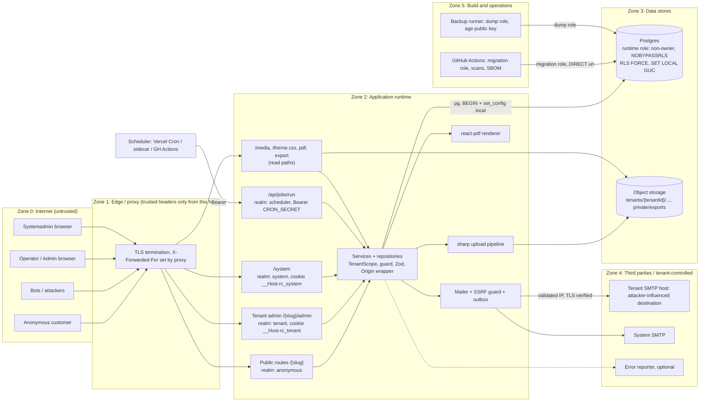

# Security threat model and requirements: RentCar

Version 1.0 · 2026-11-01 · Owner: security-engineer · Status: Phase 4 wave A deliverable (design; no code exists yet)
Inputs: `docs/03-inputs/security-constraints.md` (my Phase 3 input), `docs/security/sign-off.md`, `docs/security/registro-rischi.md`, `docs/03-architettura.md` (Option A chosen), `docs/adr/0001..0015`, `docs/02-requisiti.md` v1.2.
Language: English. ASVS references are to **ASVS 4.0.3**; Every fully numbered ASVS ID cited here was checked for existence (and its level and wording read) against the official 4.0.3 CSV (`OWASP/ASVS` tag `v4.0.3`); ranges such as `5.2.x` stand for the whole section.

## 0. How to read this document

- **Target level**: ASVS 4.0.3 **Level 2** for the whole application (decision of the cybersecurity-manager, NFR-SEC-01). Password minimum 12.
- **Accepted residual risks (user decisions, valid until GATE 4)**: no MFA, no SMTP-change re-authentication or notification, no CAPTCHA switch. They are **not requirements** here and are not re-proposed; see `docs/security/registro-rischi.md` (user acceptance log; R-AUTH-02, R-AUTH-03, R-AUTH-06, R-APP-04). Where a threat below touches one of them, the row says "accepted, see register" and lists only the controls that are still in force (for example the SSRF guard on the SMTP host stays mandatory). The extension points (`SecondFactorVerifier`, `session.assurance_level`) stay in the design.
- **ID scheme**: threats `XX-nn` (component prefix), security requirements `SR-<area>-nn` (these are what developers implement and reviewers check), abuse cases `ABU-Mx-nn` (these become automated tests), ASVS items `V<chapter>.<section>.<n>`.
- **Priority**: M = must (blocking in review if missing), S = should (tracked, not blocking). Everything marked M is in the ASVS L2 scope.
- **Risk scale** is the register's: P (probability) and I (impact) in L/M/H; level High if one is H and the other at least M, Medium if M/M or H/L, else Low. "Residual" is the expected level once the controls are implemented **and verified**; nothing is claimed verified yet.
- The hosting decision (Vercel Pro vs EU VPS, DB and S3 provider) is deferred to before GATE 4. Every requirement is written so that it holds on both; host-dependent items are collected in section 9.

---

## 1. Data classification and assets

| Class | Data | Where | Impact if disclosed or altered |
|---|---|---|---|
| Personal, ordinary | Customer first/last name, phone, optional email (booking snapshot and `customer`); staff name, username, email | DB, PDFs, emails, CSV, exports | Medium per record; high in aggregate (GDPR breach, owner is processor) |
| Credentials | Argon2id hashes, set-password and reset tokens (hashed), session tokens (hashed) | DB; token plaintext only in the email in flight | High (account or tenant takeover) |
| Secrets | Tenant SMTP passwords (AES-GCM ciphertext), `APP_ENCRYPTION_KEY`, `CRON_SECRET`, DB URLs, S3 keys, system SMTP | DB (ciphertext), host env | High |
| Business confidential | Bookings, revenue, expenses, snapshots, fleet, audit | DB | Medium per tenant; cross-tenant leak is the main product risk |
| Security telemetry | Audit log, security events, `JobRun`, `EmailLog`, rate-limit rows (HMAC keys) | DB | Low to medium (can contain recipient addresses; must not contain PII values) |
| Public | Branding, vehicle cards and photos, tenant public pages | DB, storage | Low |

Not processed: card numbers, identity or licence documents (SEC-5 answer A, FR-DAT-01), health data, special categories. If that premise changes, the sign-off is void (re-classification, DPIA, possibly ASVS L3 for those fields).

**Crown jewels**: (1) tenant isolation, (2) systemadmin account, (3) KEK and stored SMTP secrets, (4) tenant admin accounts, (5) the database and its backups.

**Structural fact that raises XSS impact**: tenancy is path-based (`/{slug}`), so all tenants and `/system` share **one browser origin**. A script injected through one tenant's content can act with the session of any staff member who is logged in, in the same browser, to any tenant or to `/system`. Strict CSP, plain-text tenant content and output encoding are therefore not optional hardening; they are the origin-isolation substitute until custom domains exist (FR-PLT-04).

---

## 2. Architecture, trust boundaries and data flow

Components in scope (Option A, code portable to Vercel or VPS): Next.js app (public site, tenant admin, `/system`, route handlers `media`, `theme.css`, `pdf`, `export`, `health`, `jobs`), Postgres (RLS), object storage, per-tenant SMTP and system SMTP, scheduler (Vercel Cron, compose sidecar, GitHub Actions), CI/CD with migration role, backup runner. No inbound webhooks. Outbound traffic exists only to: Postgres, S3 endpoint, SMTP hosts (tenant-controlled, therefore guarded), optional error reporter. This short list is an **egress allowlist** where the host supports one.

**Trust boundaries (each is a place where validation, authentication or authorisation must happen)**

| ID | Boundary | What crosses | Required control (see SR) |
|---|---|---|---|
| TB-1 | Internet to edge/app | All HTTP input: forms, JSON, multipart, headers, cookies | TLS, header policy, Zod at the boundary, Origin check, rate limit, trusted-proxy IP derivation |
| TB-2 | Realm boundary inside the app: anonymous / tenant staff (operator, admin) / systemadmin / scheduler | Identity and role | `requireRole(scope, role)` in every action, handler and page; separate cookies; session bound to tenant |
| TB-3 | App to Postgres | Queries, tenant context | Runtime role without DDL/BYPASSRLS, `set_config(..., true)` inside an explicit transaction, parameterised SQL, TLS `verify-full` |
| TB-4 | App to storage | Image bytes, keys | Server-generated keys, re-encoded content only, private prefix for exports |
| TB-5 | App to SMTP (tenant-controlled destination) | Host, port, credentials, message | SSRF guard with resolve-then-connect, TLS required, timeouts, error categories only |
| TB-6 | Scheduler to job endpoint | Bearer secret | Constant-time compare, separate secret, idempotent jobs |
| TB-7 | CI/CD to production DB | Migration role | Environment-scoped secrets, reviewers, migration role never at runtime |
| TB-8 | DB to backups | Full dump | Dump role (BYPASSRLS, read-only), `age` encryption, key held elsewhere, separate provider |
| TB-9 | Tenant to tenant (logical) | Any tenant-owned row, file, cache, job | `TenantScope` repositories plus RLS plus the generated cross-tenant matrix |

**Main data flows** (numbers are used in the STRIDE tables): F1 customer search and booking; F2 staff login and set-password; F3 admin CRUD; F4 systemadmin console; F5 job run; F6 outbound mail; F7 upload and media; F8 PDF by code and admin; F9 CSV and customer export; F10 audit and security events; F11 termination, export and hard delete.

---

## 3. Threat model (STRIDE per component)

Legend: S spoofing, T tampering, R repudiation, I information disclosure, D denial of service, E elevation of privilege. "Reg" links to the register (`R-…`). Residual is expected after the listed controls are verified.

### 3.1 Public booking and search (F1; FR-PUB-*, FR-BKG-08/10/11)

| ID | STRIDE | Threat | P | I | Level | Controls | Residual | Reg |
|---|---|---|---|---|---|---|---|---|
| PB-01 | S | Booking in someone else's name or with a victim's email: the platform emails a confirmation (and PDF) through the tenant SMTP to an arbitrary address (harassment, mail-bombing, damage to the tenant SMTP reputation) | H | M | High | One recipient per booking, entered once; per-IP and per-recipient-address limits; fixed template with names only, "ignore this email if you did not book" and tenant contact; CR/LF stripped; skip silently when the per-address cap is hit (SR-EML-05, SR-RL-01) | Medium | R-APP-04 |
| PB-02 | T | Client-supplied price, total, status, source, code, tenant id or vehicle attributes (mass assignment, FR-PUB-11) | H | M | High | Strict Zod schema (unknown key = 400); server recomputes with the pure `pricing()`; tenant from `TenantResolver` only (SR-VAL-01, SR-VAL-03) | Low | R-APP-01 |
| PB-03 | T | Stored XSS or HTML/template injection through first/last name into confirmation page, calendar, lists, email HTML, PDF, CSV | M | H | High (shared origin, section 1) | Character allowlist plus length caps, no raw HTML sinks, auto-escaping templates, strict CSP, PDF text as data (SR-VAL-04, SR-HDR-02, SR-PDF-01, SR-EML-03) | Low | R-APP-01 |
| PB-04 | I | Booking-code or PDF enumeration; code as bearer capability on the PDF route (FR-PDF-04) | M | M | Medium | Code >= 50 bits (Crockford base32, 10 chars), tenant-bound lookup, uniform 404, miss-rate limit, `no-store`, `noindex` (SR-PDF-02, SR-RL-01) | Low | R-APP-05 |
| PB-05 | I | Customer de-duplication by phone (FR-CUS-03) discloses an existing customer's name or email in the confirmation or PDF | M | M | Medium | Confirmation, email and PDF show only the values submitted in this booking, never stored customer fields; existing data never overwritten (SR-VAL-07) | Low | - |
| PB-06 | D | Distributed fake bookings block vehicles (RK-1); IP rotation defeats per-IP limits | H | M | High | Per-IP and per-phone limits, honeypot, minimum-fill-time token, trusted-IP derivation, admin quick-cancel, burst events for the CSM-1 alert. **Residual accepted, no CAPTCHA switch (register, SEC-10 = no)** | Medium (accepted) | R-APP-04 |
| PB-07 | D | Expensive availability queries (long ranges, many vehicles), query flooding | M | M | Medium | Range bounded by tenant max days and a hard cap, 5/min/IP, `statement_timeout`, indexed query (SR-VAL-06, SR-RL-01, SR-DB-07) | Low | - |
| PB-08 | S | Spoofed `X-Forwarded-For` to evade limits or to poison hashed-IP keys | H | M | High | Client IP only from the trusted hop (`TRUSTED_PROXY_COUNT`), never the leftmost XFF value (SR-RL-02) | Low | R-APP-04 |
| PB-09 | T | Double booking race, stale form after price change, duplicate submit | M | M | Medium | Exclusion constraint (ADR-0004), server re-check, idempotency key (FR-BKG-11) | Low | - |
| PB-10 | R | Customer denies a booking; no verification by design (REQ-7) | M | L | Low | Audit entry "public customer" with request id; accepted business risk (pay on site) | Low | - |
| PB-11 | E | Public endpoint reaches an admin function (shared handler) | L | H | Medium | Separate route trees, deny-by-default guard declaration enforced by an architecture test (SR-ACC-01) | Low | R-ISO-04 |

### 3.2 Authentication, set-password, reset, sessions (F2; FR-AUTH-*, ADR-0005)

| ID | STRIDE | Threat | P | I | Level | Controls | Residual | Reg |
|---|---|---|---|---|---|---|---|---|
| AU-01 | S | Credential stuffing and brute force on `/{slug}/admin/login` and `/system/login` | H | M | High | Per `(tenant, username)` and per hashed-IP limits before hashing, 12-char minimum, common-password list, identical responses (SR-AUT-05, SR-AUT-06, SR-RL-01) | Medium (no MFA, accepted) | R-AUTH-02/03/04 |
| AU-02 | S | Session theft: XSS, cookie leakage, token in URL or logs | M | H | High | `__Host-` HttpOnly Secure cookies, hashed tokens, no token in URL, strict CSP (SR-SES-01..03, SR-HDR-02) | Low | R-AUTH-01 |
| AU-03 | S | Session fixation or cross-tenant cookie replay (shared origin: the browser holds one tenant cookie for all slugs) | M | H | High | New token at login, ignore pre-login cookie, session row bound to tenant and realm, mismatch gives uniform 404 (SR-SES-04, SR-SES-05) | Low | R-ISO-01 |
| AU-04 | S/I | Set-password or reset token stolen from mailbox, Referer, logs, mail-scanner prefetch, browser history | M | H | High | 256-bit CSPRNG token stored as SHA-256, 24 h or 60 min, single use, **GET never consumes**, `Referrer-Policy: no-referrer`, query string redacted in logs, new link invalidates old (SR-AUT-03, SR-AUT-04). Mailbox compromise remains (R-AUTH-03, accepted with no MFA) | Medium | R-AUTH-03/05 |
| AU-05 | I | Account enumeration by message, status code or timing (login, reset, activation, suspended tenant) | M | M | Medium | Constant-shape responses, dummy argon2 verify for unknown users, reset work done in `after()`, suspended-tenant message only after valid credentials (SR-AUT-06, SR-AUT-07) | Low | R-AUTH-04 |
| AU-06 | S | Host-header poisoning of emailed links | L | H | Medium | Links built from `APP_BASE_URL` / `tenantUrl()` only (SR-AUT-08) | Low | R-AUTH-05 |
| AU-07 | D | Argon2id used as CPU/memory DoS (floods of logins), very long passwords | M | M | Medium | Pre-hash rate limit, max password length 128, global hashing concurrency cap per instance (SR-AUT-09) | Low | - |
| AU-08 | T | Race on token redemption, stale session after deactivation, suspension or password change | M | M | Medium | Atomic `UPDATE ... WHERE used_at IS NULL AND expires_at > now() RETURNING`; session check on every request joins user.active and tenant.status; revoke on change (SR-AUT-04, SR-SES-06) | Low | R-ISO-04 |
| AU-09 | E | Role, tenant id, `active` or `mustChangePassword` set from request body; forced-change bypass; operator performs admin write | M | H | High | Strict schemas, `requireRole` in the action itself, `mustChangePassword` checked in the guard (SR-ACC-02, SR-VAL-01) | Low | R-ISO-04 |
| AU-10 | R | Authentication decisions not recorded; no evidence in an incident | M | M | Medium | Security-event taxonomy and append-only `security_event` (SR-LOG-03) | Low | R-IR-01 |
| AU-11 | S | Seeded or default systemadmin credentials reach production | L | H | Medium | Production refuses seed without explicit flag; production systemadmin created by one-off CLI (A-33); dev password rejected by config validation (SR-CFG-02) | Low | R-SEC-03 |
| AU-12 | S | Stolen password of a tenant admin or systemadmin used from anywhere (no second factor) | M | H | High | **Accepted until GATE 4 (register R-AUTH-02, R-AUTH-03).** Controls still in force: throttling, short systemadmin session (15 min idle, 8 h absolute), `Strict` systemadmin cookie, security events for new logins, notification after credential changes (SR-AUT-10), `SecondFactorVerifier` seam | High (accepted) | R-AUTH-02/03 |

### 3.3 Tenant admin application (F3; FR-VEH, FR-BKG, FR-CUS, FR-OPR, FR-REV, FR-BRD)

| ID | STRIDE | Threat | P | I | Level | Controls | Residual | Reg |
|---|---|---|---|---|---|---|---|---|
| AD-01 | I/E | IDOR: tenant A changes an id (route, server action argument, filter, CSV param) to tenant B's | M | H | High | `TenantScope` repositories, RLS, generated matrix (SR-ACC-03, SR-DB-01..04) | Low | R-ISO-01 |
| AD-02 | E | Operator calls an admin server action directly | M | M | Medium | `requireRole` inside every action/handler; generated operator-write matrix (SR-ACC-02) | Low | R-ISO-04 |
| AD-03 | E | Framework-level auth bypass (middleware class, CVE-2025-29927) | M | H | High | Authorisation never only in middleware; proxy strips `x-middleware-subrequest` from external requests; patched Next.js; SCA gate (SR-ACC-04) | Medium | R-ISO-05 |
| AD-04 | T | CSRF on server actions and route handlers (route handlers have no built-in check) | M | M | Medium | `SameSite` cookies, mandatory `withOriginCheck` wrapper, JSON content type enforced, no state change on GET (SR-CSRF-01..03) | Low | - |
| AD-05 | T | Write while tenant is read-only (expired after grace, cancelled) through a crafted request | M | M | Medium | One central read-only policy (FR-ENF-01) called by the guard; generated test over every mutation (SR-ACC-05) | Low | - |
| AD-06 | T | Stored XSS or CSS injection through privacy notice/terms text, vehicle notes, branding fields, logo alt text | M | H | High (shared origin) | Privacy/terms text is **plain text** (decision, section 5.4); links `https:` only; colours hex-validated at write **and** at render; font enum (SR-VAL-05, SR-HDR-02) | Low | R-APP-01 |
| AD-07 | T | Open redirect through `next`/`returnTo` parameter after login | M | M | Medium | Redirect target must be a same-realm relative path from an allowlist pattern (SR-VAL-08) | Low | - |
| AD-08 | I | Over-fetching: hashes, flags or other tenants' ids in API/RSC payloads; SMTP password returned to the browser | M | H | High | DTO allowlists per route, repository columns explicit, SMTP secret write-only (SR-VAL-02, SR-CRY-04) | Low | R-SEC-01 |
| AD-09 | D | Unbounded lists, searches or exports | M | M | Medium | Page size cap 100, sort/filter allowlists, export concurrency 1 per tenant (SR-VAL-06, SR-CSV-04) | Low | - |
| AD-10 | R | Admin denies a change | M | L | Low | Audit entry with actor, entity, old/new identifiers (SR-AUD-01) | Low | - |
| AD-11 | S/E | Compromised admin session abuses SMTP settings to redirect or exfiltrate mail, or to probe internal hosts | M | H | High | **No re-authentication/notification (accepted, register R-AUTH-06/R-SEC-01).** In force: SSRF guard (SR-SSRF-*), audit entry without secret, test-email recipient fixed to the acting user (SR-SSRF-06) | Medium (accepted) | R-AUTH-06, R-SEC-05 |
| AD-12 | T | Lost update on concurrent edit (FR-BKG-19) | M | L | Low | Optimistic concurrency token | Low | - |

### 3.4 Systemadmin console (F4; FR-SYS-*, FR-AUTH-02)

| ID | STRIDE | Threat | P | I | Level | Controls | Residual | Reg |
|---|---|---|---|---|---|---|---|---|
| SY-01 | S/E | Systemadmin takeover gives control of every tenant's configuration and admin recovery | M | H | High | **No MFA (accepted until GATE 4, R-AUTH-02).** In force: separate realm, `Strict` `__Host-rc_system` cookie, 15 min idle / 8 h absolute, stricter per-IP limit, security events, platform audit, no tenant-data read path (SY-02) limits the blast radius to configuration and access recovery | High (accepted) | R-AUTH-02 |
| SY-02 | I | Systemadmin reads tenant bookings and customers (A-13: not allowed) through a system-context query | M | H | High | No system-scope policy on customer/booking/expense/vehicle tables, so the DB returns zero rows even if code tries (SR-DB-05) | Low | R-ISO-03 |
| SY-03 | E | The "system context" becomes a general bypass | M | H | High | Closed list of call sites (`purpose` enum), architecture test, each use writes a `system.context.used` event (SR-DB-05) | Low | R-ISO-03 |
| SY-04 | T | Hard delete of the wrong tenant or too early | L | H | Medium | Destructive path is a DB function with guards (terminated, >= 90 days, exact id), double confirmation by typing the slug, platform audit (SR-GDPR-07) | Low | R-PRIV-03 |
| SY-05 | R | Systemadmin action untraceable | M | M | Medium | Platform audit (append-only, not tenant-visible) for tenant create/edit/suspend/terminate, admin reset/replace, hard delete (SR-AUD-02) | Low | - |
| SY-06 | S/E | Admin recovery abuse: attacker with systemadmin session replaces a tenant admin | L | H | Medium | Audit; old admin sessions revoked; notification of the old admin address through the system SMTP (credential-change notice, SR-AUT-10); not an SMTP-change control | Medium | R-AUTH-02 |
| SY-07 | T | Slug takeover or collision with reserved namespaces; reuse of a deleted tenant's slug to phish old customers | L | M | Low | Reserved list, ASCII-only slug regex, slug tombstone 12 months after hard delete (SR-ACC-07) | Low | - |

### 3.5 Jobs and cron endpoint (F5; FR-PLT-05, ADR-0007)

| ID | STRIDE | Threat | P | I | Level | Controls | Residual | Reg |
|---|---|---|---|---|---|---|---|---|
| JB-01 | S | Anyone triggers jobs (duplicate emails, DB load) | M | M | Medium | Bearer secret, constant-time compare, 401 otherwise, failed-attempt limit (SR-JOB-01) | Low | R-SEC-04 |
| JB-02 | I | `CRON_SECRET` leak (logs, preview, shared with other secrets) | L | M | Low | Distinct per environment and from all other secrets, redacted in logs, rotation documented (SR-JOB-02) | Low | R-SEC-04 |
| JB-03 | T | Replay or concurrent runs duplicate effects | M | M | Medium | `JobRun(job, tenant, period)` unique key plus `pg_try_advisory_xact_lock`; idempotent effects (SR-JOB-03) | Low | - |
| JB-04 | E | Job loop uses a global context and mixes tenants | M | H | High | List tenants in `job` scope (ids, time zone, status only), then one scoped transaction per tenant; failure of one tenant does not stop others (SR-JOB-04) | Low | R-ISO-03 |
| JB-05 | D | Long or overlapping runs; endpoint used as a flood target | M | L | Low | Time budget per run with continuation, failed-secret rate limit, counts-only response (SR-JOB-05) | Low | - |
| JB-06 | R | Job failure unnoticed (D14: no alerting) | M | M | Medium | `JobRun` status and error code persisted; heartbeat email under CSM-1 (not a new requirement) | Medium | R-IR-01 |
| JB-07 | T | GET performs state change (Vercel Cron only issues GET) and could be triggered cross-site | L | M | Low | Cross-site requests cannot add the `Authorization` header; the route accepts no cookies and ignores `x-vercel-cron` as proof of origin (SR-JOB-01) | Low | - |

### 3.6 Email: per-tenant SMTP, outbox (F6; FR-BRD-06, FR-MAIL-*, ADR-0008)

| ID | STRIDE | Threat | P | I | Level | Controls | Residual | Reg |
|---|---|---|---|---|---|---|---|---|
| EM-01 | T/I | **SSRF** through the tenant-chosen SMTP host/port: probing internal services and cloud metadata, DNS rebinding between save and send | M | H | High | Resolve-then-validate-then-connect to the validated IP on every save, test and send; port allowlist; IP literals rejected; TLS verified (SR-SSRF-01..05) | Low | R-SEC-05 |
| EM-02 | I | SMTP password disclosure: DB dump, logs, API response, audit, error summary, CSV | M | H | High | AES-256-GCM with AAD, write-only field, redaction, canary tests (SR-CRY-01..04, SR-LOG-02) | Medium (single KEK in env, accepted R-SEC-02) | R-SEC-01/02 |
| EM-03 | T | Header or template injection through names, subject, addresses | M | M | Medium | Fixed templates from the catalog, auto-escaping, CR/LF rejected in all header fields, single validated `to`, `from` from settings only (SR-EML-03) | Low | - |
| EM-04 | I | Activation/reset token persisted in the outbox or `EmailLog` payload, undoing the hashing | M | H | High | Credential emails are rendered at send time, never stored, never auto-retried; failure means re-issue (SR-EML-02) | Low | R-AUTH-03 |
| EM-05 | I | STARTTLS downgrade or unverified certificate exposes mail and links | M | M | Medium | `requireTLS`, `rejectUnauthorized: true`, TLS >= 1.2, no dev override in production (SR-EML-01) | Low | - |
| EM-06 | I | SMTP error text used as a port-scan/banner oracle from the test-email action | M | M | Medium | Only coarse error categories reach the UI and `EmailLog` (SR-SSRF-05) | Low | R-SEC-05 |
| EM-07 | D | Mail bombing via booking form or reset requests; outbox flood | H | M | High | Per-address, per-IP, per-tenant limits; outbox row cap per tenant per day; retry cap and backoff (SR-EML-05, SR-RL-01) | Medium | R-APP-04 |
| EM-08 | S | A compromised admin sends phishing as the tenant | L | M | Low | Accepted with the admin-compromise risk; outbound mail only from templates (no free-text mail feature exists), which limits abuse to booking/reset content | Low | R-AUTH-06 |
| EM-09 | I | PDF attachment or email body carries more PII than needed | L | M | Low | Content minimisation in templates (name, code, dates, price) (SR-EML-04) | Low | - |

### 3.7 Storage, uploads, media (F7; FR-VEH-05, FR-BRD-08, ADR-0009)

| ID | STRIDE | Threat | P | I | Level | Controls | Residual | Reg |
|---|---|---|---|---|---|---|---|---|
| ST-01 | T/E | Malicious upload: SVG, polyglot, HTML renamed, decompression bomb, animated image | M | M | Medium | Magic-byte allowlist, size/pixel caps before decode, re-encode with `sharp`, output WebP/PNG only (SR-UPL-01..05) | Low | R-APP-03 |
| ST-02 | T | Path traversal, key forging, overwrite of another tenant's object | M | H | High | Keys generated server-side from validated ids and `randomUUID()`; `/media` route parses with a strict regex and never concatenates raw path (SR-UPL-06) | Low | R-ISO-01 |
| ST-03 | I | Private artefacts (exports) reachable by URL or via long-lived presigned URL; bucket allows anonymous list | M | H | High | `private/` prefix never served by `/media`; exports downloaded through an authorised route or presigned <= 5 min; bucket policy test (SR-UPL-08) | Low | R-ISO-01 |
| ST-04 | D | Storage fill, pixel bombs, parallel uploads exhausting memory | M | M | Medium | Per-vehicle 10 photos, per-tenant byte quota, `sharp` pixel cap and concurrency cap, body cap enforced while streaming (SR-UPL-03, SR-UPL-07) | Low | - |
| ST-05 | I | EXIF GPS and device data in customer-visible photos | M | L | Low | Re-encode strips metadata (SR-UPL-04) | Low | - |
| ST-06 | T | Served image executes as HTML on the shared origin | L | H | Medium | `nosniff`, `Content-Type` from verified output type, `Content-Security-Policy: default-src 'none'; sandbox`, `Cross-Origin-Resource-Policy: same-origin` (SR-UPL-06) | Low | R-APP-03 |
| ST-07 | I | Cross-tenant media via guessed key | L | M | Low | UUID v4 keys (122 bits); media is public content by design; private data is never in `/media` | Low | - |

### 3.8 PDF (F8; FR-PDF-*, ADR-0006)

| ID | STRIDE | Threat | P | I | Level | Controls | Residual | Reg |
|---|---|---|---|---|---|---|---|---|
| PD-01 | T/I | react-pdf fetches a URL (image `src`, link) taken from tenant data: SSRF and tracking pixel | M | H | High | Images only as `Buffer` read through `StoragePort`; no remote `src`; no `Link` with data-driven URL (SR-PDF-01) | Low | R-SEC-05 |
| PD-02 | I | PDF by booking code guessed or enumerated | M | M | Medium | SR-PDF-02 (see PB-04) | Low | R-APP-05 |
| PD-03 | D | CPU/memory exhaustion by generation | M | M | Medium | Input caps, concurrency cap, 5 s timeout, rate limit (SR-PDF-03) | Low | - |
| PD-04 | I | Shared cache or CDN stores a booking PDF | L | M | Low | `Cache-Control: private, no-store`, `Content-Disposition: attachment` (SR-PDF-02) | Low | - |
| PD-05 | T | Bidi override or homoglyph names spoof content in PDF/admin | L | L | Low | Reject control and bidi characters in names (SR-VAL-04) | Low | - |

### 3.9 CSV and data export (F9; FR-CSV-*, FR-CUS-07)

| ID | STRIDE | Threat | P | I | Level | Controls | Residual | Reg |
|---|---|---|---|---|---|---|---|---|
| CS-01 | T | Spreadsheet formula injection from any text column | M | M | Medium | Neutralise every string cell (trigger set includes TAB, CR, full-width forms); typed columns untouched (SR-CSV-01) | Low | R-APP-02 |
| CS-02 | I | Cross-tenant rows in an export | M | H | High | Query runs in the tenant transaction (RLS) and the repository scope; matrix test (SR-CSV-02) | Low | R-ISO-01 |
| CS-03 | E | Operator downloads exports | M | M | Medium | Admin-only guard (SR-CSV-02) | Low | R-ISO-04 |
| CS-04 | D | 50,000-row export exhausts memory/time; repeated exports | M | M | Medium | Streaming with a cursor, concurrency 1 per tenant, 10/h limit (SR-CSV-04) | Low | - |
| CS-05 | R | Export not logged | M | M | Medium | Audit entry (who, filters, row count, no data) written **before** the first byte (SR-CSV-03) | Low | - |
| CS-06 | I | Export cached, or filename carries PII | L | M | Low | `no-store`, `attachment`, generic filename (SR-CSV-05) | Low | - |

### 3.10 Audit log and security events (F10; FR-AUD-*)

| ID | STRIDE | Threat | P | I | Level | Controls | Residual | Reg |
|---|---|---|---|---|---|---|---|---|
| AL-01 | T | Audit entries edited or deleted by a compromised app or a bug | L | M | Low | Runtime role has INSERT/SELECT only; trigger rejects UPDATE/DELETE unless run by the owner-defined retention function (SR-AUD-03) | Low | R-ISO-06 |
| AL-02 | I | PII or free text copied into audit values (notes, names) so anonymisation leaves traces | M | M | Medium | Free-text fields are logged as a `changed` marker with length, never the value; allowlist of audited fields; scan test with canaries (SR-AUD-04) | Low | R-PRIV-02 |
| AL-03 | R | Missing audit entries for listed actions | M | M | Medium | Single audited-action registry; test iterates it (SR-AUD-01) | Low | - |
| AL-04 | I | Tenant reads another tenant's or the platform's events | L | H | Medium | RLS on audit; `security_event` and `platform_audit` readable only in system scope (SR-AUD-02) | Low | R-ISO-01 |
| AL-05 | T | Log injection via CR/LF in logged values | L | L | Low | JSON logger, values never concatenated into messages (SR-LOG-01) | Low | - |

### 3.11 Database, tenant isolation, operations (cross-cutting)

| ID | STRIDE | Threat | P | I | Level | Controls | Residual | Reg |
|---|---|---|---|---|---|---|---|---|
| DB-01 | E/I | RLS silently ineffective: runtime role owns tables or has BYPASSRLS (provider default roles), `FORCE` missing, session-level `SET` leaking across pooled connections | M | H | High | Roles created by SQL, catalog tests, `set_config(..., true)` only, spike S1 on the real pooler (SR-DB-01..04) | Low | R-ISO-02 |
| DB-02 | T | SQL injection via raw `sql` fragments, `ORDER BY`, `LIKE` patterns | L | H | Medium | Parameterised queries only, sort allowlists, `LIKE` escaping, Semgrep rule (SR-VAL-06) | Low | - |
| DB-03 | E | Migration/owner credentials used at runtime, or runtime role gets DDL | L | H | Medium | Separate env vars and roles; runtime URL cannot run DDL (test); grant snapshot test (SR-DB-06) | Low | R-ISO-02 |
| DB-04 | I | Backups unencrypted, or silently empty because the dump role is filtered by RLS | M | H | High | `age` encryption, separate provider and key, dump role with BYPASSRLS and read-only, restore test with row-count comparison (SR-DB-09) | Medium | R-HOST-05 |
| DB-05 | D | Connection exhaustion, long transactions holding locks, aborted transaction returned to pool | M | M | Medium | Role-level `statement_timeout`, `lock_timeout`, `idle_in_transaction_session_timeout`; destroy connection on failed `ROLLBACK` (SR-DB-07) | Low | R-HOST-06 |
| DB-06 | I | Preview/staging with production data or keys | M | H | High | Separate DB branch, bucket, keys, secrets scope; synthetic data; deployment protection (SR-CFG-04) | Low | R-HOST-04 |

### 3.12 Supply chain, build, theming

| ID | STRIDE | Threat | P | I | Level | Controls | Residual | Reg |
|---|---|---|---|---|---|---|---|---|
| SC-01 | T | Malicious or vulnerable dependency (install scripts, native modules `sharp`, argon2) | M | H | High | Frozen lockfile, `ignore-scripts` with reviewed allowlist, SCA, SBOM, review of every new dependency (SR-CFG-05) | Medium | R-SUP-01 |
| SC-02 | T | CI compromise (third-party actions, over-broad secrets) | L | H | Medium | Actions pinned by SHA, `contents: read`, environment-scoped secrets, OIDC where possible | Low | R-SUP-02 |
| TH-01 | T | CSS injection or breakage through colour/font values; tenant-supplied CSS | M | M | Medium | Hex regex at write and at render, font enum, no tenant CSS, theme served as same-origin stylesheet (SR-VAL-05, SR-HDR-02) | Low | R-APP-06 |

**New risks for the register (for the cybersecurity-manager to add; none exist today)**: (a) shared browser origin raises the impact of any XSS across tenants and `/system` (AD-06, PB-03); (b) credential emails persisted in the outbox would defeat token hashing (EM-04); (c) backups taken with a role filtered by RLS can be silently incomplete (DB-04); (d) `pg_dump`/restore can resurrect anonymised or hard-deleted data unless a deletion ledger is replayed (SR-GDPR-08); (e) mail-scanner prefetch can burn single-use links if a GET consumes them (AU-04); (f) contradictory text on displaying the activation link once in the UI (ADR-0005 vs FR-OPR-05/A-26; question SEC-15).

---

## 4. Abuse cases by milestone (each becomes an automated test)

Milestones follow `02-requisiti.md` §3.2 (M0 is the repository/CI harness required by the sign-off). **Level**: U unit · I integration (real Postgres via Testcontainers, handlers called through the real guard) · D database catalog/role test · E Playwright browser test · C static/CI check (Semgrep, dependency-cruiser, config) · X staging/deployment test. "Expect" is the pass criterion; a failure is a blocking finding.
Fixtures every test may rely on (qa-engineer builds them in M0): tenants A and B (each with admin, operator, deactivated operator, un-activated user), a suspended tenant, a read-only tenant (expired after grace), a systemadmin, a fake DNS resolver, a fake SMTP server with controllable STARTTLS/certificate behaviour, MinIO, a controllable clock.

### 4.1 M0: harness, platform, configuration

| ID | Attack / abuse | Expect | Lvl | Covers |
|---|---|---|---|---|
| ABU-M0-01 | Inspect runtime DB role | `rolsuper=false`, `rolbypassrls=false`, `rolcreaterole=false`, owns no table/function/sequence, no `CREATE` on any schema | D | DB-01, SR-DB-01 |
| ABU-M0-02 | List all tables with a `tenant_id` column | Each has `relrowsecurity` and `relforcerowsecurity` true and at least one policy using `nullif(current_setting('app.tenant_id', true), '')::uuid` | D | DB-01, SR-DB-02/04 |
| ABU-M0-03 | As runtime role, no GUC set: SELECT, INSERT, UPDATE, DELETE on every tenant table | SELECT returns 0 rows; INSERT/UPDATE/DELETE affect 0 rows or fail `WITH CHECK` | D | AD-01, SR-DB-04 |
| ABU-M0-04 | Pool with `max=1`: tenant A transaction commits, then a statement runs with no new context; also after ROLLBACK and after an error | `current_setting('app.tenant_id', true)` is empty/NULL on the reused connection; no A rows visible | I | DB-01, SR-DB-03 |
| ABU-M0-05 | 1,000 concurrent requests alternating tenants A and B against the real pooler (spike S1) | Zero foreign rows in any response; zero errors from stale context | I/X | DB-01, SR-DB-03 |
| ABU-M0-06 | Source contains `set_config(..., false)`, `SET app.`, `SET SESSION`, or a repository call outside `withTenantTx` | Semgrep/grep rule fails the build on fixture files; clean tree passes | C | SR-DB-03 |
| ABU-M0-07 | Runtime role tries `UPDATE`/`DELETE`/`TRUNCATE` on `audit_log`, `security_event`, `platform_audit`, snapshot versions; tries DDL | All denied (permission error); trigger also rejects when run as another role | D | AL-01, SR-AUD-03 |
| ABU-M0-08 | Snapshot of `information_schema.role_table_grants` for the runtime role | Equals the committed allowlist; any new grant needs a reviewed change | D | DB-03, SR-DB-06 |
| ABU-M0-09 | Boot in production mode with: placeholder `APP_ENCRYPTION_KEY`, short/missing `CRON_SECRET`, `http://` base URL, seed enabled, local storage on Vercel, `RATE_LIMIT_DISABLED=true` | Process exits non-zero; message names the variable, never its value | U | AU-11, SR-CFG-01/02 |
| ABU-M0-10 | Fixture file with a fake API key and a fake private key committed on a branch | gitleaks pre-commit and CI fail; clean tree passes | C | R-SEC-03 |
| ABU-M0-11 | Request each route class (public page, admin page, `/system`, API JSON, `/media`, `theme.css`, PDF, CSV, 404, 500, health) | Header set matches section 7.1 exactly for that class; no `X-Powered-By`; every response has `Content-Type` and `nosniff` | E | SR-HDR-01..08 |
| ABU-M0-12 | External request with `x-middleware-subrequest: middleware:middleware:middleware:middleware:middleware` to a protected route | Same result as without the header (401/redirect/404); header stripped or ignored | E | AD-03, SR-ACC-04 |
| ABU-M0-13 | Route registry: add a handler without a guard declaration | Architecture test fails; every existing route has `{scope, minRole}` or `public` with a reason | C | PB-11, SR-ACC-01 |
| ABU-M0-14 | ORM/SDK import or raw `sql` with string interpolation outside the data layer | dependency-cruiser and Semgrep fail | C | DB-02, SR-VAL-06 |
| ABU-M0-15 | Log canary: submit booking, failed login, SMTP save, upload, set-password with sentinel values (`CANARY_NAME_7f3a`, `CANARY_PASS_…`, `CANARY_TOKEN_…`, `CANARY_SMTP_…`) | Sentinels absent from stdout/stderr, the log sink, error-reporter payload, `EmailLog`, `JobRun`, audit and security events | I | EM-02, SR-LOG-02 |
| ABU-M0-16 | Introduce a known-vulnerable dependency, a Dockerfile running as root, a high Semgrep finding in a throwaway branch | SCA, Trivy and SAST gates fail the pipeline | C | SC-01 |

### 4.2 M1: auth, sessions, systemadmin, tenants, jobs, SMTP guard

| ID | Attack / abuse | Expect | Lvl | Covers |
|---|---|---|---|---|
| ABU-M1-01 | Unauthenticated request to every protected route/action (matrix generated from the route registry) | 401 (API) or redirect to the right login (page); no body data | I | SR-ACC-01 |
| ABU-M1-02 | Wrong role for every route: operator on admin mutations, admin on `/system`, systemadmin on tenant admin routes, tenant A admin on tenant B slug | 403 (role) or 404 (tenant mismatch); no side effect (checked by DB diff) | I | AD-02, SR-ACC-02 |
| ABU-M1-03 | Tenant A session cookie sent to `/{B}/admin`; systemadmin cookie to tenant routes and the reverse | Rejected with the uniform 404/login redirect; `tenant.mismatch` security event written | I | AU-03, SR-SES-05 |
| ABU-M1-04 | Login with unknown user, wrong password, deactivated user, un-activated user, suspended tenant (wrong password), suspended tenant (right password) | First five: identical status, body and headers; argon2 `verify` called exactly once on each path (spy); sixth: suspended message only for valid credentials | I | AU-05, SR-AUT-06 |
| ABU-M1-05 | 5 failures in 15 min for `(A, admin)`, then the correct password | 429 with `Retry-After`; correct password also refused during the window; `(B, admin)` unaffected; per-IP limit independent | I | AU-01, SR-RL-01 |
| ABU-M1-06 | Rotate `X-Forwarded-For` values on each request to evade limits | Counter keyed on the trusted-hop IP only; limit still reached | I | PB-08, SR-RL-02 |
| ABU-M1-07 | Login while the rate-limit store is down | Login/reset fail closed (503/429 generic), search/public read paths unaffected | I | SR-RL-04 |
| ABU-M1-08 | Cookie inspection after login (tenant and system) | `__Host-rc_tenant` / `__Host-rc_system`, `HttpOnly`, `Secure` (HTTPS), `Path=/`, no `Domain`, `SameSite=Lax` / `Strict`, no `Max-Age` beyond policy, value >= 256 bits base64url | E | AU-02, SR-SES-02 |
| ABU-M1-09 | Fixation: send a pre-login `__Host-rc_tenant` value, then log in | Server issues a new token; old value invalid; DB stores only SHA-256 of the new token | I | AU-03, SR-SES-04 |
| ABU-M1-10 | Session lifetime with the clock fixture: tenant idle 30 min / absolute 12 h; systemadmin 15 min / 8 h | Rejected exactly after the limit; sliding refresh never exceeds absolute | I | SR-SES-07 |
| ABU-M1-11 | Open session, then: deactivate user; suspend tenant; change password; admin replaced; logout | Next request returns 401/redirect in every case; logout deletes the row | I | AU-08, SR-SES-06 |
| ABU-M1-12 | Set-password link: GET it twice (simulating a mail scanner), then POST once, then POST again; expired token; token of another purpose; token for a deactivated user; re-issue then use the old one | GETs do not consume; first POST succeeds; every other case fails with the same generic page; DB holds only the hash | I | AU-04, SR-AUT-03/04 |
| ABU-M1-13 | Two concurrent POSTs redeeming the same token | Exactly one succeeds; one password set; all other sessions of the user revoked | I | AU-08, SR-AUT-04 |
| ABU-M1-14 | Password policy: 11 chars; 12 chars; 128 chars; 129 chars; equals username; top-100k entry; Unicode passphrase with spaces and emoji; leading/trailing spaces | Rejected, accepted, accepted, rejected, rejected, rejected, accepted, preserved (no truncation, NFKC applied consistently on set and verify); error names the failed rule; token stays usable | U/I | SR-AUT-11 |
| ABU-M1-15 | Reset request for existing and unknown username; with forged `Host` and `X-Forwarded-Host` | Identical response; emailed link host equals `APP_BASE_URL`; reset invalidates other sessions and the previous reset link | I | AU-05/06, SR-AUT-07/08 |
| ABU-M1-16 | Mass assignment on create/update user: `role=admin`, `tenantId=B`, `active=true`, `mustChangePassword=false`, `passwordHash` | 400 (unknown key) and no change | I | AU-09, SR-VAL-01 |
| ABU-M1-17 | Cross-origin POST (`Origin: https://evil.test`, `Origin: null`, no Origin with `Sec-Fetch-Site: cross-site`, text/plain body) to every mutating route and server action; same-origin control | Cross-origin cases 403, no effect; same-origin passes; logout/exports/job triggers over GET are 405 | I/E | AD-04, SR-CSRF-01..03 |
| ABU-M1-18 | `next`/`returnTo` = `//evil.test`, `https://evil.test`, `/\evil.test`, `javascript:alert(1)`, `/system` from a tenant login | Ignored; redirected to the default page of the right realm | I | AD-07, SR-VAL-08 |
| ABU-M1-19 | SMTP guard on save, test and send: `127.0.0.1`, `localhost`, `10.0.0.5`, `172.16.0.1`, `192.168.1.1`, `169.254.169.254`, `100.64.0.1`, `0.0.0.0`, `[::1]`, `::ffff:127.0.0.1`, `fc00::1`, `fe80::1`, decimal `2130706433`, hex `0x7f.1`, a public hostname whose A record is private (fake DNS), IP literal of a public host | All rejected with category `blocked_address` (IP literals: `invalid_host`); no socket opened (assert on the fake network layer) | I | EM-01, SR-SSRF-01/02 |
| ABU-M1-20 | DNS rebinding: resolver returns a public IP at save, a private IP at send | Send refused; no connection to the private IP | I | EM-01, SR-SSRF-04 |
| ABU-M1-21 | Ports 22, 25 (allowed), 80, 110, 143, 3306, 5432, 6379, 8080; port 465/587 with certificate for a different name; expired cert; STARTTLS stripped by the fake server | Only 25/465/587/2525 accepted; bad cert and stripped STARTTLS refused (`tls_failed`); never falls back to plaintext | I | EM-05, SR-SSRF-03 |
| ABU-M1-22 | Error content of the test-email action against a server that returns a banner containing `SECRET_BANNER_1` | UI and `EmailLog` show only a category; banner absent | I | EM-06, SR-SSRF-05 |
| ABU-M1-23 | Dev override for private SMTP (Mailpit) with `APP_ENV=production` | Override ignored and boot fails if the flag is set | U | SR-SSRF-07 |
| ABU-M1-24 | Encryption: save SMTP password; read settings via every route, action and RSC payload; dump DB; inspect audit and logs | Plaintext appears nowhere; form shows a placeholder; ciphertext is `v1.<kid>.<nonce>.<ct>`; copying the ciphertext to tenant B's row fails to decrypt; flipped bit fails; unknown `kid` fails closed | I | EM-02, SR-CRY-01..04 |
| ABU-M1-25 | Key rotation fixture: encrypt under key 1, deploy with key 2 + `PREVIOUS=key1`, run the rotation command, retire key 1 | Old data readable before, re-encrypted after, unreadable-with-key-1-only after retirement; procedure documented and repeatable | I | SR-CRY-03 |
| ABU-M1-26 | Job endpoint: no header; `Authorization: Bearer wrong`; secret as query string; valid secret via GET and POST; five parallel valid calls; `x-vercel-cron: 1` without secret; `CRON_SECRET` unset | 401; 401; 401; 200 counts only; one set of effects (no duplicate `JobRun`, no duplicate emails); 401; endpoint disabled and boot fails in production | I | JB-01/03/07, SR-JOB-01/03 |
| ABU-M1-27 | Compare function review | Secret compare uses `timingSafeEqual` on equal-length SHA-256 digests (unit test with spy; Semgrep forbids `===` on secrets) | U/C | JB-01, SR-JOB-01 |
| ABU-M1-28 | As systemadmin context, `SELECT` on booking, customer, vehicle, expense tables | 0 rows (no system policy exists); no route exposes tenant bookings/customers to `/system` | D/I | SY-02, SR-DB-05 |
| ABU-M1-29 | Production seed: run seed with `NODE_ENV=production`; check logs and process env for the seed password | Refused without the flag; password never logged | U | AU-11, SR-AUT-13 |
| ABU-M1-30 | Tenant suspended: public page, theme, media, admin login, API with an existing session, PDF, job per-tenant work | Neutral unavailable page; logins rejected; session invalid at once; no cached state (no cross-request cache) | I/E | FR-SYS-12, SR-ACC-09 |
| ABU-M1-31 | Slug creation: reserved (`system`, `api`, `media`, `_next`), upper case, Unicode homoglyph, 1 char, 40+ chars, trailing hyphen, tombstoned slug | All rejected with a field error; unknown slug returns the same generic 404 as a tombstoned one | U/I | SY-07, SR-ACC-07 |
| ABU-M1-32 | Admin replaced or reset by systemadmin | Old sessions die at once; old admin address receives a notice; audit entry present; never two active admins (concurrent replace) | I | SY-06, SR-AUT-10 |
| ABU-M1-33 | 50 parallel logins on one instance | No out-of-memory; excess requests get 429/503 within the hashing concurrency cap; p95 for the accepted ones within budget | I | AU-07, SR-AUT-09 |
| ABU-M1-34 | Password change and credential notifications | Notice email sent after change/reset/replace and contains no secret; change requires current password; session list shows other sessions; "sign out others" works | I/E | SR-AUT-10/12, SR-SES-08 |

### 4.3 M2: vehicles, public booking, email, PDF, uploads

| ID | Attack / abuse | Expect | Lvl | Covers |
|---|---|---|---|---|
| ABU-M2-01 | Limits: 6 searches/min/IP; 11 bookings/h/IP; 4th open booking for one phone in one tenant; same phone in tenant B | 429 with `Retry-After` / friendly message; tenant B unaffected; counter keys contain no raw IP | I | PB-06, SR-RL-01 |
| ABU-M2-02 | Rate-limit store down | Search succeeds; booking submit fails closed with a friendly "try again"; login/reset closed | I | SR-RL-04 |
| ABU-M2-03 | Honeypot filled; form submitted faster than the minimum fill time; replayed or tampered form token | Neutral success page, no booking, no email, no PDF, no signal difference visible to the client except timing-equal | I | PB-06, SR-RL-05 |
| ABU-M2-04 | Booking body with extra keys (`status`, `tenantId`, `code`, `total`, `source`, `dailyPrice`) | 400, nothing created | I | PB-02, SR-VAL-01 |
| ABU-M2-05 | Names/phone/email: 10,000-char names, control chars, U+202E, NUL, emoji, `\r\nBcc:`, non-E.164 phone, 300-char email, array-valued fields (parameter pollution) | 400 with field errors; nothing created | U/I | PB-03, SR-VAL-04/09 |
| ABU-M2-06 | XSS payloads in names (``, `"><svg/onload=…>`, `{{7*7}}`, `${7*7}`, `<%= 7*7 %>`) then view in confirmation, admin calendar, list, detail, audit view, email HTML, PDF, CSV, and as operator | Rendered as literal text everywhere; no dialog/network call (Playwright listeners); `49` never appears; PDF text equals payload literally | E/I | PB-03, SR-VAL-04, SR-HDR-02 |
| ABU-M2-07 | Booking with a phone that already belongs to a customer with another name/email | Confirmation, email and PDF show only submitted values; stored customer unchanged | I | PB-05, SR-VAL-07 |
| ABU-M2-08 | Replay the same idempotency key (3 times, parallel) | One booking, one email, same confirmation | I | PB-09 |
| ABU-M2-09 | Email: one booking with email to victim address; 4 bookings to the same address in a day | One mail per booking with ignore-line and tenant contact; fourth booking succeeds but its mail is skipped; header fields contain no CR/LF | I | PB-01, SR-EML-03/05 |
| ABU-M2-10 | Credential email delivery fails (SMTP down) | No token or rendered body stored in `EmailLog`/outbox; no automatic retry; creator can re-issue; old link invalid after re-issue | I | EM-04, SR-EML-02 |
| ABU-M2-11 | PDF by code: wrong code, right code with another tenant slug, tenant suspended, 11 misses in 1 h from one IP | Identical 404 body/headers for all misses; 429 after the miss limit; response headers `private, no-store`, `noindex`, `nosniff`, `attachment` | I | PB-04, PD-02, SR-PDF-02 |
| ABU-M2-12 | Tenant row tampered: logo/vehicle image URL = `http://169.254.169.254/x` or a collaborator URL; render PDF | No outbound request is made (network layer asserts zero calls); PDF renders with fallback | I | PD-01, SR-PDF-01 |
| ABU-M2-13 | Booking code generation | Alphabet 32, length 10 (50 bits); 1,000,000 generated codes show no sequential pattern and no collision within a tenant; lookup is tenant-scoped | U | R-APP-05, SR-PDF-02 |
| ABU-M2-14 | Uploads (vehicle photo and logo): SVG; animated GIF/WebP; HTML renamed `.jpg`; JPEG+PHP polyglot; PNG 30000x30000 (tiny file); truncated JPEG; body 4 MB + 1 byte; lying `Content-Length`; filename `../../x.php`, double extension, NUL byte; 11th photo; by operator; in read-only tenant; to tenant B's vehicle id | Each rejected with the right 4xx; storage listing shows no new object; no 5xx; memory stays bounded | I | ST-01/04, SR-UPL-01..07 |
| ABU-M2-15 | Valid JPEG with GPS EXIF and ICC profile | Stored as WebP (and PNG logo) re-encoded; no EXIF/GPS in output bytes; key `tenants/{A}/vehicles/{v}/{uuid}.webp`; filename not reflected anywhere | I | ST-05, SR-UPL-04/05 |
| ABU-M2-16 | `/media` requests: `..%2f`, `%2e%2e/`, double encoding, other tenant's valid-looking key, `private/exports/...`, disallowed extension, huge path | 404; valid keys return correct type with `nosniff`, `default-src 'none'; sandbox`, immutable cache | I | ST-02/03/06, SR-UPL-06/08 |
| ABU-M2-17 | Deployment: anonymous `LIST`, `PUT`, `DELETE` and ACL read against the bucket | All denied; objects reachable only by public prefix GET (or only through the app) | X | ST-03, SR-UPL-08 |
| ABU-M2-18 | Vehicle IDOR: tenant A admin edits, archives, deletes, uploads photos for, or reads expenses of tenant B vehicle ids; public search for archived/maintenance/other-tenant vehicles | 404 and no change; never listed | I | AD-01, SR-ACC-03 |
| ABU-M2-19 | 50 parallel overlapping bookings (S5) | Exactly one wins; the rest get the conflict message; no deadlock | I | PB-09 |
| ABU-M2-20 | Public booking on a suspended tenant or after grace, using a stale form | Rejected server side with the neutral message; nothing created | I | SR-ACC-09 |
| ABU-M2-21 | Search with return before pickup, range 400 days, dates in year 9999, malformed ISO, `limit=100000` | 400; query time bounded; no DB statement over `statement_timeout` | I | PB-07, SR-VAL-06 |
| ABU-M2-22 | Free-text field with a Luhn-valid 16-digit number (only if SEC-16 = A) | Rejected with an explanatory message; a 10-digit phone in notes accepted | U | SR-VAL-11 |

### 4.4 M3: admin bookings, calendar, customers, operators, audit

| ID | Attack / abuse | Expect | Lvl | Covers |
|---|---|---|---|---|
| ABU-M3-01 | Cross-tenant matrix for bookings, customers, operators, audit view, calendar data, search: read, list, update, delete, export with tenant B ids as tenant A admin | 404/403 and zero B data in body, headers or timing-distinguishable errors | I | AD-01, SR-ACC-03 |
| ABU-M3-02 | Operator sends every admin mutation (generated from the action registry) with a valid body | 403 and DB unchanged; GET views of customers list, revenue, audit, settings are 403 | I | AD-02, SR-ACC-02 |
| ABU-M3-03 | Read-only tenant: attempt every mutation; then the allowed ones (payment, status, login, password change, export) | Blocked ones 403 "subscription expired", allowed ones succeed | I | AD-05, SR-ACC-05 |
| ABU-M3-04 | Mass assignment on booking edit/create (`tenantId`, `code`, `createdAt`, `dailyPriceSnapshot`, `source`, `status` transitions that skip rules) | 400 or ignored; invalid transitions rejected | I | SR-VAL-01 |
| ABU-M3-05 | Stale update with an old version token | "changed by someone else"; no lost update | I | AD-12 |
| ABU-M3-06 | Anonymise a customer with original values `ANON_NAME`, `ANON_PHONE`, `ANON_EMAIL`, then search every table and the object store | Zero hits for the originals in customer, booking snapshots, `EmailLog`, audit, security events, `JobRun`, rate-limit, exports; placeholder is random, not a hash of the phone; a new booking with the old phone creates a new customer; open bookings block it with a clear message | I | SR-GDPR-04 |
| ABU-M3-07 | Customer export for own customer and a foreign id; inspect storage and logs | Own data only, foreign id 404; audit entry with customer id; not persisted to storage; CSV cells neutralised | I | SR-GDPR-03, SR-CSV-01 |
| ABU-M3-08 | Operator creation: link goes through tenant SMTP; limit; `role=admin` in body; second admin | One-time link only; limit enforced under concurrency; role ignored; second admin impossible | I | FR-OPR, REQ-16 |
| ABU-M3-09 | Audit: perform each audited action (registry); edit booking notes with canary; anonymise; export CSV | Entry per action with actor/entity/ids; notes stored as `changed` marker with length; canary absent; entries survive anonymisation | I | AL-02/03, SR-AUD-01/04 |
| ABU-M3-10 | Operator opens audit view; tenant A reads B's audit; tenant admin opens platform audit or security events | 403/404 | I | AL-04 |
| ABU-M3-11 | Filter/sort injection: `sort=name;DROP TABLE x`, `sort=passwordHash`, `q=%`, `q=_`, 5,000-char `q`, `pageSize=10000`, `page=-1`, repeated `status=a&status=b` | 400 or clamped; no SQL error text; no hash column ever selectable | I | DB-02, SR-VAL-06 |
| ABU-M3-12 | Sessions: list active sessions, revoke one, revoke all others after re-entering the password | Revoked sessions fail on next request; revoking requires the password | E | SR-SES-08 |
| ABU-M3-13 | Calendar and booking detail for another tenant's booking id via RSC/server action payload | 404; no foreign data in the serialised payload | I | AD-01 |

### 4.5 M4: expenses, revenue, snapshots, CSV

| ID | Attack / abuse | Expect | Lvl | Covers |
|---|---|---|---|---|
| ABU-M4-01 | CSV injection payloads in every text column (customer name, vehicle name/plate/notes, booking notes, expense description, tenant name): `=HYPERLINK("http://e.test","x")`, `@SUM(1+1)`, `+cmd|' /C calc'!A0`, `-2+3`, `\t=1+1`, `\r=1`, `" =1+1"`, full-width `＝1+1`, `\|`-leading | Each string cell begins with `'`; numbers/dates/validated E.164 phones are untouched (`-12.50` stays numeric); quoting per RFC 4180 | U/I | CS-01, SR-CSV-01 |
| ABU-M4-02 | Export as operator; as tenant A with B filters; in read-only tenant | 403; zero B rows; works in read-only | I | CS-02/03, SR-CSV-02 |
| ABU-M4-03 | Export audit and headers; second parallel export; filename | Audit row written before the first byte, with filters and row count but no data; second export 429/409; headers `attachment`, `text/csv`, `no-store`, `nosniff`; filename has no PII | I | CS-04/05/06, SR-CSV-03..05 |
| ABU-M4-04 | 50,000-row export (spike S6) | Streams within time budget and bounded memory | I/X | CS-04 |
| ABU-M4-05 | Cross-tenant matrix for expenses, revenue aggregates, snapshots; correction of a closed year from tenant A | B untouched; 404 on B ids | I | AD-01 |
| ABU-M4-06 | Snapshot integrity: runtime role updates or deletes an existing snapshot version | Denied; corrections only INSERT a new version | D | SR-AUD-03 |
| ABU-M4-07 | Expense amount `0`, `-1`, `1e9`, `NaN`, 3 decimals, description with Luhn number (if SEC-16 = A) | 400 | U | SR-VAL-12, SR-VAL-11 |

### 4.6 M5: branding and theming

| ID | Attack / abuse | Expect | Lvl | Covers |
|---|---|---|---|---|
| ABU-M5-01 | Colour values `red`, `#12345`, `#12345g`, `#fff;}body{display:none}`, `url(//e.test)`, `</style><script>`; font `Comic`; | Rejected at write (400); font only from the enum | U/I | TH-01, SR-VAL-05 |
| ABU-M5-02 | DB row tampered with an invalid colour, then request `/{slug}/theme.css` | Output uses safe defaults for that token; response is valid CSS; no injected rule | I | TH-01, SR-VAL-05 |
| ABU-M5-03 | Privacy notice/terms text with `<script>`, `<a href=javascript:…>`, markdown link; "link" variant with `javascript:`, `data:`, `http://`, `ftp://`, `https://ok.test` | Text variant rendered as escaped plain text; link variant accepts only `https:` and renders `rel="noopener noreferrer nofollow"` `target="_blank"` | E/I | AD-06, SR-VAL-05 |
| ABU-M5-04 | Logo upload with all M2-14 vectors but 1 MB limit; alt text with markup | Same rejections; alt rendered escaped | I | SR-UPL-* |
| ABU-M5-05 | Playwright crawl of all key pages (public, admin, system) with `securitypolicyviolation` listener; inject an inline script via DOM | Zero violations in normal flows; injected inline script blocked | E | SR-HDR-02 |
| ABU-M5-06 | `theme.css` and `/media` for unknown, suspended or deleted tenants | 404; no data of other tenants | I | SR-ACC-09 |
| ABU-M5-07 | Branding IDOR: tenant A saves branding with tenant B id in body/path | Ignored/404; B unchanged | I | AD-01 |

### 4.7 M6: hardening, notifications, GDPR, operations

| ID | Attack / abuse | Expect | Lvl | Covers |
|---|---|---|---|---|
| ABU-M6-01 | Hard delete: active tenant; terminated 30 days ago; terminated 91 days ago; wrong confirmation slug; as tenant admin | Refused, refused, succeeds, refused, 403. After success: query over every table with `tenant_id` (generated from the catalog) returns 0 for that tenant; storage prefixes empty; other tenant untouched; platform audit row, slug tombstone and deletion-ledger row exist | I/D | SY-04, SR-GDPR-07 |
| ABU-M6-02 | Termination export: request, download as tenant admin link, reuse link, wait past expiry | Contains only that tenant; link single-purpose with download cap and expiry; file deleted after expiry; no PII in URL | I | SR-GDPR-06 |
| ABU-M6-03 | Retention jobs with the clock fixture: sessions, credential tokens, rate-limit rows, idempotency keys, `EmailLog` recipients, security events, audit > 24 months, exports | Each purged at its threshold, nothing earlier; running twice changes nothing; tenant audit purge uses the retention function only | I | SR-GDPR-05 |
| ABU-M6-04 | ZAP baseline on staging and ZAP authenticated active scan on an ephemeral CI environment (seeded users) | No High; Mediums triaged; report archived | X | all |
| ABU-M6-05 | TLS and header scan of staging and production (testssl.sh or SSL Labs, securityheaders) | TLS 1.2+ only, strong ciphers, HSTS present, no mixed content; header set as section 7.1 | X | SR-HDR-01 |
| ABU-M6-06 | Restore test: restore latest dump into a scratch DB; compare per-table row counts with the source; replay the deletion ledger | Counts equal (proves the dump role bypasses RLS); anonymised customers and hard-deleted tenants are re-erased by the ledger step | X | DB-04, SR-DB-09, SR-GDPR-08 |
| ABU-M6-07 | Preview deployment environment variables | No production DB host, bucket, `APP_ENCRYPTION_KEY`, `CRON_SECRET` or S3 key value present (compare hashes in CI) | X | DB-06, SR-CFG-04 |
| ABU-M6-08 | Fault injection: DB down, Zod failure, unhandled exception in action, route handler and RSC render, SMTP exception | Generic message with request id; no stack, SQL, path or env value in body or headers; status codes correct | I | SR-LOG-05 |
| ABU-M6-09 | `TRACE`, `PUT`, `OPTIONS` on routes; request with `Origin: https://evil.test` and preflight | 405 for unsupported methods; no `Access-Control-Allow-*` header ever | I | SR-HDR-06/07 |
| ABU-M6-10 | Serverless smoke (NFR-SRV-01) on a Vercel preview with synthetic data | Security header set, cookies and RLS behaviour identical to compose; `local` storage refused | X | SR-CFG-02 |
| ABU-M6-11 | Booking-blocking burst: 200 bookings from 100 rotated trusted IPs | Per-IP limits do not stop it (known residual, accepted); security events `ratelimit.exceeded`/burst counter written so the CSM-1 alert can fire; admin bulk-cancel works | I | PB-06 |
| ABU-M6-12 | Credential-bearing job outputs and `JobRun` rows | Contain counts and error codes only | I | JB-05 |

---

## 5. Decisions taken in this document

These resolve items the architecture left to Phase 4 or that needed one consistent answer. They are binding for implementation unless the cybersecurity-manager objects.

| # | Decision | Rationale |
|---|---|---|
| 5.1 | **CSP style handling (AR-8)**: `style-src 'self' 'nonce-…'` and **no** `style-src-attr` in the first implementation. If Radix/shadcn SSR output needs inline `style=""` attributes and the CSP test (ABU-M5-05) shows violations, allow `style-src-attr 'unsafe-inline'` only, never `style-src 'unsafe-inline'`. Condition for the exception: no `style` attribute or prop is ever built from user, tenant or request data (Semgrep rule on JSX `style=` with non-literal values). | Inline style attributes cannot run script; the residual is CSS-based data exfiltration, which needs an injection point we remove by rule. Tenant colours reach the page only through `theme.css`. |
| 5.2 | **Cookie `SameSite`**: tenant realm `Lax`, systemadmin realm `Strict`. | Email links must land on admin pages with the session (Lax); `/system` is entered directly. |
| 5.3 | **Fail modes** (clarifies ADR-0013): login, reset and set-password: closed. Public booking **submit**: closed (it triggers email and writes). Public search and read pages: open. | A failed store must not remove the mail-bomb and fake-booking limits for the write path. |
| 5.4 | **Tenant text is plain text**: privacy notice/terms text is rendered as escaped plain text with line breaks; no Markdown, no HTML, no auto-linking. The "link" variant accepts `https:` URLs only. | The field is the highest-risk XSS sink on a shared origin; a sanitiser is a dependency we can avoid. Revisit only with a reviewed Markdown pipeline. |
| 5.5 | **Credential emails are never persisted or auto-retried.** Carve-out from the outbox retry rule in ADR-0008: the link is rendered at send time; on failure the row records `failed` + category only, the creator re-issues (FR-AUTH-04, FR-OPR-05). | A persisted link next to a hashed token nullifies the hashing. |
| 5.6 | **IP handling**: raw client IP is never written to app logs, audit, `EmailLog` or the database. Rate-limit keys use `HMAC(server key, ip)`; security events store `ip_prefix` (IPv4 /24, IPv6 /48) and `ip_hmac`. Host platform logs (Vercel, Caddy) still contain IPs; that is stated in the privacy notice and covered by the 30-day log retention. | Minimisation while keeping enough for incident correlation. |
| 5.7 | **Tenant admin password reset mail goes through the system SMTP** (assumption pending SEC-12). Operator resets stay on the tenant SMTP (FR-AUTH-05). | Account recovery for the most privileged tenant user should not depend on a tenant-controlled mail server. No new process; the system SMTP exists already. |
| 5.8 | **Booking code**: 10 characters, Crockford base32 (50 bits), CSPRNG, unique per tenant, never sequential. | NFR-SEC-07 asks >= 40 bits; the PDF route makes the code a bearer capability, so 50 bits plus rate limit (R-APP-05). |
| 5.9 | **Free-text fields never reach audit, logs or events as values**; audit stores a `changed` marker and length. | Keeps anonymisation complete and FR-AUD-03 verifiable. |
| 5.10 | **No bypass of rate limits or Origin checks in any production-mode build.** Test environments use `APP_ENV=ci` for relaxed limits; boot rejects `RATE_LIMIT_DISABLED` when `APP_ENV` is `staging` or `production`. | DAST needs headroom; a global off-switch must not exist where real data is. |
| 5.11 | **Systemadmin has no read path to tenant customers/bookings/expenses/vehicles**, enforced by absence of system-scope RLS policies (not only by missing routes). Termination export runs in a tenant-scoped job (SR-GDPR-06). | A-13, segregation of duties (V4.3.3). |

---

## 6. ASVS 4.0.3 Level 2 mapping

Status: **Plan** = requirement written, to be verified in the milestone review · **Dev** = deviation or accepted risk (not a silent gap). Test IDs refer to section 4. FR/NFR IDs refer to `02-requisiti.md` v1.2. I list the requirement IDs that apply to this product; chapters/sections not listed are N/A (reasons in the last table).

| ASVS | Items (L1+L2) | Security requirements | FR / NFR | Verified by | Status |
|---|---|---|---|---|---|
| V1 Architecture | 1.1.1-1.1.7 (SDLC, threat model, trust boundaries); 1.2.1-1.2.4; 1.4.1, 1.4.4, 1.4.5; 1.5.1-1.5.4; 1.6.1-1.6.4; 1.7.1; 1.8.1-1.8.2; 1.9.1-1.9.2; 1.10.1; 1.11.1-1.11.2; 1.12.2; 1.14.1-1.14.6 | This document; SR-AUT-01, SR-ACC-01, SR-VAL-01, SR-CRY-*, SR-LOG-01, SR-CFG-* | NFR-SEC-01, NFR-ISO-*, FR-PLT-09 | Per-milestone review, ABU-M0-13/14 | Plan (1.6.x depends on KEK custody, see Dev table) |
| V2 Authentication | 2.1.1-2.1.12; 2.2.1-2.2.3; 2.3.1; 2.4.1-2.4.4 (**2.4.5 see Dev**); 2.5.1-2.5.6; 2.7.2, 2.7.3, 2.7.5, 2.7.6 (link tokens treated as out-of-band activation/recovery codes); 2.10.1-2.10.4 (service secrets) | SR-AUT-01..14 | FR-AUTH-01..13, NFR-SEC-02/07 | ABU-M1-04..16, 29, 32..34 | Plan |
| V3 Session | 3.1.1; 3.2.1-3.2.4; 3.3.1-3.3.4; 3.4.1-3.4.5; 3.5.2; 3.7.1 | SR-SES-01..08 | FR-AUTH-09/10, NFR-SEC-04 | ABU-M1-03, 08..11, ABU-M3-12 | Plan |
| V4 Access control | 4.1.1-4.1.5; 4.2.1; 4.2.2; 4.3.2; 4.3.3 | SR-ACC-01..09, SR-CSRF-*, SR-DB-* | FR-AUTH-13, NFR-ISO-01..03, FR-OPR-02, FR-ENF-01 | ABU-M0-02..08, 13; ABU-M1-01..03; ABU-M3-01..03 | Plan; **4.3.1 (MFA on admin interfaces) accepted risk, see Dev** |
| V5 Validation, sanitisation, encoding | 5.1.1-5.1.5; 5.2.1-5.2.8; 5.3.1-5.3.10; 5.4.1-5.4.3; 5.5.1-5.5.4 | SR-VAL-01..12, SR-SSRF-*, SR-EML-03, SR-PDF-01, SR-CSV-01 | NFR-SEC-03, FR-CSV-02, FR-BRD-11, FR-DAT-01 | ABU-M2-04..06, ABU-M3-11, ABU-M4-01, ABU-M5-01..03 | Plan |
| V6 Stored cryptography | 6.1.1 (see Dev), 6.2.1-6.2.6; 6.3.1-6.3.2; 6.4.1 (6.4.2 see Dev) | SR-CRY-01..10 | NFR-SEC-02, FR-BRD-06, FR-SYS-03 | ABU-M1-24/25 | Plan (+ Dev rows) |
| V7 Logging and error handling | 7.1.1-7.1.4; 7.2.1-7.2.2; 7.3.1, 7.3.3, 7.3.4; 7.4.1-7.4.3 | SR-LOG-01..08, SR-AUD-* | FR-PLT-08, NFR-OBS-01, FR-AUD-* | ABU-M0-15, ABU-M6-08 | Plan |
| V8 Data protection | 8.1.1-8.1.4; 8.2.1-8.2.3; 8.3.1-8.3.8 (8.3.6 see Dev) | SR-HDR-03, SR-GDPR-*, SR-LOG-02, SR-AUD-04 | NFR-GDPR-01..07, FR-CUS-06/07, FR-SYS-16 | ABU-M3-06/07, ABU-M6-01..03 | Plan |
| V9 Communications | 9.1.1-9.1.3; 9.2.1-9.2.3 (9.2.4 host-dependent) | SR-HDR-01 (HSTS), SR-CRY-07, SR-SSRF-03, SR-EML-01, SR-DB-08 | NFR-SEC-04 | ABU-M6-05, ABU-M1-21 | Plan |
| V10 Malicious code | 10.2.1, 10.2.2; 10.3.1-10.3.3 | SR-CFG-05 (review of new dependencies, lockfile, SCA), no auto-update feature | NFR-SEC-08 | ABU-M0-16 | Plan; 10.3.3 re-check when custom domains are added |
| V11 Business logic | 11.1.1-11.1.8 | SR-RL-*, SR-VAL-03, SR-ACC-05, SR-GDPR-04, SR-LOG-03 (events for CSM-1) | FR-PUB-10/11, FR-BKG-08/11, FR-SYS-08, FR-ENF-01 | ABU-M2-01..03, 08, 19 | Plan (11.1.7/11.1.8 alerting is CSM-1) |
| V12 Files and resources | 12.1.1, 12.1.3; 12.2.1; 12.3.1-12.3.6; 12.4.1 (12.4.2 see Dev); 12.5.1-12.5.2; 12.6.1 | SR-UPL-01..10, SR-PDF-01 | NFR-SEC-06, FR-VEH-05, FR-BRD-08, NFR-ISO-02 | ABU-M2-14..17 | Plan |
| V13 API and web service | 13.1.1, 13.1.3-13.1.5; 13.2.1-13.2.3, 13.2.5, 13.2.6; 13.4.x not applicable (no GraphQL) | SR-CSRF-*, SR-VAL-01, SR-HDR-07, SR-ACC-01/04 | NFR-SEC-03/04 | ABU-M1-17, ABU-M6-09 | Plan |
| V14 Configuration | 14.1.1-14.1.4; 14.2.1-14.2.6; 14.3.2, 14.3.3; 14.4.1-14.4.7; 14.5.1-14.5.4 | SR-HDR-*, SR-CFG-* | NFR-SEC-04/08, FR-PLT-06/09 | ABU-M0-09/11, ABU-M6-04/05 | Plan |

### Deviations, accepted risks and host-dependent items (explicit)

| ASVS | Item | Position | Owner of decision |
|---|---|---|---|
| 4.3.1 (L1) | MFA for administrative interfaces | **Accepted risk until GATE 4** (user decision 2026-11-01; R-AUTH-02, R-AUTH-03). `SecondFactorVerifier` seam and `assurance_level` kept. V2.8.x applies as soon as TOTP is added. | User via register |
| 2.4.5 (L2) | Additional KDF iteration with a secret salt (pepper) stored separately | Not in the design. Cost to add about half a day (`secret` parameter of argon2 from a separate env value, version stored with the hash). Question SEC-14. | cybersecurity-manager / user |
| 6.4.1, 6.4.2 (L2), 2.10.4 | Key vault; key material not exposed to the application | KEK is an environment secret (AS-4, R-SEC-02 "needs acceptance"). Compensations: HKDF domain separation, AAD binding, key custody rules (SR-CRY-09), rotation tested. KMS later. | User via register (R-SEC-02) |
| 6.1.1 (L2) | PII encrypted at rest | Provided by the platform (managed Postgres/object storage encrypt at rest by default; backups `age`-encrypted). On a VPS this needs volume/disk encryption or provider-managed encryption, which may not exist: condition for option C (section 9). Field-level encryption of customer data is not planned (it would break search and de-duplication). | cybersecurity-manager at the host decision |
| 8.3.5 (L2) | Auditing access to sensitive data | Treated as: exports (CSV, customer export, termination export), anonymisation and secret changes are audited; ordinary reads of customer lists are not (ordinary personal data, volume). Needs the cybersecurity-manager's agreement. | cybersecurity-manager |
| 8.3.6 (L2) | Overwrite sensitive memory | Not achievable in a JS runtime; mitigated by short lifetime of decrypted secrets (no module-level caching). | cybersecurity-manager |
| 12.4.2 (L1) | Antivirus on uploads | Equivalent control: only JPEG/PNG/WebP accepted, fully decoded and re-encoded, originals discarded; no document types. Request confirmation that this satisfies the intent. | cybersecurity-manager |
| 9.2.4 (L2) | OCSP stapling | Host/proxy property (Vercel and Caddy handle it); verify in the TLS scan. | devops-engineer |
| 1.7.2, 7.3.3 (L2) | Logs shipped to a remote system and protected | Logs go to stdout and the host's log store; no log drain by default; retention <= 30 days. Remote analysis is the minimal CSM-1 alerting. | observability-engineer |
| 11.1.7, 11.1.8, 8.1.4 (L2) | Monitoring and alerting of abnormal activity | The application emits the events (SR-LOG-03); the email alerts are CSM-1. | observability-engineer / cybersecurity-manager |
| 14.2.3 | SRI for external assets | N/A: no external assets (self-hosted fonts, same-origin CSS/JS). | - |
| 13.4.x, 2.8 (until TOTP), 3.5.1/3.5.3 | GraphQL, OTP, OAuth, stateless tokens | N/A: not used. | - |

---

## 7. Security requirements for implementation

Format: `ID · requirement · priority · ASVS · source · test`. All are verifiable; "Test" points to section 4. Developers cite the SR ID in the commit/PR; the security review checks them one by one.

### 7.1 Headers, CSP, cache, CORS (SR-HDR)

Header matrix by route class. `P` public pages, `A` authenticated pages (`/{slug}/admin/**`, `/system/**`, login, set-password, reset), `J` JSON/API and server-action responses, `M` `/media/*`, `T` `theme.css`, `F` file downloads (PDF, CSV, export).

| Header | P | A | J | M | T | F |
|---|---|---|---|---|---|---|
| `Strict-Transport-Security: max-age=31536000; includeSubDomains` (no `preload`, SEC-8 A assumed) | yes | yes | yes | yes | yes | yes |
| `Content-Security-Policy` | page CSP | page CSP | `default-src 'none'; frame-ancestors 'none'` | `default-src 'none'; sandbox` | `default-src 'none'` | `default-src 'none'; frame-ancestors 'none'` |
| `X-Content-Type-Options: nosniff` | yes | yes | yes | yes | yes | yes |
| `Referrer-Policy` | `strict-origin-when-cross-origin` | `no-referrer` | `no-referrer` | `no-referrer` | `no-referrer` | `no-referrer` |
| `Permissions-Policy: camera=(), microphone=(), geolocation=(), payment=(), usb=(), browsing-topics=()` | yes | yes | yes | - | - | - |
| `Cross-Origin-Opener-Policy: same-origin` | yes | yes | - | - | - | - |
| `Cross-Origin-Resource-Policy: same-origin` | - | - | yes | yes | yes | yes |
| `X-Frame-Options: DENY` (legacy backup of `frame-ancestors`) | yes | yes | yes | - | - | yes |
| `Cache-Control` | `no-cache` (suspension must apply at once; no shared cache) | `no-store` | `no-store` | `public, max-age=31536000, immutable` | `public, max-age=31536000, immutable` (URL carries `?v=`) | `private, no-store` |
| `X-Robots-Tag: noindex, nofollow` | only confirmation, 404, unavailable pages | yes | yes | - | - | yes |
| `Content-Disposition: attachment; filename="…"` | - | - | - | - | - | yes |

| ID | Requirement | Pri | ASVS | Test |
|---|---|---|---|---|
| SR-HDR-01 | Every response carries the headers of its class from the matrix; set centrally (one module), not per route; automated header test runs on the compose app in CI and on staging/production | M | 14.4.1-14.4.7, 14.3.3 | ABU-M0-11, M6-05 |
| SR-HDR-02 | **Page CSP**: `default-src 'none'; script-src 'self' 'nonce-{n}' 'strict-dynamic'; style-src 'self' 'nonce-{n}'; img-src 'self' data: blob:; font-src 'self'; connect-src 'self'; manifest-src 'self'; form-action 'self'; base-uri 'none'; object-src 'none'; frame-ancestors 'none'; upgrade-insecure-requests`. Fresh CSPRNG nonce per request (>= 128 bits). `'unsafe-eval'` only when `APP_ENV=local` (React dev). No third-party origin in any directive. `blob:` is needed only for the client-side photo downscale preview. Style-attribute rule: decision 5.1. No CSP report endpoint in production (it would add an unauthenticated write endpoint); violations are caught by the Playwright listener | M | 14.4.3, 5.3.3 | ABU-M5-05 |
| SR-HDR-03 | `Cache-Control` as in the matrix; authenticated, credential, PDF, CSV and export responses `no-store`; no sensitive data in `localStorage`/`sessionStorage`/IndexedDB (none is used) | M | 8.2.1-8.2.3 | ABU-M0-11 |
| SR-HDR-04 | `X-Robots-Tag: noindex` on every non-public route class. Do not list `/system` or admin paths in `robots.txt` (it would advertise them); the SEO document owns the public side | M | - | ABU-M0-11 |
| SR-HDR-05 | `poweredByHeader: false`; no framework/version/stack information in any header, body or error | M | 14.3.3 | ABU-M0-11 |
| SR-HDR-06 | No CORS: no `Access-Control-Allow-*` header on any route; `OPTIONS` is 405. A future mobile/API consumer needs an exact-origin allowlist and never `*` with credentials | M | 14.5.3 | ABU-M6-09 |
| SR-HDR-07 | Each route declares its allowed methods; others return 405; `TRACE` and `CONNECT` rejected at the proxy | M | 14.5.1 | ABU-M6-09 |
| SR-HDR-08 | Behind the proxy, only the trusted hop may set `X-Forwarded-*`; the app reads `Host` and scheme from configuration (`APP_BASE_URL`, tenant host allowlist), never from request headers, for building URLs | M | 14.5.4, 5.1.5 | ABU-M1-15 |

### 7.2 Sessions and cookies (SR-SES)

| ID | Requirement | Pri | ASVS | Test |
|---|---|---|---|---|
| SR-SES-01 | Token = 32 bytes from `crypto.randomBytes`, base64url. Only `SHA-256(token)` is stored (`session` row: user, tenant nullable for system realm, realm, created, last_seen, idle_expires, abs_expires, `assurance_level`, coarse user agent) | M | 3.2.2, 3.2.4, 3.5.2 | ABU-M1-09 |
| SR-SES-02 | Cookies `__Host-rc_tenant` and `__Host-rc_system`: `HttpOnly; Secure; Path=/`; no `Domain`; no `Max-Age`/`Expires` (browser-session cookie; the server enforces lifetime); tenant `SameSite=Lax`, system `SameSite=Strict`. The `Secure` flag and the prefix are dropped only when `APP_ENV=local` over `http://localhost` | M | 3.4.1-3.4.5 | ABU-M1-08 |
| SR-SES-03 | Token never in URL, query, response body, log, audit, error report or email | M | 3.1.1, 3.2.3 | ABU-M0-15 |
| SR-SES-04 | New token on login, on set-password completion, on password change and on reset; any incoming session cookie is ignored by login handlers; old row deleted | M | 3.2.1 | ABU-M1-09 |
| SR-SES-05 | The session row binds user, realm and tenant. A tenant cookie presented on another slug, or a system cookie on tenant routes (and the reverse), is treated as no session; response is the uniform 404/redirect; event `tenant.mismatch` | M | 4.1.2 | ABU-M1-03 |
| SR-SES-06 | Every request revalidates in the guard: not expired, user active, tenant status allows access, `password_changed_at` not after session creation. Logout deletes the row (server-side). Deactivation, suspension, password change, reset and admin replacement revoke at once (delete rows) | M | 3.3.1, 3.7.1, 4.1.5 | ABU-M1-11 |
| SR-SES-07 | Lifetimes (config constants): tenant users 30 min idle / 12 h absolute; systemadmin 15 min idle / 8 h absolute. `last_seen` is written at most once per 60 s per session. Expired rows purged daily | M | 3.3.2 | ABU-M1-10 |
| SR-SES-08 | Profile page lists the user's active sessions (created, last seen, coarse browser/OS, current marked); user can sign out any or all others after re-entering the password; password change and activation offer "sign out other sessions" (default on); reset always revokes all | M | 3.3.3, 3.3.4 | ABU-M3-12 |

### 7.3 Credentials and account lifecycle (SR-AUT)

| ID | Requirement | Pri | ASVS | Test |
|---|---|---|---|---|
| SR-AUT-01 | One `auth` module is the only code that creates, verifies, rotates or revokes credentials and sessions; no second login path (including `/system`, set-password, reset) bypasses its checks | M | 1.2.3, 1.2.4 | ABU-M0-13 |
| SR-AUT-02 | Password hash: `@node-rs/argon2` argon2id, m >= 19456 KiB, t >= 2, p = 1 (tuned on the target to about 250 ms, spike S3), random salt >= 16 bytes, encoded string stores parameters; rehash on successful login when parameters are outdated. Password is NFKC-normalised, up to 128 characters, never truncated, any printable Unicode accepted, spaces not stripped | M | 2.1.2-2.1.4, 2.4.1, 2.4.2 | ABU-M1-14 |
| SR-AUT-03 | **Set-password link** (`SetPasswordLinkIssuer`, ADR-0005): 32-byte CSPRNG token; `credential_token` stores SHA-256, user, tenant, purpose (`activation` 24 h, `reset` 60 min), `expires_at`, `used_at`; issuing a new token for the same user and purpose expires the previous one; token bound to user and tenant; never logged; no password is generated, emailed or shown | M | 2.3.1, 2.5.1, 2.5.6, 2.7.2, 2.7.5, 2.7.6 | ABU-M1-12 |
| SR-AUT-04 | **Redemption**: the link's GET renders the form and consumes nothing (mail scanners prefetch links). The POST redeems in one transaction: `UPDATE credential_token SET used_at = now() WHERE hash = $1 AND used_at IS NULL AND expires_at > now() RETURNING …`, checks user active and tenant status, validates the password policy first (a policy failure does not consume the token), sets the hash, revokes all sessions of the user, then issues a fresh session or sends to login. Token page: `Referrer-Policy: no-referrer`, `no-store`; request URL redacted in logs (route template only); the page loads no third-party resource | M | 2.5.6, 3.3.3 | ABU-M1-12/13 |
| SR-AUT-05 | **Throttling**: 5 failed logins per `(tenant, username)` per 15 min, then every attempt in the window is refused with 429 + `Retry-After` (the correct password is refused too, to defeat brute force; cap 15 min, so lockout DoS of a legitimate user is bounded); plus per-IP limit (20 failures per 15 min per hashed IP; systemadmin realm 10); counters in the shared store; systemadmin realm has its own counters | M | 2.2.1 | ABU-M1-05 |
| SR-AUT-06 | Login failure for unknown user, wrong password, deactivated user and never-activated user returns the same status, body and headers; the unknown-user path runs an argon2 verify against a fixed dummy hash with the same parameters; the "tenant suspended" message appears only after valid credentials | M | 2.2.1, 3.2.1 | ABU-M1-04 |
| SR-AUT-07 | Reset request returns the identical confirmation for existing and unknown accounts; mail is rendered and sent in `after()`; limits 3/h per account and 10/h per IP; failure of the tenant SMTP is logged and shown to the admin, never to the requester | M | 2.5.6, FR-AUTH-06 | ABU-M1-15 |
| SR-AUT-08 | All emailed links are built from `APP_BASE_URL` (or `tenantUrl()` for a tenant host from the allowlist), never from `Host`/`X-Forwarded-*` | M | 2.5.6 | ABU-M1-15 |
| SR-AUT-09 | Argon2 verify/hash runs behind a per-instance concurrency semaphore (suggest 4) and after the rate-limit check; excess requests get 429/503; request body size for auth routes <= 8 KB | M | 2.2.1 | ABU-M1-33 |
| SR-AUT-10 | Notification emails (no secret, no link) after: password change, password reset completion, admin reset/replacement (to the previous address too), staff email change. Not a new control for SMTP changes | M | 2.2.3, 2.5.5 | ABU-M1-32/34 |
| SR-AUT-11 | Password policy: >= 12 characters, not equal to or containing the username or email local part, not in a local common/breached list (top 100k, loaded at build time; no external call with the password), no composition rules, no periodic rotation, paste and password managers allowed, strength meter and "show password" toggle on the form | M | 2.1.1, 2.1.5-2.1.12 | ABU-M1-14 |
| SR-AUT-12 | Password change requires the current password; applies the same policy | M | 2.1.6 | ABU-M1-34 |
| SR-AUT-13 | No default or shared accounts. Production systemadmin is created once by a CLI command run by the owner (interactive password or a one-time set-password link printed to the terminal); the dev seed refuses `NODE_ENV=production` without an explicit flag and never prints the password | M | 2.5.4 | ABU-M1-29 |
| SR-AUT-14 | `SecondFactorVerifier` port with `NoopSecondFactorVerifier` is on the login path and covered by a test using a fake that demands a factor (proves the seam works); `assurance_level` is stored. This is not MFA | S | 2.8 (prep) | unit |

### 7.4 Access control and tenancy (SR-ACC)

| ID | Requirement | Pri | ASVS | Test |
|---|---|---|---|---|
| SR-ACC-01 | Deny by default. A **route registry** records for every page, server action and route handler `{ scope: public\|tenant\|system\|scheduler, minRole, resource? }`; an architecture test fails on any handler not registered; public entries need a `reason`. The generated matrices in section 4 read this registry | M | 4.1.1, 1.4.1, 13.1.4 | ABU-M0-13, ABU-M1-01 |
| SR-ACC-02 | `requireRole(scope, role)` is called **inside** each action/handler/page (not only in a layout or middleware). Operator is read-only: server-side 403 on every mutation. `mustChangePassword` is enforced by the guard | M | 4.1.3, 4.1.5 | ABU-M1-02, ABU-M3-02 |
| SR-ACC-03 | Object-level access: every read/write by id goes through a repository created from the session's `TenantScope`; a foreign or missing id both return the same not-found. Tenant ids never come from request input. Repositories select explicit columns (no `select *` into DTOs) | M | 4.2.1, 4.1.2 | ABU-M3-01 |
| SR-ACC-04 | Authorisation is never only in middleware. The proxy/edge strips `x-middleware-subrequest` from external requests; Next.js and React are kept on the latest patched minor (weekly update window, advisory subscription) | M | 4.1.1, 14.2.1 | ABU-M0-12 |
| SR-ACC-05 | Read-only policy (FR-ENF-01) is one function called by the guard for every mutation, with an explicit allowlist (login, password change, reset, logout, payment, status, exports) | M | 11.1.1 | ABU-M3-03 |
| SR-ACC-06 | Any exception in a guard, repository or policy ends in a denial, never in a pass-through | M | 4.1.5 | unit |
| SR-ACC-07 | Slug: `^[a-z0-9](?:[a-z0-9-]{1,38}[a-z0-9])$`, ASCII only, reserved list (`system`, `api`, `media`, `_next`, `static`, `assets`, `admin`, `login`, `robots.txt` and similar); immutable; after hard delete the slug is tombstoned for 12 months; unknown, reserved and tombstoned slugs return the same generic 404. Resolution only through `TenantResolver` | M | 4.1.2, 10.3.3 (future custom domains) | ABU-M1-31 |
| SR-ACC-08 | Segregation: no systemadmin read path to tenant customers/bookings/expenses/vehicles (decision 5.11); no operator access to customer list, revenue, expenses, settings, audit (FR-OPR-02); exactly one active admin per tenant (constraint) | M | 4.3.3 | ABU-M1-28, M3-02 |
| SR-ACC-09 | Tenant status (suspended, terminated, tombstoned, read-only after grace) is evaluated per request with no cross-request cache; public routes, `theme.css`, `/media`, PDF and jobs all honour it | M | 11.1.1 | ABU-M1-30 |

### 7.5 CSRF (SR-CSRF)

| ID | Requirement | Pri | ASVS | Test |
|---|---|---|---|---|
| SR-CSRF-01 | Every non-GET/HEAD route handler is wrapped by `withOriginCheck`: `Origin` must exactly match an allowed origin (`APP_BASE_URL` origin, or the tenant host allowlist); if absent, `Sec-Fetch-Site` must be `same-origin`; if both are absent the request is refused. Applies to anonymous public POSTs too (reduces scripted cross-site abuse). The scheduler route is exempt because it accepts no cookie, only the Bearer secret | M | 4.2.2, 13.2.3 | ABU-M1-17 |
| SR-CSRF-02 | Server actions: keep Next.js' Origin/Host verification, set `experimental.serverActions.allowedOrigins` to the minimal exact list, and verify behind the proxy that `Host`/`X-Forwarded-Host` are the trusted values | M | 4.2.2 | ABU-M1-17 |
| SR-CSRF-03 | No state change on GET/HEAD (logout, export, job trigger by browser, token consumption). JSON handlers require `Content-Type: application/json` and reject others with 415 | M | 13.1.5, 13.2.5 | ABU-M1-17 |

### 7.6 Input validation and output encoding (SR-VAL)

| ID | Requirement | Pri | ASVS | Test |
|---|---|---|---|---|
| SR-VAL-01 | A Zod schema with `.strict()` at every boundary (route handler, server action, query string, path params, cookies you read, message payloads); unknown keys, wrong types, arrays where scalars are expected (parameter pollution) give 400. `role`, `tenantId`, `active`, `mustChangePassword`, `status`, `source`, `code`, `total`, price snapshots are never accepted from input | M | 5.1.1-5.1.4, 13.2.2 | ABU-M1-16, M2-04, M3-04 |
| SR-VAL-02 | Responses are built from DTO allowlists (never serialise an ORM row); hashes, flags and foreign ids never appear in any payload, including RSC payloads | M | 8.3.4, 13.2.2 | ABU-M3-13 |
| SR-VAL-03 | Business values are recomputed on the server: price and totals by `pricing()`, billed days, status, tenant, source. Client values are display-only | M | 11.1.5 | ABU-M2-04 |
| SR-VAL-04 | Text fields: Unicode NFC, trim; reject control characters (except `\n` in multi-line fields), NUL, bidi controls U+202A-202E and U+2066-2069, zero-width joiners except inside emoji sequences. Caps below. Output is always escaped by the template/JSX engine; no raw-HTML sink (Semgrep: `dangerouslySetInnerHTML`, `innerHTML`, `v-html` equivalents forbidden) | M | 5.2.x, 5.3.1-5.3.3, 5.4.3 | ABU-M2-05/06 |
| SR-VAL-05 | Branding and tenant content: colours `^#[0-9a-fA-F]{6}$` at write and re-validated when rendering `theme.css`; font = enum of 3; title/alt/contact plain text; privacy/terms text plain text (decision 5.4); link variant `https:` URL only (parsed with `new URL`, protocol check, <= 2048 chars), rendered with `rel="noopener noreferrer nofollow"`; no remote image URLs accepted anywhere | M | 5.2.x, 5.1.5, 14.4.3 | ABU-M5-01..03 |
| SR-VAL-06 | Queries: pagination `pageSize` 1-100 (default 25); sort and filter keys from per-endpoint allowlists; `LIKE`/`ILIKE` input escaped for `%`, `_`, `\`; search term <= 64 chars; dates parsed as ISO with an upper/lower bound (search range <= tenant max days, never past 2 years ahead); all SQL parameterised (Drizzle `sql` with placeholders only; no string concatenation, no identifier from input); Semgrep rule on `sql.raw` and template concatenation | M | 5.3.4, 5.3.5, 5.1.3 | ABU-M0-14, M2-21, M3-11 |
| SR-VAL-07 | Customer de-duplication (FR-CUS-03) never changes stored fields and never echoes stored values to the public | M | 4.2.1 | ABU-M2-07 |
| SR-VAL-08 | Redirect targets (`next`, `returnTo`) must be relative paths starting with a single `/`, no `//`, no `\`, no scheme, and must belong to the current realm | M | 5.1.5 | ABU-M1-18 |
| SR-VAL-09 | Phone parsed with `libphonenumber-js` and stored E.164 `^\+[1-9][0-9]{6,14}$`; email by Zod `email()` plus length <= 254 and CR/LF rejection; ids `uuid()`; booking code `^[0-9A-HJKMNP-TV-Z]{10}$` | M | 5.1.3 | ABU-M2-05 |
| SR-VAL-10 | No `eval`, `new Function`, dynamic `require` or `child_process` with data; no template engine fed with user-controlled template text; regexes on input reviewed for ReDoS (Semgrep `detect-unsafe-regex`) | M | 5.2.4, 5.2.5, 5.3.8 | ABU-M0-14 |
| SR-VAL-11 | Free-text fields (vehicle notes, booking notes, expense description, customer notes) reject a 15-19 digit sequence (spaces/hyphens allowed) that passes the Luhn check, with a message "Do not enter card numbers or identity document data" (FR-DAT-01 becomes testable). Warning text stays visible on the field | S | 8.3.4 | ABU-M2-22 (SEC-16) |
| SR-VAL-12 | Money: stored as integer minor units, bounds `0 < amount <= 99,999,999` minor units for expenses, `paidAmount <= total`; booking duration and counts bounded by tenant rules; integer overflow impossible by construction (Zod `int().safe()`) | M | 5.4.3, 11.1.5 | ABU-M4-07 |

**Field caps (defaults; stricter is allowed, looser needs review)**

| Field | Rule |
|---|---|
| first name, last name | 1-80 chars, letters/marks/space/apostrophe/hyphen/period (Unicode `\p{L}\p{M}`), NFC |
| phone | E.164, 8-16 chars |
| email | <= 254, single address |
| username | `^[a-z0-9._-]{3,40}$`, case-insensitive unique per tenant |
| password | 12-128 chars |
| vehicle name / make / model | 1-80 |
| plate | 2-16, `[A-Za-z0-9 -]`, unique per tenant ignoring case/space |
| notes, expense description | <= 1,000 |
| tenant title | 1-80; contact text <= 500 |
| privacy/terms text | <= 20,000 chars plain text |
| logo alt text | 1-125 |
| cancellation reason | <= 500 |
| JSON/route handler body | <= 1 MB (uploads excepted, SR-UPL-02); auth routes <= 8 KB |

### 7.7 Upload pipeline (SR-UPL)

| ID | Requirement | Pri | ASVS | Test |
|---|---|---|---|---|
| SR-UPL-01 | Uploads are accepted **only** through a dedicated route handler (not a server action, whose body limit is global) behind the guard (admin role, tenant not read-only), Origin wrapper and rate limit (30/h per user). Accepted types by magic bytes (`file-type`): JPEG, PNG, WebP. Extension and client `Content-Type` are ignored. SVG, GIF, AVIF, PDF and everything else: 415 | M | 12.2.1, 12.1.1 | ABU-M2-14 |
| SR-UPL-02 | Size enforced while streaming: reject on `Content-Length` > limit before reading; count bytes and abort at the cap (`UPLOAD_MAX_BYTES` default 4,194,304 for photos; logos 1,048,576). The cap must stay below the host body limit (4.5 MB on Vercel). Multipart with more than one file part is rejected | M | 12.1.1 | ABU-M2-14 |
| SR-UPL-03 | Before and during decode: `sharp` with `limitInputPixels` <= 25,000,000, `failOn: 'error'`, `animated: false`/single frame only, global `sharp.concurrency` and a per-process upload semaphore (2), 10 s timeout; decode failure or oversize dimensions: 422 | M | 12.1.1, 12.2.1 | ABU-M2-14 |
| SR-UPL-04 | Re-encode everything: apply EXIF orientation (`rotate()`), then output new buffers without metadata (no `withMetadata`): 480 px and 1280 px WebP variants for photos; PNG for logo plus its WebP; originals are discarded | M | 12.2.1 | ABU-M2-15 |
| SR-UPL-05 | Object key `tenants/{tenantId}/{vehicles/{vehicleId}\|branding}/{randomUUID()}.{webp\|png}` generated server side from validated ids; the client filename is not stored (or kept only as sanitised display metadata <= 100 chars, escaped on output) | M | 12.3.1-12.3.5, 6.3.2 | ABU-M2-15 |
| SR-UPL-06 | `/media/*` handler: path matched against `^tenants/[0-9a-f-]{36}/(vehicles/[0-9a-f-]{36}\|branding)/[0-9a-f-]{36}\.(webp\|png)$` after one decode pass; the storage key is rebuilt from the captured groups, never from the raw string; `local` provider additionally resolves and verifies the path stays inside the base directory. Response headers per matrix M | M | 12.3.1, 12.5.1, 12.5.2 | ABU-M2-16 |
| SR-UPL-07 | Limits: <= 10 photos per vehicle, enforced inside the transaction that registers the object (lock the vehicle row); per-tenant storage quota (default 1 GB, config); cleanup job removes orphan objects older than 24 h | M | 12.1.3 | ABU-M2-14 |
| SR-UPL-08 | Private artefacts (termination export, any future document) live under `private/{tenantId}/...`, are never served by `/media`, and are delivered through an authorised route or a presigned URL <= 5 min. The bucket denies anonymous list, put, delete and ACL access; tested in the deployment check | M | 12.4.1 | ABU-M2-17 |
| SR-UPL-09 | Deleting a photo, vehicle or tenant deletes the objects; `StorageError` details are not returned to users | M | 8.3.7 | ABU-M6-01 |
| SR-UPL-10 | No upload content is ever executed, parsed as HTML, or included server-side | M | 12.3.6 | review |

### 7.8 SSRF guard for tenant SMTP and outbound calls (SR-SSRF)

`guardedSmtpTarget(host, port)` is the only way to obtain a connection target. It runs on **save**, **test** and **every send** (FR-BRD-06, NFR-SEC-09), for tenant settings and for systemadmin edits (FR-SYS-03).

| ID | Requirement | Pri | ASVS | Test |
|---|---|---|---|---|
| SR-SSRF-01 | Algorithm: (1) host must be an ASCII hostname (IDN converted with `domainToASCII`), 1-253 chars, no IP literal, no `localhost`, `*.local`, `*.internal`, `*.localhost`, no trailing-dot tricks; (2) resolve **all** A and AAAA records with a timeout of 3 s (system resolver or DoH not used); (3) every returned address must pass SR-SSRF-02, otherwise reject (one bad record rejects the host); (4) connect to the **validated IP** (set `host` to the IP and `tls.servername` to the hostname so certificate verification still uses the name); (5) never follow a name a second time between check and connect | M | 5.2.6 | ABU-M1-19/20 |
| SR-SSRF-02 | Denied ranges, checked after normalising IPv4-mapped/compatible IPv6 and NAT64/6to4 embedded addresses: IPv4 `0.0.0.0/8`, `10/8`, `100.64/10`, `127/8`, `169.254/16`, `172.16/12`, `192.0.0.0/24`, `192.0.2.0/24`, `192.168/16`, `198.18/15`, `198.51.100/24`, `203.0.113/24`, `224/4`, `240/4`; IPv6 `::/128`, `::1/128`, `::ffff:0:0/96` (check embedded v4), `64:ff9b::/96` (check embedded v4), `100::/64`, `2001:db8::/32`, `2002::/16` (check embedded v4), `fc00::/7`, `fe80::/10`, `fec0::/10`, `ff00::/8`. Use a maintained IP-range library, not hand-written regexes | M | 5.2.6 | ABU-M1-19 |
| SR-SSRF-03 | Ports 25, 465, 587, 2525 only (docs recommend 465/587). Port 465: implicit TLS. Others: STARTTLS **required** (`requireTLS: true`), no plaintext fallback. `tls.rejectUnauthorized: true`, `minVersion: 'TLSv1.2'`, hostname verified. Connect 5 s, greeting/socket 10 s, total send budget bounded | M | 9.2.2, 9.2.3 | ABU-M1-21 |
| SR-SSRF-04 | Re-resolution happens on every send (no caching of validation results beyond the call), defeating DNS rebinding between save and send | M | 5.2.6 | ABU-M1-20 |
| SR-SSRF-05 | Errors shown to users and stored in `EmailLog` are categories only: `invalid_host`, `blocked_address`, `blocked_port`, `dns_failed`, `connect_timeout`, `tls_failed`, `auth_failed`, `rejected`, `unknown`. Raw server banners, response text and stack traces go nowhere persistent | M | 7.4.1 | ABU-M1-22 |
| SR-SSRF-06 | "Send test email": recipient is fixed to the acting user's own email address (not free input), rate limit 5/h per tenant, audit entry without secret | M | 5.2.3 | ABU-M1-22 |
| SR-SSRF-07 | A development override that allows a private SMTP host (Mailpit) exists only when `APP_ENV=local`; if the flag is present in any other environment, boot fails | M | 14.1.3 | ABU-M1-23 |
| SR-SSRF-08 | No other server-side fetch of a user- or tenant-supplied URL exists. The only outbound destinations are the configured DB, S3 endpoint, system SMTP, error reporter and guarded tenant SMTP. A Semgrep rule flags `fetch`, `http(s).request`, `net.connect`, `undici` calls whose target is not a config value. On hosts that support it, egress is restricted to the same list | M | 5.2.6 | ABU-M0-14 |

### 7.9 Cryptography and key handling (SR-CRY)

| ID | Requirement | Pri | ASVS | Test |
|---|---|---|---|---|
| SR-CRY-01 | SMTP password encryption: AES-256-GCM via `node:crypto`, random 96-bit nonce per encryption (CSPRNG), 128-bit tag. Stored string `v1.<kid>.<nonce_b64url>.<ciphertext+tag_b64url>`. AAD = `rc:v1:smtp_password:{tenantId}`. No ECB/CBC, no home-made modes | M | 6.2.2-6.2.6, 8.3.7 | ABU-M1-24 |
| SR-CRY-02 | `APP_ENCRYPTION_KEY` is a 32-byte base64 master secret. Purpose keys are derived with HKDF-SHA-256 and distinct `info` labels (`rc:enc:smtp:v1`, `rc:hmac:ratelimit:v1`, `rc:hmac:form-token:v1`); a key is never used for two purposes. `CRON_SECRET` and DB/S3 credentials are independent random values | M | 1.6.1, 1.6.2 | ABU-M1-24 |
| SR-CRY-03 | Key ids: `kid` = first 8 hex chars of SHA-256 of the derived key. Config accepts `APP_ENCRYPTION_KEY` and `APP_ENCRYPTION_KEY_PREVIOUS`; encryption always uses the current key; decryption selects by `kid`; unknown `kid` fails closed. Rotation command re-encrypts all rows, is idempotent, reports counts, and is rehearsed once with a fixture (ABU-M1-25) and documented in the runbook; compromise rotation also asks tenants to change their SMTP passwords | M | 1.6.3 | ABU-M1-25 |
| SR-CRY-04 | The SMTP password is write-only: absent from every response, form value, RSC payload, log, audit value (field name only), error message, CSV and export; the edit form shows a placeholder and replaces the secret only when a new value is submitted | M | 8.3.4, 2.10.4 | ABU-M1-24 |
| SR-CRY-05 | All tokens, codes, nonces, keys, salts, file names and ids come from `crypto.randomBytes`/`randomUUID` (v4); `Math.random` and `Date.now()`-derived values are forbidden for anything security-relevant (Semgrep) | M | 6.3.1, 6.3.2, 3.2.2 | ABU-M0-14 |
| SR-CRY-06 | Token and secret comparisons are constant time (`timingSafeEqual` on equal-length digests); tokens are looked up by hash | M | 2.7.x, 6.2.1 | ABU-M1-27 |
| SR-CRY-07 | TLS everywhere: browser-to-app (HSTS), app-to-DB `sslmode=verify-full` with a pinned CA bundle in production, app-to-S3 HTTPS, app-to-SMTP per SR-SSRF-03. No `NODE_TLS_REJECT_UNAUTHORIZED=0` anywhere (CI grep) | M | 9.1.1-9.2.3 | ABU-M6-05 |
| SR-CRY-08 | Decrypt/verify failures fail closed (the email is not sent, the settings page shows "re-enter SMTP password"), raise a `crypto.decrypt_failed` security event, and never fall back to plaintext or a default | M | 6.2.1 | ABU-M1-24 |
| SR-CRY-09 | Key custody: the production key is held outside the DB provider and outside backups; an offline copy is kept by the owner (CSM-2); staging, preview and production use different keys; keys are never in the repo, CI logs, images or client bundle; boot validation (SR-CFG-02) rejects placeholders and weak values | M | 6.4.1, 1.6.2, 2.10.4 | ABU-M0-09 |
| SR-CRY-10 | Only vetted libraries/primitives (`node:crypto`, `@node-rs/argon2`, `sharp`, `file-type`); adding any crypto library needs a security review | M | 1.6.x | review |

### 7.10 Logging, errors, security events (SR-LOG)

| ID | Requirement | Pri | ASVS | Test |
|---|---|---|---|---|
| SR-LOG-01 | One logger (pino, JSON to stdout, UTC timestamps) with an **allowlist** context: `ts, level, event, request_id, tenant_id, user_id, realm, route_template, status, duration_ms, outcome, reason_code, ip_prefix, ip_hmac`. Messages are constants; data goes in fields (no concatenation, so no log injection). Redaction paths for `password`, `token`, `authorization`, `cookie`, `set-cookie`, `smtp*`, `secret`, `email`, `phone`, `firstName`, `lastName` as a second line of defence. Request logging uses the route template, never the raw URL/query | M | 1.7.1, 7.3.1, 7.3.4 | ABU-M0-15 |
| SR-LOG-02 | Never logged or persisted in events/audit/`EmailLog`/`JobRun`: passwords, tokens, session ids, cookies, SMTP values, encryption keys, customer names/phones/emails, free-text values, full request bodies, raw IPs, SMTP banners. Canary test in CI | M | 7.1.1, 7.1.2 | ABU-M0-15 |
| SR-LOG-03 | **Security events** are appended to `security_event` (INSERT-only for the runtime role; readable in system scope only) and logged. Taxonomy: `auth.login.success`, `auth.login.failure`, `auth.login.throttled`, `auth.logout`, `auth.session.revoked`, `auth.password.changed`, `auth.token.issued`, `auth.token.redeemed`, `auth.token.rejected`, `access.denied`, `tenant.mismatch`, `csrf.rejected`, `ratelimit.exceeded`, `ssrf.blocked`, `upload.rejected`, `job.auth_failed`, `job.run`, `crypto.decrypt_failed`, `system.context.used`, `export.created`, `tenant.hard_deleted`, `config.invalid`. Fields: ts, request_id, event, realm, tenant_id?, actor_id?, outcome, reason_code, ip_prefix, ip_hmac. Retention 12 months (assumption). These events are the input for the CSM-1 minimal alerts (login-failure bursts, new systemadmin login, job/backup failure, rate-limit bursts) | M | 7.1.3, 7.1.4, 7.2.1, 7.2.2, 8.1.4, 11.1.7 | ABU-M1-03/04, M6-11 |
| SR-LOG-04 | IP handling per decision 5.6 | M | 8.3.4 | ABU-M0-15 |
| SR-LOG-05 | Users see a generic error with a code and the `request_id`; no stack, SQL, file path, library version or env value. A last-resort handler exists for route handlers, server actions and RSC render errors; unexpected exceptions map to 500 with the generic body. Access-control failures are logged with metadata | M | 7.4.1-7.4.3 | ABU-M6-08 |
| SR-LOG-06 | Application logs keep no PII and are retained <= 30 days (host setting); security events 12 months; clocks UTC | M | 7.3.4, 8.3.8 | review |
| SR-LOG-07 | Logs and events are accessible only to the owner/devops accounts of the host (MFA) and, for events, to the systemadmin console; no log drain to a third party without a DPA | M | 7.3.3 | review |
| SR-LOG-08 | Error reporter (`ErrorReporter` port, Sentry optional): `sendDefaultPii=false`, `beforeSend` strips request bodies, cookies, headers, query strings and user data; EU region; browser SDK not used. Disabled by default | M | 7.1.1, 8.3.4 | ABU-M0-15 |

### 7.11 Rate limiting and anti-automation (SR-RL)

| ID | Requirement | Pri | ASVS | Test |
|---|---|---|---|---|
| SR-RL-01 | Limits (fixed windows in the Postgres store; tenant included in keys; 429 + `Retry-After`; generic body): see table below | M | 2.2.1, 11.1.3, 11.1.4 | ABU-M1-05, M2-01 |
| SR-RL-02 | Client IP derivation: use only the address added by the trusted hop, with `TRUSTED_PROXY_COUNT` explicit (Vercel: documented client-IP header; VPS: Caddy overwrites `X-Forwarded-For`). If the count is unset in production, boot fails. The leftmost `X-Forwarded-For` value is never trusted | M | 14.5.4 | ABU-M1-06 |
| SR-RL-03 | Keys are `HMAC-SHA256(derived key, tenant:scope:identity)`; rows hold key, window start, count; purged hourly by the job, nothing older than 24 h (NFR-GDPR-02) | M | 8.3.8 | ABU-M6-03 |
| SR-RL-04 | Fail modes per decision 5.3. Store errors are logged as `ratelimit.store_error` | M | 4.1.5 | ABU-M1-07, M2-02 |
| SR-RL-05 | Public booking form carries a signed form token (HMAC over tenant id, issue time, nonce) and a hidden honeypot. Submissions with a filled honeypot, a missing/invalid token, or a fill time under 3 s return the normal-looking success page, create nothing and send nothing. No CAPTCHA (register) | S | 11.1.4 | ABU-M2-03 |
| SR-RL-06 | No code path disables or relaxes limits in `staging` or `production` (decision 5.10) | M | 14.1.3 | ABU-M0-09 |

| Scope | Key | Limit | Fail mode |
|---|---|---|---|
| Public search | tenant + IP | 5/min | open |
| Public booking submit | tenant + IP | 10/h | closed |
| Open future bookings per phone | tenant + phone | 3 open (business rule) | closed |
| Confirmation emails per recipient address | tenant + address | 3/day (excess: booking OK, mail skipped) | closed |
| PDF lookup misses | tenant + IP | 10/h | open |
| Login failures | tenant + username | 5/15 min | closed |
| Login failures | IP | 20/15 min (systemadmin realm 10) | closed |
| Reset request | account | 3/h | closed |
| Reset request | IP | 10/h | closed |
| Set-password POST failures | IP | 10/h | closed |
| Activation/reset emails issued | tenant | 20/h | closed |
| SMTP test email | tenant | 5/h | closed |
| CSV/customer export | tenant | 10/h and 1 concurrent | closed |
| Uploads | user | 30/h | closed |
| Job endpoint failed secret | IP | 10/min | open (still 401) |
| Authenticated API/server actions generally | user | 300/min (abuse backstop) | open |

### 7.12 Database, RLS and roles (SR-DB)

| ID | Requirement | Pri | ASVS | Test |
|---|---|---|---|---|
| SR-DB-01 | **Roles** (created by SQL, never via a provider console default role): `rentcar_owner` (owns objects; used only by migrations and the DB-side retention functions; not a runtime login), `rentcar_migrator` (member of owner; used by CI/compose `migrate`; DDL), `rentcar_app` (runtime: `LOGIN NOSUPERUSER NOCREATEDB NOCREATEROLE NOBYPASSRLS`, not an owner, `CREATE` revoked on all schemas), `rentcar_backup` (read-only, `BYPASSRLS` because a dump through RLS is silently filtered). Runtime connection string and migration connection string are different variables with different passwords; the runtime process has no access to the migrator credential | M | 1.2.1, 4.1.3 | ABU-M0-01 |
| SR-DB-02 | **Policy template** for every table with `tenant_id`: `ENABLE` and `FORCE ROW LEVEL SECURITY`; `CREATE POLICY tenant_isolation ... USING (tenant_id = nullif(current_setting('app.tenant_id', true), '')::uuid) WITH CHECK (same)`. `nullif(..., '')` matters: after a transaction-local setting ends, the same connection can return an empty string instead of NULL, and casting `''` to uuid would raise instead of returning zero rows. Tables without `tenant_id` (`tenant`, `session`, `credential_token`, `rate_limit`, `job_run`, `security_event`, `platform_audit`, `slug_tombstone`) have explicit policies by scope (SR-DB-05) or a documented exemption on a closed list that the catalog test checks | M | 4.1.1, 1.4.4 | ABU-M0-02/03 |
| SR-DB-03 | **Transaction wrapper** is the only way to touch tenant data: acquire a client, `BEGIN`, `SELECT set_config('app.tenant_id', $1, true), set_config('app.scope', 'tenant', true)` (parameterised; the `true` makes it transaction-local; `SET LOCAL` cannot take parameters), run the work, `COMMIT`; on error `ROLLBACK`; release with `release(true)` (destroy the connection) if `ROLLBACK` itself fails. The tenant id is validated as a UUID first. Session-level `SET`, `set_config(..., false)`, `SET ROLE`, and any repository call outside the wrapper are forbidden (Semgrep + architecture test). Safe with transaction-mode poolers; no named prepared statements | M | 1.4.1, 4.1.1 | ABU-M0-04..06 |
| SR-DB-04 | Catalog tests in CI against the real migrated schema (ABU-M0-01..03, 08): role attributes, FORCE RLS and policy on every `tenant_id` table, zero rows without GUC, `WITH CHECK` blocks cross-tenant inserts, grants snapshot. Spike S1 repeats the concurrency test on the production pooler/provider before M2 closes | M | 4.1.1 | ABU-M0-* |
| SR-DB-05 | **Scopes** (`app.scope`): `tenant` (default for staff and public requests after slug resolution), `resolve` (slug lookup with limited columns), `job` (list tenants: id, time zone, status, subscription dates; insert `job_run`), `system` (systemadmin console: tenant, subscription, users with `tenant_id IS NULL`, platform audit, security events). Policies grant each scope only the tables it needs; **no policy grants `system`, `resolve` or `job` access to customer, booking, vehicle, expense, snapshot or media tables**. Entering a non-`tenant` scope goes through `withSystemTx(purpose)` where `purpose` is an enum; call sites are a closed list checked by an architecture test; each use emits `system.context.used`. Jobs process each tenant in its own `tenant`-scope transaction | M | 4.1.1, 4.3.3 | ABU-M1-28, M0-13 |
| SR-DB-06 | Least privilege: explicit `GRANT`s per table to `rentcar_app` (no `ALL`, no default privileges); audit, `security_event`, `platform_audit`, snapshot versions and `slug_tombstone`: INSERT/SELECT only; sequences `USAGE`; functions `EXECUTE` only for the retention/hard-delete functions (SR-AUD-03, SR-GDPR-07); `REVOKE ALL ON SCHEMA public FROM PUBLIC`. The grants snapshot test fails on any difference | M | 4.1.3, 1.2.1 | ABU-M0-07/08 |
| SR-DB-07 | Role-level settings: `statement_timeout=10s`, `lock_timeout=3s`, `idle_in_transaction_session_timeout=15s`; pool `max` sized for the host; connect and idle timeouts; transactions kept short (no network call such as SMTP or S3 inside a DB transaction) | M | 11.1.6 | ABU-M6-08 |
| SR-DB-08 | Runtime connection: TLS `verify-full`, credentials from env only, port not published to the host in compose (127.0.0.1 only), no superuser credentials in the app environment | M | 9.2.2, 1.2.2 | ABU-M6-05 |
| SR-DB-09 | Backups: dump with `rentcar_backup`, compressed and encrypted on the runner with an `age` public key (private key held offline), uploaded to a different provider, 30-day retention; restore test before go-live and quarterly compares per-table row counts with the source (a filtered dump would show zeros) and replays the deletion ledger (SR-GDPR-08) | M | 8.3.8, 1.8.2 | ABU-M6-06 |
| SR-DB-10 | Migrations: reviewed SQL files, run in CI/compose `migrate` as `rentcar_migrator` under advisory lock, never on cold start; expand/contract; no PII or secrets in migrations or seeds; `btree_gist` and policies are created by the migrator; seeds use the migrator and are dev-only | M | 14.1.1, 14.1.4 | ABU-M0-* |

### 7.13 Jobs (SR-JOB)

| ID | Requirement | Pri | ASVS | Test |
|---|---|---|---|---|
| SR-JOB-01 | `/api/jobs/run` (GET for Vercel Cron, POST elsewhere) requires `Authorization: Bearer <CRON_SECRET>`; the secret is compared in constant time; it is never accepted in a query string or cookie; `x-vercel-cron` and similar headers are not proof of origin; missing/invalid gives 401 with no detail; unset secret disables the route (503) and fails production boot | M | 14.5.4, 2.10.1 | ABU-M1-26/27 |
| SR-JOB-02 | `CRON_SECRET` >= 32 random bytes, different in every environment and from every other secret, redacted by the logger, rotation steps in the runbook (update scheduler and app together) | M | 2.10.4 | ABU-M0-09 |
| SR-JOB-03 | Idempotent per `(job, tenant, period)` via a unique `job_run` key and `pg_try_advisory_xact_lock`; concurrent calls do not duplicate emails, snapshots or transitions | M | 11.1.6 | ABU-M1-26 |
| SR-JOB-04 | Per-tenant isolation: tenants listed in `job` scope, each processed in its own `tenant`-scope transaction with its own try/catch; one tenant's failure is recorded in `job_run` and does not stop the others | M | 4.1.1 | ABU-M6-03 |
| SR-JOB-05 | Response is counts and error codes only; runs have a time budget (default 8 s) and resume on the next invocation; failures recorded with a code, never an exception message that could hold data | M | 7.4.1 | ABU-M6-12 |

### 7.14 Email (SR-EML)

| ID | Requirement | Pri | ASVS | Test |
|---|---|---|---|---|
| SR-EML-01 | All SMTP traffic follows SR-SSRF-03 (TLS required, certificate verified) for tenant and system SMTP alike; the system SMTP uses an authenticated TLS submission port | M | 9.2.x | ABU-M1-21 |
| SR-EML-02 | Credential emails (activation, reset, replaced-admin) are rendered at send time and never stored in `EmailLog`/outbox; no automatic retry; `EmailLog` keeps recipient, template id, status, category and timestamps only; creator re-issues on failure | M | 2.5.1, 8.3.4 | ABU-M2-10 |
| SR-EML-03 | Templates come from the message catalog with auto-escaping; user data enters only as escaped values; every header field (`to`, `subject`, `from`, `reply-to`) is rejected if it contains CR, LF or NUL; one `to` address per message; `from` comes from tenant settings, never from booking input; no user-controlled URL in a template | M | 5.2.3, 5.2.5 | ABU-M2-05/09 |
| SR-EML-04 | Content minimisation: booking mail carries name, code, vehicle, dates, price, tenant contact and the line that it can be ignored if the recipient did not book; reset/activation mails contain only the link, expiry and a "not you? ignore" line; no passwords or secrets (FR-MAIL-06) | M | 8.1.3 | ABU-M2-09 |
| SR-EML-05 | Abuse limits per SR-RL-01 (per address, per IP, per tenant); an address that bounces is not retried beyond the cap | M | 11.1.4 | ABU-M2-09 |
| SR-EML-06 | Outbox: statuses, max 5 attempts with backoff for non-credential mail, PDF regenerated from the booking id on retry (not stored), sends executed outside DB transactions, recipient address nulled/hashed 90 days after the last attempt (SR-GDPR-05) | M | 8.3.8 | ABU-M6-03 |

### 7.15 PDF (SR-PDF)

| ID | Requirement | Pri | ASVS | Test |
|---|---|---|---|---|
| SR-PDF-01 | react-pdf receives data only: strings as text nodes (never markup), images as `Buffer` read through `StoragePort`; no remote `src`, no `Link` built from data, fonts embedded from files; the renderer process makes no network calls | M | 5.2.6, 12.3.6 | ABU-M2-06/12 |
| SR-PDF-02 | Public PDF route: tenant slug and booking code must both match (tenant-scoped lookup); any miss returns an identical 404; miss limit SR-RL-01; headers class F (`private, no-store`, `attachment`, `noindex`, `nosniff`); filename `booking-{code}.pdf`; the confirmation page and PDF URL carry the code only in the path, with `no-referrer`; admin PDF re-download goes through the guard | M | 4.2.1, 8.2.1, 12.3.1 | ABU-M2-11/13 |
| SR-PDF-03 | Generation limits: input caps from SR-VAL-04, concurrency semaphore (2), 5 s timeout, memory ceiling verified in spike S2; failure returns the generic error, booking unaffected | M | 11.1.4 | ABU-M2-12 |
| SR-PDF-04 | PDF metadata contains title and tenant name only; no server paths, versions or user ids | S | 14.3.3 | review |

### 7.16 CSV and exports (SR-CSV)

| ID | Requirement | Pri | ASVS | Test |
|---|---|---|---|---|
| SR-CSV-01 | `csvSafeText(value)` is applied to every **string-typed** cell: after trimming leading whitespace, if the first character is `=`, `+`, `-`, `@`, TAB (0x09), CR (0x0D), or one of the full-width/Unicode look-alikes (`＝ ＋ － ＠`), or the cell starts with `'` followed by one of those, prefix with `'`. Amounts, integers, ISO dates and values already validated as E.164 phone or booking code are written from typed values without the prefix (a negative amount stays numeric); the export re-validates the pattern and falls back to the prefix if a stored value does not match. RFC 4180 quoting; UTF-8 with BOM | M | 5.2.x, 5.3.x | ABU-M4-01 |
| SR-CSV-02 | Admin only (operators 403), works in read-only, runs in a tenant-scope transaction (RLS + repository), filters parsed by schema; anonymised customers appear as anonymised | M | 4.1.3, 4.2.1 | ABU-M4-02 |
| SR-CSV-03 | Audit entry (actor, export type, filters, row count) written before the first byte is streamed; no data in the entry | M | 8.3.5, 7.1.3 | ABU-M4-03 |
| SR-CSV-04 | Streaming with a DB cursor and backpressure, hard cap 50,000 rows (more: ask to narrow filters), 1 concurrent export per tenant (lease row in the rate-limit store), 10/h | M | 12.1.1 | ABU-M4-03/04 |
| SR-CSV-05 | Headers class F; filename `bookings-{yyyymmdd}.csv` (no tenant data, no PII) | M | 14.4.2 | ABU-M4-03 |

### 7.17 Audit and platform records (SR-AUD)

| ID | Requirement | Pri | ASVS | Test |
|---|---|---|---|---|
| SR-AUD-01 | An **audited-action registry** lists every action required by FR-AUD-01 (bookings, payments, settings, subscriptions, tenant status, admin reset/replace, snapshot corrections, anonymisation, exports). The service layer writes the entry in the same transaction as the change; a test iterates the registry and asserts one entry per action | M | 7.1.3, 8.3.5 | ABU-M3-09 |
| SR-AUD-02 | Three append-only stores: tenant `audit_log` (RLS by tenant, visible to the tenant admin), `platform_audit` (systemadmin actions, tenant lifecycle, hard delete; system scope only), `security_event` (SR-LOG-03; system scope only) | M | 7.3.3 | ABU-M3-10 |
| SR-AUD-03 | Immutability at database level: runtime role has INSERT and SELECT only; a trigger rejects UPDATE/DELETE/TRUNCATE unless `current_user` is `rentcar_owner` (i.e. inside the `SECURITY DEFINER` retention functions with `search_path` pinned and `EXECUTE` revoked from `PUBLIC`). Snapshot versions follow the same rule (corrections insert a new version) | M | 7.3.3 | ABU-M0-07, M4-06 |
| SR-AUD-04 | Values policy (decision 5.9): audit holds identifiers (customer id, booking code, vehicle id), enumerated values (status, method), numbers (amount, dates), and a `changed` marker with length for free text, SMTP and privacy-text fields; never names, phones, emails, notes, secrets | M | 8.3.4 | ABU-M3-09 |
| SR-AUD-05 | Retention: tenant audit 24 months (purge by the retention function in the hourly job); `security_event` 12 months; `platform_audit` 6 years or contract life (no PII, only ids) | M | 8.3.8 | ABU-M6-03 |

### 7.18 Configuration, secrets, supply chain (SR-CFG)

| ID | Requirement | Pri | ASVS | Test |
|---|---|---|---|---|
| SR-CFG-01 | One Zod-validated config object at startup (`instrumentation.ts`), injected everywhere; failure prints variable names and reasons, never values; no `process.env` reads outside it | M | 14.1.3 | ABU-M0-09 |
| SR-CFG-02 | Production-mode boot **refuses**: placeholder or short `APP_ENCRYPTION_KEY`/`CRON_SECRET`; `APP_BASE_URL` not `https`; `TRUSTED_PROXY_COUNT` unset; seed flag enabled; `STORAGE_PROVIDER=local` on Vercel; any local-only override (SSRF, rate limit); equal values for two different secrets; runtime DB URL that connects as a superuser/owner/BYPASSRLS role (checked with one query at startup). `APP_ENV` is one of `local|ci|staging|production` | M | 14.1.3, 14.3.2 | ABU-M0-09, M6-10 |
| SR-CFG-03 | No secret in the repo, tests, logs, bundle or images; `.env.example` has non-working placeholders; gitleaks pre-commit and CI full history; GitHub push protection; client bundle scanned for env names in CI | M | 2.10.4, 14.1.1 | ABU-M0-10 |
| SR-CFG-04 | Environment isolation: preview and staging use their own DB branch, bucket and keys, synthetic data only, deployment protection on; previews never receive production env scopes; checked in ABU-M6-07 | M | 14.1.1 | ABU-M6-07 |
| SR-CFG-05 | Supply chain per sign-off section 4: frozen lockfile, pinned `packageManager`/`engines`, `ignore-scripts` with a reviewed allowlist (`sharp`, `@node-rs/argon2`), `pnpm audit --audit-level=high` + OSV-Scanner on PR and weekly, Dependabot/Renovate grouped, licence check, Semgrep (OWASP/TypeScript/Next.js + project rules: raw SQL, repository outside wrapper, handler without guard, `dangerouslySetInnerHTML`, user-URL fetch, `Math.random`, `NODE_TLS_REJECT_UNAUTHORIZED`, `style=` with non-literal), Trivy on image/FS/IaC, CycloneDX SBOM per release, Actions pinned by SHA with `contents: read` | M | 14.2.1, 14.2.4, 14.2.5, 10.2.1 | ABU-M0-16 |
| SR-CFG-06 | Containers: minimal base pinned by digest, non-root, read-only root filesystem where possible, no secrets in layers, only port 3000 exposed to the proxy; compose publishes the DB only on 127.0.0.1 | M | 1.2.1, 1.14.5 | Trivy |
| SR-CFG-07 | `/api/healthz` and `/api/readyz` return no tenant data, versions or error detail; readiness failure is a bare status code | M | 14.3.3 | ABU-M0-11 |

---

## 8. Privacy and GDPR: technical requirements

Legal and contractual deliverables (DPA, privacy-notice template, ROPA entry, sub-processor list, breach procedure, Italian legal review SEC-6) belong to the cybersecurity-manager and the owner and block Gate 4 (R-PRIV-01). This section gives the technical requirements and the content the legal documents can rely on.

### 8.1 Roles and legal basis

| Data | Controller | Processor | Basis (tenant's responsibility for customers) |
|---|---|---|---|
| Customer data in bookings (name, phone, optional email) | Tenant | Platform owner (Art. 28 DPA) | Art. 6(1)(b) contract (the booking); email is voluntary, used only for confirmation; no marketing |
| Staff accounts (name, username, email, hash) and authentication/security events | Platform owner (account and security data) | - | Art. 6(1)(b) provision of the service, 6(1)(f) security and fraud prevention |
| Tenant audit log (who did what in the tenant) | Tenant | Platform owner | 6(1)(f) legitimate interest, 24-month retention |
| Rate-limit keys, security events (hashed IP, IP prefix) | Platform owner | - | 6(1)(f) abuse prevention; <= 24 h and 12 months respectively |
| Cookies | - | - | Only a strictly necessary session cookie for logged-in staff: no consent, no banner (NFR-GDPR-07). No analytics, third-party fonts, maps or CAPTCHA anywhere (enforced by the CSP) |

DPIA screening: not required on the facts (ordinary data, no profiling, no special categories, small scale, no systematic monitoring). Re-screen if SEC-5 changes, if documents/licence data are ever added, or if marketing/analytics are introduced.

### 8.2 Processing inventory (seed for the processor ROPA and the tenant template)

| Activity | Data | Recipients | Retention | Security measures |
|---|---|---|---|---|
| Public booking | name, phone, optional email, booking | Tenant staff; hosting/DB/storage; tenant's SMTP provider (tenant's own processor) | Until the tenant anonymises; reminder every January for customers inactive >= 24 months | Sections 3, 7 |
| Confirmation email + PDF | name, code, vehicle, dates, price | Tenant SMTP provider | `EmailLog` recipient scrubbed after 90 days; PDFs not stored | SR-EML-*, SR-PDF-* |
| Staff accounts | name, username, email, password hash | Platform, tenant | While the account exists; hard delete with the tenant | SR-AUT-*, SR-SES-* |
| Audit and security events | ids, actions, hashed IP | Tenant admin (audit), owner (events) | 24 / 12 months | SR-AUD-*, SR-LOG-* |
| Backups | everything | Backup provider (EU) | <= 35 days | SR-DB-09 |

### 8.3 Technical requirements (SR-GDPR)

| ID | Requirement | Pri | ASVS | Source | Test |
|---|---|---|---|---|---|
| SR-GDPR-01 | Minimisation: the public form collects exactly first name, last name, phone, optional email; no other personal field exists in the schema (no date of birth, address, licence, ID, card). `customer` and booking snapshots hold nothing else. A schema test lists allowed personal columns; adding one fails CI until the classification is reviewed | M | 8.1.3, 8.3.4 | NFR-GDPR-02, FR-DAT-01 | ABU-M3-06 + schema test |
| SR-GDPR-02 | No non-essential cookies or third-party requests: CSP (SR-HDR-02) and a Playwright test asserting that public pages set no cookie and contact no third-party host | M | - | NFR-GDPR-07, FR-PUB-13 | ABU-M5-05 |
| SR-GDPR-03 | **Customer export** (access/portability): admin-only action producing JSON and CSV with the customer's contact data and booking history for one customer id; tenant-scoped; streamed, not stored; CSV sanitised; audit entry (customer id, format); works in read-only mode; also available for anonymised customers (shows placeholders) | M | 8.3.2 | FR-CUS-07 | ABU-M3-07 |
| SR-GDPR-04 | **Anonymisation** (erasure): one transaction replaces customer name, phone and email with random irreversible placeholders (random value, never a hash or truncation of the original), **including the name/phone/email snapshots stored on the customer's bookings (FR-CUS-03)**, and nulls recipient addresses in `EmailLog` rows for that customer; sets `anonymised_at`; the placeholder phone is unique so de-duplication never re-links; revenue and booking facts remain; audit entry holds ids only. Blocked while open bookings exist, with a message explaining the workaround (cancel or complete first) so the one-month response deadline can still be met. A test searches every table and the object store for the original values | M | 8.3.7, 8.3.8 | FR-CUS-06, NFR-GDPR-04 | ABU-M3-06 |
| SR-GDPR-05 | **Retention jobs** (hourly, idempotent): sessions 7 days after expiry; credential tokens 7 days after use/expiry; rate-limit rows <= 24 h; idempotency keys 48 h; `EmailLog` recipient nulled/hashed after 90 days and rows deleted after 12 months; `job_run` 12 months; tenant audit 24 months; `security_event` 12 months; expired termination exports and orphan media. All thresholds are config constants with tests on the clock fixture | M | 8.3.8 | NFR-GDPR-06 | ABU-M6-03 |
| SR-GDPR-06 | **Termination export (FR-SYS-16)**: a tenant-scoped job (never a system-scope read) writes the export (CSV files plus photo/logo files, zipped) under `private/{tenantId}/exports/`; the tenant admin gets a link by email (token stored hashed, single purpose, expires in 7 days, 3 downloads, audit entry); the object is deleted at expiry or after 14 days. Delivery channel pending SEC-13 | M | 8.3.2 | FR-SYS-16 | ABU-M6-02 |
| SR-GDPR-07 | **Hard delete** 90 days after termination: a `SECURITY DEFINER` function owned by `rentcar_owner`, `EXECUTE` granted to the runtime role, that refuses unless the tenant is `terminated` and `terminated_at + 90 days <= now()`; deletes rows from every table that has `tenant_id` (list generated from the catalog and compared in a test), then the tenant row. A separate step deletes `tenants/{id}/` and `private/{id}/` objects and verifies the prefix is empty. The UI requires typing the slug and re-entering the systemadmin password. Writes a `platform_audit` row, a slug tombstone (12 months) and a deletion-ledger row (tenant id, date only). The owner is reminded before the date (FR-SYS-16) | M | 8.3.8 | FR-SYS-16, SEC-7 | ABU-M6-01 |
| SR-GDPR-08 | **Deletion ledger and restores**: anonymisation events (customer id, tenant id, date) and hard deletions (tenant id, date) are kept in an append-only ledger with no personal data. The restore runbook has a mandatory step that replays the ledger after any restore from a backup or PITR, so erased data does not return. Backups age out within 35 days; the DPA says so | M | 8.3.8 | NFR-GDPR-04, R-PRIV-02 | ABU-M6-06 |
| SR-GDPR-09 | Staff data: deactivated operators remain for audit integrity; an `anonymiseUser` function (replaces name, email, username with placeholders, keeps the id) is available to the admin for operators and to the systemadmin for admins on request | S | 8.3.8 | R-PRIV-02 | integration |
| SR-GDPR-10 | Breach support: the events in SR-LOG-03, `job_run` and `EmailLog` provide the evidence; a query pack (documented in the runbook) answers "which tenants/users/sessions were affected between T1 and T2" without reading PII; the cybersecurity-manager's incident-response procedure sets the 24 h target to notify controllers | S | 7.1.3 | R-IR-01 | review |
| SR-GDPR-11 | Notes fields display the FR-DAT-01 warning; SR-VAL-11 automates the check (pending SEC-16) | M/S | 8.3.4 | FR-DAT-01, SEC-5 | ABU-M2-22 |

### 8.4 Retention summary

| Data | Retention | Mechanism |
|---|---|---|
| Customers and booking snapshots | Until anonymised by the tenant (yearly reminder) | SR-GDPR-04, FR-CUS-09 |
| Tenant data after termination | Export delivered; hard delete at 90 days | SR-GDPR-06/07 |
| Backups | <= 35 days (30-day dumps, provider history <= 7 days) | SR-DB-09 |
| Tenant audit | 24 months | SR-AUD-05 |
| Security events | 12 months (assumption) | SR-LOG-03 |
| `platform_audit` and deletion ledger | Contract life + 6 years; ids only | SR-AUD-02 |
| Application logs | <= 30 days | host setting |
| Rate-limit rows | <= 24 h | SR-RL-03 |
| Sessions, tokens | 7 days after expiry/use | SR-GDPR-05 |
| `EmailLog` | Recipient 90 days, row 12 months | SR-GDPR-05 |
| Termination export file | 7 days link, deleted by day 14 | SR-GDPR-06 |

### 8.5 Data-subject requests (runbook input)

| Right | How the platform supports the tenant | Deadline |
|---|---|---|
| Access, portability | Customer export (SR-GDPR-03) | one month (tenant) |
| Rectification | Edit customer (FR-CUS-04) | one month |
| Erasure | Anonymise (SR-GDPR-04); open bookings must be completed or cancelled first | one month |
| Restriction, objection | Manual: tenant stops using the record; no technical feature, documented in the DPA | one month |
| Complaint | Privacy notice names the Garante | - |

### 8.6 Sub-processors and residency (decision deferred to before Gate 4; facts below are from the architecture, not re-verified by me)

| Component | Option A (Vercel + Neon + Scaleway) | Option C (EU VPS) | Required either way |
|---|---|---|---|
| App compute and edge | Vercel Pro, functions pinned to `fra1`, US-HQ, global edge (VERIFY DPF and SCC, edge transit) | EU VPS provider | DPA, listed as sub-processor |
| Database | Neon Frankfurt, US-HQ parent (VERIFY) | Postgres on the VPS | EU region, encrypted backups, DPA |
| Object storage | Scaleway Paris (EU) or R2 (VERIFY EU jurisdiction) | EU provider storage | EU region, DPA |
| System email | EU provider (for example Brevo, VERIFY DPA) | same | DPA |
| Backups | Different provider, `age`-encrypted | same | Key held separately; GitHub listed if the runner dumps from Actions (R-HOST-03) |
| Error reporter | Off by default; Sentry EU if enabled | same | Scrubbing (SR-LOG-08) |

The published sub-processor list gives 30 days' notice of changes (suggestion in R-HOST-02).

---

## 9. Constraints for hosting and architecture (to pass to the solution-architect and devops-engineer)

| # | Constraint | A: Vercel Pro + Neon + Scaleway | C: EU VPS (Caddy + Compose) |
|---|---|---|---|
| H-1 | RLS works only with `set_config(..., true)` in explicit transactions; the pooler must be transaction-mode safe; the runtime role must be created by SQL without BYPASSRLS/owner (spike S1 is go/no-go) | Neon pooled endpoint; the console default role is a member of a role that bypasses RLS: create `rentcar_app` by SQL and verify | Postgres in a private Docker network, roles by init SQL |
| H-2 | Backup dump role needs BYPASSRLS read-only; restore test compares row counts | Dump role over the direct endpoint from the runner | restic/pg_dump as `rentcar_backup`, key off-host |
| H-3 | Trusted client IP: `TRUSTED_PROXY_COUNT` explicit; documented header only | Vercel client-IP header per its docs (VERIFY at build) | Caddy overwrites `X-Forwarded-For`; app trusts one hop |
| H-4 | TLS: HSTS, TLS 1.2+, OCSP stapling, DB `verify-full` | Vercel terminates; DB CA bundle in the image | Caddy automatic TLS; DB on private network may use TLS with a private CA |
| H-5 | Encryption at rest for PII (V6.1.1) | Provider-managed at rest (VERIFY per provider) | Needs provider volume encryption or LUKS; otherwise a recorded deviation. **Condition for option C** |
| H-6 | KEK custody (R-SEC-02): outside DB provider and backups; offline copy | Vercel "sensitive" env variable; MFA on the Vercel account, minimal members | Root-only file or Docker secret, excluded from the backup set |
| H-7 | Body limit above `UPLOAD_MAX_BYTES` | 4.5 MB platform cap; keep 4 MB | Raise only with a proxy limit that matches |
| H-8 | Outbound SMTP 465/587 open; egress allowlist if possible | Port 25 blocked, 465/587 fine (S4) | Verify with the provider before purchase (R-HOST-08); firewall egress to DB, S3, SMTP |
| H-9 | Scheduler authenticated with `CRON_SECRET`; independent second trigger | Vercel Cron hourly + GitHub Actions | Compose sidecar + optional GH Actions |
| H-10 | Previews/staging isolation and deployment protection | Separate Neon branch/bucket/keys, protection on | Separate compose project and keys |
| H-11 | Logs: no PII, retention <= 30 days, access limited | Vercel log retention per plan, no drain by default | Docker log rotation |
| H-12 | Proxy hardening: strip `x-middleware-subrequest`, only 80/443 published, request size and timeout limits, `TRACE` blocked | Vercel config / `next.config` headers | Caddy rules; UFW; DB never published |
| H-13 | Migrations from CI on the direct URL with the migrator role before promotion | GitHub Actions environment with reviewers | Compose `migrate` service / CI over SSH |
| H-14 | Time sync (UTC) | Provider | `chrony`/systemd-timesyncd |

---

## 10. Security test plan inputs for the qa-engineer

### 10.1 Layers and tools (project tooling first; nothing is installed unrequested)

| Layer | What | Tool (proposed) | Runs |
|---|---|---|---|
| Unit | Guards, validators, `csvSafeText`, SSRF address classifier, crypto envelope, password policy, code generator, theme validators | Vitest | every PR |
| Integration | Handlers and actions through the real guard against Postgres with the real roles, RLS and grants | Vitest + Testcontainers Postgres, MinIO, fake SMTP (`smtp-server`), fake DNS | every PR |
| DB catalog | Role attributes, FORCE RLS, policies, grants snapshot, audit immutability | SQL assertions in the integration suite | every PR |
| Browser | XSS rendering, CSP violations, cookie flags, CSRF from a second origin, session list | Playwright (Chromium, WebKit, Firefox) | every PR (smoke), nightly (full) |
| Static | Semgrep project rules, dependency-cruiser, gitleaks, config checks | Semgrep, dependency-cruiser, gitleaks | every PR |
| Supply chain | Audit, OSV-Scanner, Trivy, SBOM | pnpm audit, OSV-Scanner, Trivy, CycloneDX | PR + weekly |
| DAST | ZAP baseline on staging; authenticated active scan on an ephemeral `APP_ENV=ci` stack | OWASP ZAP (docker `zaproxy/zap-stable`), testssl.sh | pre-release (Gate 4), baseline nightly optional |
| Concurrency | S1 tenant bleed, S5 double booking, argon2 cap, upload semaphore | Vitest + parallel clients / k6 | nightly + pre-release |

### 10.2 Harness the QA must build in M0 (sign-off mandatory controls)

1. **Route registry export** (SR-ACC-01) as JSON; generators read it to produce the 401/403/404/400/mass-assignment/429 tests per route and the cross-tenant matrix per entity (read, list, update, delete, export).
2. **Fixtures**: tenants A/B, users per role, suspended and read-only tenants, systemadmin, controllable clock, fake DNS resolver, fake SMTP with TLS controls, canary values (`CANARY_*`), payload corpora (XSS, SQL meta, CSV formulas, SSRF addresses, upload files: SVG, polyglot, bomb, truncated, EXIF-GPS).
3. **DB assertions** helper (role flags, RLS, grants snapshot, "search every table for value X").
4. **Log/event sink capture** to run the canary test against stdout, the event table and the error-reporter mock.
5. **Header assertion** helper with the matrix from section 7.1 as data.
6. A **mutation registry** of server actions for the operator-403 and read-only tests (same source as the route registry).

### 10.3 Gates and evidence

| Stage | Must pass | Evidence stored |
|---|---|---|
| PR | Unit, integration, DB catalog, Semgrep, gitleaks, SCA, abuse cases for touched routes | CI logs |
| Milestone end | All ABU cases of the milestone and earlier; security review report `docs/reviews/security-<milestone>.md` | Test run + review |
| Pre-release (Gate 4) | ABU-M6-04..07, 10; no High/Critical open; TLS and header scan; restore test; preview isolation | ZAP report, testssl output, restore log |

### 10.4 DAST specifics

- Target: staging (separate DB branch, synthetic data, `APP_ENV=staging`, limits unchanged). Baseline (passive) scan there. Authenticated **active** scan only on the ephemeral `APP_ENV=ci` stack, because active scanning trips the production limits by design and decision 5.10 forbids relaxing them in staging.
- Authentication context: scripted form login for tenant admin, operator and systemadmin; session detection by the `__Host-` cookie; logout URL excluded; `/api/jobs/run` scanned separately with the secret to assert 401 without it.
- Exclusions: none for authorisation tests; tune out only documented false positives (for example Next.js `_next` assets) in a committed ZAP config.
- Acceptance: no High; Mediums triaged with owner and date; all findings in the review report with file:line when they map to code.

### 10.5 Review checklist hooks for the per-milestone security review

For each milestone I will check: the ABU cases exist and pass; every new route is in the registry; no raw SQL or repository access outside the wrapper; Semgrep clean; log canaries; headers; the SR items of the areas touched; and I will re-check that each previous finding is really closed. Critical and High findings block the milestone.

---

## 11. Forwarded items

### 11.1 Change requests for the requirements (PM to route to the requirements-analyst; none changes scope materially)

| # | Change | Why |
|---|---|---|
| CR-1 | FR-CSV-02: trigger characters become `= + - @ TAB CR` (and full-width forms); applies to every string column | SR-CSV-01 |
| CR-2 | FR-AUD-03: free-text values are never stored in audit values (marker only) | decision 5.9 |
| CR-3 | FR-CUS-06: state that booking name/phone/email snapshots are anonymised too | SR-GDPR-04 |
| CR-4 | FR-AUTH-10/NFR: add "active sessions list with revoke" (ASVS 3.3.3/3.3.4 at L2) | SR-SES-08 |
| CR-5 | FR-AUTH-05: tenant admin reset mail through the system SMTP (pending SEC-12) | decision 5.7 |
| CR-6 | FR-OPR-03: add staff anonymisation (Should) | SR-GDPR-09 |
| CR-7 | Resolve the contradiction: ADR-0005 says the creator sees the link once if delivery fails; FR-OPR-05/A-26 say links are never displayed (pending SEC-15) | SR-EML-02 |
| CR-8 | FR-PUB: add the form token and minimum fill time (Should) to the honeypot rule; clarify that public booking submit fails closed when the limit store is down | SR-RL-04/05 |
| CR-9 | NFR-SEC-07: booking code >= 50 bits | decision 5.8 |
| CR-10 | FR-BRD-09: privacy notice/terms text is plain text (pending SEC-17) | decision 5.4 |
| CR-11 | FR-DAT-01: optional automatic check for card-like numbers (pending SEC-16) | SR-VAL-11 |

### 11.2 Notes for the solution-architect, database-architect, devops and observability

- Architect: ADR-0005 (credential email carve-out from the outbox retry, decision 5.5; redemption on POST only), ADR-0008 (same), ADR-0013 (fail modes, decision 5.3), ADR-0012 (style-src decision 5.1), ADR-0003 (scopes and closed list of system call sites, SR-DB-05; `nullif` in policies). Status of the new tables: `security_event`, `platform_audit`, `slug_tombstone`, `deletion_ledger`, `credential_token`, `session`.
- Database-architect: roles and grants (SR-DB-01/06), policy template (SR-DB-02), audit immutability and retention/hard-delete functions (SR-AUD-03, SR-GDPR-07), catalog-generated delete list, role-level timeouts (SR-DB-07), dump role with BYPASSRLS.
- Devops: header module and proxy rules (section 7.1, H-12), env isolation, secrets custody, backup/restore runbook with the ledger replay step, DAST environment with `APP_ENV=ci`.
- Observability: allowlist logger, security-event table, CSM-1 alert inputs (SR-LOG-03). Alerts themselves are not re-specified here.
- Frontend/UX (for the ux-designer, not edited by me): set-password and reset pages (token pages with `no-referrer`, a form that works without third-party assets, clear expired/used messages), active sessions page with password confirmation, field warnings for notes (FR-DAT-01), generic neutral messages for rate-limit and unavailable states, privacy-notice rendering as plain text, admin "bulk cancel" for burst abuse (R-APP-04 mitigation already in the register).

---

## Esito
- **Stato**: completato
- **File prodotti/modificati**: `/Users/ermaaga/Work/RentCar/docs/08-security.md` (no other file touched)
- **Sintesi**:
  1. Threat model: 12 component groups, 92 STRIDE rows with P x I and residual, linked to register IDs; accepted risks (no MFA, no SMTP-change controls, no CAPTCHA) are referenced, not re-proposed (AU-12, SY-01, AD-11, PB-06).
  2. New findings for the register: path-based tenancy means one browser origin for all tenants and `/system` (XSS impact is cross-tenant); credential emails must never be persisted in the outbox (carve-out from ADR-0008 retry); backups through an RLS-filtered role are silently empty (dump role needs BYPASSRLS plus a row-count restore test); restores can resurrect erased data (deletion ledger replay); GET on set-password links must not consume the token (mail-scanner prefetch).
  3. 111 abuse cases `ABU-M0..M6` with explicit expected results and test level, grouped by milestone, ready to become automated tests; fixtures and the generated-matrix harness (route registry) specified for M0.
  4. 149 verifiable requirements (`SR-*`) covering headers/CSP matrix, sessions and cookies, auth, access control, CSRF, validation (field caps), upload pipeline, SSRF guard algorithm and denied ranges, key handling (AES-GCM format, HKDF, rotation), logging and event taxonomy, rate-limit table with fail modes, RLS template and GUC wrapper (`set_config(..., true)`, `nullif` in policies), roles, jobs, email, PDF, CSV, audit immutability, config/supply chain.
  5. ASVS 4.0.3 L2 mapped per chapter to FR/NFR/SR/tests; every cited ID exists in the official CSV. Explicit deviation table: 4.3.1 (MFA, accepted), 2.4.5 (pepper, question SEC-14), 6.4.1/6.4.2 (KEK in env, R-SEC-02), 6.1.1 (at-rest encryption is host-dependent, condition for option C), 8.3.5, 8.3.6, 12.4.2, 9.2.4, 1.7.2.
  6. GDPR technical requirements: export, anonymisation (including booking snapshots; random placeholders), retention table, termination export, hard delete via guarded DB function, deletion ledger for restores, DSR runbook inputs, sub-processor table (VERIFY marks, not re-checked).
  7. Eleven decisions closed (section 5), including style-src handling (AR-8), fail modes, plain-text tenant content, 50-bit booking codes, IP handling, no rate-limit bypass outside `APP_ENV=ci`.
  8. Eleven change requests (11.1) and hosting constraints H-1..H-14 for the architect/devops; DAST plan with an ephemeral CI stack for active scans.
- **Assunzioni** (each to be confirmed):
  - ASSUNZIONE: HSTS `max-age=31536000; includeSubDomains`, no preload (SEC-8 recommended answer; not recorded as answered).
  - ASSUNZIONE: `security_event` retention 12 months, `EmailLog` recipient scrubbed at 90 days, platform audit contract life + 6 years.
  - ASSUNZIONE: raw IPs never stored by the app; IP prefix + HMAC only (host logs still contain IPs).
  - ASSUNZIONE: tenant admin reset mail via system SMTP (SEC-12); termination export delivered by expiring emailed link (SEC-13); no pepper (SEC-14); activation link never displayed in UI (SEC-15); card-number check on free text (SEC-16); privacy text plain text (SEC-17).
  - ASSUNZIONE: per-tenant storage quota 1 GB and the rate-limit numbers not fixed by the requirements (IP login 20/15 min, reset 3/h/10/h, test email 5/h, uploads 30/h, exports 10/h) are acceptable defaults.
  - ASSUNZIONE: ASVS 8.3.5 satisfied by auditing exports, anonymisation and secret changes (not ordinary customer reads); needs the cybersecurity-manager's agreement.
- **Rischi**:
  - Cross-tenant XSS impact from the shared origin if CSP or plain-text rules slip: alta (controls SR-HDR-02, decision 5.4).
  - RLS go/no-go depends on spike S1 on the real pooler and DB role (BYPASSRLS defaults): alta.
  - Systemadmin and tenant admin without MFA until GATE 4: alta, accepted by the user (register).
  - KEK in the hosting environment (V6.4.2 deviation): media-alta, needs acceptance R-SEC-02.
  - Option C may not offer encryption at rest for PII (V6.1.1): media, condition at the host decision.
  - Bespoke auth (about 600 lines) has not been implemented or reviewed: alta until the M1 review and CSM-3.
  - Booking blocking by distributed bots remains (accepted): media.
  - Nothing is implemented, so no control is claimed as verified; this document is design evidence only.
- **Rilievi bloccanti**: nessuno (design review; no code exists)
- **Criteri non verificati**: nessuno nel perimetro di questa fase. Not verified, by design: provider facts (Vercel/Neon/Scaleway DPF, regions, BYPASSRLS defaults, client-IP header name) were not re-fetched; they stay "VERIFY" in sections 8.6 and 9 and are checked in spike S1 and before Gate 4. ASVS IDs were verified with `curl` of the official `v4.0.3` CSV plus a script that confirmed each cited ID exists.

## Domande per l'utente
Solo domande nuove. Le scelte già prese (niente MFA, niente controlli sul cambio SMTP, niente CAPTCHA) non vengono riproposte.

| ID | Domanda | Opzioni (la prima è raccomandata) | Perché conta / impatto | Bloccante |
|---|---|---|---|---|
| SEC-12 | Quando l'admin di un noleggiatore dimentica la password, l'email di recupero deve partire dal server email del noleggiatore (come da requisiti) o da quello della piattaforma? | A (raccomandata): sempre dal server della piattaforma per gli admin; per gli operatori resta quello del noleggiatore / B: sempre quello del noleggiatore, come ora | Se il server email del noleggiatore è sbagliato o in mano a un malintenzionato, chi lo controlla può intercettare il recupero dell'account più importante. A non costa lavoro aggiuntivo | no |
| SEC-13 | A fine contratto di un noleggiatore, come gli consegniamo l'archivio dei suoi dati prima della cancellazione dopo 90 giorni? | A (raccomandata): link scaricabile inviato all'email dell'admin, valido 7 giorni e utilizzabile 3 volte, poi il file viene cancellato / B: lo scarichi tu come proprietario e glielo consegni a mano | Con B tu (o chi gestisce la piattaforma) tocchi tutti i dati dei clienti del noleggiatore e li porti in giro su un computer: più rischio e più responsabilità. Con A i dati restano sul sistema fino al download | no |
| SEC-14 | Vuoi aggiungere una "chiave segreta extra" alla protezione delle password (il cosiddetto pepper), richiesta dal livello di sicurezza scelto? | A (raccomandata): sì, mezza giornata di lavoro; se un database venisse copiato, le password sarebbero ancora più difficili da decifrare; la chiave va custodita come le altre / B: no, accettiamo la deviazione dallo standard e la scriviamo nel registro dei rischi | Dà un livello in più contro il furto del database, ma se la chiave si perde tutte le password vanno reimpostate. Con B lo standard non è rispettato in un punto | no |
| SEC-15 | Se l'email con il link di attivazione di un nuovo operatore non parte (server email non funzionante), l'admin può vedere il link una volta sullo schermo? | A (raccomandata): no, mai sullo schermo; l'admin sistema l'email e rigenera il link (come nei requisiti) / B: sì, lo vede una sola volta (come scritto nella decisione tecnica ADR-0005) | I due documenti oggi si contraddicono. Mostrare il link a video lo rende copiabile e visibile a chi guarda lo schermo; A è più sicuro ma obbliga a sistemare prima l'email | no |
| SEC-16 | Nei campi note (veicoli, prenotazioni, spese) vuoi che il sistema rifiuti automaticamente numeri che sembrano numeri di carta di credito? | A (raccomandata): sì, con messaggio chiaro; falsi positivi molto rari / B: solo l'avviso scritto sotto il campo, come nei requisiti | Fa rispettare davvero la regola "niente dati di carta"; senza controllo, un errore umano può portare dati di pagamento nel sistema e cambiare tutto il livello di rischio | no |
| SEC-17 | I testi di informativa privacy e condizioni scritti dal noleggiatore: solo testo semplice o con formattazione di base? | A (raccomandata): solo testo semplice (a capo permessi), oppure un link a una pagina propria del noleggiatore / B: formattazione di base (grassetto, elenchi, link) | Con B serve una libreria di pulizia del testo e resta un rischio di codice malevolo che colpirebbe tutti i noleggiatori (stesso indirizzo web). A non ha costi e basta per quasi tutti | no |
